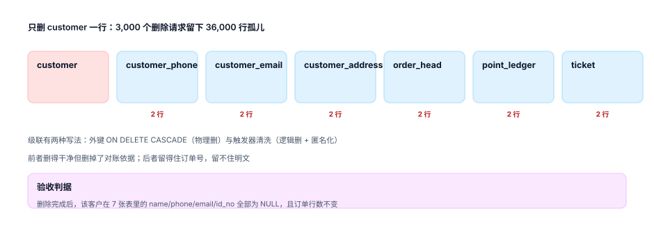

# 同意、可见范围与删除

归并做完，一个人变成了一个 `customer_id`——接着就会出现三个新问题：这个人的数据**谁能看**、**能用来干什么**、**什么时候必须消失**。三件事在数据模型上是同一件事的三个面：**每条记录都要带「凭什么在这里」**。

::: tip 一句话理解
同意是**带用途的、可撤回的、有版本的**授权；删除是**跨表的一次性承诺**，不是主表的一行 `DELETE`。
:::

## 一、同意不是一个布尔值

把 `is_agreed` 放在客户表上，是最常见也最难补的设计。它无法回答三个必答问题：**同意了什么用途**、**什么时候同意的**、**撤回之后哪些数据要停用**。

```sql
CREATE TABLE consent(
  customer_id INTEGER NOT NULL REFERENCES customer(id),
  purpose     TEXT NOT NULL,        -- marketing / analytics / third_party_share
  granted     INTEGER NOT NULL CHECK (granted IN (0,1)),
  version     TEXT NOT NULL,        -- 同意文本的版本号
  changed_at  TEXT NOT NULL,
  PRIMARY KEY (customer_id, purpose)
);
```

三个字段的设计理由：

- **`purpose` 是主键的一部分**。同一个人可以同意营销、拒绝第三方共享——一个布尔值表达不了。
- **`version` 记录同意的是哪一版文本**。文本改了（增加了一条用途），旧同意不能自动延伸到新用途。
- **撤回是「再插一条 granted=0」**，不是 `DELETE`。撤回这件事本身要留证。

::: danger 撤回之后的两个必做动作
1. **停用派生的标签**。营销同意撤回了，但画像表里还挂着他算出来的「高价值客户」标签——这些标签是派生数据，同样受同意约束。
2. **停用触达任务**。已经排进队列的短信/推送要能撤回，而不是「下次发的时候再判断」——队列里的任务在生成时就固化了收件人，撤回同意不会自动把它从队列里摘掉。
:::

## 二、可见范围：本人、家庭、经办

一个 `customer_id` 不代表「只有本人能看」。真实场景至少有三种关系：

| 关系 | 例子 | 可见范围 | 存的表 |
| --- | --- | --- | --- |
| 本人 | 账号所有者 | 全部 | `customer` 本身 |
| 家庭 | 家庭账户、亲子号 | 共用地址与部分订单 | `customer_relation` |
| 经办 | 企业客户的操作员 | 企业数据，不含个人隐私 | `customer_relation` |

把「家庭」做成「合并」是常见错误：夫妻共用一个手机号，不代表他们是同一个人（证件不同、偏好不同、订单要分开开票）。正确做法是**关系表 + 可见范围**，而不是合并成一个客户。

```sql
CREATE TABLE customer_relation(
  id           INTEGER PRIMARY KEY,
  from_cust    INTEGER NOT NULL REFERENCES customer(id),
  to_cust      INTEGER NOT NULL REFERENCES customer(id),
  relation     TEXT NOT NULL CHECK (relation IN ('family','agent')),
  scope        TEXT NOT NULL,       -- order / address / invoice
  CHECK (from_cust <> to_cust)
);
```

## 三、删除要碰七张表，不是一张



本机实测：3,000 个删除请求只删 `customer` 主表，6 张从表留下 **36,000 行**孤儿（每人 12 行：2 电话 + 2 邮箱 + 2 地址 + 2 订单 + 2 积分 + 2 工单）。这个数字在任何监控面板上都看不到，因为所有接口都返回 200。

「删干净」有四种粒度，选哪种要写进合同：

| 粒度 | 做法 | 保留了什么 | 适合 |
| --- | --- | --- | --- |
| 物理删除 | 所有表 `DELETE` | 什么都不留 | 无留存义务的场景 |
| 级联删除 | 外键 `ON DELETE CASCADE` | 什么都不留，但依赖外键齐全 | 外键完整的库 |
| 匿名化 | PII 字段置 `NULL`，行保留 | 订单金额、时间、状态 | 有对账与统计义务 |
| 假名化 | PII 换成不可逆哈希 | 关联性（同一哈希） | 需要保持会话连续 |

多数业务的正确答案是**第三条**：订单要留（财务与售后），人不能留。判据不是「主表 0 行」，而是「**7 张表里 `name/phone/email/id_no` 全为 `NULL`，且订单行数不变**」。

```sql
-- 删除完成后的验收：两个数字必须同时成立
SELECT (SELECT count(*) FROM customer_record r
          JOIN customer c ON c.id = r.customer_id
         WHERE c.status = 'deleted'
           AND (r.name IS NOT NULL OR r.phone IS NOT NULL
                OR r.email IS NOT NULL OR r.id_no IS NOT NULL)) AS pii_left,
       (SELECT count(*) FROM order_head o
          JOIN customer c ON c.id = o.cid
         WHERE c.status = 'deleted') AS orders_kept;
```

期望：`pii_left = 0` 且 `orders_kept > 0`。**两个数字缺一不可**——第一个 0 说明数据清了，第二个大于 0 说明该留的还在。只看第一个的实现，往往把订单也删了。

::: warning 备份与派生数据是最容易漏的两层
- **备份**：删除请求不能改历史备份。可行做法是「备份加密 + 密钥轮换」，让旧备份在密钥销毁后不可读，而不是去改备份。
- **派生**：画像标签、推荐特征、报表聚合。聚合到「华东区 30 岁女性 1,240 人」这一层已经不可识别个人，可以保留；但「这个人的 12 个标签」必须一起清。
:::

## 四、删除请求本身要能证明

监管问的是「你怎么证明删了」。所以删除请求是一张有状态的表，不是一次 API 调用：

| 状态 | 含义 | 必须记录 |
| --- | --- | --- |
| `received` | 收到请求，已核验身份 | 请求时间、渠道、核验方式 |
| `processing` | 正在跨表清洗 | 涉及的表清单 |
| `done` | 清洗完成 | 完成时间、残留校验结果 |
| `rejected` | 拒绝（有法定留存义务） | 拒绝依据、法条 |

本机 Practice 页的触发器把「`done_at` 被写入」作为清洗的触发点：一次 `UPDATE` 完成 7 张表的匿名化，且残留校验返回 0。这样「状态」与「数据」不会脱节——不会出现「状态是 done、数据还在」。

## 五、边界

本页只管**数据模型怎么落**，不管合规流程：

- 告知文本、同意的取得方式、影响评估（PIA）属 [隐私工程](../../../Others/PrivacyEngineering/index.md)。
- 字段级的分类分级与脱敏策略属 [数据治理](../../../DB/DataGovernance/Overview/index.md)。
- 访问控制与鉴权属 [认证与授权](../../Auth/Authorization/index.md)。

## 判据

本页判据族 `CIE-A` ~ `CIE-H`，共 8 条，逐条可判定：

| 编号 | 判据 | 怎么判 |
| --- | --- | --- |
| `CIE-A` | 同意按用途存，非单一布尔值 | `consent` 主键含 `purpose` |
| `CIE-B` | 同意带文本版本，文本升级不自动延展 | `version` 非空，升级后旧同意需重取 |
| `CIE-C` | 撤回留证（插 `granted=0`），不物理删 | 撤回后仍有行 |
| `CIE-D` | 撤回触发派生标签与在途触达停用 | 撤回后 24 小时内触达为 0 |
| `CIE-E` | 家庭/经办用关系表，不做合并 | `customer_relation` 有 `relation` 与 `scope` |
| `CIE-F` | 删除以「7 张表无明文」为完成条件 | 验收查询 `pii_left = 0` |
| `CIE-G` | 删除后订单行数不变（该留的留住） | 验收查询 `orders_kept > 0` |
| `CIE-H` | 删除请求有状态机与时间戳，可对外举证 | 四态齐全，`done` 有校验结果 |

## 验证方式

先算清「只删主表」会留多少行，再验证「匿名化 + 订单保留」这个双条件：

```shell
# 1) 只删主表的残留量
python3 - <<'PY'
per = 12          # 2 电话 + 2 邮箱 + 2 地址 + 2 订单 + 2 积分 + 2 工单
print("3,000 个删除请求残留 =", 3000 * per)     # 期望 36000
PY

# 2) 本页判据 8 条
grep -o 'CIE-[A-H]' docs/Backend/CustomerIdentity/Privacy/index.md | sort -u | wc -l

# 3) 全库判据不撞号
python3 utils/audit/judgeidcheck.py --root . | tail -1
```

预期输出：第一条 `3,000 个删除请求残留 = 36000`；第二条 `8`；第三条 `E=0`。把这个数字贴给业务看，比任何「我们会保护好数据」的承诺都直接。

## 参考资料

- [合并与别名](../MergeAlias/index.md)
- [隐私工程](../../../Others/PrivacyEngineering/index.md)
- 《中华人民共和国个人信息保护法》第四十七条（删除权的五种情形）：<https://www.gov.cn/xinwen/2021-08/20/content_5632486.htm>
- GDPR Art. 17《Right to erasure》（删除与匿名化的边界）：<https://gdpr-info.eu/art-17-gdpr/>
- NIST SP 800-188《De-Identifying Government Datasets》（假名化与不可逆性评估）：<https://csrc.nist.gov/pubs/sp/800/188/final>
