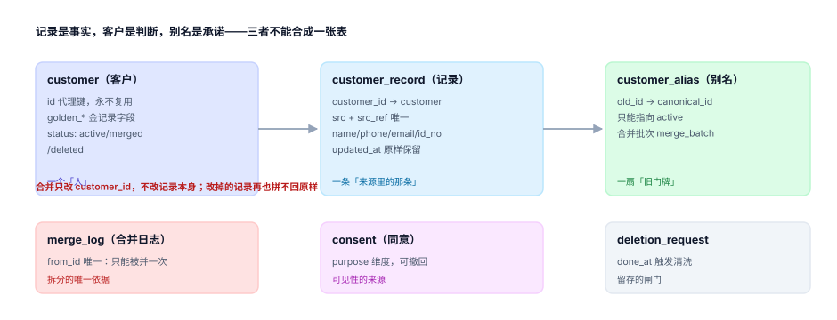

# 记录模型：三层结构与四类归一化

归并最贵的错误不是「没认出来」，而是**认出来之后改不回去**。而能不能改回去，几乎在设计表结构的那一刻就决定了：记录是事实还是一行可覆盖的文本，客户是代理键还是手机号本身，别名是「一扇门」还是「一条链」——这三个选择没有一个能在出事后补上。

::: tip 一句话理解
**记录是事实（只增不改），客户是判断（可合可拆），别名是承诺（旧门牌永远能走到新家）。** 三层缺一层，合并就不可逆。
:::

## 一、三层各自回答什么



| 层 | 表 | 回答的问题 | 关键约束 | 能不能删 |
| --- | --- | --- | --- | --- |
| 事实层 | `customer_record` | 「哪个入口、哪一次提交、写了什么」 | `UNIQUE(src, src_ref)` | 只增不改，删除请求时匿名化 |
| 判断层 | `customer` | 「这些记录归谁」 | `merged_into <> id` | 不物理删，改 `status` |
| 承诺层 | `customer_alias` | 「旧 ID 现在指向谁」 | 只能指向 `active` | 永久保留（留存期内） |

三层的分工可以用一句话检验：**如果你把 `customer` 整表删掉，能不能只靠 `customer_record` 重建出同样的簇？** 能，说明记录层还留着判定所需的全部输入；不能，说明你在记录层丢了字段，或者把判定结果写进了记录。

### 为什么客户不能用手机号当主键

手机号会换主人。运营商回收号码的冷静期在部分地区只有 90 天，一个号码上半年属于 A、下半年属于 B。若 `customer.id = phone`，B 注册时要么撞上 A 的历史记录（把 A 的订单给了他），要么被迫换号（用户体验崩）。

代理键 + 别名是唯一稳的写法：`customer.id` 是无意义自增/雪花，手机号只是 `customer_record` 上的一个字段。本机数据里，**18%** 的人有两个手机号，若用手机号当主键，这 18% 会被永久拆成两个人。

## 二、四类归一化：只为比较，不为展示

归一化的唯一目的是「让本该相等的两个值变成相等的字符串」。它**不进金记录**，也不该覆盖原始值。

| 字段 | 归一化动作 | 保留原值的原因 | 本机影响（召回） |
| --- | --- | --- | --- |
| 手机 | 去除非数字、去 `86` 前缀、长度校验 | 短信网关与面单要 `+86` 形态 | 38.5% → **80.3%** |
| 邮箱 | 转小写、去首尾空白 | 大小写在某些老系统里有意义 | 30.3% → **44.3%** |
| 姓名 | 去空格（含全角空格）、简繁统一 | 发票、合同要打原始写法 | 62.5% → **87.7%** |
| 证件 | 大写 `X`、校验位验算 | 打印与人工核对要原样 | 3.06% 的号码校验位是错的 |

### 手机号归一化

```python
def norm_phone(raw: str) -> str:
    d = "".join(c for c in raw if c.isdigit())
    if d.startswith("86") and len(d) == 13:
        d = d[2:]
    return d if len(d) == 11 else ""

print(norm_phone("+86 138-0000-1111"))   # 13800001111
print(norm_phone("013800001111"))        # ''  ← 长度 12，判为无效而不是硬截
```

最后一行是刻意的：**归一化失败要返回空，不要「尽量修」**。把 12 位截成 11 位会让两个不同的号码撞成一个，而这种错配在打分阶段看起来是「高置信度命中」。

::: danger 三个归一化坑

1. **不要剥邮箱的 `+tag`**。`a+b@x.com` 与 `a@x.com` 在 Gmail 是同一人，在部分企业邮是不同的信箱。剥掉会把两个真实用户并成一个，而这类误合并**在金记录里看不出来**——两条记录的邮箱前缀一样，只是其中一个多了一段。
2. **不要用 `strip()` 代替「去全角空格」**。`strip()` 会去掉 `\u3000`，但中间的 `张　伟` 去不掉；必须显式 `replace("\u3000", "")`。
3. **简繁映射要有边界**。逐字替换 `张→張` 是对的，但「干」→「乾/幹」要看词。首次上线只做**一对一**映射表，遇到多对一的字就保留原字——宁可少归一，不要归错。
:::

### 证件号：长度不是校验

18 位身份证的最后一位是校验位，算法固定（前 17 位加权求和 mod 11 查表）。只查长度等于什么都没查：

```python
W = [7, 9, 10, 5, 8, 4, 2, 1, 6, 3, 7, 9, 10, 5, 8, 4, 2]
CHK = "10X98765432"

def id_ok(s: str) -> bool:
    s = s.strip().upper()
    return len(s) == 18 and CHK[sum(int(s[i]) * W[i] for i in range(17)) % 11] == s[17]

print(id_ok("110101199001011237"))   # True
print(id_ok("110101199001011236"))   # False —— 只差最后一位
```

本机 36,079 条有证件号的记录里，**1,104 条（3.06%）** 校验位是错的——这些是录入时敲错一位的号码。用「长度 = 18」过滤会把它们全部放行，然后拿着一个不存在的号码去做强匹配：既匹配不上正确的人，又可能匹配到另一个同样被敲错的人。

## 三、表结构：把不变式写进 DDL

```sql
CREATE TABLE customer(
  id           INTEGER PRIMARY KEY,
  golden_name  TEXT,
  golden_phone TEXT,
  status       TEXT NOT NULL DEFAULT 'active'
               CHECK (status IN ('active','merged','deleted')),
  merged_into  INTEGER REFERENCES customer(id),
  CHECK (merged_into IS NULL OR merged_into <> id)      -- 不许自合并
);

CREATE TABLE customer_record(
  id          INTEGER PRIMARY KEY,
  customer_id INTEGER NOT NULL REFERENCES customer(id),
  src         TEXT NOT NULL CHECK (src IN ('web','app','store','import')),
  src_ref     TEXT NOT NULL,
  name        TEXT,
  phone       TEXT,
  email       TEXT,
  id_no       TEXT,
  updated_at  TEXT NOT NULL,
  UNIQUE (src, src_ref)
);

CREATE TABLE customer_alias(
  old_id       INTEGER PRIMARY KEY,
  canonical_id INTEGER NOT NULL REFERENCES customer(id),
  merged_at    TEXT NOT NULL DEFAULT (datetime('now')),
  merge_batch  TEXT NOT NULL,
  CHECK (old_id <> canonical_id)
);
```

四条不变式，每条都能被一条查询证伪：

| 不变式 | 查询 | 违反说明什么 |
| --- | --- | --- |
| 状态与标记一致 | `status='merged'` 的行 `merged_into` 必非空 | 合并写了一半 |
| 别名指向活人 | `alias.canonical_id` 的 `status='active'` | 出现了多跳链 |
| 别名不指自己 | `old_id <> canonical_id` | 自环，读的时候死循环 |
| 记录必有来源 | `src`、`src_ref` 非空且唯一 | 重复导入会造重复记录 |

::: warning `UNIQUE(src, src_ref)` 是这一层最值钱的一行
它把「同一个来源的同一条数据被导两次」挡在门外。没有它，一次失败的批量重跑会造出两倍记录，而这些重复记录在打分时是「完全相同的字段」——分值 1.00，直接合并，于是你得到一个「自己和自己合并」的日志。
:::

## 四、块键要预计算，不要现场算

分块用的键（手机后 8 位、姓名 + 城市）要落成**生成列**或随写入计算的普通列，理由有两个：

- **一致性**：归一化函数升级后，旧数据的块键必须一起重算，否则新旧两套键并存，同一人分在两个块。落成列才能批量重算并对齐版本号。
- **可索引**：`WHERE phone_key = ?` 能走索引；`WHERE substr(norm(phone), -8) = ?` 不能。

```sql
ALTER TABLE customer_record ADD COLUMN phone_key TEXT;
ALTER TABLE customer_record ADD COLUMN name_city_key TEXT;

UPDATE customer_record
   SET phone_key = substr(replace(replace(replace(phone,'+86',''),'-',''),' ',''), -8)
 WHERE phone IS NOT NULL;
```

重算必须带版本：`norm_ver` 列记下「这一行的块键是按第几版规则算的」。本机全量重算 49,875 行耗时 **37.1 ms**，代价可以忽略，所以没有理由不重算。

## 判据

本页判据族 `CIR-A` ~ `CIR-H`，共 8 条，逐条可判定：

| 编号 | 判据 | 怎么判 |
| --- | --- | --- |
| `CIR-A` | 记录、客户、别名三层分表，且记录层只增不改 | `customer_record` 无 `UPDATE` 业务路径，只有匿名化 |
| `CIR-B` | 客户主键是无业务含义的代理键，不是手机号/邮箱 | `customer.id` 不自手机号派生 |
| `CIR-C` | 归一化函数失败时返回空，不做「尽力修补」 | 长度不符返回 `''`，且有单测 |
| `CIR-D` | 归一化结果与原始值分列存放，金记录存原始写法 | `phone` 与 `phone_key` 同时存在 |
| `CIR-E` | 证件号做校验位验算，不只查长度 | 校验位错的号码被拒 |
| `CIR-F` | `UNIQUE(src, src_ref)` 存在，重复导入被拦 | 同来源同 `src_ref` 二次插入失败 |
| `CIR-G` | 块键预计算成列，并带归一化规则版本号 | 存在 `norm_ver`，可按版本重算 |
| `CIR-H` | 四条不变式各有一条可执行查询 | 见本页第三节表格，四条都能跑出 0 |

## 验证方式

先验证归一化与校验位的实际效果，再验证「三层 + 四条不变式」是否真的拦得住：

```shell
# 1) 归一化与校验位
python3 - <<'PY'
d = "+86 138-0000-1111"
n = "".join(c for c in d if c.isdigit())
n = n[2:] if n.startswith("86") and len(n) == 13 else n
print("归一化 =", n, "长度 =", len(n))          # 期望 13800001111 / 11
W = [7,9,10,5,8,4,2,1,6,3,7,9,10,5,8,4,2]
CHK = "10X98765432"
ok = lambda s: len(s)==18 and CHK[sum(int(s[i])*W[i] for i in range(17))%11]==s[17].upper()
print("校验位：", ok("110101199001011237"), ok("110101199001011236"))   # 期望 True False
PY

# 2) 本页判据 8 条
grep -o 'CIR-[A-H]' docs/Backend/CustomerIdentity/RecordModel/index.md | sort -u | wc -l

# 3) 全库判据不撞号
python3 utils/audit/judgeidcheck.py --root . | tail -1
```

预期输出：第一条打印 `归一化 = 13800001111 长度 = 11` 与 `校验位： True False`；第二条 `8`；第三条 `E=0`。若第 2 行打印出 `False True`，说明你把校验表 `10X98765432` 写成了 `10X9876543`。

## 参考资料

- [总览：七段链与三个「同一个人」](../Overview/index.md)
- [分块与候选对](../Blocking/index.md)
- GB 11643—1999《公民身份号码》（18 位号码与校验位算法）：<https://openstd.samr.gov.cn/bzgk/gb/newGbInfo?hcno=080D6FBF2BB468F9007657F26D60013E>
- ISO 3166-1（国家/地区代码，`+86` 前缀的规范化依据）：<https://www.iso.org/iso-3166-country-codes.html>
- RFC 5321《Simple Mail Transfer Protocol》§4.1.2（邮箱本地部分大小写敏感性）：<https://www.rfc-editor.org/rfc/rfc5321>
