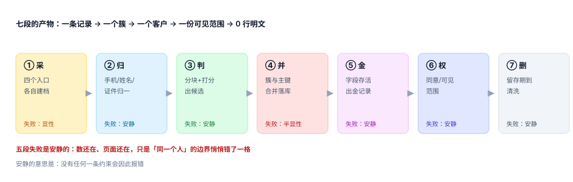

# 客户身份归并与主数据

<p style="text-align:center;"></p>

一家公司只要开过三个入口——官网表单、App 注册、门店扫码——就一定会出现同一个人以三种样子存在：官网填「张伟」、App 用微信昵称「伟哥」、门店录入手机号时多敲了一位。这三条记录在系统里互不相识，于是这个人收到三份新人券、被三个销售各打一次电话、退订了一次却还在收短信。

识别「这是同一个人」看起来是「比对两个字段」，实际是一次**不可逆的判断**：合并之后，那两条记录原本属于谁、那笔订单是谁下的，就再也分不开了。所以本专题关心的不是「怎么算得像」，而是**算错之后怎么退回去**。

::: tip 一句话理解
身份不是一条记录，是一次判断。**判断会错，所以每一条判断都要留凭据、能撤回、可解释。**
:::

## 一、这个专题讲什么

从「四个入口各建一条档」到「一个客户一份可见范围」，要走七段。本专题按这七段组织，每段都标出产物与失败方式：

| 段 | 这一段在做什么 | 产物 | 失败是否安静 |
| --- | --- | --- | --- |
| ① 采 | 四个入口各自落一条原始记录，保留来源与来源内主键 | `customer_record` | 显性（收不到会报错） |
| ② 归 | 手机、邮箱、姓名、证件归一化到可比较的形态 | 归一化字段 | **安静**（归一化错了只是「比较不上」） |
| ③ 判 | 用块键把平方级比较压到线性级，再打分出候选 | `candidate_pair` | **安静**（漏判只是「没认出来」） |
| ④ 并 | 把成对判定闭包成簇，落成一次合并 | `merge_log` | 半显性（唯一键会拦一部分） |
| ⑤ 金 | 每个字段按规则各自存活，拼出一条金记录 | `customer.golden_*` | **安静**（拼错只是「用了旧手机号」） |
| ⑥ 权 | 同意、可见范围、经办关系 | `consent` | **安静**（越权可见不报错） |
| ⑦ 删 | 留存到期、删除请求、匿名化 | 清洗后的行 | **安静**（残留几十万行没人知道） |



七段里**五段的失败是安静的**。它们的共同形态是：页面上一切正常，只有「这是不是同一个人」的边界悄悄挪了一格。而唯一会自己喊出来的第 ④ 段最容易被误解——**唯一键冲突说明「并重了」，不说明「并对了」**。本机实测：19,290 条记录被合并之后，全部满足唯一约束，其中 1,405 条属于互不相识的人（共用号码所致）。

## 二、三个「同一个人」，只有一个是业务要的

| 说法 | 判据 | 典型错法 | 后果 |
| --- | --- | --- | --- |
| 记录相同 | 两条记录的字段值一致 | 用「手机号相同」当结论 | 家庭共用号码 → 全家伙同一人 |
| 客户相同 | 两条记录指向同一个 `customer_id` | 合并后不回写、别名指中间节点 | 旧订单查不到、客服看不到历史 |
| 主体相同 | 同一个自然人（可能是家庭账户、企业经办人） | 把「一个账号」当「一个人」 | 一人多号被算成多个人，报表口径全错 |

本专题判的是**第二条**：让「客户」这个代理键稳定、可追溯、可撤销。第三条（自然人）是法律与业务口径，通常在同意书与实名体系里定义，本册只保证「合并记录有据可查」。

## 三、与其它专题的分工

库里写「用户」的册子不少，问的问题完全不一样。先看这张表再决定读哪一册：

| 你关心的问题 | 该读哪一册 | 为什么不是本册 |
| --- | --- | --- |
| 「这个请求是谁发的、能不能做」 | [认证与授权](../Auth/Authorization/index.md) | 那册判**令牌与权限**，本册判**多个档案是不是同一个人** |
| 「同一个租户的数据不能串」 | [多租户上下文](../MultiTenantSaaS/TenantContext/index.md) | 那册判**租户隔离**，本册判**租户内的人归并** |
| 「删了数据还有没有残留」 | [隐私工程](../../Others/PrivacyEngineering/index.md) | 那册判**合规义务与流程**，本册判**这条链路怎么落地** |
| 「字段命名、编码、主数据标准」 | [主数据与标准](../../DB/DataGovernance/StandardsMasterData/index.md) | 那册判**标准怎么定**，本册判**实例怎么归并** |
| 「数据质量怎么度量」 | [数据质量](../../DB/DataGovernance/DataQuality/index.md) | 那册判**规则命中率**，本册判**判定与合并的正确性** |
| 「积分、等级、储值挂谁名下」 | [会员积分与储值](../LoyaltyProgram/Overview/index.md) | 那册判**权益账本**，本册只判**账本的主人是谁** |
| 「工单里的客户是谁」 | [客服工单与 SLA](../SupportTicket/Overview/index.md) | 那册判**SLA 时钟**，本册判**来话人识别** |
| 「下单的人和历史订单能不能对上」 | [电商订单状态机](../Ecommerce/OrderStateMachine/index.md) | 那册判**状态迁移**，本册判**订单归属** |
| 「这个人的数据能不能给营销用」 | [隐私工程](../../Others/PrivacyEngineering/index.md) | 那册判**用途与同意文本**，本册判**同意在数据模型上怎么落** |

::: info 为什么不并入「认证与授权」
两册都会出现 `user_id`，但判据一条不重合：认证判「**你是不是你说的那个人**」（凭证），本册判「**你说的这个人是不是同一个人**」（归并）。

一组最直观的反例：登录完全正常（令牌有效、权限正确），同时同一个人在库里是三个客户、拿着三份新人券、被三次触达。前者全绿，后者全错。
:::

## 四、本机读数（种子 20261102）

49,875 条记录、16,000 个真实的人（人均 3.12 条），跑完七段得到七个数字，后面每一页都会用到：

| 环节 | 读数 | 说明 |
| --- | --- | --- |
| 分块 | 12.4 亿对 → 79,329 对 | 压减 **15,678 倍**；覆盖真实对 **94.3%** |
| 匹配 | 手机号相等 P 90.2% / R 80.3% | 误合并 6,640 对，全部来自共用号码 |
| 匹配 | 后 4 位 + 姓名 ED≤1 P 100% / R 82.3% | 误合并 7 对 |
| 成簇 | 低阈值 0.45 时最大簇 **68 条** | 传递闭包把一栋楼并成一个人 |
| 金记录 | 换一套存活规则，**41.1%** 的簇结论变了 | 「来源优先」与「最新优先」 |
| 合并 | 删除 **25,076** 个主键 | 硬合并的代价 |
| 删除 | 3,000 个删除请求留 **36,000** 行孤儿 | 只删主表 |
| 别名 | 不做路径压缩时最长链 **43 跳** | 三轮合并 |

::: warning 这七个数字之间的关系
它们不是七个独立指标，是**同一条链上七次「安静失败」的度量**。分块丢掉的 5.7%、匹配漏掉的 17.7%、成簇多并的 68 条、金记录改主意的 41.1%，没有一个会让接口返回 500。这正是本专题要建立判据的理由。
:::

## 五、章节索引

| 章 | 章节 | 判据族 | 条数 |
| --- | --- | --- | --- |
| 1 | [总览：七段链与三个「同一个人」](Overview/index.md) | `CIO-A` ~ `CIO-H` | 8 |
| 2 | [记录模型：三层结构与四类归一化](RecordModel/index.md) | `CIR-A` ~ `CIR-H` | 8 |
| 3 | [分块与候选对：把平方级压成线性级](Blocking/index.md) | `CIB-A` ~ `CIB-H` | 8 |
| 4 | [匹配规则与打分：阈值是钱的选择](Matching/index.md) | `CIM-A` ~ `CIM-H` | 8 |
| 5 | [成簇与传递闭包：三对都对，簇可能全错](Clustering/index.md) | `CIC-A` ~ `CIC-H` | 8 |
| 6 | [金记录：每个字段各自存活](GoldenRecord/index.md) | `CIG-A` ~ `CIG-H` | 8 |
| 7 | [合并与别名：一扇门和一串门牌](MergeAlias/index.md) | `CIX-A` ~ `CIX-H` | 8 |
| 8 | [同意、可见范围与删除](Privacy/index.md) | `CIE-A` ~ `CIE-H` | 8 |
| 9 | [度量与验收：四个率与一条成本线](Metrics/index.md) | `CIS-A` ~ `CIS-H` | 8 |
| 10 | [实战：七张表跑通一次归并](Practice/index.md) | `CIP-A` ~ `CIP-H` | 8 |

## 六、验证方式

先确认目录结构与判据编号，再复现「合并之后约束全绿、人却错了」这个论断：

```shell
# 1) 目录页 + 10 章齐备
ls -d docs/Backend/CustomerIdentity/*/ | grep -v assets | wc -l

# 2) 本专题判据族 10 个、每个 8 条
grep -rho 'CI[A-Z]-[A-H]' docs/Backend/CustomerIdentity | sort -u | wc -l

# 3) 全库判据不撞号
python3 utils/audit/judgeidcheck.py --root . | tail -1

# 4) 复现「共用号码把陌生人并成一簇」
python3 - <<'PY'
rows = ["13800001111"] * 18          # 一栋楼的住户登记了同一个前台号码
pairs = len(rows) * (len(rows) - 1) // 2
print("块内两两 =", pairs)            # 期望 153
print("并查集结果 = 1 个簇，18 条记录，18 个不同的人")
PY
```

预期输出：第一条 `10`；第二条 `80`；第三条 `E=0`；第四条打印 `块内两两 = 153` 与那句结论——**18 条记录、153 对判定、1 个簇、18 个人**，四个数字同时成立，就是本专题要防的那件事。

## 参考资料

- [记录模型：三层结构与四类归一化](RecordModel/index.md)
- [分块与候选对](Blocking/index.md)
- [合并与别名](MergeAlias/index.md)
- ISO/IEC 29148:2018《Systems and software engineering — Life cycle processes — Requirements engineering》（身份与主体表述的术语基线）：<https://www.iso.org/standard/72089.html>
- NIST SP 800-63A《Digital Identity Guidelines: Enrollment and Identity Proofing》：<https://pages.nist.gov/800-63-4/sp800-63a.html>
- 《中华人民共和国个人信息保护法》第二十四条（自动化决策与拒绝权）：<https://www.gov.cn/xinwen/2021-08/20/content_5632486.htm>
