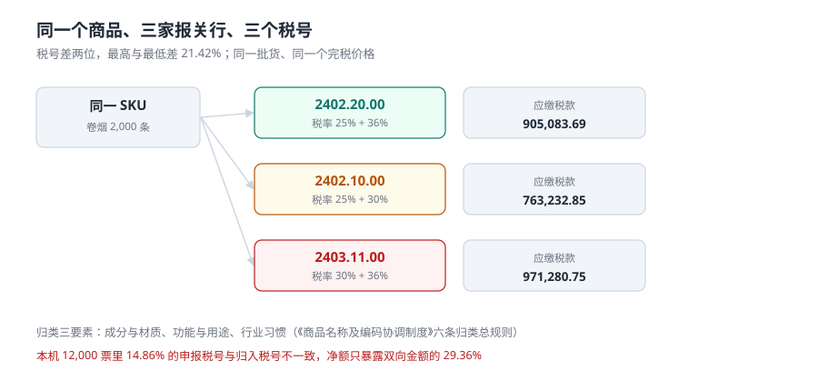

# 商品归类：一个商品为什么会有三个税号

同一个 SKU、同一批货、同一个完税价格，三家报关行报出三个税号，税额最高与最低差 **21.42%**。这不是谁算错了——**归类本来就是一个需要举证的判断**，而不是一个可以抄的字段。

本页讲清三件事：税则号列的结构、归类分歧是怎么产生的、以及工程上怎样把「一个判断」变成「一条可复核、可回溯、可解释的记录」。

::: tip 一句话理解
税号不是商品的属性，是**对商品的一次行政认定**。认定会变、会分歧、会被推翻，所以每一次认定都要有依据、有生效期、有留痕。
:::

## 一、税则号列：前六位全世界一样，后几位各国自己定



| 层级 | 位数 | 谁定 | 例子（卷烟） | 变更频率 |
| --- | --- | --- | --- | --- |
| 章 | 2 位 | WCO（HS 公约） | `24` 烟草 | 极低 |
| 品目 | 4 位 | WCO | `2402` 烟草及烟草代用品的制品 | 低 |
| 子目 | 6 位 | WCO | `240220` 含烟草的卷烟 | 低（约五年一版） |
| 本国子目 | 8 位 | 国务院关税税则委员会 | `24022000` | **每年** |
| 附加编码 | 10 位 | 海关（监管、统计） | 用于许可证与统计口径 | 不定期 |

工程含义很直接：**六位以内是国际共识，八位以后是本国政策**。所以「归类库」必须把「六位」和「八位」分开存——前者跟你用哪国系统无关，后者每年跟着税则调整。

## 二、归类总规则：六条，但九成争议落在第一条

《商品名称及编码协调制度》的六条归类总规则（General Rules for the Interpretation，GRI）里，实务中最常用的是前三条：

| 规则 | 说什么 | 什么时候用 | 典型争议 |
| --- | --- | --- | --- |
| GRI 1 | 按品目条文与章注、类注归类 | 首选，永远先看 | 「这算不算品目条文里说的那种」 |
| GRI 2(a) | 未完成品、未装配品按完整品归类 | 拆散发运 | 「这套零件算不算一台机器」 |
| GRI 3(b) | 混合物、组合物按基本特征 | 多材料、多部件 | 「哪个是基本特征」 |
| GRI 3(c) | 基本特征也判不出时，从后归类 | 兜底 | 争议最大，结果最意外 |
| GRI 4 | 按最相类似货物归类 | 很少用 | 新型产品 |
| GRI 5/6 | 包装容器、子目比较 | 附带 | 包装是否随货计价 |

本机的分歧样本刻意只让**后两位**变化（八位号列的前六位一致），因为「品目判对、子目判错」是实务里最常见的一类：品名、章、品目全对，报表上看不出异常，但税率差一档。跨品目的分歧税额差会更大——样本里单票偏离最大 41.02% 已经只来自后两位。

## 三、分歧是怎么产生的

三个来源，都很日常：

1. **同一商品不同报关行**：A 行按「材料成分」归，B 行按「用途」归，两个都对，但落到不同子目。本机把这种现象建模成「每个 SKU 有若干家报关行会归错」，结果是 **40.90% 的 SKU 在不同票上出现过两个以上税号**。
2. **同一报关行不同时间**：税则每年调整，去年归的号今年可能已被拆分。如果系统只存「当前税号」，去年那些票的税额就永远复算不出来。
3. **成分与用途本身在变**：同一个 SKU 换了配方、换了包装规格，归类依据变了，税号却没人改。

::: warning 为什么「不一致率」不能当作质量指标看
不一致有两种：**真分歧**（同商品同事实，判断不同）与**真变更**（商品或税则变了，判断跟着变）。前者是缺陷，后者是正确行为。所以要区分它们，必须同时存三样东西：**归类依据、判定日期、判定人**。只存税号，两种不一致在数据里长得一模一样。
:::

## 四、分歧的代价：净额会骗人

本机 12,000 票的读数：

| 量 | 读数 |
| --- | --- |
| 申报税号与归入税号不一致 | 1,783 票 = **14.86%** |
| 同一 SKU 出现 ≥2 个税号 | 409 / 1,000 = **40.90%** |
| 按申报税号算的税款 | 651,630,120.85 元 |
| 按归入税号算的税款 | 658,933,553.07 元 |
| 差额（净额） | **+7,303,432.22 元（+1.11%）** |
| 少缴合计（1,040 票） | **16,087,727.12 元** |
| 多缴合计（743 票） | **8,784,294.90 元** |
| 净额占双向合计的比例 | **29.36%** |

净额 730 万看起来只是「1.11% 的小偏差」。但双向合计是 2,487 万——**七成的问题金额被互相抵消掉了**。少缴的 1,040 票会被追征并加滞纳金，多缴的 743 票要申请退还，两件事都不会因为「净额很小」而消失。

单票维度的偏差更刺眼：错归票的税款偏离**中位 17.47%、P90 34.28%、最大 41.02%**。

```sql
-- 1) 同一 SKU 的税号分歧（按判定日期看，不看当前值）
SELECT sku, COUNT(DISTINCT hs_code) AS n, GROUP_CONCAT(DISTINCT hs_code) AS codes
FROM decl_item
GROUP BY sku
HAVING n > 1
ORDER BY n DESC;

-- 2) 按税号对算出的税额差（双向，不取净额）
WITH t AS (
  SELECT i.decl_id,
         i.pdv_fen * t1.mfn_rate / 10000.0 AS duty_decl,
         i.pdv_fen * t2.mfn_rate / 10000.0 AS duty_true
  FROM decl_item i
  JOIN tariff t1 ON t1.hs_code = i.hs_code_declared
  JOIN tariff t2 ON t2.hs_code = i.hs_code_ruling
)
SELECT SUM(CASE WHEN duty_true > duty_decl THEN duty_true - duty_decl ELSE 0 END) AS under_fen,
       SUM(CASE WHEN duty_decl > duty_true THEN duty_decl - duty_true ELSE 0 END) AS over_fen
FROM t;
```

第 2 条刻意分成 `under` 与 `over` 两列：**只要写成 `SUM(true) - SUM(decl)`，你就永远看不到 1,040 与 743 这两个数。**

## 五、工程做法：把判断存成记录

```sql
CREATE TABLE tariff (
  hs_code        TEXT    NOT NULL,          -- 十位号列
  mfn_rate       INTEGER NOT NULL,          -- 最惠国税率，万分之一
  ct_rate        INTEGER NOT NULL DEFAULT 0,-- 消费税比例税率，万分之一
  effective_from TEXT    NOT NULL,
  effective_to   TEXT,                      -- NULL = 至今有效
  CHECK (mfn_rate BETWEEN 0 AND 10000)
);
-- 同一税号在同一时点只能有一版税率
CREATE UNIQUE INDEX uq_tariff_point ON tariff(hs_code, effective_from);

CREATE TABLE classification (
  sku         TEXT NOT NULL,
  hs_code     TEXT NOT NULL,
  basis       TEXT NOT NULL,      -- 归类依据：GRI 1 + 章注/品目条文/预裁定编号
  ruled_by    TEXT NOT NULL,      -- 判定人 / 预裁定文号
  ruled_on    TEXT NOT NULL,      -- 判定日期
  superseded  TEXT,               -- 被哪条记录取代（自引用）
  PRIMARY KEY (sku, ruled_on)
);
```

三条设计理由：

1. **`effective_from / effective_to` 半开区间**：一票货适用哪一版税率，只取决于申报日落在哪个区间。这比 `Tariff2024/`、`Tariff2025/` 这种目录更贴近事实，也与库内 [合同版本](../../ContractEvolution/index.md) 的处理方式一致。
2. **`classification` 主键带 `ruled_on`**：同一 SKU 允许多次判定，历史不覆盖。`superseded` 自引用形成链，任一历史时点的结论都能回放。
3. **`basis` 是必填文本**：没有依据的归类就是猜测，猜测不能进库。这条字段的价值在于「三个月后有人问为什么这么归」时有答案。

## 六、判据：本页的八条

本页判据族 `CUC-A` ~ `CUC-H`，共 8 条。它们都在回答「这个税号是不是查过的、而不是估的」。

| 编号 | 判据 | 不满足时改哪里 |
| --- | --- | --- |
| `CUC-A` | 税号六位与后四位分开可查（`LEFT(hs_code,6)`） | `tariff` 增加 `hs6` 生成列或视图 |
| `CUC-B` | 税率带生效期，同一税号同一时点只有一版 | `uq_tariff_point` 唯一索引 |
| `CUC-C` | 归类结论有依据字段且非空 | `classification.basis NOT NULL` |
| `CUC-D` | 归类历史不覆盖，可回溯到任一 `ruled_on` | `classification` 主键含 `ruled_on` |
| `CUC-E` | 报关单同时存「申报税号」与「归入税号」 | `decl_item` 两个字段都在 |
| `CUC-F` | 税额差按双向统计，不只看净额 | 校验 SQL 输出 `under` / `over` 两列 |
| `CUC-G` | 同一 SKU 的税号分歧可枚举 | 分歧 SQL 返回行数 = 分歧 SKU 数 |
| `CUC-H` | 税则里不存在的税号无法入库 | `trg_item_hs` 触发器（见实战页） |

## 七、验证方式

```shell
# 1. 同一 SKU 三个税号的税额差（同一个完税价格 749,842.80）
python3 -c "
from decimal import Decimal as D, ROUND_HALF_UP
Q=lambda x: D(str(x)).quantize(D('0.01'), rounding=ROUND_HALF_UP)
p=D('749842.80')
def t(m,c):
    duty=Q(p*m); ct=Q((p+duty)/(1-c)*c) if c else D('0.00')
    vat=Q((p+duty+ct)*D('0.13')); return duty+ct+vat
a,b,c=t(D('0.25'),D('0.36')),t(D('0.25'),D('0.30')),t(D('0.30'),D('0.36'))
print(a,b,c, Q((c-b)/c*100))"
# 期望输出：905083.69 763232.85 971280.75 21.42

# 2. 净额只暴露双向金额的比例（本机 29.36%）
python3 -c "
u=16087727.12; o=8784294.90
print(round((u-o)/(u+o)*100,2))"
# 期望输出：29.36

# 3. 税则生效期不得重叠（同税号同生效日插入两次应失败）
sqlite3 :memory: "CREATE TABLE tariff(hs TEXT, mfn INT, ef TEXT);
CREATE UNIQUE INDEX u ON tariff(hs, ef);
INSERT INTO tariff VALUES('84713000',0,'2024-01-01');
INSERT INTO tariff VALUES('84713000',800,'2024-01-01');"
# 期望输出：UNIQUE constraint failed: tariff.hs, tariff.ef
```

## 参考资料

- 世界海关组织《商品名称及编码协调制度》（HS）2022 版及《归类总规则》：六位子目与六条总规则的唯一国际依据。
- 《中华人民共和国进出口税则》（国务院关税税则委员会每年发布）：八位本国子目与当年税率，本册 `tariff` 表的数据来源。
- 《中华人民共和国海关进出口货物商品归类管理规定》（海关总署令第 158 号）：归类申报义务、预裁定与归类决定的效力。
- 与本页相邻：[完税价格](../Valuation/index.md)（归对税号只是第一步）、[三税计征](../Duty/index.md)（税率怎么变成税额）、[实战](../Practice/index.md)（触发器怎么写）。
