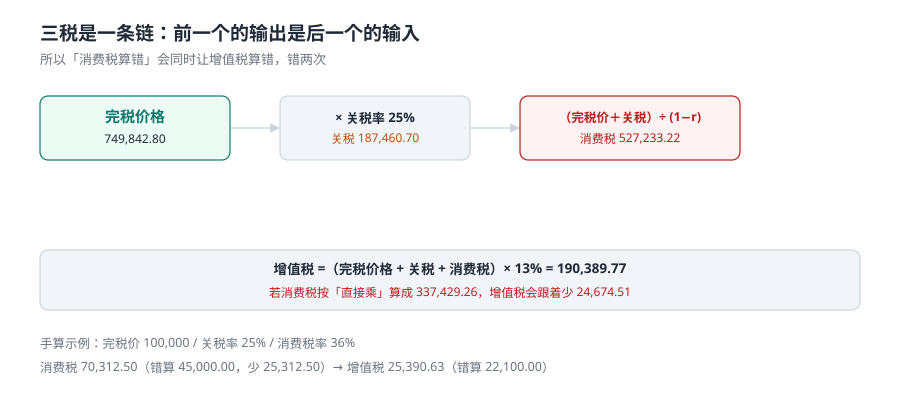

# 三税计征：关税、消费税、增值税

三税不是三个独立的乘法，而是一条链：**关税用完税价格算，消费税用完税价格加关税算，增值税用前三者之和算**。任何一个环节算错，后面的都会跟着错——这就是为什么「消费税按价外税算」这一个错误，能让总税额少 17.01%。

本页把三个公式、两个「金」（滞报金、滞纳金）、以及舍分这件小事讲透。

::: tip 一句话理解
关税和增值税都是**价外税**（直接乘），只有消费税是**价内税**（先还原含税价再乘）。把消费税当价外税算，是这一行最贵的一个错误，本机样本上的代价是 **4,272.99 万元**。
:::

## 一、三个公式



| 税种 | 公式 | 税率来源 | 计税基础 |
| --- | --- | --- | --- |
| 关税 | 完税价格 × 关税税率 | 税则（按税号 + 生效期） | 完税价格 |
| 进口环节消费税 | **（完税价格 + 关税）÷（1 − 消费税比例税率）× 消费税比例税率** | 消费税税目税率表 | 组成计税价格 |
| 进口环节增值税 | （完税价格 + 关税 + 消费税）× 增值税税率 | 13% / 9% / 6% | 三者之和 |

三税合计 = 关税 + 消费税 + 增值税。本机 12,000 票的分布：

| 税种 | 金额（元） | 占总税额 |
| --- | --- | --- |
| 关税 | 196,996,657.45 | 29.90% |
| 进口环节增值税 | 313,569,102.18 | 47.59% |
| 进口环节消费税 | 148,367,793.44 | 22.52% |
| 合计 | 658,933,553.07 | 100% |

**增值税占了将近一半**——这也是为什么「完税价格算错」的代价远大于「税率选错」。

## 二、消费税：唯一需要「除」的那一步

### 手算一遍

完税价格 100,000 元、关税率 25%、消费税率 36%（卷烟类）：

```text
关税     = 100,000 × 25%                       = 25,000.00
组成计税价格 = (100,000 + 25,000) ÷ (1 − 36%)   = 195,312.50
消费税   = 195,312.50 × 36%                    = 70,312.50
增值税   = (100,000 + 25,000 + 70,312.50) × 13% = 25,390.63
```

错算版本（把消费税当价外税）：

```text
消费税 = (100,000 + 25,000) × 36%              = 45,000.00   ← 少 25,312.50
增值税 = (100,000 + 25,000 + 45,000) × 13%     = 22,100.00   ← 跟着少 3,290.63
```

**一个错误的公式，让两个税都少了**，合计少 28,603.13 元，占应缴税额的 **23.7%**。

### 本机读数

| 量 | 读数 |
| --- | --- |
| 应税消费品票数 | 3,455 票 = **28.79%** |
| 正确算法合计 | 251,228,559.32 元 |
| 错算（直接乘）合计 | 208,498,676.50 元 |
| 差额 | **42,729,882.82 元（17.01%）** |

### 复合计征

从量 + 从价的复合计征（如卷烟），公式是：

```text
组成计税价格 = (完税价格 + 关税 + 数量 × 定额税率) ÷ (1 − 比例税率)
应纳税额     = 组成计税价格 × 比例税率 + 数量 × 定额税率
```

注意定额部分**先进分子再乘比例**——它也要被「还原」一次。写成「从价部分 + 从量部分」两段相加，是最常见的第二类错误。

## 三、滞报金与滞纳金：两个 0.5‰，两种起算

| 项目 | 触发 | 起算点 | 费率 | 起征点 | 本机读数 |
| --- | --- | --- | --- | --- | --- |
| 滞报金 | 超过 14 天未申报 | 运输工具申报进境之日起**第 15 日**为起征日，海关接受申报之日为截止日，**首尾均计入** | 完税价格 × 0.5‰ × 天数 | 50 元（不足 1 元免征） | 2,657 票 22.14%，16,121 天，**1,403,504 元** |
| 滞纳金 | 逾期缴税 | 缴款期限届满之日起至缴清之日止 | 滞纳税款 × 0.5‰ × 天数 | 按一票货物免征额度 | 1,938 票 16.15%，5,131 天，**117,897.30 元** |

两个细节：

1. **滞报金按「完税价格」算，不是按「税款」算**。所以高价值低税率的货（比如零关税的芯片）滞报金可能比税款还高。
2. **起征点 50 元让 815 票免征**（占滞报票的 30.7%）。系统如果漏掉这条，会多收 30% 的滞报金——多收也是错。

```sql
-- 滞报金：起征日 = 进境日 + 14，滞报期间含首尾
WITH late AS (
  SELECT d.decl_id, i.pdv_fen,
         CAST(julianday(d.decl_date) - julianday(d.arr_date) AS INTEGER) - 14 + 1 AS days
  FROM declaration d JOIN decl_item i ON i.decl_id = d.decl_id
)
SELECT decl_id, days,
       CASE WHEN pdv_fen * 0.0005 * days >= 50
            THEN CAST(pdv_fen * 0.0005 * days AS INTEGER)
            ELSE 0 END AS late_fee_fen
FROM late WHERE days > 0;
```

::: danger 四个算错钱的写法
1. **`days = 申报日 − 进境日 − 14`**。少了「首尾均计入」的那个 +1，每票少算一天。本机 2,657 票滞报票日均 87.06 元，少算一天合计约 **23 万元**。
2. **滞纳金按「关税」算，不按「三税合计」算**。滞纳金基数是**滞纳税款**，包含消费税与增值税；只按关税算会少收三分之二。
3. **用 `REAL` 存金额**。`749842.80 × 0.25` 在浮点下可能得到 `187460.69999999998`，舍分后变 `187460.69`——差 1 分。本机逐票舍分与未舍入求和的尾差是 **1.96 元**，看着小，但对账里它和 1 万元同权。
4. **四舍五入用「银行家舍入」**。海关口径是**四舍五入到分**（`ROUND_HALF_UP`），不是 `ROUND_HALF_EVEN`。0.005 这一档在两种规则下差 1 分，量大了就是一笔差。
:::

## 四、缴款与汇总征税

| 模式 | 缴款期限 | 适用 | 风险 |
| --- | --- | --- | --- |
| 逐票缴纳 | 完成申报之日起 **15 日内** | 默认 | 逾期按日 0.5‰ |
| 汇总征税 | 15 日内 **或** 次月第 5 个工作日结束前 | 资信良好的企业 | 额度管理，超额即停 |

汇总征税的关键约束是「额度」：企业在一个月内可以「先放后税」，但累计未缴税款不能超过担保额度。工程上这是一个**余额扣减 + 释放**的模型，与 [库存预占](../../Ecommerce/Inventory/index.md) 的「可用量」是同一类问题——区别只是这里的「量」是钱。

```sql
-- 汇总征税额度：已用 = 已放行未缴的税款合计
SELECT COALESCE(SUM(b.total_fen), 0) AS used_fen
FROM tax_bill b
JOIN declaration d ON d.decl_id = b.decl_id
WHERE b.paid_at IS NULL AND d.state IN ('RELEASED','CLOSED');
-- 注意 COALESCE：空集时 SUM() 返回 NULL，NULL > 额度 永远不成立
```

::: warning `SUM()` 空集返回 `NULL` 这个坑
这是本册实战页真实踩到的：用 `SELECT SUM(...) > quota` 做拦截时，**第一条记录（还没有任何未缴税款）永远拦不住**，因为 `NULL > 900000` 的结果是 `NULL`，不是 `TRUE`。必须写 `COALESCE(SUM(...), 0)`。同一条纪律在库内 [质量工程](../../QualityManagement/index.md) 的计数型触发器里也出现过。
:::

## 五、判据：本页的八条

本页判据族 `CUT-A` ~ `CUT-H`，共 8 条。它们都在回答「三个税种有没有按同一个基数、同一天算」。

| 编号 | 判据 | 不满足时改哪里 |
| --- | --- | --- |
| `CUT-A` | 消费税走组成计税价格，除数 `(1 − r)` 显式出现 | `trg_bill_ct` 或计算函数 |
| `CUT-B` | 增值税基数是「完税价 + 关税 + 消费税」三者之和 | 校验 SQL：`vat = round((pdv+duty+ct)*rate)` |
| `CUT-C` | 税单合计 = 三税之和（表级 `CHECK`） | `CHECK (total_fen = duty_fen + ct_fen + vat_fen)` |
| `CUT-D` | 金额全为整数分，税率全为万分之一 | 所有 `*_fen` 为 `INTEGER`，`*_rate` 为基点 |
| `CUT-E` | 舍分用 `ROUND_HALF_UP`，且逐票舍分 | 计算函数统一入口 |
| `CUT-F` | 滞报金起征日 = 进境日 + 14，期间含首尾 | 滞报金 SQL |
| `CUT-G` | 滞报金起征点 50 元生效，不足 1 元免征 | 滞报金 SQL 的 `CASE WHEN` |
| `CUT-H` | 汇总征税余额用 `COALESCE` 兜空集 | `COALESCE(SUM(...),0)` |

## 六、验证方式

```shell
# 1. 手算示例：完税价 100,000 / 关税率 25% / 消费税率 36%
python3 -c "
from decimal import Decimal as D, ROUND_HALF_UP
Q=lambda x: D(str(x)).quantize(D('0.01'), rounding=ROUND_HALF_UP)
p=D('100000'); duty=Q(p*D('0.25'))
ct=Q((p+duty)/D('0.64')*D('0.36')); vat=Q((p+duty+ct)*D('0.13'))
bad=Q((p+duty)*D('0.36'))
print(duty, ct, vat, bad)"
# 期望输出：25000.00 70312.50 25390.63 45000.00

# 2. 真实一票（D0001）：完税价 749,842.80 / 25% / 36%
python3 -c "
from decimal import Decimal as D, ROUND_HALF_UP
Q=lambda x: D(str(x)).quantize(D('0.01'), rounding=ROUND_HALF_UP)
p=D('749842.80'); d=Q(p*D('0.25')); c=Q((p+d)/D('0.64')*D('0.36')); v=Q((p+d+c)*D('0.13'))
print(d, c, v, d+c+v)"
# 期望输出：187460.70 527233.22 190389.77 905083.69

# 3. 滞报金：进境 3-02、申报 3-20、完税价 749,842.80
python3 -c "
import datetime as dt
from decimal import Decimal as D, ROUND_HALF_UP
arr=dt.date(2026,3,2); decl=dt.date(2026,3,20)
days=(decl-arr).days-14+1
fee=int((D('749842.80')*D('0.0005')*days).quantize(D('1'), rounding=ROUND_HALF_UP))
print(days, fee, 0 if fee<50 else fee)"
# 期望输出：5 1875 1875
```

## 参考资料

- 《中华人民共和国海关进出口货物征税管理办法》（海关总署令第 272 号）第十七条至第二十条：三税公式、计税价格、四舍五入至分、15 日缴款期限、万分之五滞纳金。
- 《中华人民共和国消费税暂行条例》及其实施细则：消费税税目税率、组成计税价格、复合计征。
- 《中华人民共和国海关征收进口货物滞报金办法》（海关总署令第 128 号，第 273 号令最新修正）：0.5‰/日、第 15 日起征、50 元起征点、不足 1 元免征。
- 与本页相邻：[完税价格](../Valuation/index.md)、[原产地](../Origin/index.md)（税率从哪来）、[实战](../Practice/index.md)（触发器把公式钉死）。
