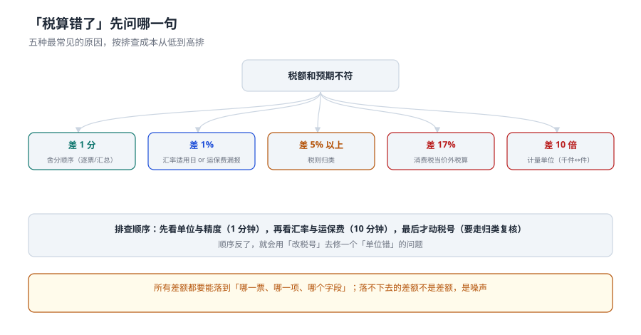

# 常见问题：差额先查哪一句

「税算错了」这句话信息量等于零。差额的大小本身就是线索：**差 1 分、差 1%、差 5%、差 17%、差 10 倍**，指向五种完全不同的原因，而排查成本从 1 分钟到两周不等。

本页按「差额形状」组织问题，每一条都给可执行的判断方式和修复位置。

::: tip 一句话理解
排查顺序必须是**从便宜到贵**：先看单位与精度（1 分钟），再看汇率与运保费（10 分钟），最后才动税号（要走归类复核）。顺序反了，就会用「改税号」去修一个「单位错」的问题。
:::

## 一、五种差额形状



| 差额形状 | 最可能原因 | 一次判断怎么做 | 修复位置 |
| --- | --- | --- | --- |
| 差 1 分 | 舍分顺序（逐票舍 vs 汇总舍） | 比「逐票舍分求和」与「未舍入求和」 | 计算入口统一 `ROUND_HALF_UP` |
| 差 0.1%~1% | 汇率适用日取错 | 用「上月第三个星期三」重算一票 | `fx_monthly` 表 |
| 差 5%~8% | 漏报运保费 | 比 FOB 口径与 CIF 口径 | `decl_item.freight_fen` / `ins_fen` |
| 差 17%（含消费税的货） | 消费税按价外税算 | 看分母有没有 `(1 − r)` | `trg_bill_ct` |
| 差 10 倍以上 | 计量单位（千件 ↔ 件） | 比报关单与装箱单的单位 | `decl_item.unit` |

本机四类差额的实测规模：归类差单票偏离中位 **17.47%**、汇率差汇总 **0.165%**、运保费差 **5.79%**、消费税错算 **17.01%**、单位错 **1.47% 的票**。五个数恰好落在五个不同量级——**差额大小本身就是指纹**。

## 二、十个高频问题

### 1. 为什么「按发票缴税」一定不对？

因为发票价是**买卖双方**商定的，完税价格是**海关审定**的。两者之间隔着四个加项与一次汇率：本机从 FOB 到完税价格差 **6.12%**。发票只是完税价格的起点。

### 2. 汇率到底用哪一天？

用「**上一个月第三个星期三**」中国人民银行公布的基准汇率；第三个星期三遇法定节假日，顺延到第四个星期三。不是申报日，不是到港日，不是合同日。非基准币种用中国银行现汇买入价与卖出价的中间值，保留 4 位小数。

### 3. 没有保单，保险费怎么算？

按惯例估算：（货价 + 运费）× 0.3%，并在系统里标明 `ins_basis = 'ESTIMATED'`。本机实测保单与估算差 **8.65%**——所以这个标记必须存在，否则事后无法解释差异来源。

### 4. 消费税为什么不能直接乘？

消费税是**价内税**：税率 36% 意味着「售价里 36% 是税」，所以要先还原含税价：`(完税价格 + 关税) ÷ (1 − 36%)`。直接乘等于把价内税当价外税，本机少算 **17.01%**，而且增值税会跟着少一次。

### 5. 特许权使用费什么时候要计入？

两个条件同时满足才计入：**与进口货物有关**，且**构成该货物向境内销售的条件**。付给第三方不等于不计——关键看「不付这笔钱，货能不能买到」。

### 6. 归类有分歧，听谁的？

听**有依据的那一方**。预裁定、归类决定、海关认定优先；都没有时，按《归类总规则》逐条论证并留存依据（`classification.basis`）。「我们一直这么报」不是依据。

### 7. 滞报金和滞纳金有什么区别？

| 维度 | 滞报金 | 滞纳金 |
| --- | --- | --- |
| 触发 | 超过 14 天未申报 | 超过缴款期限未缴税 |
| 基数 | **完税价格** | **滞纳税款** |
| 起算 | 进境日 + 14 天（第 15 日为起征日，首尾均计入） | 缴款期限届满之日 |
| 费率 | 0.5‰/日 | 0.5‰/日 |
| 起征点 | 50 元，不足 1 元免征 | 按一票免征额度 |

两者费率一样，**基数完全不同**：滞报金按货值算，所以零关税的高价货滞报金可能比税还高。

### 8. 内销为什么不能按成品价缴税？

制成品、残次品内销要**按单耗折算成所耗用的保税料件**，按料件的税号与税率申报。本机 5,000 件的例子：按成品 469,048.80 元 vs 按料件 41,930.12 元，差 **10.2 倍**。按成品报是「少缴」，补税时加滞纳金。

### 9. RVC 算到 40.1%，能享惠吗？

能，但**必须人工复核一次**。本机 RVC 落在 35%~45% 临界带的票占 **21.03%**，这一带的判定对「VNM 有没有算运费」「累积算不算」极其敏感。工程上把临界带做成「必须复核」的分支，比调阈值更有效。

### 10. 「已放行」能当「已清关」吗？

不能。放行只是允许提离，本机 **95.53%** 的票在放行与结关之间跨了至少一天，平均相差 **12.54 天**（提离 2.48 天 + 结关 10.06 天）。「已清关」只能用 `CLOSED` 判定。

## 三、五个「口径对照」速查

| 容易混的一对 | 区别 | 一句话记法 |
| --- | --- | --- |
| 申报日 / 递交日 | 海关接受才算申报 | 滞报金按「接受」算 |
| 放行 / 结关 | 允许走 / 账结了 | 提离在两者之间 |
| 完税价格 / 组成计税价格 | 税基 / 消费税的税基 | 后者多除了一个 `(1−r)` |
| 净额 / 双向 | 抵消后 / 绝对值 | 净额只暴露三到四成 |
| 溢余 / 短少 | 账上多 / 账上少 | 两者都要处理，不是只有短少有事 |

::: danger 三个最常见的「以为」
1. **以为「净额为零」就是没错。** 本机归类差净额 730 万，双向 2,487 万——七成被抵消。对账差净额只暴露 43.20%。
2. **以为「汇总对得上」就没事。** 汇率差汇总只有 0.165%，单票最大 0.98%。任何按总额比的对账都发现不了。
3. **以为「税率是商品属性」。** 税率跟着税号走，税号跟着归类判断走，判断会变。商品表里存一个 `tax_rate` 字段，等于把一次判断冻成了永久事实。
:::

## 四、判据：本页的八条

本页判据族 `CUQ-A` ~ `CUQ-H`，共 8 条。它们都在回答「同一个问题在五个页面里是不是同一个答案」。

| 编号 | 判据 | 不满足时改哪里 |
| --- | --- | --- |
| `CUQ-A` | 差额按量级分档，每档有对应的排查动作 | 排查清单（本页第一节表） |
| `CUQ-B` | 舍分顺序统一，且能证明「逐票舍」 | 计算入口唯一 |
| `CUQ-C` | 汇率取「上月第三个星期三」，可查表验证 | `fx_monthly` |
| `CUQ-D` | 保险费标明实测/估算 | `ins_basis` |
| `CUQ-E` | 消费税公式含 `(1 − r)` | `trg_bill_ct` |
| `CUQ-F` | 数量与单位必须成对比对 | 校验 SQL 同时输出 `qty` 与 `unit` |
| `CUQ-G` | 「已清关」只认 `CLOSED` | 统计 SQL |
| `CUQ-H` | 所有差额都能落到「哪一票、哪一项、哪个字段」 | 差异表含 `decl_id` + `item_id` + `field` |

## 五、验证方式

```shell
# 1. 五种差额各有指纹：同一个完税价格下的税额差
python3 -c "
from decimal import Decimal as D, ROUND_HALF_UP
Q=lambda x: D(str(x)).quantize(D('0.01'), rounding=ROUND_HALF_UP)
p=D('100000'); 
print('价外税错算', Q((p+Q(p*D('0.25')))*D('0.36')))
print('价内税正确', Q((p+Q(p*D('0.25')))/D('0.64')*D('0.36')))"
# 期望输出：价外税错算 45000.00 / 价内税正确 70312.50

# 2. 净额掩盖：用本机双向金额复核
python3 -c "
u=16087727.12; o=8784294.90
print(round(u-o,2), round(u+o,2), round((u-o)/(u+o)*100,2))"
# 期望输出：7303432.22 24872022.02 29.36

# 3. 汇率差「汇总看不出来」：单票 0.98% vs 汇总 0.165%
python3 -c "
print(round(0.165/0.98*100,1))"
# 期望输出：16.8
```

第 3 步的意思是：**汇总偏差只有单票最大偏差的 16.8%**。这就是「按总额对账永远查不出汇率错」的量化解释。

## 参考资料

- 《中华人民共和国海关进出口货物征税管理办法》（海关总署令第 272 号）：计征汇率、三税公式、缴款期限与滞纳金。
- 《中华人民共和国海关征收进口货物滞报金办法》（海关总署令第 128 号，第 273 号令修正）：滞报金基数、起征日、起征点。
- 《中华人民共和国海关审定进出口货物完税价格办法》（海关总署令第 213 号）：成交价格条件与调整项。
- 与本页相邻：[商品归类](../Classification/index.md)、[完税价格](../Valuation/index.md)、[三税计征](../Duty/index.md)、[实战](../Practice/index.md)。
