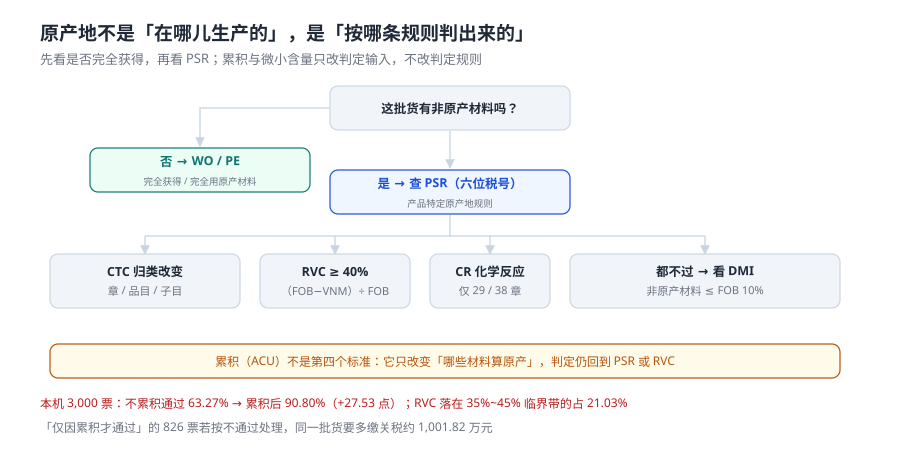

# 原产地规则：RVC、CTC 与累积

协定税率和最惠国税率的差距，往往就是「这张证书能不能用」的差距。而能不能用，不取决于货在哪儿生产，取决于**它能不能按某条规则被判成原产**。本页讲清四种判定标准、累积规则到底改变了什么，以及为什么「RVC 卡在 40% 附近」是最危险的一档。

::: tip 一句话理解
原产地判定是一条链：先问「有没有非原产材料」，没有就是完全获得；有就查 PSR（产品特定原产地规则）；PSR 给的是 CTC、RVC 或 CR 三种标准之一。**累积不是第四个标准，它只改变「哪些材料算原产」。**
:::

## 一、判定树：四种结论，一条路径



| 标准 | 全称 | 含义 | 适用 |
| --- | --- | --- | --- |
| WO | Wholly Obtained | 完全获得（农产品、矿产品） | 初级产品 |
| PE | Produced Exclusively | 完全用原产材料生产 | 工业制成品 |
| CTC | Change in Tariff Classification | 与非原产材料发生税则归类改变 | 多数制成品 |
| RVC | Regional Value Content | 区域价值成分达到门槛 | 多数制成品（常为 40%） |
| CR | Chemical Reaction | 通过化学反应制备 | 仅第 29、38 章 |

CTC 有三个层级，**PSR 说要哪一级就只能判哪一级**：

| 层级 | 位数 | 例子 | 难度 |
| --- | --- | --- | --- |
| 章改变（CC） | 2 位 | 棉花（52）→ 棉纱（52 章内，不算） | 最难 |
| 品目改变（CTH） | 4 位 | 建筑用石 2515 → 混凝土粒料 2517 | 中 |
| 子目改变（CTSH） | 6 位 | 同一品目内换子目 | 最易 |

## 二、RVC：两个公式，必须给同一个答案

```text
扣减法：RVC = (FOB − VNM) ÷ FOB × 100%
累加法：RVC = (原产材料 + 直接人工 + 直接经营费用 + 利润 + 其他成本) ÷ FOB × 100%
```

`VNM` 是非原产材料价值。两个公式在理论上等价，实务里常因费用归集口径不同而差几个点。**系统必须选定一个公式并写进判定记录**，否则同一票货换个人算就是两个结论。

| 输入 | 取值口径 | 常见错误 |
| --- | --- | --- |
| FOB | 离岸价，不含国际运费 | 用了 CIF，把运费算进分母 |
| VNM | 非原产材料的**到岸**价值（含运至生产地的运费） | 只算材料采购价，漏运费 |
| 原产材料 | 具备原产资格的材料 | 把「在本地采购但进口的料」算成原产 |

::: danger RVC 最贵的三个错
1. **分母用 CIF**。FOB 换成 CIF 后分母变大，RVC 看起来更「容易达标」——但这是把运费算成了区域价值，属于高报。
2. **VNM 只算采购价**。非原产材料价值包含运抵生产地的运费与保险费；漏掉后 VNM 偏小，RVC 虚高。
3. **累积当成「区域内都算原产」**。RCEP 现行累积只承认**已具备原产资格**的材料（不完全累积），区域内但未取得原产资格的材料仍全额计入 VNM。
:::

## 三、累积：改变了什么，没改变什么

| 概念 | 改变 | 不改变 |
| --- | --- | --- |
| ACU 累积 | 「哪些材料可以算作原产材料」 | PSR 本身（该用 CTC 还是 RVC 不变） |
| 吸收原则 | 已具原产资格的中间品，其内部含的区域外成分被整体「吸收」 | 未取得原产资格的中间品，仍 100% 计入 VNM |
| DMI 微小含量 | CTC 不满足时，非原产材料 ≤ FOB 10% 仍可通过 | 只对 CTC 有效，对 RVC 不适用 |

本机 3,000 票的读数：

| 量 | 读数 |
| --- | --- |
| 不累积时 RVC40 通过率 | 1,898 / 3,000 = **63.27%** |
| 累积后通过率 | 2,724 / 3,000 = **90.80%** |
| 增量 | **+27.53 个百分点** |
| 仅因累积才通过的票 | 826 票 = **27.53%** |
| RVC 落在 35%~45% 临界带 | 631 票 = **21.03%** |

**临界带占了两成**。这意味着「累积算不算」这一个开关，直接决定了两成票的税率——如果系统把未取得原产资格的区域内材料也当原产材料累积，这 631 票里会有一批被错误地判成原产，随后在核查时被追征。

如果这 826 票被误判为「不享惠」而按最惠国税率缴税，同一批货要多缴关税约 **1,001.82 万元**。反过来，如果误判为「享惠」，就是漏缴，补税时加滞纳金。

## 四、证书与声明：结论要有载体

| 载体 | 谁签发 | 适用 | 系统里要存什么 |
| --- | --- | --- | --- |
| 原产地证书（CO） | 海关、贸促会 | 一般协定税率 | 证书号、签发日、有效期、标准栏（WO/PE/CTC/RVC/CR + ACU/DMI 标注） |
| 原产地声明 | 经核准出口商 | RCEP 等 | 声明编号、企业备案号 |
| 背对背原产地证明 | 中间缔约方 | 转卖分批 | 初始证明号 + 本批数量金额，且中间方不得再加工 |

证书上的「原产地标准」栏是有格式的：`RVC ACU`、`CTC ACU`、`PE ACU`、`CR ACU`，**但不能出现 `WO ACU`**——完全获得的货物谈不上累积。这个细节是一个很好的入库校验点。

```sql
CREATE TABLE origin_claim (
  claim_id   INTEGER PRIMARY KEY,
  decl_id    TEXT NOT NULL,
  standard   TEXT NOT NULL CHECK (standard IN ('WO','PE','CTC','RVC','CR')),
  with_acu   INTEGER NOT NULL DEFAULT 0 CHECK (with_acu IN (0,1)),
  with_dmi   INTEGER NOT NULL DEFAULT 0 CHECK (with_dmi IN (0,1)),
  fob_fen    INTEGER NOT NULL,
  vnm_fen    INTEGER NOT NULL,
  rvc_bp     INTEGER NOT NULL,          -- 基点，4000 = 40.00%
  qualified  INTEGER NOT NULL CHECK (qualified IN (0,1)),
  cert_no    TEXT,
  CHECK (NOT (standard = 'WO' AND with_acu = 1))   -- WO 不能标 ACU
);
```

```sql
-- RVC 用基点算，避免浮点比较在 40.00% 边界抖动
SELECT claim_id, rvc_bp,
       CASE WHEN rvc_bp >= 4000 THEN 1 ELSE 0 END AS pass
FROM origin_claim;
-- RVC 落在临界带（35%~45%）的票：策略上必须人工复核
SELECT COUNT(*) FROM origin_claim WHERE rvc_bp BETWEEN 3500 AND 4500;
```

::: warning 为什么 RVC 要用基点而不是百分比浮点
`(10000-6000)/10000*100 = 40.00000000000001` 或 `39.99999999999999`，取决于实现。判据是 `>= 40` 时，两种结果一个通过一个不通过。存基点（整数万分之一）就没有这个问题：`4000 >= 4000` 恒真。
:::

## 五、判据：本页的八条

本页判据族 `CUR-A` ~ `CUR-H`，共 8 条。它们都在回答「这个『不享惠』是不是真的判过了」。

| 编号 | 判据 | 不满足时改哪里 |
| --- | --- | --- |
| `CUR-A` | 判定结论落「标准」字段（WO/PE/CTC/RVC/CR） | `origin_claim.standard` |
| `CUR-B` | RVC 用基点整数存储与比较 | `rvc_bp INTEGER` |
| `CUR-C` | 累积与微小含量各有一个布尔标记，可追溯 | `with_acu` / `with_dmi` |
| `CUR-D` | `WO` 不得标 `ACU` | 表级 `CHECK` |
| `CUR-E` | 证书号与有效期落库，可校验是否过期 | `cert_no` + `cert_expire_on` |
| `CUR-F` | 临界带（35%~45%）可枚举，供人工复核 | 校验 SQL 返回行数 = 临界票数 |
| `CUR-G` | 误判享惠/不享惠的税额差可双向量化 | 校验 SQL 输出两列 |
| `CUR-H` | 判定记录含「用了哪个公式」（扣减/累加） | `rvc_formula` 字段 |

## 六、验证方式

```shell
# 1. RVC 基点比较：40.00% 边界不抖动
python3 -c "
fob=10000; vnm=6000
rvc=(fob-vnm)/fob*100
print(rvc, rvc>=40, int(round(rvc*100))>=4000)"
# 期望输出：40.0 True True

# 2. 累积前后通过率（本机 63.27% → 90.80%）
python3 -c "
print(round(1898/3000*100,2), round(2724/3000*100,2), 2724-1898)"
# 期望输出：63.27 90.8 826

# 3. WO 不得标 ACU
sqlite3 :memory: "CREATE TABLE c(std TEXT, acu INT, CHECK (NOT (std='WO' AND acu=1)));
INSERT INTO c VALUES('RVC',1); INSERT INTO c VALUES('WO',1);"
# 期望输出：CHECK constraint failed: NOT (std='WO' AND acu=1)
```

## 参考资料

- RCEP 协定第三章（原产地规则）第四条（累积）、第五条（区域价值成分）、附件一（产品特定原产地规则）：RVC40、CTC、CR、ACU、DMI 的条文出处。
- 海关总署《〈区域全面经济伙伴关系协定〉项下进出口货物原产地管理办法》：原产地证书、原产地声明、背对背证明的签发与核查。
- 中国贸促会 / 海关总署 RCEP 原产地规则解读（2021-2022）：RVC 扣减法与累加法两种公式的官方示例。
- 与本页相邻：[商品归类](../Classification/index.md)（CTC 比较的就是归类）、[三税计征](../Duty/index.md)（税率从哪来）、[申报与四单一致](../Declaration/index.md)（原产国栏怎么填）。
