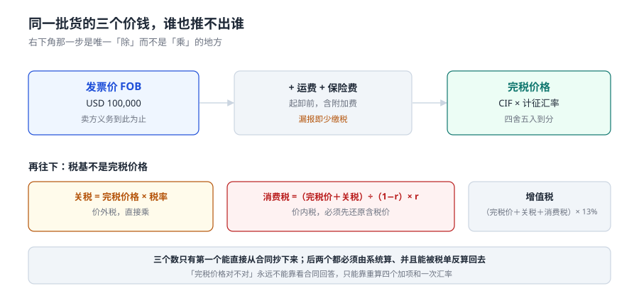

# 总览：六个口径与一套单据

在写任何一行代码之前，先把「这张单子上到底有多少个数」数清楚。一票进口报关单上有六个容易混的数：**件数、数量、净重、毛重、总价、完税价格**。它们分属三套单位体系和两个价格口径，任何两个都不能互相推出来。

本页把报关单拆成「表头 + 商品项」两层，说明每个数由谁填、被谁用、填错了会在哪一段暴露。

::: tip 一句话理解
报关单是**一张表头加若干商品项**的二维单据：表头回答「这一批货怎么运来的」，商品项回答「每一行是什么、值多少、缴多少税」。税只在商品项上算，表头只是把商品项绑到同一个运输事实上的绳子。
:::

## 一、一张报关单的两层结构



| 层 | 字段（举例） | 粒度 | 谁来填 | 写错时的典型症状 |
| --- | --- | --- | --- | --- |
| 表头 | 报关单号、进出口标志、申报日期、运输方式、提单号、集装箱号、经营单位、收货单位、报关行 | 一票一行 | 报关行 | 多票合并成一票，或一票拆成多票，税单与提单对不上 |
| 商品项 | 项号、税则号列、品名规格、数量、单位、总价、币制、原产国、征免性质 | 一票多行 | 报关行 | 一票多品名时把总价记在表头，分摊靠猜 |

本机 12,000 票里，单票平均 **1.60 个商品项**，最多的 9 项；**34.43%** 的票不止一个品名。这意味着「一票一税号」的假设在三分之一的票上直接失效——这三分之一就是所有「完税价格分摊」类 bug 的温床。

### 六个数的定义与关系

| 数 | 英文/字段 | 定义 | 单位 | 与另外五个的关系 |
| --- | --- | --- | --- | --- |
| 件数 | `packages` | 外包装件数（箱、托盘） | 件 | 只能从装箱单来，与数量无关 |
| 数量 | `qty` | 法定第一数量（成交计量单位） | 千克 / 个 / 米… | 决定从量税，与总价无关 |
| 净重 | `net_weight` | 货物本身重量 | 千克 | ≤ 毛重 |
| 毛重 | `gross_weight` | 含包装重量 | 千克 | ≥ 净重 |
| 总价 | `amount` | 成交总价（`qty × 单价`） | 币制 | 完税价格的**起点**，不是完税价格 |
| 完税价格 | `pdv` | 海关审定的计税基础 | 人民币 | 由总价加项、乘汇率得来 |

::: warning 为什么「净重」不能拿来算价格
按重量计价的货物（矿砂、化工品）单价是「元/千克」，看起来用净重乘单价就对。但**完税价格不是货价**：它还要加运费、保险费，并且要按海关审定的价格调整。本机样本里，从「总价」到「完税价格」的差额是 **6.12%**，靠净重永远推不出来。
:::

## 二、六个数分别被谁用


| 数 | 报关行用 | 海关用 | 财务用 | 用错后的连锁反应 |
| --- | --- | --- | --- | --- |
| 件数 | 填单 | 查验时点数 | 算仓储费 | 查验点不清，整票转人工 |
| 数量 | 填单、算从量税 | 核对许可证额度 | 算单位成本 | 许可证额度按数量核销，多报就卡住下一票 |
| 净重 | 填单 | 与法定第二数量互校 | 算运价 | 净重 > 毛重时，海关系统直接退单 |
| 毛重 | 填单 | 与舱单核对 | 算运费吨 | 与提单毛重不一致，触发查验 |
| 总价 | 填单 | 作为完税价格起点 | 记应付账款 | 发票金额与报关单不一致，付款卡住 |
| 完税价格 | 不填（海关审定） | 算三税 | 记存货成本 | 算错就是税算错，且事后补税要加滞纳金 |

**只有完税价格是海关算的**，其余五个都是企业申报的。这条分工决定了系统的形状：企业侧要保证「申报的五个数可核」，海关侧要保证「算出的第六个数可复算」。

## 三、状态机：一票货的七个状态

```text
DECLARED ──► ACCEPTED ──► TAXED ──► RELEASED ──► CLOSED
    │            │            │          │
    └─ 退单 ◄────┘            │          └─ 后续核查改单 ──► TAXED（回退）
                              └─ 未缴款（滞纳金起算）
```

| 状态 | 判据（能写进 SQL 的那种） | 谁推进 |
| --- | --- | --- |
| `DECLARED` | 有申报报文与回执号 | 企业 / 报关行 |
| `ACCEPTED` | 回执状态 = 接受，且审结标记存在 | 海关 |
| `TAXED` | 存在税单，且三税合计 = 税单总额 | 海关 |
| `RELEASED` | 放行回执 + 提离时间 | 海关 / 堆场 |
| `CLOSED` | 舱单核销完成 | 海关 |

::: danger 三个把状态机写坏的写法
1. **用 `is_paid` 布尔字段代替 `paid_at`。** 布尔值回答不了「什么时候缴的」，而滞纳金恰恰按天算。本机 1,938 票逾期（16.15%），分布 5,131 个滞纳日，没有 `paid_at` 这笔账根本算不出来。
2. **允许 `state` 任意回退。** 只有「后续核查」一种回退是合法的，而且必须留痕（改单人、改单原因、改单前后值）。把它写成普通 `UPDATE`，等于让历史消失。
3. **把「放行」当终态。** 放行之后还有提离、结关、后续核查三段，本机 95.53% 的票在这三段里跨了至少一天。
:::

## 四、单据清单：一票货要凑齐几份

| 单证 | 作用 | 缺了会怎样 | 与哪个数强相关 |
| --- | --- | --- | --- |
| 报关单 | 申报主体，一切税款的载体 | 无法申报 | 全部六个数 |
| 商业发票 | 成交价格、币制、贸易术语 | 完税价格无据 | 总价 |
| 装箱单 | 件数、毛重、净重、包装 | 查验点不清 | 件数 / 毛重 / 净重 |
| 提单（或舱单） | 运输事实、到港日 | 无法确认申报期限起点 | 数量、到港日 |
| 合同 | 特许权使用费、价格调整条款 | 特许权是否应税无从判断 | 完税价格加项 |
| 原产地证书 | 协定税率依据 | 只能按最惠国税率缴 | 税率 |

本机四单核对的结果：发票金额与报关单不一致 **3.15%**、提单数量不一致 **2.32%**、计量单位错（千件↔件）**1.47%**。三类里最危险的是第三类——**它不改一个字符，只改一个单位，金额就差 1,000 倍**。

## 五、六个数的校验规则

```sql
-- 表头与商品项的一致性：总价必须等于各行之和（整数分比较，不用浮点）
SELECT d.decl_id
FROM declaration d JOIN decl_item i ON i.decl_id = d.decl_id
GROUP BY d.decl_id
HAVING d.total_fen <> SUM(i.amount_fen);

-- 毛重不得小于净重
SELECT decl_id FROM declaration WHERE gross_kg < net_kg;

-- 一票一税单：靠唯一约束，不靠应用层判断
SELECT decl_id, COUNT(*) c FROM tax_bill GROUP BY decl_id HAVING c > 1;

-- 已放行但税未结清
SELECT d.decl_id FROM declaration d
WHERE d.state IN ('RELEASED','CLOSED')
  AND NOT EXISTS (SELECT 1 FROM tax_bill b WHERE b.decl_id = d.decl_id AND b.paid_at IS NOT NULL);
```

四条都能跑成「返回 0 行」的形式，这是本册所有判据的统一形态：**判据不是「应该没问题」，而是「这条 SQL 返回 0 行」**。

## 六、判据：本页的八条

本页判据族 `CUO-A` ~ `CUO-H`，共 8 条。它们都在回答「这一票的六个口径有没有一处是猜的」。

| 编号 | 判据 | 不满足时改哪里 |
| --- | --- | --- |
| `CUO-A` | 报关单与商品项分表，一票可挂多行 | `decl_item` 表存在且有 `decl_id` 外键 |
| `CUO-B` | 六个申报数各自独立成列，不用一个字段表达两个含义 | `declaration.packages / qty / net_kg / gross_kg / total_fen` 五列齐全 |
| `CUO-C` | 金额存整数分，不存 `REAL` | 所有 `*_fen` 列为 `INTEGER` |
| `CUO-D` | 完税价格在商品项上，不在表头上 | `decl_item.pdv_fen` 存在；表头无 `pdv_fen` |
| `CUO-E` | 状态机五态，且 `RELEASED` 必须已缴税 | 有 `trg_release_needs_paid` 或等价约束 |
| `CUO-F` | 一票一税单 | `tax_bill.decl_id` 上有 `UNIQUE` |
| `CUO-G` | 毛重 ≥ 净重，数量 > 0 | 表级 `CHECK` |
| `CUO-H` | 四单核对能跑成「返回 0 行」 | 四条校验 SQL 均可执行且返回 0 行 |

## 七、验证方式

```shell
# 1. 用 Python 复算「总价 → 完税价格」的差额比例（本机 6.12%）
python3 -c "
pdv=2066705561.67; fob=1947433575.48
print(round((pdv/fob-1)*100,2))"
# 期望输出：6.12

# 2. 六个数的关系自检：净重不得大于毛重
python3 -c "
rows=[(1200,980),(860,860),(40,52)]
print([r for r in rows if r[1]>r[0]])"
# 期望输出：[(40, 52)]

# 3. 状态机：已放行却未缴税的票数（应为 0）
sqlite3 :memory: "CREATE TABLE d(id TEXT,state TEXT); CREATE TABLE b(id TEXT,paid_at TEXT);
INSERT INTO d VALUES('A','RELEASED'); INSERT INTO b VALUES('A',NULL);
SELECT COUNT(*) FROM d WHERE state IN ('RELEASED','CLOSED')
  AND NOT EXISTS (SELECT 1 FROM b WHERE b.id=d.id AND b.paid_at IS NOT NULL);
SELECT COUNT(*) FROM d;"
# 期望输出：1（自检用例确实构造了 1 条违规）
```

第 3 步刻意构造了一条违规数据：**判据脚本必须能报出「有 1 条」**，否则「返回 0 行」也可能只是查询写错了。

## 参考资料

- 《中华人民共和国海关进出口货物报关单填制规范》（海关总署公告 2019 年第 18 号及后续修订）：本页六个数的官方定义与填制口径。
- 《中华人民共和国海关法》第二十四条：进口货物自运输工具申报进境之日起 **14 日内**申报的义务，滞报金的法源。
- 《中华人民共和国海关进出口货物征税管理办法》（海关总署令第 272 号）第十七条：三税计算公式。
- 与本页相邻：[商品归类](../Classification/index.md)、[完税价格](../Valuation/index.md)、[申报与四单一致](../Declaration/index.md)。
