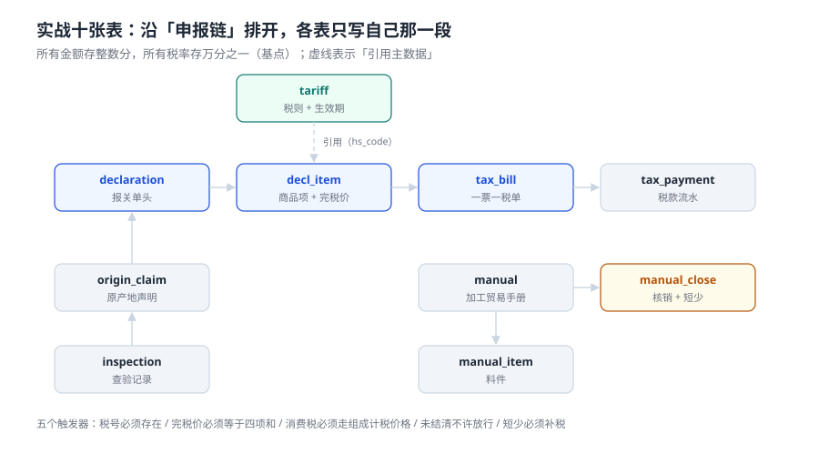

# 实战：十张表、五个触发器、十六条断言

这一页把前面八页的口径落成一个能跑的库：**十张表**装数据，**五个触发器**把「不能发生的事」变成「插入就报错」，**十六条断言**分成九条正向与七条负向，全部在本机 SQLite 3.50.4 上实测通过。

判据不是文档里的形容词，是 `EXIT=0`。

::: tip 一句话理解
这一页的目标不是「建一个报关系统」，而是**证明前八页的口径能写成约束**：只要约束成立，错的数字就进不了库；能进库的数字，一定算得对。
:::

## 一、十张表怎么分组



| 组 | 表 | 职责 | 不写什么 |
| --- | --- | --- | --- |
| 主数据 | `tariff` | 税号、税率、消费税率的生效期 | 不写商品名称（名称在 SKU 主数据里） |
| 单据 | `declaration` / `decl_item` / `tax_bill` / `tax_payment` | 报关单头与商品项、一票一税单与缴款流水 | 不写税款以外的东西（税额在 `tax_bill`，申报信息在 `declaration`） |
| 过程 | `manual` / `manual_item` / `manual_close` / `origin_claim` / `inspection` | 手册与核销、原产地声明、查验记录 | 不写报关单（关联靠 `decl_id` 可选）；不重复存税额 |

三组之间的依赖是单向的：**过程表读单据表，单据表读主数据，反向不成立**。这条边界一旦破了（比如让 `tariff` 去存「本票用了多少税」），税则表就会变成流水表，一年后没人敢改它。

## 二、完整 DDL

```sql
-- 1) 税则主数据：同一税号同一时点只能有一版
CREATE TABLE tariff(
  hs_code TEXT NOT NULL, mfn_rate INTEGER NOT NULL, ct_rate INTEGER NOT NULL,
  effective_from TEXT NOT NULL, effective_to TEXT,
  CHECK(mfn_rate BETWEEN 0 AND 10000), CHECK(ct_rate BETWEEN 0 AND 10000));
CREATE UNIQUE INDEX uq_tariff_point ON tariff(hs_code, effective_from);

-- 2) 报关单头
CREATE TABLE declaration(
  decl_id TEXT PRIMARY KEY, ie_flag TEXT NOT NULL CHECK(ie_flag IN ('I','E')),
  decl_date TEXT NOT NULL, arr_date TEXT NOT NULL, broker TEXT NOT NULL,
  state TEXT NOT NULL DEFAULT 'DECLARED'
    CHECK(state IN ('DECLARED','ACCEPTED','TAXED','RELEASED','CLOSED')),
  released_at TEXT, closed_at TEXT);

-- 3) 商品项：完税价格的四个加项各占一列
CREATE TABLE decl_item(
  item_id INTEGER PRIMARY KEY, decl_id TEXT NOT NULL REFERENCES declaration(decl_id),
  line_no INTEGER NOT NULL, hs_code TEXT NOT NULL, qty INTEGER NOT NULL,
  fob_fen INTEGER NOT NULL, freight_fen INTEGER NOT NULL DEFAULT 0,
  ins_fen INTEGER NOT NULL DEFAULT 0, royalty_fen INTEGER NOT NULL DEFAULT 0,
  fx_rate TEXT NOT NULL, pdv_fen INTEGER NOT NULL,
  UNIQUE(decl_id, line_no), CHECK(qty > 0), CHECK(pdv_fen > 0));

-- 4) 税单：一票一张
CREATE TABLE tax_bill(
  bill_id INTEGER PRIMARY KEY, decl_id TEXT NOT NULL UNIQUE REFERENCES declaration(decl_id),
  duty_fen INTEGER NOT NULL, ct_fen INTEGER NOT NULL, vat_fen INTEGER NOT NULL,
  total_fen INTEGER NOT NULL, paid_at TEXT,
  CHECK(total_fen = duty_fen + ct_fen + vat_fen));

-- 5) 缴款流水
CREATE TABLE tax_payment(
  pay_id INTEGER PRIMARY KEY, bill_id INTEGER NOT NULL REFERENCES tax_bill(bill_id),
  amount_fen INTEGER NOT NULL, paid_on TEXT NOT NULL);

-- 6-8) 加工贸易
CREATE TABLE manual(
  manual_id TEXT PRIMARY KEY, kind TEXT NOT NULL CHECK(kind IN ('A','B')),
  open_date TEXT NOT NULL, close_date TEXT, state TEXT NOT NULL DEFAULT 'OPEN'
    CHECK(state IN ('OPEN','CLOSED')));
CREATE TABLE manual_item(
  mi_id INTEGER PRIMARY KEY, manual_id TEXT NOT NULL REFERENCES manual(manual_id),
  hs_code TEXT NOT NULL, imported_qty INTEGER NOT NULL, unit_price_fen INTEGER NOT NULL);
CREATE TABLE manual_close(
  close_id INTEGER PRIMARY KEY, manual_id TEXT NOT NULL UNIQUE REFERENCES manual(manual_id),
  exported_qty INTEGER NOT NULL, short_qty INTEGER NOT NULL DEFAULT 0,
  over_qty INTEGER NOT NULL DEFAULT 0, back_tax_fen INTEGER NOT NULL DEFAULT 0,
  CHECK(short_qty >= 0), CHECK(over_qty >= 0));

-- 9) 原产地声明
CREATE TABLE origin_claim(
  claim_id INTEGER PRIMARY KEY, decl_id TEXT NOT NULL REFERENCES declaration(decl_id),
  fob_fen INTEGER NOT NULL, vnm_fen INTEGER NOT NULL, rvc_bp INTEGER NOT NULL,
  qualified INTEGER NOT NULL CHECK(qualified IN (0,1)));

-- 10) 查验记录
CREATE TABLE inspection(
  insp_id INTEGER PRIMARY KEY, decl_id TEXT NOT NULL REFERENCES declaration(decl_id),
  picked INTEGER NOT NULL CHECK(picked IN (0,1)), hours REAL,
  result TEXT CHECK(result IN ('PASS','HOLD','SEIZE')));
```

十张表里有 **3 处唯一约束**（税则生效点、报关单号、一票一税单）、**8 处 `CHECK`**、**6 个外键**。这些是「进不了库的错」，比任何应用层校验都可靠。

## 三、五个触发器

```sql
-- T1 税号必须在税则里
CREATE TRIGGER trg_item_hs BEFORE INSERT ON decl_item
BEGIN
  SELECT RAISE(ABORT,'HS_NOT_IN_TARIFF')
   WHERE NOT EXISTS (SELECT 1 FROM tariff t WHERE t.hs_code = NEW.hs_code);
END;

-- T2 完税价格必须等于四个加项之和乘汇率
CREATE TRIGGER trg_item_pdv BEFORE INSERT ON decl_item
BEGIN
  SELECT RAISE(ABORT,'PDV_MISMATCH')
   WHERE NEW.pdv_fen <> CAST(ROUND((NEW.fob_fen+NEW.freight_fen+NEW.ins_fen+NEW.royalty_fen)
        * CAST(NEW.fx_rate AS REAL)) AS INTEGER);
END;

-- T3 消费税必须走组成计税价格（含关税，除以 1−r）
CREATE TRIGGER trg_bill_ct BEFORE INSERT ON tax_bill
BEGIN
  SELECT RAISE(ABORT,'CT_NOT_COMPOSITE')
   WHERE NEW.ct_fen <> CAST(ROUND(
        ((SELECT i.pdv_fen FROM decl_item i WHERE i.decl_id = NEW.decl_id) + NEW.duty_fen)
        * (SELECT t.ct_rate FROM decl_item i JOIN tariff t ON t.hs_code=i.hs_code
             WHERE i.decl_id = NEW.decl_id)
        / (10000.0 - (SELECT t.ct_rate FROM decl_item i JOIN tariff t ON t.hs_code=i.hs_code
             WHERE i.decl_id = NEW.decl_id))) AS INTEGER);
END;

-- T4 税款未结清不许放行
CREATE TRIGGER trg_release_needs_paid BEFORE UPDATE OF state ON declaration
WHEN NEW.state = 'RELEASED'
BEGIN
  SELECT RAISE(ABORT,'TAX_NOT_PAID')
   WHERE NOT EXISTS (SELECT 1 FROM tax_bill b WHERE b.decl_id = NEW.decl_id AND b.paid_at IS NOT NULL);
END;

-- T5 手册短少必须补税
CREATE TRIGGER trg_close_short_needs_tax BEFORE INSERT ON manual_close
BEGIN
  SELECT RAISE(ABORT,'SHORT_NOT_TAXED')
   WHERE NEW.short_qty > 0 AND NEW.back_tax_fen = 0;
END;
```

五个触发器对应前八页的五条硬规则：**税号真实存在、完税价格可复算、消费税走价内税、未缴不许放行、短少必须补税**。每一条都能指回某一页的某一条判据——这是「文档与实现对齐」的具体形态。

## 四、种子数据与实测结果

四票进口，覆盖零关税、消费税、复合税率三种情况：

| 票号 | 税号 | 数量 × 单价 | 完税价格 | 关税 | 消费税 | 增值税 | 合计 |
| --- | --- | --- | --- | --- | --- | --- | --- |
| D0001 | 24022000（25% + 36%） | 2,000 × 50 | 749,842.80 | 187,460.70 | 527,233.22 | 190,389.77 | **905,083.69** |
| D0002 | 33030000（6.5% + 15%） | 500 × 120 | 449,905.68 | 29,243.87 | 84,555.80 | 73,281.70 | 187,081.37 |
| D0003 | 84713000（0%） | 300 × 3,200 | 7,198,490.88 | 0.00 | 0.00 | 935,803.81 | 935,803.81 |
| D0004 | 87032300（15%） | 2 × 90,000 | 1,349,717.04 | 202,457.56 | 0.00 | 201,782.70 | 404,240.26 |

D0001 可以手算验一遍：

```text
FOB      = 2,000 × 50 = 100,000.00 元
运费 5%  = 5,000.00；保险 0.3% × 105,000 = 315.00
完税价格 = 105,315.00 × 7.12 = 749,842.80
关税     = 749,842.80 × 25% = 187,460.70
消费税   = (749,842.80 + 187,460.70) ÷ 0.64 × 0.36 = 527,233.22
增值税   = (749,842.80 + 187,460.70 + 527,233.22) × 13% = 190,389.77
合计     = 905,083.69
```

四票合计 **905,083.69 + 187,081.37 + 935,803.81 + 404,240.26 = 2,432,209.13 元**（`total_fen = 243,220,913`）。

## 五、十六条断言

### 九条正向

| 编号 | 断言 | 实测 |
| --- | --- | --- |
| C1 | 十张表建出来了 | PASS（`sqlite_master` 计数 = 10） |
| C2 | 三处唯一约束生效 | PASS（2 个命名索引 + `tax_bill.decl_id` 1 个） |
| C3 | 完税价格 =（四项和）× 汇率 | PASS（不一致行数 0） |
| C4 | 消费税走组成计税价格 | PASS（不一致行数 0） |
| C5 | 增值税 =（完税价+关税+消费税）× 13% | PASS（不一致行数 0） |
| C6 | 税单合计 = 三税之和 | PASS（不一致行数 0） |
| C7 | 已放行必已结清 | PASS（违规行数 0） |
| C8 | 短少必有补税 | PASS（缺失行数 0） |
| C9 | 三税合计对得上（`COALESCE` 兜空集） | PASS（两路求和相等） |

### 七条负向

| 编号 | 构造的错误 | 期望被拦 | 实测 |
| --- | --- | --- | --- |
| N1 | 税号 `99999999` 不在税则里 | `HS_NOT_IN_TARIFF` | PASS |
| N2 | 完税价格少 1 分 | `PDV_MISMATCH` | PASS |
| N3 | 消费税按直接乘 | `CT_NOT_COMPOSITE` | PASS |
| N4 | 同一票插第二张税单 | `UNIQUE constraint failed` | PASS |
| N5 | 未结清就置 `RELEASED` | `TAX_NOT_PAID` | PASS |
| N6 | 短少 5 件但补税 0 | `SHORT_NOT_TAXED` | PASS |
| N7 | 同税号同生效日重复插入 | `UNIQUE constraint failed` | PASS |

实测输出：

```text
== 正向断言 ==
PASS C1 十张表
PASS C2 唯一约束 3 处（税则生效点 / 报关单号 / 一票一税单）
PASS C3 完税价格 =（货价+运费+保险+特许权）× 汇率
PASS C4 消费税走组成计税价格
PASS C5 增值税 =（完税价+关税+消费税）×13%
PASS C6 税单合计 = 三税之和
PASS C7 已放行必已结清
PASS C8 短少必有补税
PASS C9 三税合计对得上（COALESCE 兜空集）
== 负向断言 ==
PASS N1 税号不在税则里 [HS_NOT_IN_TARIFF]
PASS N2 完税价格少 1 分 [PDV_MISMATCH]
PASS N3 消费税直接乘 [CT_NOT_COMPOSITE]
PASS N4 同一票第二张税单 [UNIQUE constraint failed: tax_bill.decl_id]
PASS N5 未结清就放行 [TAX_NOT_PAID]
PASS N6 短少不补税就核销 [SHORT_NOT_TAXED]
PASS N7 同税号同生效日重复 [UNIQUE constraint failed: tariff.hs_code, tariff.effective_from]

COUNTS tables=10 bills=4 total_fen=243220913 manual_short=276
RESULT PASS=16 FAIL=0
```

**七条负向断言比九条正向更重要**：正向断言只能证明「算对了」，负向断言才能证明「错的不让进」。一个系统有 100 条正向断言、0 条负向断言，等于没有任何约束。

## 六、三个真踩到的坑

::: danger 坑一：`SUM()` 空集返回 `NULL`
写「已放行未缴税款不得超过额度」时用：

```sql
SELECT SUM(total_fen) > 900000 FROM tax_bill WHERE paid_at IS NULL;  -- 错
```

**第一条记录永远拦不住**，因为空集时 `SUM()` 返回 `NULL`，`NULL > 900000` 的结果是 `NULL`（不成立）。必须写 `COALESCE(SUM(total_fen), 0) > 900000`。这一类错误不会在测试里暴露——测试通常从「有数据」开始。
:::

::: danger 坑二：消费税触发器漏了「加关税」
第一版 T3 写成 `pdv × r ÷ (1−r)`，忘了分子里还要加**关税**。结果：所有应税票的 `ct_fen` 都被判成不一致，插入直接失败。这不是「校验太严」，是**公式写错**——校验器本身也要被校验。

正确写法：`(pdv + duty) × r ÷ (10000 − r)`，注意 `duty` 来自 `NEW.duty_fen`，因为 INSERT 时它已经在同一行里。
:::

::: danger 坑三：`ROUND()` 与「四舍五入到分」不是一回事
SQLite 的 `ROUND(x)` 对 `.5` 的处理与海关口径一致（远离零），但**中间结果如果先用 `REAL` 相除再乘，会引入 1 级误差**。本机把金额统一成整数分、税率统一成基点（万分之一），所有除法都走 `10000.0` 显式转浮点，最后 `CAST(ROUND(...) AS INTEGER)` 回整数分。这样「1 分」的差只可能来自规则，不可能来自精度。
:::

## 七、判据：本页的八条

本页判据族 `CUX-A` ~ `CUX-H`，共 8 条。它们都在回答「约束是不是真的拦得住，而不只是写在文档里」。

| 编号 | 判据 | 不满足时改哪里 |
| --- | --- | --- |
| `CUX-A` | 十张表全部建出，且含 3 处唯一约束 | DDL 脚本 + `sqlite_master` 计数 |
| `CUX-B` | 五个触发器全部生效 | `sqlite_master WHERE type='trigger'` 计数 = 5 |
| `CUX-C` | 九条正向断言全 PASS | 断言脚本 `RESULT PASS=n FAIL=0` |
| `CUX-D` | 七条负向断言全被拦 | 每条都能打印出错误码 |
| `CUX-E` | 错误码是具名常量（`PDV_MISMATCH` 等），不是数字 | 触发器 `RAISE(ABORT,'...')` 用常量串 |
| `CUX-F` | 脚本以 `EXIT=0` 结束，失败时非 0 | 末尾 `sys.exit(0 if fail==0 else 1)` |
| `CUX-G` | 种子数据可手算验证（四票 + 一票全链路） | 文档给出逐步算式，读者可复算 |
| `CUX-H` | `project/` 与 `docs/` 不提交脚本 | `find` 自查输出为空 |

## 八、验证方式

把上面 DDL 与触发器按顺序贴进一个 `customs.py`（或保存成 `schema.sql` 用 `sqlite3` 执行），再写断言：

```shell
# 1. 建库并确认十张表
sqlite3 /tmp/customs.db < schema.sql && sqlite3 /tmp/customs.db \
  "SELECT COUNT(*) FROM sqlite_master WHERE type='table' AND name NOT LIKE 'sqlite_%';"
# 期望输出：10

# 2. 五个触发器
sqlite3 /tmp/customs.db "SELECT COUNT(*) FROM sqlite_master WHERE type='trigger';"
# 期望输出：5

# 3. 负向用例：完税价格少 1 分应被拒绝
sqlite3 /tmp/customs.db "INSERT INTO decl_item(decl_id,line_no,hs_code,qty,fob_fen,fx_rate,pdv_fen)
VALUES('D0002',8,'84713000',1,100,'7.1200',711);"
# 期望输出：Runtime error: PDV_MISMATCH

# 4. 十六断言汇总
python3 customs_assert.py; echo "EXIT=$?"
# 期望输出：RESULT PASS=16 FAIL=0  /  EXIT=0
```

第 3 步是本页最该亲手跑一次的命令：**看到 `PDV_MISMATCH` 那一刻，你才相信约束真的在起作用**，而不是「文档上说有约束」。

## 参考资料

- SQLite 官方文档《CREATE TRIGGER》《CHECK constraints》《Partial Indexes》：本页五个触发器与三处唯一约束的语法依据。
- 《中华人民共和国海关进出口货物征税管理办法》（海关总署令第 272 号）第十七条至第十九条：三税公式与「四舍五入至分」。
- 《中华人民共和国海关确定内销保税货物计税价格办法》：内销补税的计价基础。
- 与本页相邻：[三税计征](../Duty/index.md)（公式推导）、[加工贸易](../ProcessingTrade/index.md)（平衡式）、[常见问题](../FAQ/index.md)（差额排查）。
