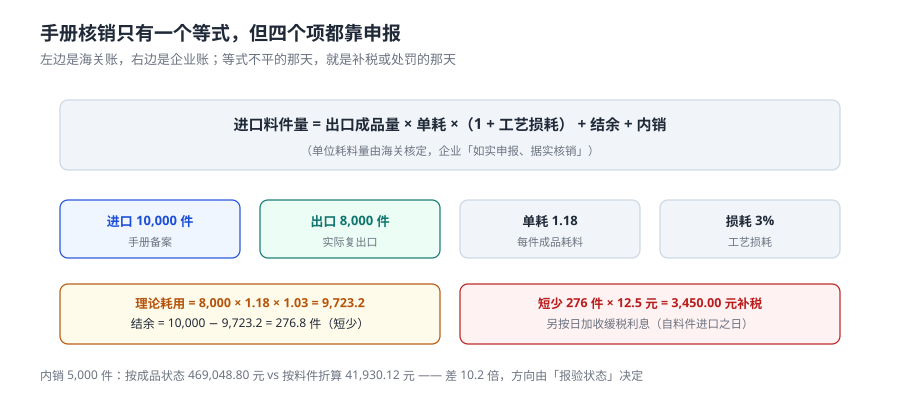

# 加工贸易：手册、单耗与核销

一般贸易是「进口就缴税」，加工贸易是「进口不缴税，出口后核销」。这一句差别带来一个问题：**海关把料件借给你了，你得证明它去哪了**。证明的方式是一个等式，等式里四个项全都靠企业申报。

本页讲清这个等式、四种「剩余物」的计税区别，以及「内销按成品还是按料件」这个能把税额差出 10 倍的选择。

::: tip 一句话理解
加工贸易的全部工程问题可以压缩成一句话：**进口料件量 = 出口成品量 × 单耗 ×（1 + 损耗） + 结余 + 内销**。四项里只有「进口」有海关数据，其余三项都是企业说自己是多少。
:::

## 一、两种模式：进料加工与来料加工

| 维度 | 进料加工（A） | 来料加工（B） |
| --- | --- | --- |
| 料件所有权 | 我方买断 | 外商提供 |
| 我方收益 | 成品售价 − 料件成本 | 加工费 |
| 内销计税价格基础 | **料件原进口成交价格** | **同时或大约同时进口的相同/类似货物成交价** |
| 手册形式 | 电子账册 / 手册 | 电子账册 / 手册 |
| 风险点 | 料件与成品价格都在自己账上，容易被「调整」 | 加工费低报，工缴费与耗料不匹配 |

这个差异直接决定内销补税的算法：进料加工有「原进口成交价」可查，来料加工没有，只能找可比价格。系统里这两种模式必须分开处理，不能用一个 `price` 字段糊过去。

## 二、平衡式：四个项，一个等式



```text
进口料件量 = 出口成品量 × 单耗 × (1 + 工艺损耗) + 结余 + 内销
```

| 项 | 含义 | 谁申报 | 偏差方向 | 后果 |
| --- | --- | --- | --- | --- |
| 进口料件量 | 保税进口累计 | 报关单（客观） | — | 唯一有第三方数据的一项 |
| 出口成品量 | 复出口累计 | 报关单（客观） | — | 与进口量共同决定理论耗用 |
| 单耗 | 每单位成品耗用的料件量 | **企业申报，海关核定** | 高报 → 料件溢余 | 溢余不报即「擅自处置」 |
| 工艺损耗 | 加工过程中合理损耗 | 企业申报 | 高报 → 掩盖短少 | 短少要补税 |
| 结余 | 剩余料件 | 企业申报 | 少报 → 掩盖短少 | 补税 + 处罚 |

**单耗是唯一一个「报高了对自己有利」的量**：单耗越高，理论耗用越多，账面结余越少，短少就越容易被解释掉。所以《加工贸易单耗管理办法》的原则是「如实申报、据实核销」，而且要求在生产过程中、出口前、内销前申报（俗称「三前」）。

### 本机读数

| 量 | 读数 |
| --- | --- |
| 手册数 | 80 本 |
| 核销时「短少」（实际耗用 > 进口） | **33 本（41.25%）**，补税约 **191,512 元** |
| 核销时「溢余超 3%」 | **15 本（18.75%）**，金额约 **175,375 元** |
| 单耗一律高报 5% 造成的料件溢余 | 折价 **1,141,763 元** |

最后一行是本页最值钱的读数：**单耗只高报 5%，账面上就凭空多出 114 万元的保税料件**。这 114 万元的料件如果继续留在库房里不申报，就是「未经海关许可擅自处置海关监管货物」。

## 三、四种剩余物：计税方式完全不同

| 类型 | 定义 | 内销计税价格 | 要不要许可证 | 要不要缓税利息 |
| --- | --- | --- | --- | --- |
| 剩余料件 | 未使用的进口料件 | 原进口成交价格 | 要 | 要 |
| 边角料 | 核定单耗内、加工中产生的废碎料 | **内销价格** | 不要 | 不要 |
| 残次品 | 有严重缺陷、无法复出口的制品 | 按单耗**折算成料件**后计税 | 要 | 要 |
| 副产品 | 加工主产品同时产生、合同未规定复出口的其他产品 | 内销价格（非全部用保税料件的按比重折算） | 要 | 要 |

**边角料与副产品的区分是最容易出错的一处**：把副产品当边角料申报，等于用「废料价」替代「产品价」，构成低报价格。典型场景：大豆加工出豆粕（主产品）同时出豆油、豆皮（副产品），豆油按边角料报就错了。

## 四、内销：按成品还是按料件，差 10 倍

这是本册最刺眼的一个数：

| 口径 | 完税价格 | 税率 | 税额 |
| --- | --- | --- | --- |
| 按**成品**状态内销 | 3,126,992.00 | 15% | **469,048.80** |
| 按**料件**折算内销 | 524,126.50 | 8% | **41,930.12** |
| 差额 | — | — | **427,118.68（10.2 倍）** |

规则是明确的：**制成品、残次品内销，应按单耗折算成所耗用的进口保税料件，按料件的品名、税号、税率申报**。所以第二个口径才对。第一个口径错在「把成品当一般贸易货物进口」——它同时错了两件事：价格用了成品价、税率用了成品税率。

::: danger 加工贸易内销的四个坑
1. **按成品申报**。上面那张表：税额差 10.2 倍，而且这是「少缴」，补税时加滞纳金。
2. **不计缓税利息**。保税料件内销要补缴**缓税利息**，计息期自料件申报进口之日起至补税之日止。只补税不补息，等于免费用了几年国库的钱。
3. **漏报国际段运保费**。内销计税价格同样包含运抵境内输入地点起卸前的运输与保险费——「这是一般贸易才有的规定」是常见误解。
4. **边角料与副产品混报**。用废料价替代产品价，性质是低报。
:::

```sql
-- 内销补税：制成品按单耗折料件，边角料/副产品按内销价
CREATE VIEW v_domestic_sale_tax AS
SELECT s.sale_id, s.manual_id, s.kind,
       CASE s.kind
         WHEN 'FINISHED' THEN CAST(s.qty * m.consumption * i.unit_price_fen AS INTEGER)
         WHEN 'DEFECTIVE' THEN CAST(s.qty * m.consumption * i.unit_price_fen AS INTEGER)
         ELSE s.price_fen                       -- 边角料 / 副产品：按内销价
       END AS base_fen,
       t.mfn_rate
FROM domestic_sale s
JOIN manual m ON m.manual_id = s.manual_id
JOIN manual_item i ON i.manual_id = m.manual_id
JOIN tariff t ON t.hs_code = i.hs_code;
```

## 五、工程做法：核销差异必须触发补税

```sql
CREATE TABLE manual_close (
  close_id      INTEGER PRIMARY KEY,
  manual_id     TEXT NOT NULL UNIQUE,
  exported_qty  INTEGER NOT NULL,
  short_qty     INTEGER NOT NULL DEFAULT 0,
  over_qty      INTEGER NOT NULL DEFAULT 0,
  back_tax_fen  INTEGER NOT NULL DEFAULT 0,
  CHECK (short_qty >= 0 AND over_qty >= 0)
);

-- 有短少就必须有补税，不补不许核销
CREATE TRIGGER trg_close_short_needs_tax BEFORE INSERT ON manual_close
BEGIN
  SELECT RAISE(ABORT, 'SHORT_NOT_TAXED')
   WHERE NEW.short_qty > 0 AND NEW.back_tax_fen = 0;
END;
```

这个触发器的价值不在于「拦住一次错误」，而在于**把一条业务规则变成一条不可能被绕过的约束**。业务上「短少必须补税」这句话写在制度里没人执行，写进触发器就执行了。

::: warning 短少的数量是小数怎么办
本机算例：理论耗用 9,723.2 件，进口 10,000 件，结余 276.8 件。件是不可分割单位，系统里用**整数件向下取整**（276 件）补税，并在核销记录里留 `short_qty_raw = 276.8`。只存整数会丢 0.8 件的证据；只存小数会让补税单出现「0.8 件」这种无法执行的数量。
:::

## 六、判据：本页的八条

本页判据族 `CUP-A` ~ `CUP-H`，共 8 条。它们都在回答「手册的账和实物的账是不是同一本」。

| 编号 | 判据 | 不满足时改哪里 |
| --- | --- | --- |
| `CUP-A` | 手册区分进料加工与来料加工，内销计价规则分开 | `manual.kind` + 计价视图分支 |
| `CUP-B` | 单耗、损耗各存一列，不合并 | `manual.consumption` / `manual.loss` |
| `CUP-C` | 平衡式四项都能取到值，且能算出结余 | 核销视图 `v_manual_balance` |
| `CUP-D` | 短少必须有补税金额，否则不许核销 | `trg_close_short_needs_tax` |
| `CUP-E` | 制成品/残次品内销按单耗折料件计税 | `v_domestic_sale_tax` 的 `FINISHED` 分支 |
| `CUP-F` | 边角料/副产品按内销价格计税，不折料件 | 同上 `ELSE` 分支 |
| `CUP-G` | 补税记录含缓税利息起算日 | `back_tax_interest_from` 字段 |
| `CUP-H` | 内销计税价格含国际段运保费 | 计价视图中 `freight` / `ins` 参与 |

## 七、验证方式

```shell
# 1. 平衡式：进口 10,000、出口 8,000、单耗 1.18、损耗 3%
python3 -c "
imp=10000; exp=8000; cons=1.18; loss=0.03
use=exp*cons*(1+loss); print(round(use,1), round(imp-use,1), int(imp-use))"
# 期望输出：9723.2 276.8 276

# 2. 短少补税（276 件 × 12.5 元）
python3 -c "print(276*12.5)"
# 期望输出：3450.0

# 3. 内销两种口径差 10.2 倍
python3 -c "
fin=3126992.00*0.15; part=524126.50*0.08
print(round(fin,2), round(part,2), round((fin-part)/part,1))"
# 期望输出：469048.8 41930.12 10.2

# 4. 短少不补税应被拦住
sqlite3 :memory: "CREATE TABLE mc(id INT, short INT, tax INT);
CREATE TRIGGER t BEFORE INSERT ON mc BEGIN SELECT RAISE(ABORT,'SHORT_NOT_TAXED') WHERE NEW.short>0 AND NEW.tax=0; END;
INSERT INTO mc VALUES(1,5,0);"
# 期望输出：SHORT_NOT_TAXED
```

## 参考资料

- 《中华人民共和国海关法》第三十三条：加工贸易备案、单耗核定、复出口与核销义务。
- 《中华人民共和国海关加工贸易单耗管理办法》（海关总署令第 155 号）：单耗与工艺损耗的定义、「如实申报、据实核销」、三前申报。
- 《中华人民共和国海关确定内销保税货物计税价格办法》（**2024-12-01 施行**）：进料加工按料件原进口成交价格、来料加工按相同或类似货物成交价、边角料按内销价格、制成品与残次品按单耗折料件。
- 《中华人民共和国海关关于加工贸易边角料、剩余料件、残次品、副产品和受灾保税货物的管理办法》：五类剩余物的定义与计税区别。
- 与本页相邻：[完税价格](../Valuation/index.md)、[仓储作业](../../WarehouseOps/Overview/index.md)（保税料件的库位与盘点）、[三税计征](../Duty/index.md)（补税怎么算）。
