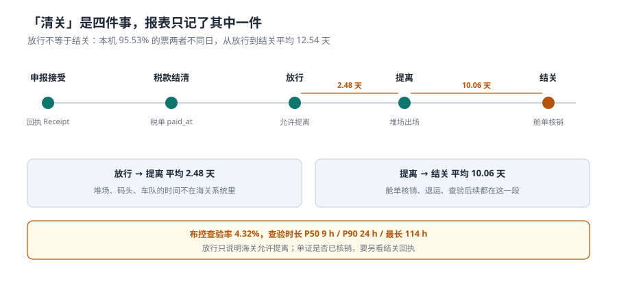

# 查验、放行与结关

「清关了吗」这个问题，在系统里至少有四个答案：申报被接受了、税款结清了、货物提走了、报关单结关了。四个答案不同日出现，报表却常常只记其中一个——于是「已清关」的统计永远比事实乐观。

本页讲布控与查验、三个「放行」时间点、以及为什么 95.53% 的票在「放行」和「结关」之间跨了至少一天。

::: tip 一句话理解
放行是海关说「可以走了」，提离是货真的走了，结关是这笔账真的结了。**三者之间隔着堆场、车队和舱单核销，任何一段卡住，货走了但账没结。**
:::

## 一、查验：4.32% 的票会被布控



| 概念 | 含义 | 决定因素 | 系统里怎么记 |
| --- | --- | --- | --- |
| 布控 | 海关风险模型把票挑出来 | 风险参数、企业信用、商品敏感度 | 布控指令号 + 指令时间 |
| 查验 | 实际开箱/机检 | 布控指令 | 查验方式、开始/结束时间、结论 |
| 查验结论 | 放行 / 待处理 / 移交 | 查验结果 | 结论代码 + 处理人 |
| 查验费用 | 掏箱、搬移、仓储 | 查验产生 | 费用单（谁承担取决于责任） |

本机读数：

| 量 | 读数 |
| --- | --- |
| 布控查验票数 | 519 / 12,000 = **4.32%** |
| 查验时长 P50 | **9 小时** |
| 查验时长 P90 | **24 小时** |
| 最长 | **114 小时（4.75 天）** |

P90 是 P50 的 2.7 倍——这意味着「平均查验时长」这个指标几乎没有意义：**用均值做承诺（比如「24 小时通关」），会对 10% 的票违约**。承诺必须写成分位数。

## 二、三个时间点：放行、提离、结关

| 时间点 | 谁记录 | 含义 | 本机与下一段的间隔 |
| --- | --- | --- | --- |
| 放行 | 海关 | 允许提离，但货还在监管场所 | → 提离 **2.48 天** |
| 提离 | 堆场 / 码头 | 货真的出场了 | → 结关 **10.06 天** |
| 结关 | 海关 | 舱单核销完成，这笔账结束 | — |

两段间隔的性质完全不同：

- **放行→提离的 2.48 天是物理时间**：排队、找车、掏箱、安排夜班。它不在海关系统里，但它在客户的账上——仓储费按天收。
- **提离→结关的 10.06 天是账务时间**：舱单核销、退运处理、查验后续、转关核销。货早就到工厂了，单子还没结。

**95.53% 的票两者不同日**。用「已放行」当「已清关」，等于把 95% 的单据提前约 12.5 天记成完成。

::: danger 三个把「清关」算错的写法
1. **只采集放行回执**。结关回执在很多系统里根本没接，于是「未结关」永远是 0——不是没有，是没采。
2. **用 `released_at` 当 `closed_at`**。这两个字段一旦合并，滞报/滞纳/仓储费的复盘全部失真，而且无法恢复（原始时间已经丢了）。
3. **把提离时间算进「海关时效」**。提离慢是物流问题，不是海关时效问题。混在一起考核，会逼着关务去催车队，而不是去优化申报质量。
:::

## 三、状态与时间的四张表

```sql
CREATE TABLE decl_receipt (          -- 回执流水，一张单多条
  receipt_id  INTEGER PRIMARY KEY,
  decl_id     TEXT NOT NULL,
  kind        TEXT NOT NULL CHECK (kind IN ('ENTRY','ACCEPT','TAX','RELEASE','CLOSE')),
  receipt_no  TEXT NOT NULL,
  received_at TEXT NOT NULL,
  UNIQUE (decl_id, kind)             -- 同一类回执只认第一条
);

CREATE TABLE inspection (
  insp_id    INTEGER PRIMARY KEY,
  decl_id    TEXT NOT NULL,
  picked     INTEGER NOT NULL CHECK (picked IN (0,1)),
  method     TEXT,                   -- 机检 / 人工 / 抽样
  started_at TEXT,
  ended_at   TEXT,
  result     TEXT CHECK (result IN ('PASS','HOLD','SEIZE'))
);

-- 「清没清」四问，各自可查
SELECT
  SUM(kind='ACCEPT')  AS accepted,
  SUM(kind='RELEASE') AS released,
  SUM(kind='CLOSE')   AS closed
FROM decl_receipt;
```

`UNIQUE (decl_id, kind)` 这一条不是可选的：回执会重复推送（网络重试、系统重发），没有唯一键就会把一张单记成三次放行，然后「平均放行时长」被算成三分之一。

## 四、时效指标：三个分母

| 指标 | 分子 | 分母 | 用途 | 陷阱 |
| --- | --- | --- | --- | --- |
| 海关时效 | 放行 − 申报 | 全部票 | 评价申报质量 | 把提离算进来就变成物流指标 |
| 口岸时效 | 提离 − 进境 | 全部票 | 评价口岸效率 | 含查验，含排队 |
| 全链时效 | 结关 − 进境 | 全部票 | 评价端到端 | 含舱单核销，通常最难优化 |

三个指标的分母相同、分子不同，所以**它们不能互相替代，也不能相加**。报表上写「平均通关 3 天」而不说分母，等于什么都没说。

```sql
-- 分位数用排序取，不用 AVG（AVG 会被长尾吃掉）
WITH d AS (
  SELECT julianday(r.received_at) - julianday(x.accepted_at) AS days
  FROM decl_receipt r JOIN decl_receipt x ON x.decl_id = r.decl_id AND x.kind='ACCEPT'
  WHERE r.kind = 'RELEASE'
), s AS (SELECT days, ROW_NUMBER() OVER (ORDER BY days) rn, COUNT(*) OVER () n FROM d)
SELECT MAX(CASE WHEN rn = CAST(n*0.5 AS INTEGER) THEN days END) AS p50,
       MAX(CASE WHEN rn = CAST(n*0.9 AS INTEGER) THEN days END) AS p90
FROM s;
```

## 五、判据：本页的八条

本页判据族 `CUL-A` ~ `CUL-H`，共 8 条。它们都在回答「这一票到底清没清完」。

| 编号 | 判据 | 不满足时改哪里 |
| --- | --- | --- |
| `CUL-A` | 四类回执各存一条，且有唯一键 | `decl_receipt` + `UNIQUE(decl_id,kind)` |
| `CUL-B` | 放行、提离、结关三个时间分列，不合并 | `released_at` / `lifted_at` / `closed_at` |
| `CUL-C` | 布控与查验分开记录（布控≠查验） | `picked` 与 `method/result` 两组字段 |
| `CUL-D` | 查验时长按回执时间算，不按人工填 | `started_at` / `ended_at` 来自回执 |
| `CUL-E` | 时效指标给出分位数，不只给均值 | 指标 SQL 输出 P50/P90 |
| `CUL-F` | 三个时效指标的分母明示 | 报表字段含 `denominator` |
| `CUL-G` | 「已清关」的判定用 `CLOSED`，不用 `RELEASED` | 统计 SQL 的 `WHERE` |
| `CUL-H` | 回执重复推送不会造成重复计数 | 唯一键 + `INSERT OR IGNORE` |

## 六、验证方式

```shell
# 1. 放行到结关的总间隔（2.48 + 10.06）
python3 -c "print(round(2.48+10.06,2))"
# 期望输出：12.54

# 2. 放行≠结关的占比
python3 -c "print(round(11463/12000*100,2))"
# 期望输出：95.53

# 3. P90/P50 的倍数是「承诺必须用分位数」的理由
python3 -c "print(round(24/9,2), round(114/9,2))"
# 期望输出：2.67 12.67

# 4. 回执重复推送：唯一键应挡住第二次
sqlite3 :memory: "CREATE TABLE r(decl TEXT, kind TEXT, UNIQUE(decl,kind));
INSERT INTO r VALUES('D1','RELEASE'); INSERT INTO r VALUES('D1','RELEASE');"
# 期望输出：UNIQUE constraint failed: r.decl, r.kind
```

## 参考资料

- 《中华人民共和国海关法》第二十八条至第三十条：查验、放行与监管场所的规定。
- 海关总署《海关查验管理办法》（海关总署令第 100 号）：查验方式、查验记录、复验与径行开验。
- 海关总署关于「提前申报」「两步申报」「汇总征税」的公告：本页「放行不等于结关」的制度背景（提离与核销分离）。
- 与本页相邻：[申报与四单一致](../Declaration/index.md)、[三税计征](../Duty/index.md)（缴款期限与放行前置条件）、[实战](../Practice/index.md)（`trg_release_needs_paid`）。
