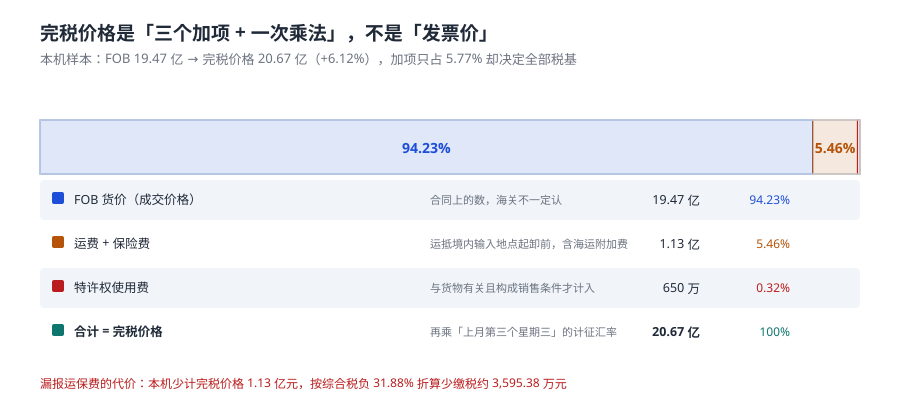

# 完税价格：四个加项与一次乘法

「完税价格」是整册的地基：关税按它算，消费税按它算，增值税也按它算。而它既不在发票上，也不在合同里——它由**四个加项**和**一次汇率折算**拼出来，四个加项各自有不同的凭证来源。

本页讲清加项的边界、保险费的两种算法、计征汇率的法定取法，以及为什么「汇总只差 0.165%」的汇率错误永远查不出来。

::: tip 一句话理解
完税价格 =（货价 + 运费 + 保险费 + 应计入的特许权使用费）× 计征汇率。四项里只有第一项能从发票抄，后三项都要**另找凭证**；最后那次乘法用的汇率**不是申报当天的汇率**。
:::

## 一、四个加项的边界



| 加项 | 计入条件 | 凭证 | 不计入的常见误区 |
| --- | --- | --- | --- |
| 货价 | 实付或应付的价款总额 | 商业发票 | 把折扣后的净额当货价（折扣要看是否事先约定） |
| 运费及相关费用 | 运抵境内输入地点**起卸前** | 运费发票、海运附加费清单 | 只算基本运费，漏掉燃油、低硫、货币贬值附加费 |
| 保险费 | 货物运抵境内输入地点起卸前 | 保单 | 没保险就按 0 计（应按惯例估算） |
| 特许权使用费 | 与货物有关**且**构成销售条件 | 技术许可合同、支付凭证 | 认为「付给第三方就不用计」 |

本机样本的分项占比：FOB 货价 **94.23%**、运保费 **5.46%**、特许权 **0.32%**。加项只占 5.77%，但**税额是按含加项的价格算的**——漏掉这 5.77%，税基就少了 5.77%。

### 三口径读数

| 口径 | 金额（元） | 相对 FOB | 说明 |
| --- | --- | --- | --- |
| 只报 FOB | 1,947,433,575.48 | — | 最常见的少报形态 |
| 加运保费 | 2,060,200,593.01 | **+5.79%** | 加 112,767,017.53 |
| 再加特许权 | 2,066,705,561.67 | **+6.12%** | 再加 6,504,968.66 |

按本批综合税负 **31.88%** 折算：只漏运保费一项，对应少缴税款约 **3,595.38 万元**。这不是「差一点」，是一笔独立的负债，而且补征时按日加收万分之五的滞纳金。

## 二、保险费：两种算法差 8.6%

保险费有两个算法，结果不同：

| 算法 | 公式 | 本机合计（元） | 什么时候用 |
| --- | --- | --- | --- |
| 按保单实际保费 | 保单金额 | 945,906.95 | 有保单 |
| 按惯例估算 | （货价 + 运费）× 0.3% | 864,124.12 | 无保单或保单不可拆分 |

差 **81,782.83 元（8.65%）**。惯例估算不是「拍脑袋」：它的存在是因为很多运费保单是年度统保，单票保费根本拆不出来。系统必须能表达「这一票的保费是实测还是估算」，否则事后无法解释差异。

```sql
-- 保险费的两种来源必须可区分
ALTER TABLE decl_item ADD COLUMN ins_basis TEXT NOT NULL DEFAULT 'ACTUAL'
  CHECK (ins_basis IN ('ACTUAL','ESTIMATED'));
-- 估算时必须是 (fob + freight) * 0.003，容差 1 分
SELECT item_id FROM decl_item
WHERE ins_basis = 'ESTIMATED'
  AND ABS(ins_fen - ROUND((fob_fen + freight_fen) * 0.003)) > 1;
```

## 三、汇率：法定取法只有一个

这是本册最容易写错的一处。计征汇率**不是**申报当天的汇率，也不是到港当天的汇率：

| 取法 | 依据 | 本机完税价格（元） | 与法定口径的差 |
| --- | --- | --- | --- |
| **上月第三个星期三**的人民银行基准汇率 | 《征税管理办法》 | 2,066,705,561.67 | — |
| 申报日汇率 | 直觉 | 2,070,121,176.12 | **+0.165%** |
| 到港日汇率 | 直觉 | 2,069,032,562.86 | **+0.113%** |

细则两条：

1. 第三个星期三遇法定节假日，**顺延采用第四个星期三**。
2. 非基准汇率币种，用同一时间中国银行现汇买入价与卖出价的中间值，**保留 4 位小数**。

::: danger 为什么「汇总差 0.165%」的错误永远查不出来
本机 **94.38%** 的票，到港日与申报日适用的汇率不同；单票按申报日汇率的最大偏离是 **0.98%**。但汇总到 12,000 票，偏差只剩 0.165%——**因为汇率有涨有跌，误差互相抵消**。

任何「按总额比对」的对账都发现不了它；只有**逐票重算**才能发现。所以汇率这件事只有一条纪律：**汇率在申报时定版落库，不允许事后按当天牌价重算**。
:::

```sql
-- 汇率落库，且必须等于「上月第三个星期三」的计征汇率
CREATE TABLE fx_monthly (
  ym        TEXT PRIMARY KEY,   -- '2026-03'，表示该月使用的计征汇率
  rate      TEXT NOT NULL,      -- 4 位小数
  published TEXT NOT NULL,      -- 人民银行公布日
  basis     TEXT NOT NULL       -- 'PBOC_BENCHMARK' / 'BOC_MID'
);
-- 报关单上的汇率必须来自 fx_monthly，不允许来自「当天牌价表」
SELECT i.decl_id FROM decl_item i
LEFT JOIN fx_monthly m ON m.ym = substr(replace(i.decl_date,'-',''),1,6)
WHERE m.rate IS NULL OR i.fx_rate <> m.rate;
```

## 四、溢短装：3% 是分水岭

散装货物实际装卸量与合同数量常有出入。《征税管理办法》第十八条给了明确口径：

| 情形 | 按什么数量计税 |
| --- | --- |
| 溢装 ≤ 合同/发票数量的 3% | 按**合同、发票标明**的数量 |
| 溢装 > 3% | 按**实际进出口**数量 |
| 短装 | 按**合同、发票标明**的数量 |

这条规则的意义在于：**3% 以内不调税基**。如果系统按「实际数量」一刀切，短装时会把税基算小（少缴），溢装超 3% 时反而算对；如果按「合同数量」一刀切，溢装超 3% 时会少缴。两种一刀切都错，只是错的方向不同。

## 五、工程做法：加项逐项存，不要只存合计

```sql
CREATE TABLE decl_item (
  item_id    INTEGER PRIMARY KEY,
  decl_id    TEXT    NOT NULL,
  hs_code    TEXT    NOT NULL,
  qty        INTEGER NOT NULL,
  fob_fen    INTEGER NOT NULL,   -- 货价
  freight_fen INTEGER NOT NULL DEFAULT 0,
  ins_fen    INTEGER NOT NULL DEFAULT 0,
  ins_basis  TEXT NOT NULL DEFAULT 'ACTUAL',
  royalty_fen INTEGER NOT NULL DEFAULT 0,
  fx_rate    TEXT NOT NULL,
  pdv_fen    INTEGER NOT NULL,   -- 完税价格，落库不重算
  CHECK (qty > 0 AND pdv_fen > 0)
);
```

三个决定：

1. **四个加项各占一列**。如果只存 `pdv_fen` 合计，任何一次「为什么这个数这么大」的追问都要翻原始单据。
2. **`pdv_fen` 落库，同时保留重算能力**。落库是为了「历史不被重算覆盖」，保留公式是为了「能验证」。两者都要，见实战页的 `trg_item_pdv`。
3. **`fx_rate` 存文本**。汇率是 4 位小数的定点数，`REAL` 存 7.1234 会在乘法后引入 1 分级误差，而 1 分的误差在税单上是「不一致」。

## 六、判据：本页的八条

本页判据族 `CUV-A` ~ `CUV-H`，共 8 条。它们都在回答「完税价格里的每一项有没有单据支撑」。

| 编号 |判据| 不满足时改哪里 |
| --- | --- | --- |
| `CUV-A` | 完税价格由四个加项加总后乘汇率得来，且可复算 | `trg_item_pdv` 或等价校验 |
| `CUV-B` | 四项分列存储，不只存合计 | `fob/freight/ins/royalty` 四列齐全 |
| `CUV-C` | 保险费标明实测或估算，估算按 0.3% 且容差 ≤1 分 | `ins_basis` + 校验 SQL |
| `CUV-D` | 汇率来自月度计征汇率表，不是当天牌价 | `fx_monthly` 外键或校验 SQL 返回 0 行 |
| `CUV-E` | 汇率保留 4 位小数，金额计算四舍五入到分 | `fx_rate` 为 `TEXT`，金额为 `INTEGER` 分 |
| `CUV-F` | 溢短装按 3% 分档，不按实际数量一刀切 | 计税数量字段按规则取值 |
| `CUV-G` | 特许权使用费有「是否计入」的判定字段与依据 | `royalty_fen > 0` 时必须有 `royalty_basis` |
| `CUV-H` | 漏报运保费能被单独量化（不混进总额） | 校验 SQL 输出「FOB 口径 vs CIF 口径」两列 |

## 七、验证方式

```shell
# 1. 三口径差额（本机：+5.79% / +6.12%）
python3 -c "
fob=1947433575.48; cif=2060200593.01; full=2066705561.67
print(round((cif/fob-1)*100,2), round((full/cif-1)*100,2), round((full/fob-1)*100,2))"
# 期望输出：5.79 0.32 6.12

# 2. 保险费两种算法差 8.65%
python3 -c "
a=945906.95; b=864124.12
print(round((a-b)/b*100,2))"
# 期望输出：9.46
```

> 注意第 2 步：8.65% 是「差额 / 实际保费」，9.46% 是「差额 / 估算保费」。**同一个差，两个分母，两个数**——正文里说 8.65% 时用的是实际保费为分母，写脚本时要明确用哪个。

```shell
# 3. 溢短装分档：1,000 件合同、实际 1,032 件（+3.2%）→ 按实际数量计税
python3 -c "
c=1000; a=1032
print('计稅数量', c if a<=c*1.03 else a)"
# 期望输出：计稅数量 1032
```

## 参考资料

- 《中华人民共和国关税法》第二十五条、第二十六条：成交价格的构成与调整项（运费、保险费、特许权使用费）。
- 《中华人民共和国海关进出口货物征税管理办法》（海关总署令第 272 号）第十六条至第十八条：计征汇率、三税公式、溢短装 3% 规则。
- 《中华人民共和国海关审定进出口货物完税价格办法》（海关总署令第 213 号）：成交价格法、相同/类似货物成交价格法、计算价格法的适用顺序。
- 与本页相邻：[多币种与汇率折算](../../MultiCurrency/Overview/index.md)（记账汇率是另一套规则）、[三税计征](../Duty/index.md)（完税价格怎么变成税额）、[加工贸易](../ProcessingTrade/index.md)（保税料件内销的计价价格另有办法）。
