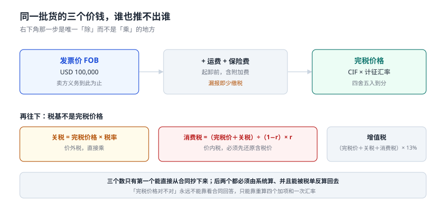

# 报关与进出口合规工程

一批货从船上下来到能拉走，中间要过七道门：资质、归类、申报、查验、征税、放行、核销。每一道门都有自己的完成定义，而且**其中四道门失败时不会报错**——系统照常返回成功，单据照常打印，账照常能平。

::: tip 一句话理解
报关不是「填一张单子交给海关」，而是**把一次跨境买卖翻译成一套能被税则、税单、账本三处独立复核的数额**。同一批货在这三处各有一个「值多少钱」，谁也算不出另外两个。
:::

## 一、为什么这一册要单独存在

库内与「钱怎么记、怎么对」相邻的册子已经有六本，各自停在不同的地方：

| 问题 | 该读哪一册 | 那册判什么 | 本册不重复什么 |
| --- | --- | --- | --- |
| 货款怎么记账、借贷怎么平 | [会计恒等式与复式记账](../../Ledger/DoubleEntry/index.md) | 分录两腿是否相等 | 不判分录，只判税基 |
| 银行流水与账面怎么对 | [对账与差异归因](../../Ledger/Reconciliation/index.md) | 未达账项怎么归口 | 不判对账方法，只判报关单⇄税单⇄付款三向 |
| 采购三单怎么凑齐 | [采购到付款](../../ProcureToPay/Overview/index.md) | 订单、收货、发票三单匹配 | 不判三单，只判「四单一致」里的报关单侧 |
| 供应商价格协议怎么管 | [供应商协同](../../SupplierCollaboration/Overview/index.md) | 两份账跨组织对齐 | 不判协议，只判特许权使用费要不要计入完税价格 |
| 多币种按哪个时点折 | [多币种与汇率折算](../../MultiCurrency/Overview/index.md) | 记账汇率、期末重估 | 不判记账汇率，只判**海关计征汇率**（另一套规则） |
| 发票怎么开、怎么红冲 | [税务发票](../../TaxInvoice/index.md) | 数电票开具与作废 | 不判发票，只判发票金额与报关单金额是否一致 |
| 保税料件的账实 | [仓储作业](../../WarehouseOps/Overview/index.md) | 库位、波次、盘点 | 不判库存，只判手册的「进口−耗用−结余」 |
| 运输与运费结算 | [车队运输与调度](../../FleetTransport/index.md) | 计费重、里程、回单 | 不判运费算得对不对，只判运费**有没有计进完税价格** |

一句话划界：**本册回答「这批货该缴多少税、凭什么」，不回答「这笔钱记在哪个科目」。**

## 二、七段链：四段失败是安静的

| 段 | 产物 | 谁在写 | 失败形态 | 会不会报错 |
| --- | --- | --- | --- | --- |
| ① 立 | 报关单位备案、电子口岸卡、税号资质 | 企业 + 海关 | 资质过期，申报被退 | 会 |
| ② 归 | 十位税则号列 + 归类依据 | 报关行 / 企业 | 同一商品三个税号 | **不会** |
| ③ 报 | 报关单 + 发票 + 装箱单 + 提单 | 报关行 | 四单某一栏对不上 | **不会** |
| ④ 查 | 布控指令、查验记录 | 海关 | 查验结论没回写 | **不会** |
| ⑤ 征 | 关税、消费税、增值税、滞纳金 | 海关 | 消费税按价外税算 | 会（金额对不上才报） |
| ⑥ 放 | 放行回执、提离时间 | 海关 / 堆场 | 放行当结关 | **不会** |
| ⑦ 核 | 手册核销、退税申报 | 企业 | 单耗高报，料件溢余 | **不会** |

安静的那四段有三个共同特征：**数据库每一行都能过外键与 `CHECK`、报表每一列都能加起来、单据每一张都打得出**。错的是「这一行属于哪一票、这一票算不算清关」，而不是「这一行合不合法」。

## 三、三个「值多少钱」与四个「清没清」

| 数 | 定义 | 由谁定 | 能不能从合同推出来 |
| --- | --- | --- | --- |
| 成交价格 | 卖方向境内销售时实付或应付的价款总额 | 买卖双方 | 能，合同上就是 |
| 完税价格 | 成交价格 + 运抵境内输入地点起卸前的运输及保险费 + 应计入的特许权使用费，再乘计征汇率 | 海关审定 | **不能**，要重算四个加项和一次汇率 |
| 组成计税价格 | （完税价格 + 关税）÷（1 − 消费税比例税率） | 公式决定 | **不能**，价内税必须先还原 |

「清没清」有四个状态，报表通常只记其中一个：

1. **申报已接受**——电子数据进了海关系统，有回执号。
2. **税款已结清**——税单上有 `paid_at`，不是「已经付了」这句话。
3. **货物已提离**——堆场出场时间，通常比放行晚 2~3 天。
4. **报关单已结关**——舱单核销完成，可能比提离晚十天以上。

本机 12,000 票里，「放行」与「结关」不同日的占 **95.53%**，平均相差 **10.06 天**。用「已放行」当「已清关」，等于把 95% 的单据提前十天记成了完成。

## 四、十页的分布

| 页 | 讲什么 | 判据族 | 条数 |
| --- | --- | --- | --- |
| [总览：六个口径与一套单据](./Overview/index.md) | 报关单长什么样、六个数各自归谁 | `CUO-A` ~ `CUO-H` | 8 |
| [商品归类：一个商品为什么会有三个税号](./Classification/index.md) | 税则、归类总规则、分歧度量 | `CUC-A` ~ `CUC-H` | 8 |
| [完税价格：四个加项与一次乘法](./Valuation/index.md) | 运保费、特许权、汇率适用日 | `CUV-A` ~ `CUV-H` | 8 |
| [申报与四单一致](./Declaration/index.md) | 报关单要素、随附单证、回执状态 | `CUD-A` ~ `CUD-H` | 8 |
| [三税计征：关税、消费税、增值税](./Duty/index.md) | 组成计税价格、滞报金、滞纳金 | `CUT-A` ~ `CUT-H` | 8 |
| [原产地规则：RVC、CTC 与累积](./Origin/index.md) | 判定树、临界带、协定税率 | `CUR-A` ~ `CUR-H` | 8 |
| [加工贸易：手册、单耗与核销](./ProcessingTrade/index.md) | 平衡式、内销补税、缓税利息 | `CUP-A` ~ `CUP-H` | 8 |
| [查验、放行与结关](./Release/index.md) | 布控、查验时长、三个「清没清」 | `CUL-A` ~ `CUL-H` | 8 |
| [实战：十张表、五个触发器、十六条断言](./Practice/index.md) | 建库、约束、正负用例 | `CUX-A` ~ `CUX-H` | 8 |
| [常见问题：差额先查哪一句](./FAQ/index.md) | 五种差额形状与排查顺序 | `CUQ-A` ~ `CUQ-H` | 8 |

## 五、版本组织：本专题不建版本目录

三条理由，都是「什么时候才该建版本目录」的反面：

1. **换代的是法规条文与申报通道，判据结构没动。** 1998 年的纸质报关单和今天的「单一窗口」报文，`完税价格 =（货价 + 运费 + 保险费 + 应税特许权）× 汇率` 一个字都没改；改的是报文格式、回执代码和申报界面。这条理由与 [Spring5 / Spring6](../../Java/Frame/Spring/Spring6/index.md) 那种「同一份代码两套写法」不是一回事。
2. **并存差异是辖区与贸易方式，不是代际。** 一般贸易、加工贸易、跨境电商、市场采购四套口径同时有效，它们不是一个替代另一个，而是同时在跑。按「版本」组织会把并存的四套写成前后两代，反而误导。
3. **法规修订用「生效期」表达，比用目录表达更准。** 税则每年调一次税率，`tariff` 表用 `effective_from / effective_to` 的半开区间记版本，比 `Tariff2024/`、`Tariff2025/` 这种目录更贴近事实——同一票货适用哪一版税率，只取决于申报日落在哪个区间。

::: info 需要按大版本建目录的先例长什么样
库内的 [Spring5](../../Java/Frame/Spring/Spring5/index.md) 与 [Spring6](../../Java/Frame/Spring/Spring6/index.md)、[Vue2](../../Frontend/Frame/Vue/Vue2/index.md) 与 [Vue3](../../Frontend/Frame/Vue/Vue3/index.md) 是必须分目录的：同一份业务代码在两代框架里写法不同，读者需要「对着自己手上那套」查。本册没有这种分裂——没有哪一页是「2024 年写法和 2025 年写法」。
:::

## 六、本机读数（固定种子 `20261105`，脚本不入库）

Python 3.13.12 + SQLite 3.50.4，12,000 票进口报关单 / 1,000 个 SKU / 10 家报关行 / 365 天：

| 量 | 读数 |
| --- | --- |
| 完税价格合计 | 2,066,705,561.67 元 |
| 税款合计 | 658,933,553.07 元（关税 196,996,657.45 / 增值税 313,569,102.18 / 消费税 148,367,793.44） |
| 综合税负 | 31.88% |
| 申报税号与归入税号不一致 | 1,783 票 = **14.86%** |
| 同一 SKU 出现 ≥2 个税号 | 409 / 1,000 = **40.90%** |
| 漏报运保费少计的完税价格 | 112,767,017.53 元（+5.79%） |
| 消费税按「直接乘」少算 | 42,729,882.82 元（**17.01%**） |
| 滞报 | 2,657 票 22.14%，滞报金 1,403,504 元 |
| 原产地 RVC40 通过率 | 不累积 63.27% → 累积后 **90.80%** |
| 放行与结关不同日 | **95.53%**，平均差 10.06 天 |
| 三向对账差异 | 314 条 2.62%，净额 1,107,243.82 vs 双向 2,563,096.04 |

## 七、本册的三条口径纪律

1. **金额一律存整数分，税率一律存万分之一（基点）。** `REAL` 存钱在第 12,000 票上会差出几毛钱，而「差几毛」在对账里和「差几万」同权——都会被当成一条待处理差异。
2. **任何「算出来的钱」都要能被反算。** 税单上的三个数必须能从完税价格、税率、公式重新推出来；推不出来的差额，一律按「有 bug」处理，不按「四舍五入」处理。
3. **净额不是结论。** 本册每一处差异都给双向绝对值：归类差净额只暴露 29.36%，对账差净额只暴露 43.20%。只看净额，等于把互相抵消的两笔错误当成没有错误。

::: danger 五个最常见的错误建模
1. **把「报关单」当成一张表。** 一票多品名是常态，商品项必须在子表里；否则「完税价格」只能记一个总额，分摊到每个税号时就必然靠猜。
2. **用发票金额当完税价格。** 发票是 FOB 或 CIF 由合同决定，海关要的是「运抵境内输入地点起卸前」的那个价，两者的差额在样本里是 6.12%。
3. **把消费税当价外税。** `(完税价格 + 关税) × 税率` 少算 17.01%，而且增值税跟着一起少。
4. **汇率取申报当天。** 法定口径是「上一个月第三个星期三」的人民银行基准汇率，两者在本机样本上差 0.165%——单票最大 0.98%，但汇总起来几乎互相抵消，所以**永远查不出来**。
5. **用「已放行」当「已结关」。** 95.53% 的票会因此提前十天记成完成。
:::

## 参考资料

- 《中华人民共和国关税法》（2024-04-26 通过，**2024-12-01 施行**）：完税价格、税率适用、退补税与法律责任的顶层依据。
- 《中华人民共和国海关进出口货物征税管理办法》（海关总署令第 **272** 号，2024-10-28 公布）：三税计算公式、计征汇率、缴款期限与滞纳金，本册第 4、5 页的公式全部出自此办法第十七条至第二十条。
- 《中华人民共和国海关征收进口货物滞报金办法》（海关总署令第 128 号，经第 218、240、**273** 号令三次修正）：0.5‰/日、第 15 日起征、50 元起征点。
- 《中华人民共和国海关确定内销保税货物计税价格办法》（**2024-12-01 施行**）：加工贸易内销按料件原进口成交价格、边角料按内销价格。
- 世界海关组织《商品名称及编码协调制度》（HS）及其《归类总规则》：六条总规则是归类争议的唯一共同语言。
- RCEP 协定第三章（原产地规则）及海关总署《〈区域全面经济伙伴关系协定〉项下进出口货物原产地管理办法》：RVC40、CTC、CR、ACU、DMI 的定义。
- 与本册相邻：[对账与差异归因](../../Ledger/Reconciliation/index.md)、[多币种与汇率折算](../../MultiCurrency/Overview/index.md)、[采购到付款](../../ProcureToPay/Overview/index.md)。
