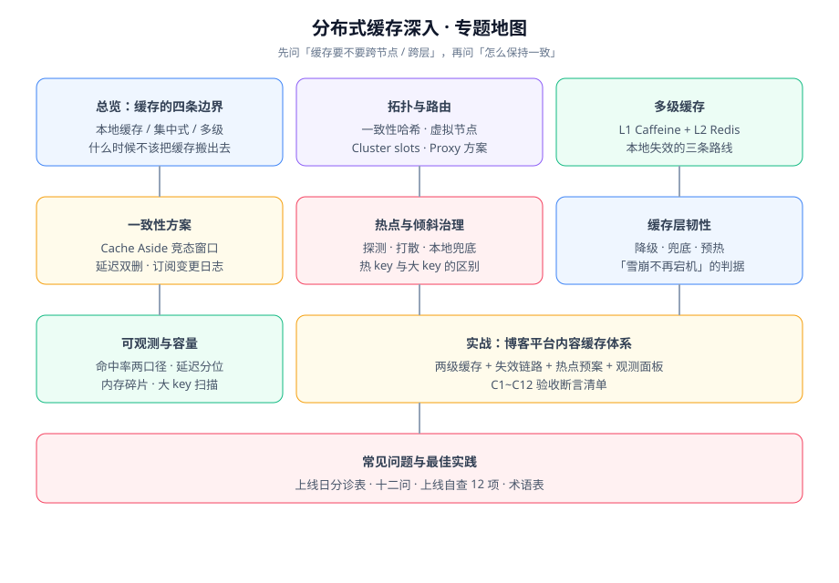

# 分布式缓存深入

分布式缓存解决的是「缓存不再只有一个进程、一份数据」之后出现的全部新问题：**多个实例各自的本地缓存怎么失效、缓存节点之间怎么路由、缓存与数据库之间怎么收敛、缓存整体挂掉时业务还能不能活**。本专题讲的是这四类问题的判据与做法，不讲 Redis 的命令（那是 [Redis 专题](../../DB/NoRelational/Redis/index.md) 的职责）。

::: tip 一句话理解
单机缓存的问题是「怎么少查一次库」，分布式缓存的问题是「**同一份数据存在好几处，你怎么知道每一处都是对的**」。前者的答案是一行代码，后者的答案是一套失效链路加一组观测指标。
:::

## 与相邻专题的分工

| 专题 | 讲什么 | 与本专题的关系 |
| --- | --- | --- |
| 本专题 | **跨节点、跨层**的缓存体系：拓扑与路由、多级失效、一致性方案、热点与韧性、观测 | —— |
| [Redis 基础](../../DB/NoRelational/Redis/index.md) | Redis 这个产品的数据结构、持久化、事务、发布订阅 | 本专题把它当成一个**共享存储**使用，不讲命令细节 |
| [Redis 进阶：缓存设计](../../DB/NoRelational/Redis/Advanced/CacheDesign/index.md) | 单应用视角的读写模式、key 设计、TTL、容量 | 本专题从「多实例、多层」的视角继续，不重复单机设计 |
| [Redis 进阶：缓存防护](../../DB/NoRelational/Redis/Advanced/CacheProtection/index.md) | 穿透、击穿、雪崩的**成因与单点防护手段** | 本专题讲这些故障在**分布式场景下的兜底与降级**，不重复成因 |
| [Redis 进阶：Cluster 分片集群](../../DB/NoRelational/Redis/Advanced/Cluster/index.md) | 槽位、重定向、迁移的**服务端实现** | 本专题讲「为什么要分片、路由表放在哪」这类选型与边界 |
| [高性能 Java](../HighPerformanceJava/index.md) | JVM 内存、GC、对象分配 | 本地缓存的内存占用与 GC 压力由该专题解释，本专题只讲缓存语义 |
| [Spring Boot 整合 Redis](../Java/Frame/SpringBoot/v3/Integration/Redis/index.md) | 客户端配置、序列化、连接池 | 本专题的代码示例建立在其配置之上，不重复依赖与配置细节 |
| [微服务 · 熔断限流](../Microservices/CircuitBreaker/index.md) | 超时、熔断、限流、降级的手段 | 本专题讲这些手段**用在缓存层**时的具体判据 |
| [项目实战 · 博客平台监控接入](/project/Complete/BlogPlatform/Monitoring/index.md) | 指标定义、标签纪律、面板 | 本专题实战章节的观测面板沿用其指标口径 |

## 专题地图

| 页面 | 内容 | 适合谁读 |
| --- | --- | --- |
| [总览：缓存的四条边界](./Overview/index.md) | 什么时候该把缓存搬出进程、什么时候不该；三类形态的取舍 | 所有人，先读 |
| [拓扑与路由](./Topology/index.md) | 一致性哈希与虚拟节点、三种拓扑对比、扩缩容与重平衡 | 做容量规划与选型的人 |
| [多级缓存深入](./MultiLevel/index.md) | L1/L2/L3 的职责划分、本地缓存失效的三条路线 | 写后端的人，**重点读** |
| [一致性方案深入](./Consistency/index.md) | Cache Aside 竞态、延迟双删、订阅变更日志、版本号与 CAS | 写后端的人，**重点读** |
| [热点与倾斜治理](./HotKey/index.md) | 热 key 探测、打散、本地兜底、大 key 拆分 | 做大促与高并发的人 |
| [缓存层韧性](./Availability/index.md) | 限流、熔断、多级兜底、冷启动预热与可验证判据 | 做稳定性的人 |
| [可观测与容量治理](./Observability/index.md) | 三层指标、成对判读的四组组合、由基线推导阈值 | 做运维与 SRE 的人 |
| [实战：博客平台内容缓存体系](./Practice/index.md) | 两级缓存 + 失效链路 + 热点预案，含 C1~C12 断言 | 想看完整过程的人 |
| [常见问题与最佳实践](./FAQ/index.md) | 分诊表、十二问、上线自查 12 项、术语表 | 所有人 |

## 版本状态速览

按 **2026-10** 口径联网核对，本专题涉及的工具与版本如下（**选型前请复核，客户端迭代很快**）：

| 组件 | 当前版本 | 关键约束 |
| --- | --- | --- |
| Redis | **8.10**（Q3 2026 GA）；8.8 / 8.6 / 8.4 / 8.0 为 Standard；8.2 为 Extended（**EOL 2030-09-01**） | 8.6 起新增热 key 相关能力；8.10 新增 `BACKUP` / `HIMPORT` / `LMOVEM` 等命令 |
| Caffeine（本地缓存） | **3.3.0**（2026-09-21） | 3.x 要求 **Java 11+**；Java 8 只能用 2.x 线 |
| Guava Cache | **33.7.2-jre**（2026-09-29） | 仍是 `jre`/`android` 双风味；新项目建议直接用 Caffeine |
| Lettuce | **7.8.0.RELEASE**（2026-09-24） | 要求 Java 8+，可与 Java 24 协作；已测试 Redis 8.10~7.2；**旧版客户端缓存（client-side caching）标记为废弃** |
| Jedis | **8.0.1**（2026-08-28） | **8.0.0 起删除 `JedisPooled` / `JedisSentineled`**，默认协商 RESP3 并强制 TLS 主机名校验；新类族是 `RedisClient` / `RedisClusterClient` / `RedisSentinelClient` |
| Redisson | **4.7.0**（2026-08-04） | Spring Boot 4.1 + Spring Data Redis 4.1 对应 `redisson-spring-data-41` |
| Spring Boot / Framework | **4.1.1** / **7.0.9** | Java 17 起；Boot 3.5 的 OSS 支持已于 **2026-06-30 结束** |

::: info 版本核对说明
以上版本按 Maven 中央仓库、官方发布公告与 GitHub Releases 核对（2026-10 口径）。**大版本差异写在各页的版本说明块里，不覆盖旧版本内容**：例如 Jedis 6.x/7.x 的 `JedisPool` 写法在各页以「旧版兼容提示」形式保留，便于存量项目对照。Redis 目前按单主题维护，尚未出现需要拆分的大型目录边界；若将来出现破坏性主版本，再按「官方名 + 大版本号」建目录并存。
:::

## 学习路径

1. **先读 [总览](./Overview/index.md)**：先判断你的项目**到底需不需要**把缓存搬出进程。多数项目不需要，这比学会多级缓存更重要。
2. **要做容量规划或选型的读 [拓扑与路由](./Topology/index.md)**：路由表放在哪，决定了你以后扩容的代价。
3. **已经有多实例的读 [多级缓存深入](./MultiLevel/index.md)**：本地那一层是全部难点的来源。
4. **动手写代码前必读 [一致性方案深入](./Consistency/index.md)**：脏读窗口不长，但一旦被写进缓存就长期存在。
5. **流量大的补充 [热点与倾斜治理](./HotKey/index.md)**，做稳定性的读 [缓存层韧性](./Availability/index.md)。
6. **上线前对照 [可观测与容量治理](./Observability/index.md)** 把指标补上，再走一遍 [实战](./Practice/index.md) 的 C1~C12 断言。

## 与在线协作任务看板的分工

本页讲**缓存与广播的通用机制**：多级缓存、发布订阅、以及「缓存与数据库谁先写」的取舍。

[在线协作任务看板 · 实时网关](../../../project/Complete/TeamBoard/RealtimeGateway/index.md) 用的是**同一套 Redis 发布订阅，但用途完全不同**：它**不做缓存**，只做**跨实例的消息扇出**——多实例部署时，一条改动必须能到达「持有这条 WebSocket 连接的那个实例」，而那个实例是谁只有 Redis 知道。于是两支的分工是：

| 维度 | 本页（缓存视角） | 任务看板（扇出视角） |
| --- | --- | --- |
| 关心的失败 | 击穿 / 穿透 / 雪崩、脏读、一致性窗口 | **丢消息**与**消息早于提交**（后者会产生「别人的界面比广播更旧、刷新又好了」这种最难查的缺陷） |
| 数据能重建吗 | 能——缓存丢了回源即可 | **不能**——推出去的这一帧没有任何持久化，丢了就是这一端的缺口，只能靠 `seq` 检测 + 追平补上 |
| 与事务的关系 | 常见做法是「先写库再删缓存」 | 写死**提交之后再广播**；发布订阅在事务里发等于把未提交状态暴露出去 |

::: tip 一句话分辨该找哪一页
问「**这份数据丢了能不能回源**」：能 → 是缓存问题，看本页；不能 → 是消息问题，看 [实时网关](../../../project/Complete/TeamBoard/RealtimeGateway/index.md) 的 `seq` 与追平一节。
:::

## 与「实时协作与冲突解决」专题的分工（第 151 天补充）

本页管的是「缓存与数据库谁先写、失效怎么广播」，[实时协作与冲突解决](../../Backend/RealtimeCollaboration/index.md) 管的是「多实例之间怎么把同一份增量送到每个客户端」。两者都用 Redis 发布订阅，但承载的东西不同：

| 维度 | 本页 | 实时协作专题 |
| --- | --- | --- |
| 广播内容 | 「这个 key 失效了」 | 「这个文档的第 N 条更新」 |
| 丢失后果 | 读到旧值，直到下一次过期 | 客户端内容落后，直到主动重拉 |
| 是否持久 | 不持久（丢了靠过期兜底） | 更新必须先落库，广播只是通知 |
| 判据 | 缓存与库的差异有上界 | `seq` 连续、断线可追平 |

一句话结论：**缓存失效广播可以丢（有 TTL 兜底），协作更新广播不能丢（丢了就是内容缺失）**。所以后者的正确形态是「落库 + 广播通知去拉」，而不是「把内容塞进 pub/sub 就算完」。

::: warning 容易混用的一处
本页的「先删缓存再更新库 / 先更新库再删缓存」讨论的是**读写竞态**；协作链路里对应的问题叫「先广播还是先落库」，答案没有二选一：**必须落库成功后再广播**。
:::

## 与「租户边界」章节集的分工（第 155 天补充）

| 维度 | 本页 | 「租户边界」章节集（第 155 天） |
| --- | --- | --- |
| 回答的问题 | 缓存与数据库的一致性、失效策略、集群与热点 | 多租户下 key 的租户段、失效广播的租户携带、锁 key 的租户段 |
| 一致性 | 缓存与库谁先写、延迟双删 | 删除后由下次读回填，天然收敛到库；不用「发新值」的方式失效 |
| 锁 | 分布式锁的实现与租约 | 锁 key 必须带租户——不带时不是数据错，而是**跨租户互相阻塞**，表现为偶发超时 |
| 热点 | 热 key 拆分与本地缓存 | 本地缓存 key 必须是含租户的复合键，且 TTL 不超过 60 秒 |

一句话结论：**本页讲「缓存怎么和库保持一致」，章节集讲「缓存怎么不把两个租户的数据混成一份」**。

::: danger 这一页特有的坑
锁 key 少一段租户，后果不是「读到了别人的数据」，而是「A 的操作让 B 排队」——监控上只看到偶发超时，几乎不可能从指标反推到 key 命名。
:::

::: tip 与「分布式锁与选主」专题的分工（第 159 天补充）
本页的「缓存重建锁」是分布式锁的一个**特例**：抢不到锁的请求允许「直接回源算一次」，因为最坏结果只是多算一遍、多打一次库。通用锁（新增的 [分布式锁与选主](/docs/Backend/DistributedLock/Overview/index.md)）讨论的是「抢不到必须等」的那一类——因为那里的临界区有不可重复的外部副作用。

| 场景 | 抢不到锁的行为 | 看哪里 |
| --- | --- | --- |
| 缓存重建、热点 key 回源 | 直接回源（降级），不等待 | 本页 |
| 库存扣减、发券、定时任务 | 必须等待或快速失败，不允许并发 | [分布式锁与选主](/docs/Backend/DistributedLock/Overview/index.md) |
| 缓存删除失败后的补偿 | 重试 + 过期兜底 | 本页 |

一条常被忽略的联系：本页多级缓存里的「本地锁 + Redis 锁」双层写法，在 [租约与续期](/docs/Backend/DistributedLock/Lease/index.md) 的视角下仍然要回答「停顿超过 TTL 会怎样」——缓存场景能容忍（多算一次），业务写场景不能（会写错），这是两类锁唯一真正的分界线。
:::

## 与「状态管理与数据流」专题的分工

本页是**服务端缓存**：穿透、击穿、雪崩、多级一致、Redis 集群。浏览器内的同构问题（缓存多久算新鲜、写后谁失效、跨标签页怎么广播）归 [状态管理与数据流](/docs/Frontend/StateDataFlow/index.md) 的 [缓存失效](/docs/Frontend/StateDataFlow/CacheInvalidation/index.md)。

| 概念 | 服务端（本页） | 浏览器（专题） |
| --- | --- | --- |
| 穿透 | 空值缓存 / 布隆过滤器 | 一次性数据不该缓存（验证码、下载链接） |
| 击穿 | 互斥重建 | 同 key 并发重取合并 |
| 雪崩 | TTL 抖动 + 降级 | 大前缀失效导致的请求风暴 |

::: warning 「空值缓存」在两侧的语义不同
服务端缓存空值是为了挡穿透，通常 30~60 秒；浏览器端把「空结果」缓存下来，用户看到的是**一段时间的假空列表**（比如刚建完数据，列表还是空的）。前者是保护，后者是缺陷。前端要区分「确实是空」与「还没取到」，否则会把 `[]` 当成有效结果缓存。
:::
## 参考资料

- Redis 官方文档（含 Cluster 规范与客户端缓存）：https://redis.io/docs/latest/
- Caffeine 官方 Wiki（淘汰算法与 `refreshAfterWrite` 语义）：https://github.com/ben-manes/caffeine/wiki
- Lettuce 参考文档：https://lettuce.io/core/release/reference/
- Jedis 迁移说明（7.x → 8.x 的类族变更）：https://github.com/redis/jedis/releases
- Microsoft Azure Architecture Center · Cache-Aside 模式：https://learn.microsoft.com/azure/architecture/patterns/cache-aside
- Amazon Builders' Library · 缓存失效与一致性：https://aws.amazon.com/builders-library/caching-challenges-and-strategies/

## 与高并发系统设计的分工（第 141 天补充）

本专题把缓存当作**读放大**的解法：同一份数据被读了 N 次，用缓存把它变成 1 次；以及多级缓存之间的新鲜度问题。

[高并发系统设计 · 过载行为与有损服务](../HighConcurrency/OverloadBehavior/index.md) 关心的是缓存在**过载时的角色**——它是第二道防线，但**它会先于数据库一起被打穿**：缓存命中率一掉，全部请求同时回源，而这恰好发生在系统最脆弱的时候（这就是缓存雪崩为什么是过载事故的放大器，而不是一个独立的缓存问题）。

| 问题 | 本专题（缓存） | 高并发系统设计（过载） |
| --- | --- | --- |
| 解决什么 | 同样的读重复了 N 次 | 不同的写来了 10 万次 |
| 过载时的表现 | 穿透 / 雪崩 / 热 key 打散单个分片 | 回源流量无上限 → 打穿数据库 → 上游线程池堆满 |
| 处置位置 | 键过期策略、逻辑过期、多级缓存、互斥重建 | 回源限流、热点识别与拆分、**回源请求也要有配额** |

::: danger 一条最贵的误判
「有缓存」不是「有容量」。缓存的容量写在**命中率**上，而命中率是**输入**而不是**保证**：只要访问模式一变（新数据冷启动、热 key、宕机后的空缓存），命中率会在几秒内掉到 0，此时系统真正的容量是**数据库的容量**。所以那边写死了一条：**回源路径必须有自己的限流，且它的配额要按数据库的水位线反推**，不能按缓存命中时的 QPS 给。
:::
