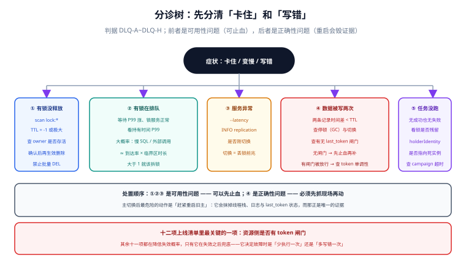

# 常见问题与分诊

这一页不按章节组织，按**症状**组织：出事的时候你手里只有一个现象，需要的是「先看哪里、再看哪里」，而不是从头读一遍原理。后面依次是十二个高频问题、十二项上线清单、十二条最佳实践与术语表。

## 判据族声明

本页判据族 `DLQ-A` ~ `DLQ-H`，共 8 条。定义表在第八节。

## 本页不讲什么

- 不讲原理推导，归 [总览](../Overview/index.md) 与 [租约与续期](../Lease/index.md)。
- 不讲某一种实现的具体写法，归 [三种实现](../Implementations/index.md)。
- 不讲排查命令的逐条解释，归 [运行面](../Operations/index.md)。



## 一、分诊树：先看这五处

```text
症状：某个功能卡住了 / 变慢了
├─ ① 有锁没释放？
│   └─ redis-cli --scan --pattern 'lock:*' → TTL 为 -1 或剩余时间极大
│       └─ 查持有者是否还活着；确认无在途写后再删
├─ ② 有锁在排队？
│   └─ 等待 P99 上涨而锁服务延迟正常
│       └─ 临界区变慢了（慢 SQL / 外部调用）；看持有时间 P99
├─ ③ 锁服务本身有问题？
│   └─ redis-cli --latency / INFO replication 异常
│       └─ 看是否刚发生主从切换（丢锁 → 双写的前兆）
├─ ④ 数据被写了两次？
│   └─ 两条记录时间差 < TTL
│       └─ 几乎一定是停顿或切换导致的双持有；查资源侧有无 token 闸门
└─ ⑤ 定时任务没跑？
    └─ 无成功也无失败日志
        └─ 查选主的 holderIdentity 是否指向已死实例；查 leaseTransitions
```

分诊的第一原则：**先分清「卡住」和「写错」**。前者是可用性问题，后者是正确性问题。两者的处置完全不同——前者可以重启止血，后者重启只会掩盖证据。

## 二、问题一~四：加锁与释放

**Q1：`SETNX` 之后进程崩了，锁永远不释放，怎么办？**
这是「两步写法」的必然后果：`SETNX` 不带过期，`EXPIRE` 还没执行就崩了，键的 `TTL` 是 **-1**（本机实测）。修法只有一条：改用 `SET key value NX PX 30000` 一条命令完成。已经泄漏的锁需要人工确认后删除——`DEL` 之前必须先 `GET` 看持有者，否则可能删掉正在使用的锁。

**Q2：为什么释放锁要用 Lua，直接 `DEL` 不行吗？**
因为 `DEL` 不认持有者。实测：A 持有锁，B 直接 `DEL` 返回 **1**——锁被 B 删掉了，而 A 还在临界区里。Lua 版本传入错误 owner 返回 **0**，正确 owner 返回 **1**。差别不是「优雅」，是「互斥是否成立」。

**Q3：`GET` 之后再 `DEL`（先查后删）行不行？**
不行。`GET` 与 `DEL` 之间有一个窗口，锁可能在这期间过期并被他人获得，于是你的 `DEL` 删掉的是**新持有者**的锁。这条和「先查后写」是同一类错误：判定与动作不在一个原子操作里。

**Q4：锁的 value 用固定字符串（如 `"locked"`）有什么问题？**
它没法证明「我是持有者」。多实例部署时，两个客户端可能用同一个 value；一旦发生「锁过期—重新获取」，旧持有者的释放脚本会通过校验，删掉新持有者的锁。value 必须是 **实例 ID + 随机串**，并在日志里能对应到具体进程。

## 三、问题五~八：过期与续期

**Q5：TTL 设多少合适？**
用不等式：`T > P + R + S`（`P` 最长停顿、`R` 续期往返上界、`S` 安全余量）。Kubernetes 的取值是 `15 > 10 + 0 + 5`。设 TTL 靠「感觉 30 秒」是最常见的做法，也是最常见的失效来源——因为 `P` 从来没被测过。

**Q6：开了看门狗是不是就不用管 TTL 了？**
不是。看门狗只在「客户端还活着」时续期。客户端被 `SIGSTOP`、被杀、网络断开时，看门狗同样停摆，锁照样过期。Redisson 的窗口是 30 秒（`lockWatchdogTimeout=30000`）——这意味着「停顿 30 秒内锁不会丢」，不是「锁不会丢」。

**Q7：续期返回「锁不是我的」，能重试吗？**
不能。重试会用一个已经失效的身份反复请求，正确做法是**当轮停手**：停止外部写、清理、上报。重试的价值在「抢锁」阶段（带超时与抖动），不在「续期失败」阶段。

**Q8：客户端时钟和服务器不一致会影响锁吗？**
会，前提是你在**客户端**算剩余时间。TTL 由锁服务的时钟判定；本地时间减开始时间得到的「剩余」在时钟偏移时会系统性偏早或偏晚。正确做法是问锁服务（Redis `PTTL`、etcd 租约 `TTL()`），不要自己算。

## 四、问题九~十二：双写、选主与选型

**Q9：锁明明加了，为什么还是双写？**
四种可能，按出现频率排序：① 停顿超过 TTL（不需要任何故障）；② 主从切换把锁弄丢（异步复制）；③ 释放时删了别人的锁（没有校验持有者）；④ 代码里在锁外还有一条写路径。前两种**都无法靠「更正确的加锁代码」解决**，只能靠资源侧拒绝旧 token。

**Q10：Redis 锁和 etcd/ZK 锁怎么选？**
看「锁丢了会怎样」。丢锁只是浪费一次计算 → Redis（亚毫秒、简单）。丢锁会导致钱算错、券多发 → etcd/ZK（共识、CP）。介于两者之间 → Redis + fencing。选型矩阵见 [三种实现](../Implementations/index.md) 第六节。

**Q11：选主之后旧主还在跑，怎么让它停？**
三道保险，缺一不可：① 主循环每轮判定领导权（不是启动时判一次）；② 单批工作量 ≤ 租约的 1/5，让「停手」足够及时；③ `SIGTERM` 时显式 `Resign`，缩短切换时间。即使三样都做了，仍要假定旧主可能写出最后一笔——这就是 fencing 存在的理由。

**Q12：`409` 和「锁冲突」是一回事吗？**
不是。`409` 是**协议层**的语义（「你基于的版本已经旧了」），锁冲突是**资源层**的状态（「有人正在改」）。项目侧用 `409` 表达乐观锁失败，用 `423 Locked` 或重试头表达「暂时拿不到锁」，两者不能混用——否则客户端无法决定「该重读还是该等」。见 [并发护栏](/docs/Backend/IdempotencyStateMachine/ConcurrencyGuard/index.md)。

## 五、十二项上线清单

上线前逐条打勾，任何一条不通过都不该上。

| # | 检查项 | 通过标准 |
| --- | --- | --- |
| 1 | 加锁是否为单条原子命令 | `SET NX PX` / `INSERT ... ON CONFLICT` / 单条事务 |
| 2 | 锁值是否含唯一持有者 | 实例 ID + 随机串，日志可对应 |
| 3 | 释放是否为原子脚本 | Lua 比对 + 删除；或 SQL 条件删除 |
| 4 | TTL 是否满足 `T > P + R + S` | 三个量都有出处（实测或文档） |
| 5 | 是否有失锁检测 | 临界区内至少一处 `PTTL` / `isHeld` 判定 |
| 6 | 资源侧是否有 token 闸门 | `WHERE token > last_token` 至少覆盖关键写 |
| 7 | 加锁是否带超时 | 超时 ≤ 业务超时的 1/3 |
| 8 | 重试是否带上限与抖动 | 最大次数 + 随机间隔 |
| 9 | 是否有幂等键 | 「只处理一次」的接口必须命中 |
| 10 | 四个指标是否采集 | 持有 P99 / 等待 P99 / 续期失败 / 无 TTL 锁 |
| 11 | 是否做过 `kill -STOP` 演练 | 旧写被拒，且指标 +1 |
| 12 | 边界是否写入文档 | 明确写「锁不保证恰好一次」 |

第 6 项是分水岭：**它决定了这套锁在故障时是「少一次执行」还是「多一次写错」**。清单里其余十一项都在减少失效概率，只有它在失效后兜底。

## 六、十二条最佳实践

1. **锁键带业务维度**（`lock:order:%s`），不要用全局单锁。
2. **锁的超时小于业务超时**，否则锁还没释放，请求已经超时重试，形成「自己与自己竞争」。
3. **临界区只放必须互斥的部分**，日志、埋点、序列化都挪到锁外。
4. **不要在锁内调用不可控的外部服务**；改成 outbox + 异步（见 [幂等与状态机](/docs/Backend/IdempotencyStateMachine/Overview/index.md)）。
5. **锁的获取与释放必须在同一作用域**（try/finally），不要在 A 方法加锁、B 方法释放。
6. **续期失败一律停手**，不做「再试一次看看」。
7. **token 序列键不加过期时间**，否则重置后旧 token 会变成「更大的」。
8. **一个事务内多个资源共享同一 token**，不要各自 `INCR`。
9. **`kill -STOP` 演练每季度一次**，脚本必须含 `-CONT` 与清理。
10. **主切换后先抓现场，再重启**；重启会抹掉唯一的证据。
11. **把「锁不保证恰好一次」写进值班手册**，避免事故中被当成幂等用。
12. **锁的删除是高风险操作**：先 `GET` 看 owner，确认实例已死，再删，并在群里留一句。

## 七、术语表

| 术语 | 英文 | 一句话解释 |
| --- | --- | --- |
| 租约 | lease | 「一段时间的使用权」，到期自动失效 |
| 看门狗 | watchdog | 在租约到期前自动续期的后台任务 |
| fencing token | fencing token | 锁服务签发的单调序号，资源侧据此拒绝旧写者 |
| 脑裂 | split-brain | 两个节点同时认为自己是主 |
| 多数派 | quorum | 写操作需要的过半节点确认 |
| 领导权 | leadership | 选主产生的「谁可以执行主逻辑」的身份 |
| 让位 | resign | 主动放弃领导权，缩短切换时间 |
| 停顿 | pause / stall | 进程活着但停止执行（GC、swap、挂起） |
| 惊群 | thundering herd | 一个事件唤醒所有等待者，造成瞬时尖峰 |
| 失锁 | lease lost | 租约到期或被他人获得，而原持有者可能不知情 |

## 八、判据族定义

| 判据 | 规则 | 违反时的样子 | 验证方式 |
| --- | --- | --- | --- |
| `DLQ-A` | 分诊顺序固定为「卡住 → 写错 → 服务异常」，先分类再处置 | 把「写入重复」当性能问题重启，证据被抹 | 命令 1 |
| `DLQ-B` | 上线清单十二项逐条检查并留痕 | 「都测过了」无法复现 | 命令 2 |
| `DLQ-C` | `409` 与「锁冲突」使用不同状态码与错误体 | 客户端无法区分「重读」与「等待」 | 命令 3 |
| `DLQ-D` | 删除锁前必须看 owner 并确认实例状态 | 删掉正在使用的锁，引发双写 | 命令 4 |
| `DLQ-E` | 术语在团队内统一（租约 / 看门狗 / fencing / 让位） | 会上各说各话，方案评审失效 | 命令 5 |
| `DLQ-F` | 「锁不保证恰好一次」写进值班手册与接口文档 | 值班把锁当幂等用，重复扣款 | 命令 6 |
| `DLQ-G` | 每条最佳实践都有对应的代码位置或配置项 | 实践只存在于文档，代码里找不到 | 命令 7 |
| `DLQ-H` | 本页的分诊树与实际告警一一对应 | 告警响了不知从哪一格进 | 命令 8 |

## 如何验证

```shell
# ① DLQ-A：分诊的第一步是否可执行（有没有锁泄漏）
redis-cli -p 16379 --scan --pattern 'lock:*' | while read k; do \
  echo "$k ttl=$(redis-cli -p 16379 TTL "$k") owner=$(redis-cli -p 16379 GET "$k")"; done
```

**预期输出**：每行都带 `ttl` 与 `owner`，且 `ttl` 不为 `-1`。这条命令就是分诊树的第 ① 格。

```shell
# ② DLQ-B：上线清单是否留痕（CI 里应有对应检查）
ls deploy/checklists/ 2>/dev/null; grep -rn "checklist\|上线清单" docs/ --include=*.md | head -3
```

**预期输出**：能定位到一份可勾选的清单文件或页面。没有留痕的清单等于没有清单。

```shell
# ③ DLQ-C：两类失败的错误码是否分开
grep -rn "409\|423\|LOCK_BUSY\|VERSION_CONFLICT" src/main/java --include=*.java | head
```

**预期输出**：至少两个不同码，且语义清晰（版本冲突 vs 锁占用）。只有一个码说明客户端只能猜。

```shell
# ④ DLQ-D：删锁前是否检查 owner（把这条做成脚本，不靠记性）
redis-cli -p 16379 GET lock:task:daily
```

**预期输出**：一个可读的 owner 字符串（含实例 ID）。返回 `nil` 说明锁不存在，此时「删除」是空操作，不必紧张。

```shell
# ⑤ DLQ-E：文档里的术语是否统一（同义混用是最常见的评审障碍）
grep -rhoE "租约|lease|看门狗|watchdog|fencing|栅栏" docs/ --include=*.md | sort | uniq -c | sort -rn | head
```

**预期输出**：术语集中且成对出现（中文 + 英文）。出现四五种叫法说明团队还没统一。

```shell
# ⑥ DLQ-F：边界表述是否存在
grep -rniE "不保证|不提供.*恰好一次|at-least-once" docs/ --include=*.md | head
```

**预期输出**：至少一处。没有这句，事故中一定会有人问「不是有锁吗」。

```shell
# ⑦ DLQ-G：最佳实践是否有代码落点（以「锁内不调外部服务」为例）
grep -rn -A 15 "tryAcquire\|tryLock" src/main/java --include=*.java | grep -c "http\|feign\|restTemplate"
```

**预期输出**：0。大于 0 说明临界区里直接调了外部服务，需要改成 outbox。

```shell
# ⑧ DLQ-H：告警是否与分诊树对齐
curl -s localhost:9090/api/v1/rules | grep -c "lock"
```

**预期输出**：大于 0 且每条告警都能在分诊树里找到入口格。找不到入口的告警，响了也没人知道该做什么。

::: info 诚实标注
本页的问答基于本专题前八页的实测与推导，其中 Q1、Q2 的返回值（`TTL=-1`、`DEL` 返回 1、Lua 返回 0）为本机 Redis 7.4.0 实测；清单与最佳实践是纪律性约定，不是实测结论。验证命令中带 `$DSN` 与 `src/` 的部分需要在具体工程上执行。
:::

## 参考资料

- [Martin Kleppmann · How to do distributed locking](https://martin.kleppmann.com/2016/02/08/how-to-do-distributed-locking.html)——「效率型锁」与「正确性型锁」的分野，Q10 的判断依据
- [Redis · Distributed Locks](https://redis.io/docs/latest/develop/use/patterns/distributed-locks/)——加锁/释放的标准写法与常见错误
- [Redisson · Configuration](https://redisson.pro/docs/configuration/)——看门狗窗口与从库确认参数
- [Kubernetes · Leases](https://kubernetes.io/docs/concepts/architecture/leases/)——选主排障时看哪几个字段
- [RFC 9110 · 409 Conflict](https://www.rfc-editor.org/rfc/rfc9110#status.409)——409 的协议语义，与「锁占用」的区别
- 本站 [并发护栏](/docs/Backend/IdempotencyStateMachine/ConcurrencyGuard/index.md) · [告警设计](/docs/Ops/Monitoring/Alerting/index.md)
- 相邻：[运行面](../Operations/index.md) · [实战](../Practice/index.md)
