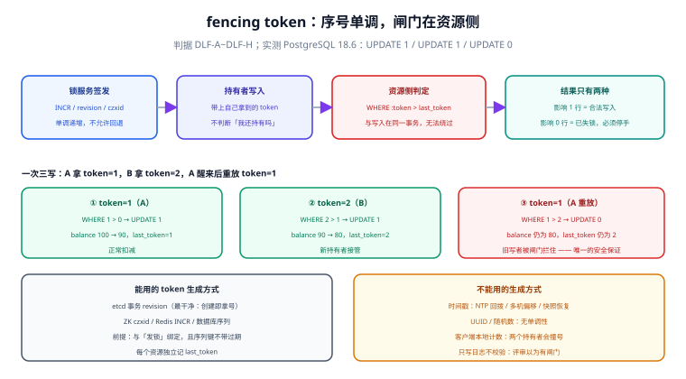

# fencing token：失锁之后谁来拦住旧写者

分布式锁最危险的一刻不是「抢不到」，而是「抢到了、干活干到一半、锁过期了、别人抢到了、而你还在写」。这时无论加锁代码写得多正确都没用——**互斥已经被破坏，而且双方都不知道**。

fencing token 是这个问题目前唯一被证明有效的解法：让锁服务在发锁时**同时发一个单调递增的序号**，让资源自己记住「见过的最大序号」，并拒绝任何序号不大于它的写入。本页把这条链路从签发做到落地，并给出本机实测的拦截读数。

## 判据族声明

本页判据族 `DLF-A` ~ `DLF-H`，共 8 条。定义表在第八节。

## 本页不讲什么

- 不讲 `version` 乐观锁在「一次请求写一次」里的用法，归 [并发护栏](/docs/Backend/IdempotencyStateMachine/ConcurrencyGuard/index.md)。
- 不讲锁服务怎么选、TTL 怎么定，归 [三种实现](../Implementations/index.md) 与 [租约与续期](../Lease/index.md)。
- 不讲分区与多数派，归 [脑裂与分区](../SplitBrain/index.md)；本页只讲「分区发生后靠什么收口」。



## 一、问题：锁过期了，但我还在写

把时序摊平，一次典型的双写是这样的：

```text
时间轴 →
A:  [加锁 token=1]──[读数据]──────────────[写数据]──✗ 写进去了
                      ↑停顿 450ms          ↑
锁:  └── TTL 300ms 到期 ──┘                │
B:                        [加锁 token=2]──[写数据]──✓
```

A 的写发生在 B 之后，覆盖了 B 的结果；而 A 的日志里写着「持有锁 token=1，写入成功」。**任何只看日志的排查都会得出「系统是串行的」这个错误结论。**

本机实测的存储层读数（PostgreSQL 18.6，表 `locklab.ledger`，初值 `balance=100, last_token=0`）：

```sql
UPDATE locklab.ledger SET balance = balance - 10, last_token = 1
 WHERE id = 1 AND 1 > last_token;      -- UPDATE 1
UPDATE locklab.ledger SET balance = balance - 10, last_token = 2
 WHERE id = 1 AND 2 > last_token;      -- UPDATE 1
UPDATE locklab.ledger SET balance = balance - 10, last_token = 1
 WHERE id = 1 AND 1 > last_token;      -- UPDATE 0   ← 旧持有者的写被拒
```

最终 `balance = 80`、`last_token = 2`：只有前两次生效，第三次（A 醒来后的重放）**影响 0 行**。这条 `WHERE` 就是闸门本身，它不需要知道锁的存在，只需要知道「序号必须更大」。

## 二、token 由谁签发：只能由锁服务

这是整页最容易做错的一处。token 必须满足两个条件：**单调递增**、**由发锁的一方生成**（这样「拿到更大的 token」与「拿到锁」是同一件事）。

| 生成方式 | 单调性 | 与锁的绑定 | 结论 |
| --- | --- | --- | --- |
| Redis `INCR lock:seq` | 单实例内严格单调 | 需与发锁在同一脚本/同一事务 | 可用；但主从切换后可能回退 |
| etcd 事务 + `revision` | 全局单调（Raft 日志序号） | 天然绑定（创建 key 即拿到 revision） | **最干净** |
| ZooKeeper `czxid` | 全局单调 | 创建顺序节点即拿到 | 可用 |
| 数据库序列 `nextval()` | 单调（有缓存时可能跳号，但不回退） | 需在同一事务里抢锁 | 可用 |
| 客户端 UUID / 随机数 | **无** | 无 | 不可用（只能当持有者标识，不能当 token） |
| 时间戳（毫秒） | 依赖时钟 | 无 | **危险**：时钟回拨会让新 token 变小 |

一条判据可以快速筛掉错的实现：**token 的值域里能不能出现「后发的比先发的小」？** 能出现，就不是 fencing token。

::: danger 时间戳做 token 的三个具体事故
1. **NTP 回拨**：校时把时钟往回调 1 秒，新 token 比旧 token 小，闸门放行旧写者。
2. **多机时钟不一致**：两个持有者的时钟差 200 ms，先发的 token 反而更大。
3. **虚拟机恢复**：快照恢复后时钟回到过去，整个 token 序列失效。
这三种都不是「极端情况」——它们在生产上都被踩过，只是很少被归因到 token 上。
:::

## 三、资源侧强制：唯一正确的位置

token 只有在**资源自己拒绝旧序号**时才有意义。三种写法的对比如下：

| 写法 | 是否有效 | 原因 |
| --- | --- | --- |
| 客户端写前比对本地 token | 无效 | 客户端已经停顿过，本地状态不可信 |
| 客户端把 token 写进日志 / 上报 | 无效 | 只是事后取证，拦不住写入 |
| **资源侧 `WHERE token > last_token`** | **有效** | 判定与写入在同一事务，无法被绕过 |

```sql
-- 写入方必须把 token 作为条件的一部分，而不是「先查后写」
UPDATE inventory
   SET qty = qty - 1, last_token = :token
 WHERE sku = :sku
   AND :token > last_token;
-- 影响 0 行 = 你已失去锁，这次写必须当作失败处理
```

注意这里有一个**必须写进代码的约定**：影响 0 行不是「数据没变，重试一下」，而是「**我已经不是合法写者**」。重试会用同一个旧 token，永远返回 0 行——这恰好是好事：它把「悄悄写坏」变成了「明显失败」。

::: warning 影响 0 行的两种含义要分开
`WHERE` 不匹配可能是「token 过期」，也可能是「行不存在」。两者都必须显式区分，否则会把「记录被删了」误判成「我失锁了」，进而触发不必要的补偿。做法是先 `SELECT ... FOR UPDATE` 拿当前 `last_token` 与行存在性，再决定分支——但注意这会引入新的窗口，所以更稳的做法是让 `UPDATE` 返回 `RETURNING last_token`，用返回值判断。
:::

## 四、三个落地位置

| 位置 | 怎么落地 | 注意 |
| --- | --- | --- |
| **数据库** | 每张受保护的表加 `last_token bigint not null default 0`，写语句带 `AND :token > last_token` | 一列一表，不要共用；跨表写要在同一事务里全部带条件 |
| **对象存储** | 用对象版本号 / `If-Match` ETag 做条件写 | S3 的 `If-Match` 支持情况随接口而异，需按官方文档确认 |
| **下游服务** | 请求头带 `Fencing-Token`，下游按资源记 `last_token` | 下游必须**真的校验**；只透传不校验等于没做 |

第三条最容易被做成形式主义：网关注入 `Fencing-Token`、下游记进日志、没人校验。它的危害比不做更大——因为它会让架构评审误以为「已经有 fencing 了」。

## 五、与「版本号乐观锁」的分工

这两个概念经常被混为一谈，但它们回答的问题不同：

| 维度 | `version` 乐观锁（并发护栏） | `fencing token`（本页） |
| --- | --- | --- |
| 拦的是什么 | 「我读到的版本已经旧了」 | 「我已经不是锁的持有者」 |
| 谁生成 | 数据库（每次更新 +1） | 锁服务（发锁时签发） |
| 失效场景 | 两个写者都基于旧版本读改写 | 持有者停顿超过租约 |
| 是否需要锁 | 不需要 | 需要（token 来自锁） |
| 典型位置 | `UPDATE ... WHERE version = ?` | `UPDATE ... WHERE :token > last_token` |

两者可以叠加，而且**叠加时顺序不能反**：先判 token（我还是不是合法写者），再判 version（我读到的数据是否最新）。反过来会出现「版本对得上、但写者已过期」的放行。项目侧的 [看板与卡片读写接口](/project/Complete/TeamBoard/BoardCardApi/index.md) 用的正是「`version` 主判 + `409` 语义」，因为那里没有跨进程的锁——两类护栏各自解决自己那一半。

## 六、五种反模式

| 反模式 | 为什么看起来合理 | 实际后果 |
| --- | --- | --- |
| token 用时间戳 | 「时间天然递增」 | 时钟回拨 / 多机偏移 / 快照恢复都会让序列回退 |
| token 只在客户端比对 | 「写之前检查一下更安全」 | 停顿过后客户端的判断本身就不可信 |
| token 全局共享一个计数器 | 「省事」 | 不同资源的 token 互相推高，导致合法写入被误拒 |
| 影响 0 行时自动重试 | 「事务失败就重试」 | 用旧 token 重试永远失败；若代码改成「重试时刷新 token」则等于绕过闸门 |
| 只在下游记日志不校验 | 「先埋点，后面再加校验」 | 架构上被当成已实现，事故时才发现没有闸门 |

## 七、跨资源与批量写的单调性

一个锁保护多个资源时，token 的用法要更小心：

```text
场景：一次结算要同时改 orders（订单状态）与 ledger（流水）
一个 token = 7，两个资源各自记 last_token
```

三条规则：

1. **每个资源独立记 `last_token`**，不要全局一个。全局计数会让「改订单」推高计数，导致「改流水」的合法写入被误拒。
2. **同一事务里的多个资源必须共享同一个 token**。若各自 `INCR`，会出现「订单 token=7、流水 token=8」，重放时一个通过一个被拒，产生半成品数据。
3. **批量写要么全带条件、要么全不带**。部分带条件的批量写，会在失锁时留下「一半生效」的状态，比全失败更难修。

```sql
-- 正确：一个 token，两个资源，同一事务，各自独立的条件
BEGIN;
UPDATE orders SET status = 'settled', last_token = :token
 WHERE id = :order_id AND :token > last_token;
UPDATE ledger SET posted = true, last_token = :token
 WHERE order_id = :order_id AND :token > last_token;
-- 两条都影响 1 行才 COMMIT；任一为 0 行则 ROLLBACK 并按「失锁」处理
COMMIT;
```

## 八、判据族定义

| 判据 | 规则 | 违反时的样子 | 验证方式 |
| --- | --- | --- | --- |
| `DLF-A` | token 由锁服务签发且严格单调，禁止时间戳与随机数 | 时钟回拨后旧写者被放行 | 命令 1 |
| `DLF-B` | 每次写入都带 `AND :token > last_token` 条件，禁止先查后写 | 检查与写入之间有窗口，仍会覆盖 | 命令 2 |
| `DLF-C` | 影响 0 行时必须按「失锁」处理，不得当作「重试即可」 | 无限重试或绕过闸门刷新 token | 命令 3 |
| `DLF-D` | 每个受保护资源独立维护 `last_token`，不共用全局计数 | 合法写入被误拒，业务出现莫名失败 | 命令 4 |
| `DLF-E` | 同一事务内多资源共享同一 token | 半成品数据：一个资源生效、一个被拒 | 命令 5 |
| `DLF-F` | 下游服务必须真的校验 `Fencing-Token`，不能只透传 | 评审以为有闸门，实际没有 | 命令 6 |
| `DLF-G` | token 与 `version` 同时存在时先判 token 再判 version | 版本匹配但写者已过期，仍被放行 | 命令 7 |
| `DLF-H` | 失锁必须可观测（计数 + 告警），且能定位到具体资源 | 事故后无法回答「哪些写被拒了」 | 命令 8 |

## 如何验证

```shell
# ① DLF-A：token 生成方式是否单调（Redis INCR 是单调的，时间戳不是）
redis-cli -p 16379 INCR lab:fence:seq; redis-cli -p 16379 INCR lab:fence:seq
grep -rn "currentTimeMillis\|nanoTime" src/main/java --include=*.java | grep -i "token\|fence"
```

**预期输出**：`1` 与 `2`（严格递增）；grep 应为空。命中时间戳生成 token 的代码即为缺陷。

```shell
# ② DLF-B：写入语句是否带 token 条件（以项目表名为例）
grep -rn "last_token" src/main/resources/mapper/*.xml src/main/java --include=*.java | head
```

**预期输出**：每条受保护的写语句都应命中，且同一语句里出现 `token > last_token`。只有列定义、没有条件即为「记录了但没用」。

```shell
# ③ DLF-C：0 行影响的处理分支
psql "$DSN" -tAc "UPDATE locklab.ledger SET balance = balance - 10, last_token = 1 WHERE id = 1 AND 1 > last_token;"
```

**预期输出**：`UPDATE 0`（本机实测，`last_token` 已是 2）。代码里对应的分支必须抛「失锁」异常并停止，而不是重试。

```shell
# ④ DLF-D：是否只有一个全局计数器
grep -rn "last_token" src/main/resources/db/migration/*.sql | wc -l
psql "$DSN" -tAc "SELECT table_name FROM information_schema.columns WHERE column_name='last_token';"
```

**预期输出**：每张受保护表各一行（本机示例为 `ledger` 一张）。只有一张表却保护多个资源，说明共用了计数。

```shell
# ⑤ DLF-E：同一事务内的多资源写是否共享 token
grep -rn -B 2 -A 8 "BEGIN" src/main/java/**/Settlement*.java 2>/dev/null | grep "last_token" | head
```

**预期输出**：同一事务块内多条 `UPDATE` 使用同一参数 `:token`。若各写各的 `INCR`，失锁时会留下半成品。

```shell
# ⑥ DLF-F：下游是否校验 Fencing-Token（而不是只读进日志）
grep -rn "Fencing-Token\|fencing_token" src/main/java | grep -v "log\." | head
```

**预期输出**：命中校验分支（比较 `last_token` 或抛 409/412）。只出现在日志语句里即为未校验。

```shell
# ⑦ DLF-G：两类护栏的判断顺序
grep -rn -A 6 "UPDATE .*last_token" src/main/resources/mapper/*.xml | grep -n "version\|last_token"
```

**预期输出**：`token > last_token` 在前，`version = ?` 在后（或同一条 SQL 里两者并列）。顺序反了会放行「版本对但已过期」的写。

```shell
# ⑧ DLF-H：失锁是否被计数
curl -s localhost:9090/api/v1/query --data-urlencode 'query=increase(lock_fence_rejected_total[5m])' | head -c 200
```

**预期输出**：指标存在（值可为 0）。若指标不存在，说明「有多少次写被闸门拒绝」这件事从未被观测。

::: info 实测口径
第一节三条 `UPDATE` 的读数为本机 PostgreSQL 18.6 实跑（2026-10-18），表结构与初值见 [实战](../Practice/index.md)。第 1、3 节的其余命令为判据形态，未在真实工程上执行；标 `$DSN` 的位置按实际连接串替换。
:::

## 参考资料

- [Martin Kleppmann · How to do distributed locking](https://martin.kleppmann.com/2016/02/08/how-to-do-distributed-locking.html)——fencing token 的原始定义与「为什么锁服务不能自证安全」
- [etcd · Concurrency package](https://pkg.go.dev/go.etcd.io/etcd/client/v3/concurrency)——revision 的单调性来源
- [PostgreSQL · UPDATE](https://www.postgresql.org/docs/current/sql-update.html)——`WHERE` 与 `RETURNING` 的组合用法，影响行数的判定方式
- [AWS S3 · Conditional writes](https://docs.aws.amazon.com/AmazonS3/latest/userguide/conditional-writes.html)——`If-Match` / `If-None-Match` 在对象存储侧做条件写的官方说明
- 本站 [并发护栏](/docs/Backend/IdempotencyStateMachine/ConcurrencyGuard/index.md) · [Redis 分布式锁](/docs/DB/NoRelational/Redis/Advanced/DistributedLock/index.md)
- 相邻：[租约与续期](../Lease/index.md) · [脑裂与分区](../SplitBrain/index.md) · [实战](../Practice/index.md)
