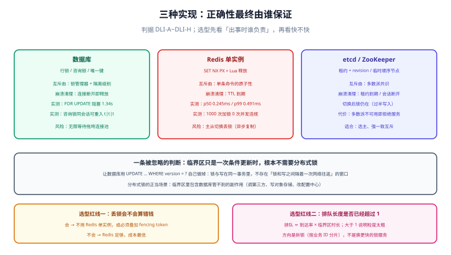

# 三种实现与安全性来源

选锁服务时最容易问错的问题是「哪个快」。真正决定后果的是另一个问题：**这把锁的安全性，最终由谁保证？** 数据库交给自己事务里的行锁，Redis 单实例交给「一条命令的原子性」，etcd 与 ZooKeeper 交给多数派共识。三者的失效方式完全不同，所以「换一个更快的」往往是把一类失效换成另一类。

本页给三种实现的最小正确写法、本机实测读数，以及一张按「出事时谁负责」组织的选型矩阵。

## 判据族声明

本页判据族 `DLI-A` ~ `DLI-H`，共 8 条。定义表在第八节。

## 本页不讲什么

- 不讲 Redis 的 Lua 语法、Redisson 的可重入实现、Redlock 的论战细节，归 [Redis · 分布式锁与 Lua](/docs/DB/NoRelational/Redis/Advanced/DistributedLock/index.md)。
- 不讲 `SET NX PX` 之后 TTL 该设多少、怎么续期，归 [租约与续期](../Lease/index.md)。
- 不讲选主（谁当主），归 [选主与领导权](../LeaderElection/index.md)。



## 一、三种实现：正确性托付给谁

| 实现 | 互斥由谁保证 | 崩溃后谁清理 | 主要失效模式 | 典型用途 |
| --- | --- | --- | --- | --- |
| **数据库**（行锁 / 咨询锁 / 唯一键） | 数据库的锁管理器与隔离级别 | 连接断开时自动释放（会话级） | 长事务、连接池串号、跨库无效 | 临界区本身就是数据库写；不想引入新组件 |
| **Redis 单实例** | 单条命令的原子性（`SET NX PX`） | TTL 到期 | 主从切换丢锁、停顿超过 TTL | 短临界区、可容忍极小概率失效 |
| **etcd / ZooKeeper** | 多数派共识（Raft / ZAB） | 租约到期或会话断开 | 多数派不可用时**拒绝服务**（CP） | 选主、配置变更、必须强一致的互斥 |

这张表最重要的一列是第三列：**「崩溃后谁清理」**。数据库靠连接生命周期，Redis 靠时间，etcd/ZK 靠租约加共识。清理机制不同，「活着但停住」的处理就不同——数据库与 Redis 都会把停顿的客户端当成死了，而 etcd/ZK 的租约同样如此，区别在于**它们不会在主备切换时把已经发出去的锁弄丢**。

## 二、数据库：三种用法与各自的坑

### 2.1 行锁：临界区就是一次更新

```sql
-- 持锁期间其他事务的同一行 FOR UPDATE 会阻塞，直到本事务提交
BEGIN;
SELECT balance FROM account WHERE id = 1 FOR UPDATE;
UPDATE account SET balance = balance - 10 WHERE id = 1;
COMMIT;
```

本机实测（PostgreSQL 18.6）：另一会话的 `SELECT ... FOR UPDATE` 被阻塞 **1.34 s**，正好等于持锁事务里 `pg_sleep(1.5)` 的剩余时长。这说明行锁是**真阻塞**的——它不会「抢不到就返回」，会一直等下去，直到锁释放或语句超时。

::: danger 行锁最大的坑不是死锁，是「等」
默认没有等待上限。一个忘记提交的事务会让后续所有请求排队，连接池在几十秒内被占满，故障从「一个功能慢」升级成「整个服务不可用」。所以行锁必须配 `lock_timeout` 或 `FOR UPDATE NOWAIT`：

```sql
SET LOCAL lock_timeout = '2s';
SELECT balance FROM account WHERE id = 1 FOR UPDATE NOWAIT;  -- 抢不到立刻报 55P03
```
:::

### 2.2 咨询锁：不锁行，锁「一个名字」

当要保护的不是某一行、而是「某件事只能有一个实例在做」时，用咨询锁（advisory lock）：

```sql
-- 会话级：可重入，断开连接自动释放
SELECT pg_try_advisory_lock(42);

-- 事务级：COMMIT / ROLLBACK 时自动释放
SELECT pg_try_advisory_xact_lock(42);
```

本机实测三条读数：

| 动作 | 读数 | 含义 |
| --- | --- | --- |
| 同一会话连续三次 `pg_try_advisory_lock(42)` | `t \| t \| t` | **可重入**：同一会话重复加锁不报错，内部计数 +1 |
| 连接断开后新会话 `pg_try_advisory_lock(42)` | `t` | 会话级锁随连接结束自动释放，不会泄漏 |
| `BEGIN; pg_try_advisory_xact_lock(7); COMMIT;` 后新会话再加 | `t` | 事务级锁在提交时释放，无需显式解锁 |

第一行的可重入是**最容易踩的坑**：同一连接里加了三次，只解锁一次，锁仍然被持有。用连接池时这几乎必然发生——连接被复用，上一次的咨询锁还挂着。

### 2.3 唯一键：把「锁」变成「一条记录」

```sql
CREATE TABLE task_lease (
  task_name   text        PRIMARY KEY,
  owner       text        NOT NULL,
  expires_at  timestamptz NOT NULL
);

-- 抢锁：插入成功即获得；过期记录可被覆盖
INSERT INTO task_lease (task_name, owner, expires_at)
VALUES ('daily-settle', 'node-a', now() + interval '30 seconds')
ON CONFLICT (task_name) DO UPDATE
  SET owner = EXCLUDED.owner, expires_at = EXCLUDED.expires_at
  WHERE task_lease.expires_at < now()
RETURNING owner;
```

返回一行即抢到，返回零行即没抢到。这条 SQL 的好处是**没有 TTL 语义的黑箱**：过期判断写在 `WHERE` 里，读得懂、测得出；坏处是它依赖数据库时钟，且所有竞争者都要打到同一行——高并发下这行会成为热点。

## 三、Redis 单实例：最小正确集

只有三条命令，缺一条就不算正确：

```lua
-- 加锁：一条命令完成「不存在才设置」+「设置过期」
-- SET lock:order:42 <owner> NX PX 3000
-- 返回 OK 即获得；返回 nil 即被他人持有

-- 释放：必须「比对 + 删除」原子完成
if redis.call('GET', KEYS[1]) == ARGV[1] then
  return redis.call('DEL', KEYS[1])
else
  return 0
end
```

本机实测（Redis 7.4.0，容器内 `redis-cli`）：

| 动作 | 读数 |
| --- | --- |
| `SET lab:lock ownerA NX PX 3000` | `OK`，随后 `PTTL` = **2994**（毫秒） |
| 另一客户端 `SET lab:lock ownerB NX PX 3000` | `nil`（被拒） |
| 裸 `DEL lab:lock` | **1**（删掉了别人的锁——这就是为什么要 Lua） |
| Lua 脚本传入错误 owner | **0**（拒绝） |
| Lua 脚本传入正确 owner | **1**（正常释放） |

竞争下的表现（5 个客户端各抢 200 次，临界区 0.5 ms）：

| 指标 | 读数 |
| --- | --- |
| 总加锁次数 / 耗时 | 1000 次 / **1.87 s**（约 533 次/秒，受客户端单线程限制） |
| 获取延迟 | p50 **0.245 ms**、p95 **0.399 ms**、p99 **0.491 ms**、max **1.716 ms** |
| 临界区内并发数 ≠ 1 的次数 | **0** |

::: warning 这组读数只能证明「单实例下互斥成立」
它证明不了任何关于故障转移的事。Redis 主从是**异步复制**：锁写在主库、`DEL`/过期事件还没传到从库时发生故障转移，新主上这把锁**不存在**，第二个客户端立刻能拿到。这不是 Redis 的 bug，是异步复制的定义。Redisson 用 `checkLockSyncedSlaves`（默认 `true`）+ `slavesSyncTimeout`（默认 `1000 ms`）在加锁后等待从库确认，是在缩小窗口，不是消除窗口。
:::

## 四、etcd 与 ZooKeeper：把正确性交给共识

### 4.1 etcd：租约 + 事务 + revision

```go
session, err := concurrency.NewSession(cli, concurrency.WithTTL(10))
if err != nil {
    return err
}
defer session.Close()

// 抢锁 = 在一个 key 前缀下创建一个绑定租约的节点
mutex := concurrency.NewMutex(session, "/lock/order-42")
if err := mutex.Lock(ctx); err != nil {
    return err
}
defer mutex.Unlock(ctx)

// 关键：会话结束（进程死、网络断）时租约失效，节点被自动删除
select {
case <-session.Done():
    // 已经失去锁，必须立刻停止手上的工作
case <-ctx.Done():
}
```

etcd 的强处在于**锁的获得与「谁先来」由 Raft 日志顺序决定**：revision 单调递增，不存在「两个客户端都以为自己创建了第一个节点」。弱处同样明显：多数派不可用时**直接拒绝服务**——这是 CP 的代价，不是缺陷。

### 4.2 ZooKeeper：临时顺序节点

```java
// Curator 的 InterProcessMutex 本质是「临时顺序节点 + 监听前一个节点」
InterProcessMutex lock = new InterProcessMutex(client, "/locks/order-42");
if (lock.acquire(3, TimeUnit.SECONDS)) {
    try {
        // 临界区
    } finally {
        lock.release();
    }
}
```

临时节点（ephemeral）绑在会话上：会话超时，节点消失，排在后面的候选者被唤醒。这条路径比 Redis 多了一次「监听前驱节点」的往返，换来的是**不会因为主备切换丢锁**——ZK 的写必须过半数，切换后新主一定有这条记录。

### 4.3 三者的语义差异（一张表说清）

| 维度 | 数据库 | Redis 单实例 | etcd / ZK |
| --- | --- | --- | --- |
| 抢锁失败的行为 | 阻塞（可 `NOWAIT`） | 立即返回失败 | 排队等待（watch 前驱） |
| 崩溃清理依据 | 连接生命周期 | TTL（服务器时钟） | 租约 + 会话 |
| 主备切换后锁是否还在 | 在（同一份数据） | **可能不在** | 在（过半写入） |
| 分区时的选择 | 视配置（多数可写） | 偏向可用（AP） | 偏向一致（CP） |
| 公平性（先来先得） | 无保证 | 无保证 | 有（顺序节点 / revision） |
| 典型延迟量级 | 一次事务往返 | 亚毫秒（实测 p50 0.245 ms） | 一次共识往返 |

## 五、性能与成本，怎么读才不算自欺

上表的延迟数字只说明**空载下的顺序**，不能直接外推到生产：

1. **Redis 的亚毫秒是「同机房、单实例、无竞争」**。跨可用区一次往返就变成 1~3 ms；一旦有竞争，等待时间由持锁方的临界区长度决定，与锁服务无关。
2. **数据库的锁延迟不可单独测量**，因为它与事务、连接池、行锁等待耦合。实测 1.34 s 的阻塞不是「数据库慢」，而是持锁事务确实占用了 1.5 s。
3. **etcd/ZK 的成本在「每次抢锁一次共识」**。用它做高频短锁（每秒上千次）会先把 etcd 打满；它适合**低频、长持有**的场景，例如选主、配置变更、定时任务。

::: tip 一条实用的估算
设临界区平均耗时 `c`、并发请求率 `r`，则锁的排队长度约为 `r × c`（利特尔法则）。若 `r × c > 1`，说明这把锁的粒度太粗——等待时间会随负载线性增长，此时优化方向是**拆锁**（按 ID 分片），而不是换更快的锁服务。
:::

## 六、选型矩阵

按「出事时谁负责」排序，而不是按性能排序：

| 维度 | 数据库 | Redis 单实例 | etcd / ZK |
| --- | --- | --- | --- |
| 需要新增组件 | 否 | 是（多数系统已有） | 是（通常已有 K8s 集群内的 etcd） |
| 正确性上限 | 高（事务内） | 中（依赖单点不切换） | 高（共识） |
| 停顿容忍 | 连接不断即可 | TTL 内 | 租约内 |
| 分区时可用性 | 中 | 高 | 低（正确优先） |
| 公平排队 | 无 | 无 | 有 |
| 运维复杂度 | 低 | 低 | 中（需维护奇数节点集群） |
| **首选场景** | 临界区=一次写 | 短锁、高吞吐 | 选主、强一致互斥 |

一条经验判断：**如果这个锁的失效会导致「钱算错、券多发、账不平」，就不要单独依赖 Redis 单实例**，至少加上 fencing（见 [fencing token](../Fencing/index.md)）。

## 七、四种常见错配

| 错配 | 症状 | 正确做法 |
| --- | --- | --- |
| 用 Redis 锁保护一次数据库更新 | 锁与写之间有网络窗口，反而更容易出错 | 改成 `UPDATE ... WHERE version = ?` |
| 用数据库咨询锁做高频短锁 | 连接池被占满，锁等待拖垮整个服务 | 换 Redis；或把粒度拆细 |
| 用 etcd 做每秒上千次的锁 | etcd 延迟升高，连带拖慢 K8s 控制面 | 换 Redis，或改成批量/分片 |
| 用 Redis 锁做选主且不校验续期 | 主从切换后出现两个主，双写 | 换 etcd/ZK，或加 fencing + 外部见证 |

## 八、判据族定义

| 判据 | 规则 | 违反时的样子 | 验证方式 |
| --- | --- | --- | --- |
| `DLI-A` | 加锁是单条原子命令或单条 SQL，不存在「设置」与「过期」两步 | 崩溃后 `TTL` 为 -1，锁永久占用 | 命令 1 |
| `DLI-B` | 释放通过原子脚本比对持有者，禁止裸 `DEL` | 裸 `DEL` 返回 1，删掉了新持有者的锁 | 命令 2 |
| `DLI-C` | 行锁必须配 `lock_timeout` 或 `NOWAIT`，不允许无限等待 | 一个忘记提交的事务拖垮连接池 | 命令 3 |
| `DLI-D` | 咨询锁的使用处必须成对解锁，且知晓同会话可重入 | 连接复用时锁不释放，下一个请求永远抢不到 | 命令 4 |
| `DLI-E` | 选型写明「主备切换后这把锁还在不在」，并据此决定是否加 fencing | 切换后双持有，日志无异常 | 命令 5 |
| `DLI-F` | 锁粒度按业务键分片，禁止全局单锁 | 排队长度 `r × c > 1`，延迟随负载线性增长 | 命令 6 |
| `DLI-G` | 强一致场景不用 Redis 单实例，或明确接受其失效概率并写入文档 | 事故后无法回答「为什么选 Redis」 | 命令 7 |
| `DLI-H` | 每种实现都写清「崩溃后谁清理」，并与运维手册一致 | 停机后残留锁无人清理，需人工删 key | 命令 8 |

## 如何验证

```shell
# ① DLI-A：加锁是否原子（Redis 侧）
redis-cli -p 16379 SET lab:probe v NX PX 1000; redis-cli -p 16379 PTTL lab:probe
```

**预期输出**：`OK` 与一个 **0 < 值 ≤ 1000** 的毫秒数（本机实测 2994，写 3000 ms 时）。若第二条返回 `-1`，说明过期时间没有被设置——那就是两步写法。

```shell
# ② DLI-B：裸 DEL 与 Lua 校验的差别（同一把锁，先看错误用法）
redis-cli -p 16379 SET lab:probe ownerA NX PX 5000
redis-cli -p 16379 DEL lab:probe
```

**预期输出**：`OK` 与 **1**。第二个 `1` 就是缺陷本身——任何客户端都能删掉不属于自己的锁。正确实现应返回 **0**（见 [总览](../Overview/index.md) 第三节实测）。

```shell
# ③ DLI-C：行锁是否设置了等待上限
psql "$DSN" -c "SHOW lock_timeout;" -c "SHOW statement_timeout;"
```

**预期输出**：两个都不是 `0`（`0` 表示无限等待）。本机默认即为 `0`，这正是「一个慢事务拖垮全站」的默认配置。

```shell
# ④ DLI-D：同一会话重复加咨询锁是否被察觉（可重入陷阱）
psql "$DSN" -tAc "SELECT pg_try_advisory_lock(42), pg_try_advisory_lock(42);" \
             -tAc "SELECT pg_advisory_unlock_all();"
```

**预期输出**：`t|t`。两次都为 `t` 说明同会话可重入——若代码里只解锁一次，锁仍然被持有。

```shell
# ⑤ DLI-E：代码里是否存在「切换后锁还在不在」的判断依据
grep -rn "Redlock\|redLock\|checkLockSyncedSlaves\|WAIT" src/main/java --include=*.java | head
```

**预期输出**：人工判读。没有任何一处涉及从库确认或 fencing，说明选型默认忽略了主备切换这一类失效。

```shell
# ⑥ DLI-F：锁键是否按业务 ID 分片（全局单锁是高危信号）
grep -rhoE '"lock:[^"]*"' src/main/java | sort | uniq -c | sort -rn | head
```

**预期输出**：键里应含业务 ID 占位（如 `lock:order:%s`）。若出现固定键（`lock:order`）且 QPS 高，排队长度会随负载线性增长。

```shell
# ⑦ DLI-G：选型文档是否写明失效概率与兜底
grep -rniE "redis.*锁|distributed lock" docs/ --include=*.md | grep -i "切换\|failover\|fencing" | head
```

**预期输出**：至少命中一处。没有这一句，等于选型时没有考虑过切换。

```shell
# ⑧ DLI-H：停机后是否残留锁（按前缀扫一遍 TTL）
redis-cli -p 16379 --scan --pattern 'lock:*' | while read k; do echo "$k $(redis-cli -p 16379 TTL "$k")"; done
```

**预期输出**：每行第二个字段都不是 `-1`。出现 `-1` 说明存在无人清理的永久锁。

::: info 实测口径
本页所有读数来自本机容器：Redis **7.4.0**（`teamboard-sandbox-cache-1`，端口 16379）与 PostgreSQL **18.6**（`teamboard-sandbox-db-1`，端口 15432），测试日期 2026-10-18。etcd / ZooKeeper 本机无实例，第四节代码按官方文档编写、**未实测**，已在该节注明。
:::

## 参考资料

- [Redis · SET](https://redis.io/docs/latest/commands/set/)——`NX` / `PX` 选项的原子性语义
- [Redis · EVAL](https://redis.io/docs/latest/commands/eval/)——脚本执行的原子性，释放锁为什么必须用脚本
- [etcd · Concurrency package](https://pkg.go.dev/go.etcd.io/etcd/client/v3/concurrency)——`Mutex` / `Election` / `Session` 的接口与语义
- [Apache Curator · Shared Lock](https://curator.apache.org/docs/recipes/locks/)——`InterProcessMutex` 的临时顺序节点实现
- [PostgreSQL · Advisory Locks](https://www.postgresql.org/docs/current/explicit-locking.html#ADVISORY-LOCKS)——会话级与事务级咨询锁的定义、可重入语义
- 本站 [Redis 分布式锁](/docs/DB/NoRelational/Redis/Advanced/DistributedLock/index.md) · [PostgreSQL](/docs/DB/Relational/PostgreSQL/index.md)
- 相邻：[租约与续期](../Lease/index.md) · [fencing token](../Fencing/index.md) · [脑裂与分区](../SplitBrain/index.md)
