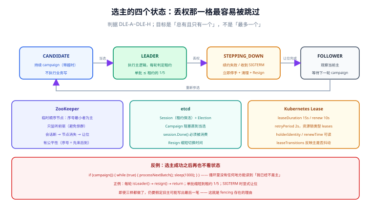

# 选主与领导权

选主（leader election）和加锁很像：都是「同一时刻只让一个进来」。但目标正好相反——**加锁要求「最多一个」，选主要求「总有且只有一个」**。前者抢不到可以返回失败，后者抢不到必须排队等到有人当主；前者关心互斥，后者还关心**收敛时间**（多久能选出新主）。

这一页讲三件事：选主的实现怎么做到「不会有两个主」、领导权丢失时旧主必须做什么、以及单例定时任务该怎么接这套机制。

## 判据族声明

本页判据族 `DLE-A` ~ `DLE-H`，共 8 条。定义表在第八节。

## 本页不讲什么

- 不讲加锁命令与释放脚本，归 [三种实现](../Implementations/index.md)。
- 不讲租约参数怎么推导，归 [租约与续期](../Lease/index.md)；本页只引用 Kubernetes 那组默认值作为范例。
- 不讲分区下的双主推演，归 [脑裂与分区](../SplitBrain/index.md)。



## 一、锁与选主：四条差别

| 维度 | 分布式锁 | 选主 |
| --- | --- | --- |
| 活性目标 | 抢不到就返回失败（最多一个） | 必须有人当主（**总有一个**） |
| 等待方式 | 重试或放弃 | 排队，watch 前驱或监听变更 |
| 公平性 | 通常无保证 | 通常有（顺序节点 / revision） |
| 典型持有时间 | 毫秒到秒 | 秒到分钟（持续续约） |
| 失效后果 | 两个写者同时写 | 两个主同时发号施令（更严重） |
| 关键指标 | 获取延迟、持有时间 | **切换时间**（旧主停手到新主就绪） |

最后一行是选主独有的：**你必须能回答「主挂了之后，业务停多久」**。这个时间 = 租约到期时间 + 新主启动时间 + 新主预热时间。Kubernetes 用 15 秒租约把第一项压到 15 秒以内，剩下两项由业务自己承担。

## 二、选主必须满足的三条

比「三性质」更严格，因为选主还要保证**收敛**：

1. **同一刻至多一个主**：由共识或租约保证。这一条锁也满足。
2. **最终一定有一个主**：候选者必须持续参与，且失败要能被检测。锁不要求这条——抢不到就是抢不到。
3. **切换时间有上界**：从旧主失效到新主就绪的时间必须可估、可测。选主没有这条就不可运维。

第三条常被忽略，导致「选主是有的，但切换要 3 分钟」——这在定时任务场景里等于「任务少跑两轮」。

## 三、ZooKeeper：临时顺序节点

机制（Curator 的 `LeaderLatch` / `LeaderSelector` 都是这个模型的封装）：

```text
/election
  ├─ _c_0000000001   ← 序号最小者即主（临时节点，绑会话）
  ├─ _c_0000000002   ← 监听前一个节点
  └─ _c_0000000003   ← 监听前一个节点
```

三个要点：

1. **临时节点**：会话超时（进程死、网络断）节点自动消失，主的位置立刻空出来。
2. **只监听前驱**：`_c_00000003` 只 watch `_c_00000002`，避免「一个节点变化唤醒所有候选者」的惊群。
3. **序号单调**：`czxid` 与序号都由 ZK 分配，因此「谁先来」有确定答案——这也是它能顺带提供 fencing token 的原因。

```java
// LeaderLatch：抢到就持有，直到 close()
try (LeaderLatch latch = new LeaderLatch(client, "/election", "node-a")) {
    latch.start();
    latch.await(10, TimeUnit.SECONDS);          // 最多等 10 秒
    if (latch.hasLeadership()) {
        runLeaderLoop();                        // 只在主上跑
    }
}
// close() 会删除临时节点，让位给下一个候选者
```

::: warning `await` 返回不代表你一直是主
`hasLeadership()` 只反映**这一刻**的状态。ZK 会话断开后，`LeaderLatch` 会触发 `handleStateChanged` 回调；如果你的 `runLeaderLoop()` 不检查这个状态，就会在主已经换人的情况下继续干活。正确处理见第六节。
:::

## 四、etcd：Session + Election

etcd 的 `concurrency` 包把「租约 + 事务 + revision」封装成两件东西：`Session`（租约保活）与 `Election`（campaign / observe / resign）。

```go
session, err := concurrency.NewSession(cli, concurrency.WithTTL(10))
if err != nil {
    return err
}
defer session.Close()

e := concurrency.NewElection(session, "/election/order-scheduler")
if err := e.Campaign(ctx, "node-a"); err != nil {   // 阻塞直到当选
    return err
}
defer e.Resign(context.Background())                // 优雅让位

for {
    select {
    case <-session.Done():                          // 租约失效 = 丢权
        return errLostLeadership
    case <-ctx.Done():
        return ctx.Err()
    default:
        doLeaderWork()                              // 每一轮都要能感知丢权
    }
}
```

两个细节决定这套代码是否真安全：

- **`session.Done()` 必须被消费**。它是唯一能在「租约已经失效」时立刻通知你的通道；不消费它，`doLeaderWork()` 会一直跑下去。
- **`Resign` 要显式调用**。不调用的话，新主必须等你 10 秒租约到期——切换时间从「毫秒」变成「10 秒」。

## 五、Kubernetes：Lease 对象

Kubernetes 自己的组件（controller-manager、scheduler）用 `coordination.k8s.io/v1` 的 `Lease` 对象做选主，三个默认值在 [租约与续期](../Lease/index.md) 里已推导过：`leaseDuration=15s`、`renewDeadline=10s`、`retryPeriod=2s`。

```yaml
apiVersion: coordination.k8s.io/v1
kind: Lease
metadata:
  name: order-scheduler
  namespace: default
spec:
  holderIdentity: order-scheduler-7d9f8b6c5-x2vqz
  leaseDurationSeconds: 15
  acquireTime: "2026-10-18T02:11:03.512Z"
  renewTime: "2026-10-18T02:12:41.088Z"
  leaseTransitions: 3
```

四个字段的用途：

| 字段 | 含义 | 排障时的用法 |
| --- | --- | --- |
| `holderIdentity` | 当前主是谁（Pod 名 / 实例 ID） | 直接回答「现在谁在跑」 |
| `leaseDurationSeconds` | 租约长度 | 与 `renewTime` 比对，判断是否已经过期 |
| `renewTime` | 最后一次续约时间 | `now - renewTime > leaseDuration` 即「主已失联」 |
| `leaseTransitions` | 换主次数 | 短时间频繁上涨说明主不稳定（抖动） |

::: tip `leaseTransitions` 是被低估的指标
它涨得快，说明「主在反复横跳」。常见原因：续约请求超时（`renewDeadline` 太紧）、节点时钟漂移、Pod 被频繁驱逐。这个数比任何日志都直观——一天涨 50 次，说明这套选主在生产上并不稳定。
:::

## 六、状态机：候选、领导、让位

选主在代码里应该是一个显式状态机，而不是一堆回调：

| 状态 | 进入条件 | 该做什么 | 不该做什么 |
| --- | --- | --- | --- |
| `CANDIDATE` | 进程启动 | 持续 campaign，带超时与取消 | 执行业务写 |
| `LEADER` | campaign 成功 | 执行主逻辑，**每轮检查租约** | 假设「已经是主」就一直安全 |
| `STEPPING_DOWN` | 续约失败 / 收到 SIGTERM | 立即停手、清理、`Resign` | 再试一次续约「看看」 |
| `FOLLOWER` | 让位完成 | 等待、观察当前主 | 偷偷执行主逻辑 |

`STEPPING_DOWN` 是最容易被跳过的一格。很多实现是「续约失败 → 重试 → 重试 → 放弃 → 进程退出」，中间那几秒旧主还在干活。正确做法是**续约失败当轮就停手**，把重试留给下一轮 campaign。

## 七、丢权必须停手：一段反例代码

```java
// 反例：选主成功之后就再也不看状态
if (election.campaign()) {
    while (true) {
        processNextBatch();     // 不管自己还是不是主
        Thread.sleep(1000);
    }
}
```

这段代码的问题不是「没有检查」，而是**它连检查的机会都没有**：`while (true)` 里没有任何地方能读到「我已经不是主」。

```java
// 正例：每一轮都先确认领导权，再干活
while (!Thread.currentThread().isInterrupted()) {
    if (!leadership.isLeader()) {          // 每轮判定
        leadership.resign();               // 主动让位，缩短切换时间
        return;
    }
    processNextBatch();                    // 单批要短，便于及时停手
    Thread.sleep(200);                     // 间隔要远小于租约
}
```

两条纪律：

1. **单批工作量要短**（≤ 租约的 1/5）。一批跑 30 秒而租约 15 秒，中间必然出现「旧主还在跑、新主已上任」。
2. **检查间隔要远小于租约**。200 ms 对 15 秒租约是合适的；1 秒检查一次也能接受；「只在启动时检查一次」等于没有。

## 八、判据族定义

| 判据 | 规则 | 违反时的样子 | 验证方式 |
| --- | --- | --- | --- |
| `DLE-A` | 选主用共识型存储（etcd / ZK）或 K8s Lease，不用 Redis 单实例 | 主从切换后出现两个主 | 命令 1 |
| `DLE-B` | 主循环每一轮都判定领导权，不是启动时判一次 | 丢权后旧主继续处理，双写 | 命令 2 |
| `DLE-C` | 单批工作量 ≤ 租约的 1/5，检查间隔远小于租约 | 旧主与新主同时处理同一批 | 命令 3 |
| `DLE-D` | 优雅退出时显式 `Resign`，不等租约到期 | 发布一次业务停 15 秒 | 命令 4 |
| `DLE-E` | `leaseTransitions` / 换主次数纳入监控与告警 | 主反复横跳无人知 | 命令 5 |
| `DLE-F` | 候选阶段必须有超时与取消，不能无限阻塞 | 滚动发布时旧 Pod 卡在 campaign | 命令 6 |
| `DLE-G` | 只监听前驱（ZK）或监听变更（etcd），不轮询全量 | 选举期间 QPS 尖刺，ZK/etcd 被打满 | 命令 7 |
| `DLE-H` | 切换时间有实测值，并写入运维手册 | 事故时说不清「多久能恢复」 | 命令 8 |

## 如何验证

```shell
# ① DLE-A：选主用的是哪种存储
kubectl get lease -A | head
grep -rn "NewElection\|LeaderLatch\|LeaderElector" src/main/java src/main/go 2>/dev/null | head
```

**预期输出**：能定位到 `Lease` 对象或 etcd/ZK 客户端调用。若只有 Redis 锁而没有共识存储，说明选主建立在「主从切换可能丢锁」的前提上。

```shell
# ② DLE-B：主循环里是否有领导权判定
grep -rn -A 12 "while (true)\|while (!" src/main/java/**/Leader*.java 2>/dev/null | grep -c "isLeader\|hasLeadership"
```

**预期输出**：大于 0，且应出现在循环体内。为 0 说明「选主成功后就不再看状态」，这是最典型的双主成因。

```shell
# ③ DLE-C：单批耗时与租约的比值
kubectl get lease order-scheduler -o jsonpath='{.spec.leaseDurationSeconds}{"\n"}'
grep -rn "batchSize\|processNextBatch" src/main/java/**/Leader*.java | head
```

**预期输出**：租约 15 秒时，单批耗时应有日志或指标证明 ≤ 3 秒。拿不出证据即视为不合格。

```shell
# ④ DLE-D：是否有显式让位
grep -rn "resign\|Resign\|release()" src/main/java src/main/go 2>/dev/null | head
```

**预期输出**：退出路径（SIGTERM handler / finally）里必须命中。只在启动时调用 `campaign` 而没有 `Resign`，发布期间业务会空转一个租约周期。

```shell
# ⑤ DLE-E：换主次数是否可观测
kubectl get lease order-scheduler -o jsonpath='{.spec.leaseTransitions}{"\n"}'
```

**预期输出**：一个较小的整数；**短时间内持续上涨**即为抖动。若该字段从未被采集，说明「主稳不稳」这个问题没有数据支撑。

```shell
# ⑥ DLE-F：campaign 是否带超时与可取消的 context
grep -rn "Campaign(ctx\|await(" src/main/go src/main/java 2>/dev/null | head
```

**预期输出**：应能看到 `context.WithTimeout` 或带超时的 `await`。裸 `Campaign(context.Background(), ...)` 会让关闭流程挂死。

```shell
# ⑦ DLE-G：ZK 侧是否只监听前驱（Curator 默认即如此）
grep -rn "getChildren\|getPrevious\|watch" src/main/java/**/Election*.java 2>/dev/null | head
```

**预期输出**：命中「获取子节点列表 + 监听前一个节点」。出现定时轮询 `getChildren` 的循环即为惊群写法。

```shell
# ⑧ DLE-H：切换时间有没有实测记录
grep -rniE "切换时间|failover.*(s|秒)|leader.*switch" docs/ --include=*.md | head
```

**预期输出**：至少一处写明数字（如「实测 6.2 秒」）。没有数字即说明这项能力从未被验收。

::: info 诚实标注
本页 Kubernetes 参数与 `Lease` 字段来自官方文档（2026-10 核对：`leaseDuration=15s` / `renewDeadline=10s` / `retryPeriod=2s`）；etcd / ZK 代码按官方文档编写，**本机无集群实例，未实测**；所有验证命令均为判据形态，需在真实集群上执行并回填读数。
:::

## 参考资料

- [Kubernetes · Leases](https://kubernetes.io/docs/concepts/architecture/leases/)——`Lease` 对象的语义与 `holderIdentity` / `renewTime` 的用途
- [Kubernetes · kube-controller-manager flags](https://kubernetes.io/docs/reference/command-line-tools-reference/kube-controller-manager/)——`--leader-elect-*` 三个默认值
- [etcd · Concurrency package](https://pkg.go.dev/go.etcd.io/etcd/client/v3/concurrency)——`Election.Campaign` / `Resign` / `Observe` 的接口语义
- [Apache Curator · Leader Election](https://curator.apache.org/docs/recipes/leader-election/)——`LeaderLatch` 与 `LeaderSelector` 的区别
- [ZooKeeper · Programmer's Guide](https://zookeeper.apache.org/doc/current/zookeeperProgrammers.html)——临时节点、顺序节点与 watch 的语义
- 本站 [Kubernetes](/docs/Ops/Kubernetes/index.md) · [可观测性](/docs/Ops/Observability/Overview/index.md)
- 相邻：[租约与续期](../Lease/index.md) · [脑裂与分区](../SplitBrain/index.md)
