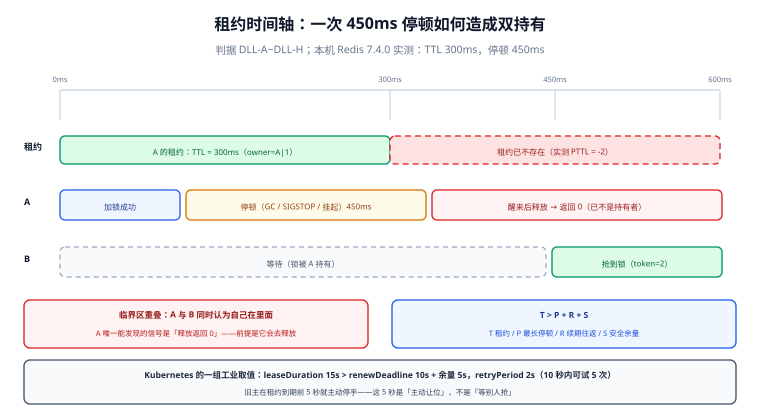

# 租约与续期

锁的过期时间不是「随便设个 30 秒」。它是一条不等式的结果，而这不等式的三个输入里，有两个你从来没测过：**进程最长会停顿多久**、**续期请求最坏要多久**。把 TTL 设小了，停顿一次就失锁；设大了，崩溃之后要等很久才有人接手。这一页把这条不等式拆开算，并给出停顿的实测来源清单。

## 判据族声明

本页判据族 `DLL-A` ~ `DLL-H`，共 8 条。定义表在第八节。

## 本页不讲什么

- 不讲加锁命令怎么写，归 [三种实现](../Implementations/index.md)。
- 不讲失锁之后怎么拦住旧写入者，归 [fencing token](../Fencing/index.md)。
- 不讲选主的租约参数怎么配，归 [选主与领导权](../LeaderElection/index.md)。



## 一、租约三角：一条不等式

设：

- `T` = 租约时长（TTL）
- `P` = 持有者可能的最长停顿（pause）
- `R` = 一次续期请求的往返时间上界（含重试）
- `S` = 安全余量

则必须满足：

```text
T > P + R + S
```

三个输入的实际含义：

| 符号 | 它到底是什么 | 怎么得到 |
| --- | --- | --- |
| `P` | 进程从「停止执行」到「恢复执行」的最长时间 | **必须实测**：Full GC 停顿、容器内存回收、宿主机快照、虚拟机挂起 |
| `R` | 续期请求最长耗时（含网络抖动与一次重试） | 取续期接口的 P999，再乘以「允许的重试次数」 |
| `S` | 安全余量 | 常用 `R` 的一倍到两倍；不要用「感觉」 |

::: danger 最常见的三个错
1. **`P` 取 0**：认为「我的服务不会停顿」。任何 JVM 服务只要有 Full GC，`P` 就不是 0；容器有内存压力时更不是。
2. **`R` 取平均值**：续期是控制面请求，量小但抖动大。用平均值等于假设每次续期都顺利。
3. **`T` 与续期周期相等**：续期还没回来锁就过期了。续期周期必须显著小于 `T`（工业实现通常取 `T/3`）。
:::

## 二、用 Kubernetes 的默认参数反推

Kubernetes 的 leaderelection 有三个默认值，正好是这条不等式的一个工业级范例：

| 参数 | 默认值 | 作用 |
| --- | --- | --- |
| `leaseDuration` | **15 s** | 租约长度 `T` |
| `renewDeadline` | **10 s** | 续期截止 `R` 的上界：主必须在 10 秒内续期成功，否则主动停手 |
| `retryPeriod` | **2 s** | 重试间隔：10 秒内最多尝试 5 次 |

把数字代进不等式：`15 > 10 + 0 + 5`。这 5 秒余量就是 `S`——它留给「主已经停手、但新主还没接管」的那段空窗，以及时钟偏移。

再看一个关键设计：**`renewDeadline` 是主自己停手的时刻，不是租约到期的时刻**。也就是说旧主在 `T` 到期前 5 秒就主动放弃了。这 5 秒是**主动让位**，不是等别人抢——它把「两个主同时认为自己是主」的窗口从 15 秒压到 0（前提是旧主还活着、还能执行代码）。

::: tip 「主动停手」比「等过期」重要
停顿是唯一不受这条设计保护的失效：如果旧主被 `SIGSTOP` 挂起了 12 秒，它既不会执行「停手」，也不会续期。醒来后它会发现自己续期失败——此时**它必须立刻停手**，而不是「再试一次看看」。这条纪律在 [选主与领导权](../LeaderElection/index.md) 里展开。
:::

## 三、看门狗：它解决什么，不解决什么

Redisson 的 `RLock` 在不指定 `leaseTimeout` 时会启动看门狗（watchdog），默认 `lockWatchdogTimeout = 30000 ms`：只要客户端还活着，它就在锁过期前把过期时间重置到下一个 30 秒窗口。

| 看门狗解决了 | 看门狗没解决 |
| --- | --- |
| 「业务不知道要跑多久」——不必猜 TTL | 「进程停顿超过窗口」——看门狗自己也停着 |
| 「忘记设过期时间」——不会留下永久锁 | 「网络分区」——续期请求发不出去，锁照样过期 |
| 「临界区抖动」——自动延长 | 「主从切换」——新主可能根本没有这把锁 |

还有两个默认参数值得记住，它们说明连 Redis 官方生态都承认单实例不够：

| 参数 | 默认值 | 含义 |
| --- | --- | --- |
| `checkLockSyncedSlaves` | `true` | 加锁后检查「已同步的从节点数量」是否达标 |
| `slavesSyncTimeout` | `1000 ms` | 等待从节点确认的超时 |

也就是说：**加锁成功之后还要等从库确认，才认为真的拿到了锁。** 这缩小了故障转移丢锁的窗口，但每次加锁多了一次等待——`1000 ms` 的超时比锁本身的延迟高三个数量级。这就是「用延迟换一致性」的具体价格。

::: warning 看门狗会让「失锁」变得更隐蔽
自己设 TTL 时，锁过期是**可预期的**，你可以围绕它设计校验点。看门狗模式下锁「一直有效」，于是没人写校验逻辑——直到某一次停顿超过 30 秒，锁突然没了，而代码里没有任何一处会察觉。**看门狗降低的是「误失锁」的概率，不是「失锁后被发现」的概率。**
:::

## 四、续期失败的三种处置

续期失败（返回「锁已不属于我」或超时）之后做什么，决定了这套系统的下限：

| 处置 | 适用 | 后果 |
| --- | --- | --- |
| **立即停手**（推荐） | 临界区有外部副作用 | 可能白做一半，但不会写坏数据；需配合补偿或回滚 |
| **降级为只读 / 幂等重试** | 临界区可重入、副作用幂等 | 需要业务能接受「这次不算」 |
| **带旧 token 继续写**（错误） | —— | 这就是双写。资源侧若不校验 token，会覆盖新持有者的结果 |

第三种在地图上看起来很合理：「我已经做了 90%，只剩一次写」。但它正是 [脑裂与分区](../SplitBrain/index.md) 里所有事故的共同形状。**允许第三种的前提只有一个：这次写带 fencing token，且资源侧会拒绝过期的 token。**

## 五、一次真实的失锁时间线

本机实测（Redis 7.4.0，TTL 300 ms，客户端停顿 450 ms，时间戳为相对秒）：

```text
[0.000] A 加锁 TTL=300ms (token=1)          → OK
[0.453] A 停顿时长 450ms，租约已过期；PTTL  → -2
[0.454] B 抢锁成功 (token=2)                → OK
[0.454] A 醒来后释放（Lua 校验 owner）       → 0    ← A 已不是持有者，但它只能从这个返回值知道
[0.455] 结论：这一刻 A 与 B 都认为自己在临界区里
```

三个必须读出来的结论：

1. **`PTTL` 返回 -2 而不是 0**：-2 表示键不存在（已被过期清理），0 表示键存在但已到期。二者在排障时含义不同——`-2` 说明锁已经被别人拿走了。
2. **A 的释放返回 0**：这是「失败可判定」唯一能拿到的信号。它的前提是 A **会去释放**——如果 A 在停顿后直接写数据库、根本不去释放，它连这个 0 都看不到。
3. **`450 ms > 300 ms` 并不需要故障**：一次普通的 Full GC 就足够。这就是为什么「TTL 要大于最大停顿」不是理论洁癖。

## 六、停顿从哪来：一份可核对的清单

| 来源 | 典型量级 | 怎么观测 |
| --- | --- | --- |
| JVM Full GC | 数十 ms ~ 数秒（堆大时更长） | GC 日志里的 `Pause Full`；`jstat -gcutil` |
| 容器内存压力 / 页交换 | 数百 ms ~ 数十秒 | `container_memory_working_set_bytes`、节点 swap 指标 |
| 宿主机快照 / 备份 | 秒级（可能整机冻结） | 备份任务时间表；`vmstat` 的 `st` |
| CPU 抢占（超卖） | 数十 ms ~ 数秒 | `cpu.throttled`、节点负载 |
| 虚拟机热迁移 / 挂起 | 秒级 | 云厂商事件；宿主机日志 |
| 网络分区 | 分钟级（比停顿更糟） | 续期失败率、`TCP` 重传 |

::: danger 停顿与崩溃在锁服务眼里完全一样
锁服务只能看到「没有续期」。所以它一定会把停顿当成崩溃处理——这不是它的缺陷，是它**唯一可能的做法**。任何「让锁服务区分停顿与崩溃」的设计都会引入更多不确定性（例如「等持有者回话」会让锁永远不释放）。
结论：**停顿不可消除，只能靠资源侧兜底。**
:::

## 七、谁的时钟算数

这是最容易被忽略的一节：**TTL 由锁服务的时钟判定，不是你的时钟。**

| 场景 | 谁在算时间 | 后果 |
| --- | --- | --- |
| Redis `PX` / `EXPIRE` | Redis 服务器的系统时钟 | 服务器时间被向前调整（NTP 前跳）会让锁**提前过期**；向后调整会延长 |
| 客户端本地计算「还剩多久」 | 客户端系统时钟 | 与服务器时钟有偏移时，本地判断会系统性偏早或偏晚 |
| Kubernetes `Lease.renewTime` | 各节点的系统时钟 + API Server 的判定 | 官方用 5 秒余量吸收偏移，但节点时钟漂移过大仍会误判 |
| 数据库唯一键过期方案 | 数据库服务器时钟 | `now()` 是数据库时间，与业务机无关 |

三条纪律：

1. **判断「还剩多久」必须问锁服务，不要用本地时间减**。Redis 用 `PTTL`，etcd 用租约的 `TTL()`，不要自己算。
2. **不要用时间戳当 fencing token**。时钟回拨会让新 token 小于旧 token，闸门直接失效（见 [fencing token](../Fencing/index.md)）。
3. **NTP 前跳是真实存在的**。虚拟机恢复、容器迁移、手工校时都会造成秒级跳变；这就是为什么余量 `S` 不能取 0。

## 八、判据族定义

| 判据 | 规则 | 违反时的样子 | 验证方式 |
| --- | --- | --- | --- |
| `DLL-A` | TTL 必须满足 `T > P + R + S`，三个量都要有实测或文档依据 | 一次 Full GC 就失锁，双写无告警 | 命令 1 |
| `DLL-B` | 续期周期 ≤ `T/3`，且续期失败有明确处置 | 续期与过期赛跑，锁时有时无 | 命令 2 |
| `DLL-C` | 不使用「本地时间减开始时间」判断剩余租约 | 客户端时钟偏移导致提前/推迟停手 | 命令 3 |
| `DLL-D` | 续期失败必须「立即停手」，不允许带旧 token 继续写 | 失锁后仍写，覆盖他人结果 | 命令 4 |
| `DLL-E` | 停顿来源清单落到监控项（GC、throttle、swap、快照） | 事故时说不清停顿了多久 | 命令 5 |
| `DLL-F` | 开启看门狗时必须同时有「失锁检测」，不能只靠自动续期 | 30 秒窗口外失锁，代码零感知 | 命令 6 |
| `DLL-G` | 时钟偏移纳入监控，余量 `S` 不为 0 | NTP 前跳后锁集体提前过期 | 命令 7 |
| `DLL-H` | TTL 与业务最长执行时间的比值可解释（不超过一个数量级） | TTL 30 秒而临界区 3 毫秒，崩溃后白等 30 秒 | 命令 8 |

## 如何验证

```shell
# ① DLL-A：TTL 是否大于观测到的最大停顿（先取停顿，再看 TTL）
grep -rh "Pause Full\|Pause Young" gc.log | awk -F',' '{print $NF}' | sort -t= -k2 -n | tail -3
grep -rn "lockWatchdogTimeout\|leaseTime\|expireAfter" src/main/resources/*.yml
```

**预期输出**：最大停顿（如 `1.2s`）明显小于 TTL（如 `30s`）。若两者同一量级，TTL 需要上调或临界区需要缩短。

```shell
# ② DLL-B：续期周期与 TTL 的比值
grep -rn "lockWatchdogTimeout" src/main/resources/application.yml
```

**预期输出**：若显式设了 `leaseTime`，续期周期应 ≤ `leaseTime/3`；若未设（走看门狗默认 30000 ms），需在文档里写明「窗口 30 秒」这一事实。

```shell
# ③ DLL-C：是否有本地时钟推算租约的代码
grep -rn "System.currentTimeMillis()" src/main/java --include=*.java | grep -i "lock\|lease\|expire"
```

**预期输出**：空。任何用本地时间推算远端租约的代码，都会在时钟偏移时给出错误结论。

```shell
# ④ DLL-D：续期失败后的分支是否「停手」
grep -rn -A 6 "renewExpiration\|scheduleExpirationRenewal" src/main/java --include=*.java | head -20
```

**预期输出**：失败分支里应有 `stop` / `cancel` / `throw`，而不是重试到底或忽略异常。

```shell
# ⑤ DLL-E：停顿相关指标是否被采集
curl -s localhost:9090/api/v1/query --data-urlencode 'query=jvm_gc_pause_seconds_max' | head -c 300
```

**预期输出**：有非零读数。空响应说明 GC 停顿没有被采集，「TTL 是否够」这个问题永远答不上来。

```shell
# ⑥ DLL-F：同时存在看门狗与失锁检测
grep -rn "isHeldByCurrentThread\|remainTimeToLive" src/main/java --include=*.java | wc -l
```

**预期输出**：大于 0。只有看门狗、没有任何失锁检测，等于把正确性押在「不会停顿超过 30 秒」上。

```shell
# ⑦ DLL-G：节点时钟偏移是否可观测
docker exec teamboard-sandbox-db-1 psql -U teamboard -d teamboard -tAc "SELECT now() - statement_timestamp();"
```

**预期输出**：接近 0 的极小数。要观测**跨机**偏移需要节点级指标（如 `node_timex_offset_seconds`），库内这条只能证明时钟本身在被使用。

```shell
# ⑧ DLL-H：TTL 与临界区长度的比值是否离谱
redis-cli -p 16379 --scan --pattern 'lock:*' | head -5 | while read k; do \
  echo "$k TTL=$(redis-cli -p 16379 PTTL "$k")ms"; done
```

**预期输出**：TTL 与业务日志里的临界区耗时应在同一数量级内（通常 10~100 倍）。若临界区 3 ms 而 TTL 30 s，崩溃后要白等 30 秒才有人接手。

::: info 诚实标注
第 1、2 节的公式与 Kubernetes 参数来自官方文档（`leaseDuration=15s` / `renewDeadline=10s` / `retryPeriod=2s`，2026-10 核对）；第 5 节时间线是本机 Redis 7.4.0 实测；第 6 节量级为公开经验的区间估计，**不是本机实测**，标注在此避免被当成读数引用。Redisson 的 `lockWatchdogTimeout=30000` 与 `checkLockSyncedSlaves` 默认值来自官方配置文档。
:::

## 参考资料

- [Kubernetes · kube-controller-manager flags](https://kubernetes.io/docs/reference/command-line-tools-reference/kube-controller-manager/)——`--leader-elect-lease-duration` / `--renew-deadline` / `--retry-period` 三个默认值
- [Redisson · Configuration](https://redisson.pro/docs/configuration/)——`lockWatchdogTimeout`（默认 30000 ms）、`checkLockSyncedSlaves`、`slavesSyncTimeout`
- [Redis · EXPIRE](https://redis.io/docs/latest/commands/expire/)——过期时间与服务器时钟的关系，`TTL` / `PTTL` 返回值的含义
- [Go Blog · Monotonic Clocks](https://go.dev/doc/go1.9#monotonic-time)——为什么时间间隔要用单调时钟而不是挂钟
- [Redis · PTTL](https://redis.io/docs/latest/commands/pttl/)——返回值的三种形态（剩余毫秒 / -2 键不存在 / -1 无过期），排障时必须分清
- 本站 [Redis 分布式锁](/docs/DB/NoRelational/Redis/Advanced/DistributedLock/index.md) · [JVM 调优](/docs/Backend/Java/JavaSE/JVM/index.md)
- 相邻：[fencing token](../Fencing/index.md) · [选主与领导权](../LeaderElection/index.md)
