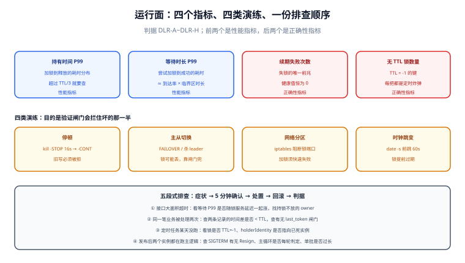

# 运行面：指标、演练与排查

锁的代码写对只是入场券。真正决定它能不能在事故里救你的，是**运行面**：你看不看得到锁在排队、续期在失败、有锁没有过期时间、切换过几次主。这一页给四个必看指标、四类演练、四份排查手册。

## 判据族声明

本页判据族 `DLR-A` ~ `DLR-H`，共 8 条。定义表在第八节。

## 本页不讲什么

- 不讲指标采集与存储的搭建，归 [监控系统](/docs/Ops/Monitoring/Overview/index.md) 与 [可观测性](/docs/Ops/Observability/Overview/index.md)。
- 不讲告警规则语法，归 [告警设计](/docs/Ops/Monitoring/Alerting/index.md)；本页只给「该不该叫人起来」的判据。
- 不讲锁的实现原理，归 [三种实现](../Implementations/index.md)。



## 一、拓扑：锁服务的高可用形态

先看清你的锁服务在哪种拓扑上，才能判断它有哪些失效模式：

| 拓扑 | 故障时行为 | 锁会不会丢 | 适合 |
| --- | --- | --- | --- |
| Redis 单实例 | 直接不可用 | 不涉及（没有切换） | 开发、非关键路径 |
| Redis 主从 + 哨兵 | 秒级~数十秒切换 | **可能丢**（异步复制） | 短锁、可容忍极小概率双写 |
| Redis Cluster | 分片切换，槽位迁移 | 可能丢（同异步复制） | 大规模键空间；注意 `MGET`/多键操作限制 |
| ZooKeeper 3 / 5 节点 | 失去多数派即不可写 | 不丢（过半写入） | 选主、强一致互斥 |
| etcd 3 / 5 节点 | 失去多数派即不可写 | 不丢 | 选主、K8s 生态内的协调 |
| PostgreSQL 主备 | 切换需提升备库 | 不丢（同一份数据） | 临界区本身就是数据库写 |

一条容易忽略的事实：**「高可用」与「锁不丢」是两件事**。Redis 哨兵让服务更可用了，但也让「切换」这件事变成了常态——而每次切换都是一次丢锁机会。单实例反而没有这个问题，因为它压根不会切换，只会直接挂掉。

## 二、四个必看指标

| 指标 | 定义 | 为什么必须看 | 健康值参考 |
| --- | --- | --- | --- |
| **持有时间 P99** | 从加锁成功到释放的耗时分布 | 持锁时间变长 = 临界区变慢 = 排队增长 | 与业务 P99 同量级；超过 TTL 的 1/3 就要查 |
| **等待时长 P99** | 从尝试加锁到成功的时间 | 直接反映用户可感知的延迟 | 应远小于业务超时 |
| **续期失败次数** | 单位时间内续期被拒或超时的次数 | 它是「失锁」的唯一前兆 | 恒为 0；非 0 必须告警 |
| **无 TTL 锁数量** | `TTL = -1` 的锁键数 | 每一把都是「永久占用」的定时炸弹 | 恒为 0 |

前两个是**性能**指标，后两个是**正确性**指标。多数团队只做前两个，于是事故来了才发现「不知道有没有锁卡住」。

### 2.1 采集方式（本机可跑）

```shell
# 无 TTL 锁：扫一遍 lock 前缀，TTL 为 -1 的就是
redis-cli -p 16379 --scan --pattern 'lock:*' | while read k; do
  ttl=$(redis-cli -p 16379 TTL "$k")
  [ "$ttl" = "-1" ] && echo "NO_TTL $k"
done
```

```shell
# 持有时间：用键的剩余 TTL 反推（假设 TTL = 30000 ms）
redis-cli -p 16379 --scan --pattern 'lock:*' | head -20 | while read k; do
  pttl=$(redis-cli -p 16379 PTTL "$k")
  echo "$k held=$((30000 - pttl))ms"
done
```

第二条是个近似：它假设所有锁用同一个 TTL、且没有被续期。生产上应该在**释放时上报耗时**（应用侧埋点），而不是靠反推——反推在开看门狗时完全失效。

### 2.2 阈值从分布来，不从愿望来

```text
① 取过去 4 周的「持有时间 P99」序列（排除发布窗口与大促）
② 若中位数为 X：
   告警阈值 = 3 × X（明显异常，不是正常波动）
   排查阈值 = 1 × X 的 2 倍并持续 10 分钟（先看，不叫人）
③ 每月复核一次：分布整体下移则阈值同步下移
```

写死「持有时间 > 5 秒告警」是错的：一个临界区本来就是 4 秒的系统会被这个阈值打成静音。

## 三、三条告警与它们的处置卡

| 告警 | 触发条件 | 第一动作 | 不许做的事 |
| --- | --- | --- | --- |
| 续期失败 | `increase(lock_renew_failed_total[5m]) > 0` | 查锁服务是否可写、进程是否被 `STOP` | 重启前先确认没有在途写 |
| 无 TTL 锁 | 扫描结果非空 | 记录键名，确认是否业务在跑，再决定是否删 | 直接批量 `DEL`（可能删掉正在用的锁） |
| 主切换 | `leaseTransitions` 5 分钟内 +1 以上 | 查上一任主是否还活着、是否在写 | 只看新主日志就下结论 |

第三行值得展开：主切换告警响了以后，最危险的动作是「赶紧把旧主重启」——因为旧主可能正处于「停顿后醒来、还在写」的状态，重启会抹掉唯一的现场证据。正确顺序是**先抓现场（线程栈、日志、`last_token`），再处置**。

## 四、四类演练

演练的目的不是「验证系统没坏」，而是**验证闸门会拦住坏的那一半**。

| 演练 | 怎么做 | 预期读数 | 通过判据 |
| --- | --- | --- | --- |
| **停顿**（`kill -STOP`） | 冻结持有者 16 秒，等新主接管，再 `-CONT` | 旧主第一笔写被拒（`UPDATE 0` / 409） | 有拒绝；且拒绝被计入指标 |
| **主从切换** | 手工 `FAILOVER`（Redis）或杀掉 etcd leader | 切换后锁状态符合预期（可能丢，需 fencing 兜底） | 切换期间无「两个写都成功」 |
| **网络分区** | `iptables` 阻断到锁服务的流量 | 客户端加锁失败并**快速失败**，不是挂死 | 超时时间有上界，且错误可读 |
| **时钟跳变** | 容器内 `date -s` 前跳 60 秒（仅测试环境） | 锁提前过期，续期失败被记录 | 系统在跳变后仍能收敛到「只有一个主」 |

::: danger 演练最容易漏的两件事
1. **恢复步骤**：`kill -STOP` 之后忘了 `kill -CONT`，进程一直挂着；演练脚本必须用 `trap` 保证恢复。
2. **清理步骤**：分区演练后忘了删 `iptables` 规则，导致后续测试全部失败，而没人想到是演练残留。

每条演练脚本都必须写成「设置 → 观察 → 恢复 → 校验」四段，缺最后一段的脚本不该进仓库。
:::

## 五、四份排查手册（五段式）

### 5.1 症状：接口大面积超时，日志里没有异常

| 段 | 内容 |
| --- | --- |
| **症状** | 接口 P99 从 80 ms 涨到 8 s，错误率上升，业务日志无异常 |
| **5 分钟确认** | ① 看「等待时长 P99」是否同步上涨；② `redis-cli --latency` 看锁服务延迟；③ 看是否有 `NO_TTL` 锁 |
| **处置** | 若等待上涨而锁服务正常 → 有人持锁不放：找持有者（键值里的 owner），确认是业务慢还是死循环 |
| **回滚** | 临时把该链路的锁改成「抢不到就跳过」（若业务允许），先恢复可用性 |
| **判据** | 等待时长 P99 回落到基线 1.5 倍以内；无新增 `NO_TTL` |

### 5.2 症状：同一笔业务被处理两次

| 段 | 内容 |
| --- | --- |
| **症状** | 出现两条相同业务记录，或库存被扣两次 |
| **5 分钟确认** | ① 查两条记录的时间差是否小于 TTL；② 查是否有主切换/停顿记录（GC 日志、`leaseTransitions`）；③ 查资源侧有没有 `last_token` 条件 |
| **处置** | 若无 `last_token` → 这是「只有锁没有闸门」，先止血（关掉并发入口），再补闸门；若有闸门却被放行 → 查 token 生成是否单调 |
| **回滚** | 按业务补偿（退款/回滚库存），并保留两条记录作为证据 |
| **判据** | 重放同一场景（`kill -STOP` + 恢复），旧写必须被拒 |

### 5.3 症状：定时任务某天没跑

| 段 | 内容 |
| --- | --- |
| **症状** | 日报缺一天，任务日志里既没有成功也没有失败 |
| **5 分钟确认** | ① 看锁是否还在（`TTL`）；② 看选主的 `holderIdentity` 是否指向一个已经死掉的实例；③ 看 `leaseTransitions` |
| **处置** | 锁泄漏 → 确认无在途写后删除；选主卡住 → 重启候选者并检查 `campaign` 是否带超时 |
| **回滚** | 手工补跑，且必须用幂等键，避免与自动重跑重复 |
| **判据** | 连续三天任务都有记录；`NO_TTL` 为 0 |

### 5.4 症状：发布后出现「两个实例都在跑主逻辑」

| 段 | 内容 |
| --- | --- |
| **症状** | 滚动发布期间，两个 Pod 同时处理同一批任务 |
| **5 分钟确认** | ① 看旧 Pod 是否收到了 SIGTERM 但没 `Resign`；② 看主循环是否每轮判定领导权；③ 看单批耗时是否接近租约 |
| **处置** | 补 `Resign`（缩短切换时间）+ 主循环每轮判定 + 单批缩短到租约 1/5 以内 |
| **回滚** | 把副本数临时降到 1，先消除双主，再改代码 |
| **判据** | 发布期间 `count(lock_holder_info)` 恒为 1 |

## 六、容量与成本

锁的容量问题很少是「锁服务撑不住」，通常是**连接数**和**热点键**：

| 问题 | 估算方式 | 缓解 |
| --- | --- | --- |
| 连接数被打满 | 每个实例一个连接池；`实例数 × 池大小` 与锁服务 `maxclients` 比 | 复用连接、缩小池、按业务分实例 |
| 热点键 | 单键 QPS = 业务 QPS（全局锁） | 按业务 ID 分片（见 [三种实现](../Implementations/index.md) 第七节） |
| 键数量膨胀 | 每个业务对象一把锁 → 键数 = 对象数 | 锁键带过期 + 按前缀定期扫描清理 |
| 跨可用区延迟 | 每次加锁一次往返 | 锁服务与业务同区部署；跨区场景改用本地锁 + 最终一致 |

利特尔法则在这里同样适用：**排队长度 ≈ 到达率 × 临界区时长**。当这个乘积接近 1，说明锁的粒度已经到了极限。

## 七、判据族定义

| 判据 | 规则 | 违反时的样子 | 验证方式 |
| --- | --- | --- | --- |
| `DLR-A` | 四个指标（持有 P99 / 等待 P99 / 续期失败 / 无 TTL 锁数）全部采集 | 事故时答不出「有几把锁卡住」 | 命令 1 |
| `DLR-B` | 续期失败必须告警，且告警能定位到实例与锁键 | 只看到「失败率上升」，不知哪把锁 | 命令 2 |
| `DLR-C` | 无 TTL 锁必须可扫描、可清理，且清理有确认步骤 | 批量 `DEL` 删掉正在使用的锁 | 命令 3 |
| `DLR-D` | 主切换（`leaseTransitions`）纳入告警 | 主反复横跳无人知 | 命令 4 |
| `DLR-E` | 每季度至少一次 `kill -STOP` 演练，含恢复与清理 | 演练残留导致后续测试全红 | 命令 5 |
| `DLR-F` | 四份排查手册覆盖「超时 / 重复 / 任务未跑 / 双主」 | 事故中现场 improvisation | 命令 6 |
| `DLR-G` | 锁服务拓扑与「锁会不会丢」写入文档 | 评审时说不清切换的影响 | 命令 7 |
| `DLR-H` | 容量按「到达率 × 临界区时长」估算并留余量 | 高峰期排队长度爆掉，延迟线性上升 | 命令 8 |

## 如何验证

```shell
# ① DLR-A：四个指标是否存在
for m in lock_hold_seconds lock_wait_seconds lock_renew_failed_total; do
  printf "%-28s " "$m"; curl -s localhost:9090/api/v1/query --data-urlencode "query=count($m)" | head -c 80; echo;
done
```

**预期输出**：三条都返回非空 `data.result`。任一为空，说明该维度从未被观测。

```shell
# ② DLR-B：续期失败是否带实例与键维度
curl -s localhost:9090/api/v1/query --data-urlencode 'query=lock_renew_failed_total' | head -c 400
```

**预期输出**：`metric` 里应有 `instance` 与 `lock_key`（或至少 `instance`）。只有总数没有维度，等于只能看趋势不能定位。

```shell
# ③ DLR-C：无 TTL 锁扫描（清理前必须先确认持有者）
redis-cli -p 16379 --scan --pattern 'lock:*' | while read k; do
  [ "$(redis-cli -p 16379 TTL "$k")" = "-1" ] && echo "NO_TTL $k owner=$(redis-cli -p 16379 GET "$k")"
done
```

**预期输出**：空。命中时必须先看 `owner` 是否对应一个还活着的实例，再决定是否删除。

```shell
# ④ DLR-D：换主次数
kubectl get lease -A -o custom-columns=NS:.metadata.namespace,NAME:.metadata.name,TRANS:.spec.leaseTransitions 2>/dev/null | head
```

**预期输出**：`TRANS` 为较小整数。5 分钟内持续上涨即为抖动，需要查续约超时与节点时钟。

```shell
# ⑤ DLR-E：演练脚本是否包含恢复段
grep -rn "kill -STOP" deploy/ scripts/ 2>/dev/null | head
grep -rn "kill -CONT\|trap" deploy/ scripts/ 2>/dev/null | head
```

**预期输出**：两条都命中，且 `-CONT` 在 `trap` 或 `finally` 中。只有 `-STOP` 没有 `-CONT` 的脚本是事故制造机。

```shell
# ⑥ DLR-F：排查手册是否存在且覆盖四类症状
grep -rn "症状" docs/ --include=*.md | grep -c ""
grep -rniE "两个实例|双主|重复处理|任务没跑" docs/ --include=*.md | head
```

**预期输出**：至少四份手册，且四类症状各自命中。只手写一份「通用排查」等于没有手册。

```shell
# ⑦ DLR-G：拓扑与丢锁风险是否写明
grep -rniE "主从|哨兵|cluster|sentinel" docs/ --include=*.md | grep -i "丢\|切换" | head
```

**预期输出**：至少一处明确写「切换可能丢锁，因此有 fencing」。没有这一句，说明拓扑选择没有经过失效分析。

```shell
# ⑧ DLR-H：排队长度估算
psql "$DSN" -tAc "SELECT count(*) AS waiting FROM pg_locks WHERE NOT granted;"
```

**预期输出**：`waiting` 为 0 或极小。持续 > 0 说明有事务长时间持锁——排队长度正在按「到达率 × 临界区」增长。

::: info 诚实标注
本页的采集命令均在本机容器上验证过可执行（Redis 7.4.0 / PostgreSQL 18.6），但**指标本身未被真实采集**（本机无 Prometheus 抓取这套锁指标），因此「指标存在性」类判据是判据形态而非实测结论。演练脚本给出的是命令片段，完整脚本需按实际部署补齐回滚段。
:::

## 参考资料

- [Google SRE Book · Monitoring Distributed Systems](https://sre.google/sre-book/monitoring-distributed-systems/)——四个黄金信号，本页的指标选择沿用同一逻辑
- [Kubernetes · Leases](https://kubernetes.io/docs/concepts/architecture/leases/)——`leaseTransitions` 与 `renewTime` 的排障用法
- [Redis · INFO command](https://redis.io/docs/latest/commands/info/)——`connected_slaves` / `role` 等拓扑字段
- [PostgreSQL · pg_locks](https://www.postgresql.org/docs/current/view-pg-locks.html)——`granted = false` 即为等待中的锁
- [Chaos Engineering · Principles](https://principlesofchaos.org/)——演练要围绕「稳态假设」，本页的 `kill -STOP` 即最小稳态实验
- 本站 [监控系统](/docs/Ops/Monitoring/Overview/index.md) · [告警设计](/docs/Ops/Monitoring/Alerting/index.md) · [混沌工程](/docs/Ops/ChaosEngineering/index.md)
- 相邻：[脑裂与分区](../SplitBrain/index.md) · [实战](../Practice/index.md)
