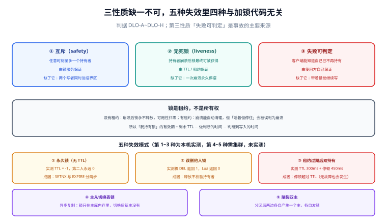

# 总览：三性质与五种失效

加锁失败并不可怕，可怕的是**加锁成功之后，锁悄悄没了**。前者会立刻报错，后者会让两个进程同时写同一行数据，而日志里两边都写着「已获得锁」。

本页把分布式锁该满足的性质一次性列清，然后把「失效」这件事拆成五种可复现的形态，最后给出一棵决策树回答「这个场景到底该不该上锁」。

## 判据族声明

本页判据族 `DLO-A` ~ `DLO-H`，共 8 条。定义表在第八节。

## 本页不讲什么

- 不讲具体实现的写法（`SET NX PX`、Lua、临时顺序节点），归 [三种实现](../Implementations/index.md)。
- 不讲 TTL 该设多少、看门狗怎么续，归 [租约与续期](../Lease/index.md)。
- 不讲选主与分区，归 [选主与领导权](../LeaderElection/index.md) 与 [脑裂与分区](../SplitBrain/index.md)。



## 一、三个性质必须同时成立

一个「能用的」分布式锁，必须同时满足三条。缺任何一条，它就不是锁，只是一段大多数时候看起来像锁的代码。

| 性质 | 严格表述 | 缺了它会怎样 |
| --- | --- | --- |
| **互斥（safety）** | 任意时刻至多一个客户端持有锁 | 两个写者同时进临界区，数据错乱且难以复现 |
| **无死锁（liveness）** | 持有者崩溃后，锁最终能被他人获得 | 一次进程崩溃让功能永久停摆，只能人工删 key |
| **失败可判定** | 客户端**能知道自己已经不再持有锁** | 进程带着「我持有锁」的错觉继续写，互斥在事实上被破坏 |

前两条几乎所有资料都会写，第三条最少被提，却是生产事故的主要来源。原因很直接：**前两条是锁服务的事，第三条是使用者的责任。**

::: danger 第三条不是「加个 try-catch」就能满足的
「失败可判定」要求客户端在**每一次可能产生副作用的外部写之前**，都有机会知道租约是否还有效。这意味着：

1. 锁的持有状态必须能被**重新查询或重新校验**，不能只存在本地一个 boolean 里；
2. 校验与写入之间的时间窗必须**小于剩余租约**，否则校验通过之后照样会过期；
3. 校验失败必须有明确的处置动作（停手 / 回滚 / 交由资源侧拒绝），而不是继续跑。

只做第 1 条、不做第 2 条，是「加了校验还是出事」的典型原因。真正的解法在 [fencing token](../Fencing/index.md)：把「是否还有效」的判断从**时间**换成**序号**，由资源侧裁决。
:::

## 二、锁是租约，不是所有权

分布式锁在实现上只有一种形态：**锁服务记下「某人持有，直到某时刻」**。这个「某时刻」就是租约（lease）。它不是为了省事才加的，而是因为**在没有租约的世界里，崩溃的持有者无法被安全地清理**——你分不清「他还在干活」和「他已经死了」。

于是有了分布式锁最重要的一次取舍：

```text
没有租约：崩溃 → 锁永不释放 → 可用性归零（只能人工干预）
有租约：  崩溃 → TTL 到期自动释放 → 但「活着但停住了」也会被误判为崩溃
```

第二行那个「但是」，就是全部麻烦的来源。停顿（GC、页交换、虚拟机挂起、CPU 被抢占、网络分区）在外部看来与崩溃**完全无法区分**，而停顿的进程醒来后仍然认为自己持有锁。

::: warning 一个必须记住的不等式
**「我持有锁」这个判断的有效期 = 锁的剩余 TTL − 我做判断所花的时间 − 我做完判断到真正写入所花的时间。**

后面两项通常被忽略，因为它们在正常情况下是微秒级。一旦进程被暂停，它们会瞬间变成「不可知」。所以任何「先查一次，然后干 5 秒活」的写法都在赌运气——除非这 5 秒活本身能被资源侧拒绝。
:::

## 三、五种失效模式

下面五种覆盖了生产上绝大多数「锁没起作用」的事故。第三列是本机实测的读数（Redis 7.4.0，2026-10）。

| # | 失效模式 | 机理 | 实测读数 |
| --- | --- | --- | --- |
| 1 | **永久锁** | `SETNX` 与 `EXPIRE` 分成两条命令，中间崩溃就没有 TTL | `SETNX` 后 `TTL` 返回 **-1**（永不过期），第二个客户端 `SETNX` 返回 **0**，永远抢不到 |
| 2 | **误删他人的锁** | 释放时直接 `DEL`，不校验持有者 | 裸 `DEL` 返回 **1**（删掉了别人的锁）；Lua 校验持有者后返回 **0**（拒绝） |
| 3 | **租约过期后双持有** | 持有者停顿超过 TTL，锁被他人获得，原持有者醒来继续写 | TTL=300 ms、停顿 450 ms 后 `PTTL` 返回 **-2**，第二个客户端加锁 **OK**，原持有者释放时返回 **0**——它已不是持有者，但它只能从这个返回值知道 |
| 4 | **锁服务主从切换丢锁** | 锁写在主库，异步复制尚未到从库就发生故障转移，新主没有这把锁 | 本机无多节点集群，**未实测**；机理与缓解见 [脑裂与分区](../SplitBrain/index.md) |
| 5 | **脑裂双主** | 网络分区把集群切成两半，两边各自产生一个「主」，各自发锁 | 本机无法构造分区，**未实测**；推演方法见 [脑裂与分区](../SplitBrain/index.md) |

第三种最值得盯：它不需要任何组件故障，只要**一次足够长的停顿**。而停顿是必然会发生的——一次 Full GC、一次容器内存回收、一次宿主机快照，都可能超过 300 ms。

::: danger 五种失效里有四种，加锁代码本身完全正确
第 3、4、5 种失效发生时，你的加锁、释放、续期全都写对了。这说明**正确性不在加锁那一行代码里**：它在「失锁之后还能不能写」这条链路上。只 review 加锁代码的评审，永远发现不了这三类问题。
:::

## 四、三种「锁」的边界

同一个业务需求，可能被三种完全不同的机制满足。选错层级，会在错误的维度上付出代价。

| 机制 | 作用范围 | 谁保证互斥 | 适用 | 代价 |
| --- | --- | --- | --- | --- |
| **本地锁**（`synchronized` / `ReentrantLock`） | 单进程内 | JVM 自身 | 单实例、或共享内存模型（如单进程多线程） | 多副本部署时**完全失效**，且不报错 |
| **数据库行锁 / 条件更新** | 数据库内 | 隔离级别与行锁 | 临界区本身就是一次数据库写 | 事务变长会放大锁等待与死锁概率；跨库无效 |
| **分布式锁**（Redis / etcd / ZK） | 跨进程、跨机器 | 锁服务 | 临界区包含**非数据库**的外部副作用（调第三方、发文件、改配置） | 多一个依赖、多一次网络往返、多一类失效模式 |

一条常被忽略的判断：**如果临界区只是一次条件更新，那根本不需要分布式锁。** 让数据库用 `UPDATE ... WHERE version = ?` 自己做掉，比引入一个锁服务安全得多——因为数据库的行锁与存储在同一事务里，不存在「锁和写之间隔着一次网络往返」的窗口。这条正是 [并发护栏](/docs/Backend/IdempotencyStateMachine/ConcurrencyGuard/index.md) 与项目侧 [看板与卡片读写接口](/project/Complete/TeamBoard/BoardCardApi/index.md) 的做法。

## 五、五问决策树：到底该不该上锁

按顺序问，任何一问答案是「否」，就不要上分布式锁。

```text
① 这些并发写，能不能合并成同一个结果？
   ├─ 能（计数器累加、状态置位、集合去重） → 用原子操作/条件更新，不上锁
   └─ 不能 → ②

② 临界区里有没有数据库管不到的副作用（调第三方、写对象存储、改配置中心）？
   ├─ 没有 → 用数据库事务/行锁，不上锁
   └─ 有 → ③

③ 最坏情况下，两个写者同时进行会造成什么？
   ├─ 只是浪费一次计算（可重入、幂等） → 不做强互斥，做幂等 + 去重
   └─ 数据错乱、重复扣款、重复发券 → ④

④ 你能接受「锁偶尔失效」吗？如果不能，资源侧能不能校验序号？
   ├─ 能校验（有版本号/序号字段） → 分布式锁 + fencing token（推荐）
   └─ 不能校验（第三方接口无幂等键） → ⑤

⑤ 能不能改成「先落库、再异步调」？
   ├─ 能 → 改成异步 + 幂等 + 补偿，锁只在调度那一步用
   └─ 不能 → 分布式锁 + fencing + 人工兜底预案（这是最后一档）
```

第五问最容易被人跳过。绝大多数「必须持锁调第三方」的场景，其实可以改成「本地事务里写一条待办记录，异步任务带幂等键去调」——一旦这么改，锁的作用域就从「整个第三方调用」缩成「抢一条待办」，风险下降一个数量级。

## 六、四种不该用锁的场景

| 场景 | 为什么不该用 | 该用什么 |
| --- | --- | --- |
| 保护一次数据库写 | 锁与写之间隔着网络，窗口比不用锁更大 | 条件更新 / `SELECT FOR UPDATE` |
| 限制 QPS | 锁是二值的，限流是计数的 | 令牌桶、滑动窗口，见 [高并发](/docs/Backend/HighConcurrency/index.md) |
| 保证「只处理一次」 | 锁只管同时，不管重试与重复投递 | 幂等键 + 去重表 |
| 让写操作「有序」 | 锁不保证顺序，只保证互斥 | 单调序号（`seq`）+ 乱序丢弃 |

第三条特别容易混淆：**锁与幂等解决的是两个正交的问题**。锁失效时幂等能救你一命，幂等失效时锁一点忙都帮不上——因为重复请求通常是**先后**到达的，锁早就释放了。

## 七、七条跨实现通用的纪律

这七条与用什么锁服务无关，任何实现都该遵守：

1. **加锁必须原子**：一条命令完成「不存在才设置」+「设置过期」，不允许分成两步。
2. **持有者身份必须唯一且可校验**：值是随机 UUID + 线程/实例标识，释放时比对。
3. **释放必须走「校验 + 删除」的原子脚本**，不能先 `GET` 再 `DEL`。
4. **TTL 必须大于「最大停顿 + 续期往返 + 安全余量」**，这个不等式在 [租约与续期](../Lease/index.md) 里给出推导。
5. **临界区里每次外部写之前，都要能知道自己是否还持有锁**；做不到就上 fencing。
6. **锁的获取要有超时与重试上限**，且重试要带抖动，否则一次抖动会把所有等待者同时唤醒。
7. **锁泄漏必须可观测**：没有 TTL 的锁、持有时间超过 P99 十倍的锁，都要能被数出来。

## 八、判据族定义

| 判据 | 规则 | 违反时的样子 | 验证方式 |
| --- | --- | --- | --- |
| `DLO-A` | 加锁用单条原子命令，禁止 `SETNX` + `EXPIRE` 两步写法 | 崩溃后锁永不过期（`TTL` 返回 -1），功能永久停摆 | 命令 1 |
| `DLO-B` | 锁的值包含唯一持有者标识，释放前必须比对 | 释放时删掉了他人的锁（`DEL` 返回 1） | 命令 2 |
| `DLO-C` | 释放必须是「比对 + 删除」的原子脚本 | 比对与删除之间被他人抢占，误删新持有者的锁 | 命令 3 |
| `DLO-D` | 临界区内每个外部副作用之前都能判定「是否仍持有锁」 | 停顿超过 TTL 后继续写，双写且日志无异常 | 命令 4 |
| `DLO-E` | 临界区只含数据库写时，改用条件更新而非分布式锁 | 多了一次网络往返，窗口反而更大 | 命令 5 |
| `DLO-F` | 锁的获取设置超时与上限，重试带抖动 | 锁服务抖动时全体等待者同频重试，把服务打崩 | 命令 6 |
| `DLO-G` | 锁与幂等同时存在，且两者都写明了「谁兜底」 | 重复请求被处理两次，而锁代码完全正确 | 命令 7 |
| `DLO-H` | 无 TTL 的锁、超长持有的锁必须可被数出来并告警 | 事故时说不清「现在有几把锁卡住了」 | 命令 8 |

## 如何验证

```shell
# ① DLO-A：全库搜两步写法（SETNX 之后紧跟 EXPIRE）
grep -rn "setIfAbsent\|SETNX\|setnx" src/main/java --include=*.java | grep -v "Duration\|TimeUnit"
```

**预期输出**：空。若命中，说明存在「先设值再补过期」的窗口——进程在两条命令之间崩溃就会留下永不过期的锁。本机实测该写法在崩溃后 `TTL` 为 **-1**，第二个客户端永远返回 0。

```shell
# ② DLO-B：锁的值是否带唯一标识（随机串 / 实例 ID / UUID）
grep -rn "tryLock\|lock(" src/main/java --include=*.java | grep -v "UUID\|instanceId\|ownerId" | head
```

**预期输出**：空或仅命中不涉及远端锁的方法。若持有者标识是常量（如 `"lock"`），任何持有者都无法证明自己是持有者。

```shell
# ③ DLO-C：释放逻辑是否为原子脚本（Lua / 事务）
redis-cli -p 16379 --no-raw EVAL \
  "if redis.call('GET',KEYS[1])==ARGV[1] then return redis.call('DEL',KEYS[1]) else return 0 end" \
  1 lab:lock someone-else
```

**预期输出**：`(integer) 0`。返回 0 表示脚本拒绝删除不属于自己的锁；若你的实现里这一步是裸 `DEL`，同一场景会返回 **1**（实测）。

```shell
# ④ DLO-D：临界区里有没有「重新校验租约」的调用
grep -rn "remainTimeToLive\|isHeldByCurrentThread\|getExpire" src/main/java --include=*.java | head
```

**预期输出**：临界区涉及外部副作用的方法里至少命中一次。空说明临界区从不回顾租约——停顿恢复后它无法知道锁已易主。

```shell
# ⑤ DLO-E：临界区是否只有数据库写（有则说明不该上锁）
grep -rn -A 20 "\.lock()" src/main/java --include=*.java | grep -c "jdbc\|mapper\.\|repository\."
```

**预期输出**：人工判读。若整段临界区只有数据库调用，把它改成条件更新（`UPDATE ... WHERE version = ?`）即可去掉锁服务依赖。

```shell
# ⑥ DLO-F：重试是否有上限与抖动
grep -rn "Thread.sleep\|backoff\|retry" src/main/java --include=*.java | grep -i lock
```

**预期输出**：重试必须有最大次数或总超时，且间隔带随机抖动。命中 `while (true)` 或固定 `sleep(100)` 即为不合格。

```shell
# ⑦ DLO-G：幂等键是否存在（与锁并存，而不是互相替代）
grep -rn "Idempotency-Key\|idempotency_key" src/main/java --include=*.java | head
```

**预期输出**：涉及「只处理一次」的接口必须命中。空说明系统把「不重复」全押在锁上，而锁在重试场景里已经释放。

```shell
# ⑧ DLO-H：数一数没有 TTL 的锁（本机沙箱，键名按实际前缀替换）
for k in $(redis-cli -p 16379 --scan --pattern 'lock:*'); do \
  [ "$(redis-cli -p 16379 TTL "$k")" = "-1" ] && echo "NO_TTL $k"; done
```

**预期输出**：空。任何 `-1` 都是一把永不过期的锁——它要么来自两步写法，要么来自被误改的续期逻辑。

::: info 诚实标注
上面八条中，①②③⑥⑦ 是**代码检索类**判据，可在本页直接执行；④⑤⑧ 需要具体工程与运行中的实例，本页给出的是判据形态。第三节的五种失效里，**第 1、2、3 种为本机实测**（Redis 7.4.0，容器 `teamboard-sandbox-cache-1`），第 4、5 种本机无法构造集群与分区，明确标为未实测。
:::

## 与「分布式调度与任务编排」的分工（第 180 天补充）

| 问题 | 归哪一页 |
| --- | --- |
| 锁的正确性来源、租约续期、Redis 主从丢锁 | **本页** |
| 调度器怎么用锁选出唯一调度者 | [分布式调度与任务编排](../../DistributedScheduling/index.md) 的「高可用」页 |
| 旧主恢复后仍写数据 | 该页的 **fencing token**；本页只讲锁，不讲写入守卫 |
| 一次任务只执行一次 | 该页的「认领必须带 `state` 条件更新」——**锁不能替代它** |

> 该页特有的一个坑：锁的 TTL 到期后，持锁者若还在执行，锁本身**不会阻止**它继续写。分布式锁保证的是「同一时刻只有一个人拿到锁」，不保证「拿到锁的人一定还活着」——后者只能靠 fencing token 在写入时校验。

## 参考资料

- [Martin Kleppmann · How to do distributed locking](https://martin.kleppmann.com/2016/02/08/how-to-do-distributed-locking.html)——「锁的两种用途」（效率 vs 正确性）与 fencing 的原始论述
- [Redis · Distributed Locks](https://redis.io/docs/latest/develop/use/patterns/distributed-locks/)——`SET NX PX` 的原子性说明与 Redlock 的官方描述
- [AWS Builders' Library · Timeouts, retries, and backoff with jitter](https://aws.amazon.com/builders-library/timeouts-retries-and-backoff-with-jitter/)——租约到期、重试与抖动为什么必须一起设计
- [PostgreSQL · Explicit Locking](https://www.postgresql.org/docs/current/explicit-locking.html)——行锁与咨询锁的语义边界，用于判断「该不该用分布式锁」
- 本站 [Redis 分布式锁](/docs/DB/NoRelational/Redis/Advanced/DistributedLock/index.md) · [并发护栏](/docs/Backend/IdempotencyStateMachine/ConcurrencyGuard/index.md) · [高并发系统设计](/docs/Backend/HighConcurrency/index.md)
- 相邻：[三种实现](../Implementations/index.md) · [租约与续期](../Lease/index.md) · [fencing token](../Fencing/index.md)
