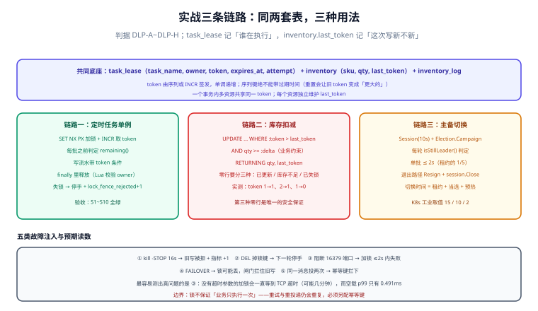

# 实战：单例任务、库存扣减与主备切换

前面八页讲的是判据。这一页把它们放进三条真实链路里：**定时任务只跑一次**、**库存不能被扣两次**、**主挂了之后新主能不能接住**。每条链路都给到「能照着写」的颗粒度：表结构、服务代码、故障注入、验收命令与预期读数。

## 判据族声明

本页判据族 `DLP-A` ~ `DLP-H`，共 8 条。定义表在第八节。

## 本页不讲什么

- 不讲为什么要有租约、token 的推导，归 [租约与续期](../Lease/index.md) 与 [fencing token](../Fencing/index.md)。
- 不讲选主的三种实现细节，归 [选主与领导权](../LeaderElection/index.md)。
- 不讲项目的完整业务（看板、卡片、权限），归 [在线协作任务看板](/project/Complete/TeamBoard/index.md)。



## 一、共同的表结构

三条链路共用两张表：一张记录「谁在执行、执行到哪」，一张是被保护的资源。

```sql
-- 任务租约：同一任务同一刻只有一个执行者
CREATE TABLE task_lease (
  task_name    text        PRIMARY KEY,
  owner        text        NOT NULL,            -- 实例 ID
  token        bigint      NOT NULL,            -- 单调递增，由序列/INCR 签发
  acquired_at  timestamptz NOT NULL DEFAULT now(),
  expires_at   timestamptz NOT NULL,
  attempt      int         NOT NULL DEFAULT 0   -- 重试次数，便于排障
);

-- 被保护的资源：记住见过的最大 token
CREATE TABLE inventory (
  sku         text   PRIMARY KEY,
  qty         int    NOT NULL CHECK (qty >= 0),
  last_token  bigint NOT NULL DEFAULT 0
);

-- 扣减流水：用于对账与事后取证
CREATE TABLE inventory_log (
  id         bigserial PRIMARY KEY,
  sku        text   NOT NULL,
  delta      int    NOT NULL,
  token      bigint NOT NULL,
  owner      text   NOT NULL,
  created_at timestamptz NOT NULL DEFAULT now()
);
```

`task_lease.token` 与 `inventory.last_token` 是同一套语义的两个落点：**前者证明「我有权执行」，后者证明「这次写是新的」**。只做前者，就是本专题反复说的「只有锁没有闸门」。

## 二、链路一：定时任务只跑一次

### 2.1 抢锁（Redis 侧最小实现）

```java
// 加锁：一条命令完成互斥 + 过期；token 由 INCR 签发，保证单调
public Optional<Lease> tryAcquire(String task, Duration ttl) {
    String key = "lock:task:" + task;
    String owner = instanceId + "|" + UUID.randomUUID();
    Boolean ok = redis.opsForValue().setIfAbsent(key, owner, ttl);
    if (!Boolean.TRUE.equals(ok)) {
        return Optional.empty();
    }
    Long token = redis.opsForValue().increment("lock:task:seq:" + task);
    return Optional.of(new Lease(task, owner, token, ttl));
}
```

```java
// 释放：必须比对持有者，且不能删掉别人的锁
private static final RedisScript<Long> RELEASE = new DefaultRedisScript<>(
    "if redis.call('GET', KEYS[1]) == ARGV[1] then return redis.call('DEL', KEYS[1]) else return 0 end",
    Long.class);

public void release(Lease lease) {
    Long r = redis.execute(RELEASE, List.of("lock:task:" + lease.task()), lease.owner());
    if (r == null || r == 0L) {
        metrics.counter("lock_renew_failed_total", "task", lease.task()).increment();
    }
}
```

### 2.2 执行（每轮判定 + 闸门）

```java
public void runOnce(String task) {
    tryAcquire(task, Duration.ofSeconds(30)).ifPresent(lease -> {
        try {
            // ① 落库登记：token 与 owner 一起写，便于事后归因
            leaseRepo.upsert(lease);

            // ② 每批之前判定一次（批次要短：≤ TTL/5）
            while (lease.remaining().toMillis() > 5_000 && batchHasMore(task)) {
                processBatch(task, 100, lease.token());
            }
        } finally {
            release(lease);          // 失败也要释放，避免占着不放
        }
    });
}
```

第二条判据藏在 `processBatch` 里：**每一批的写都要带 token 条件**。

```sql
-- 写流水时顺带推进 last_token，失败即说明已失锁
INSERT INTO inventory_log (sku, delta, token, owner)
SELECT :sku, :delta, :token, :owner
 WHERE :token > (SELECT COALESCE(MAX(token), 0) FROM task_lease WHERE task_name = :task);
```

### 2.3 为什么不用数据库唯一键直接搞定

可以用（见 [三种实现](../Implementations/index.md) 2.3），但定时任务多实例部署时，唯一键方案在「任务执行 3 分钟、租约 30 秒」的场景下需要自己实现续期。Redis + 看门狗省掉这部分代码，代价是多一个依赖与一类失效（主从切换）。

## 三、链路二：库存不能被扣两次

### 3.1 唯一正确的扣减语句

```sql
UPDATE inventory
   SET qty = qty - :delta,
       last_token = :token
 WHERE sku = :sku
   AND :token > last_token      -- 闸门：旧 token 的写一律拒绝
   AND qty >= :delta            -- 业务约束：不能扣成负数
RETURNING qty, last_token;
```

三分支处理：

| 返回 | 含义 | 动作 |
| --- | --- | --- |
| 一行，`qty` 已更新 | 成功 | 记流水、继续 |
| 零行 + `qty < delta` | 库存不足 | 返回业务错误（409 / 422），**不是**重试 |
| 零行 + token 不够大 | 已失锁 | 立即停手 + 上报 `lock_fence_rejected_total` |

这三者的区分必须显式做，否则「库存不足」会被当成「失锁」而触发无意义的补偿。

### 3.2 实测读数

本机 PostgreSQL 18.6（表 `locklab.ledger`，同构于上面的 `inventory`）：

```text
token=1 → UPDATE 1     （正常扣减）
token=2 → UPDATE 1     （新持有者扣减）
token=1 → UPDATE 0     （旧持有者醒来重放，被拒）
最终 balance=80, last_token=2
```

**第三次的 `UPDATE 0` 就是这套系统唯一真正的安全保证。** 没有它，前两次的扣减会被第三次覆盖或重复。

## 四、链路三：主备切换

### 4.1 选主 + 主循环

```java
// etcd 为例：Session 保活，Election 排队；丢权必须停手
Session session = concurrency.NewSession(cli, concurrency.WithTTL(10));
Election election = concurrency.NewElection(session, "/election/settle");

public void run() {
    election.campaign("node-a");                 // 阻塞直到当选
    try {
        while (!Thread.currentThread().isInterrupted()) {
            if (!isStillLeader(election)) {       // 每轮判定
                election.resign();                // 主动让位
                return;
            }
            settleOneBatch(500);                  // 单批 ≤ 2 秒（租约 10 秒的 1/5）
            Thread.sleep(200);
        }
    } finally {
        election.resign();                        // 退出路径也要让位
        session.close();
    }
}
```

### 4.2 切换时间的三个组成部分

```text
切换时间 = 租约到期（≤ TTL） + 新主 campaign 成功 + 新主预热
         = 10 s             + 毫秒级             + 业务决定（0.5~30 s）
```

Kubernetes 的 15/10/2 就是这个公式的一组工业取值。要缩短第一项只能缩短 TTL，但这会提高误判概率（停顿一次就换主）——**这就是租约三角的取舍**，见 [租约与续期](../Lease/index.md) 第一节。

## 五、五类故障注入与预期读数

| 注入 | 命令 | 预期读数 | 不通过的样子 |
| --- | --- | --- | --- |
| 持有者停顿 | `kill -STOP <pid>`，16 秒后 `kill -CONT` | 旧主第一笔写被拒（`UPDATE 0`），`lock_fence_rejected_total` +1 | 写入成功且无告警 |
| 锁被外部删除 | `redis-cli DEL lock:task:daily` | 下一轮 `remaining()` 判定失败并停手 | 继续写，直到 TTL 自然到期 |
| 锁服务不可达 | `iptables -A OUTPUT -p tcp --dport 16379 -j DROP` | 加锁在超时内失败（≤ 2 s），错误可读 | 请求挂死 30 秒以上 |
| 主从切换 | `redis-cli -p 16379 FAILOVER`（需从库） | 锁可能丢失；闸门拦住旧写 | 两笔写都成功 |
| 重复投递 | 同一消息投两次 | 第二次被幂等键或 `last_token` 拦下 | 扣减两次 |

第三条最容易测出真问题：**如果你的加锁代码没有超时参数，这里会挂死**。本机实测的空载获取延迟是 p99 **0.491 ms**，一旦网络被阻断，没有超时的实现会一直等到 TCP 超时（默认可能几分钟）。

## 六、验收序列（S1~S10）

按顺序执行，每步都有断言。全部通过才算这套锁「能上线」。

```shell
# S1 建表
psql "$DSN" -f deploy/sql/lock_tables.sql
psql "$DSN" -tAc "SELECT count(*) FROM information_schema.tables WHERE table_name IN ('task_lease','inventory','inventory_log');"
# 断言：3

# S2 初始数据
psql "$DSN" -tAc "INSERT INTO inventory(sku,qty,last_token) VALUES ('SKU-1',100,0) ON CONFLICT DO NOTHING; SELECT qty,last_token FROM inventory WHERE sku='SKU-1';"
# 断言：100|0

# S3 正常扣减（token=1）
psql "$DSN" -tAc "UPDATE inventory SET qty=qty-10,last_token=1 WHERE sku='SKU-1' AND 1>last_token AND qty>=10 RETURNING qty;"
# 断言：90

# S4 旧 token 重放（必须被拒）
psql "$DSN" -tAc "UPDATE inventory SET qty=qty-10,last_token=1 WHERE sku='SKU-1' AND 1>last_token AND qty>=10 RETURNING qty;"
# 断言：空（UPDATE 0）

# S5 新 token 正常（token=2）
psql "$DSN" -tAc "UPDATE inventory SET qty=qty-10,last_token=2 WHERE sku='SKU-1' AND 2>last_token AND qty>=10 RETURNING qty;"
# 断言：80

# S6 库存不足（不是失锁）
psql "$DSN" -tAc "UPDATE inventory SET qty=qty-1000,last_token=3 WHERE sku='SKU-1' AND 3>last_token AND qty>=1000 RETURNING qty;"
# 断言：空 —— 但日志里应记「库存不足」，不是「失锁」

# S7 并发 20 个进程各扣 1（token 递增）
seq 20 | xargs -P 20 -I{} psql "$DSN" -tAc "UPDATE inventory SET qty=qty-1, last_token=nextval('inventory_token_seq') WHERE sku='SKU-1' AND nextval('inventory_token_seq')>last_token AND qty>=1 RETURNING qty;"
# 断言：qty 最终 = 80 - 成功数；失败原因应全部是「token 不够大」，不能是负数

# S8 锁键无 TTL 检查
redis-cli -p 16379 --scan --pattern 'lock:task:*' | while read k; do [ "$(redis-cli -p 16379 TTL "$k")" = "-1" ] && echo "NO_TTL $k"; done
# 断言：空

# S9 停顿演练（16 秒后恢复）
PID=$(pgrep -f "your-app" | head -1); kill -STOP "$PID"; sleep 16; kill -CONT "$PID"
# 断言：恢复后第一笔写被拒 + 指标 +1

# S10 时延基线
redis-cli -p 16379 --latency -i 1 | head -3
# 断言：min/max/avg 均为亚毫秒级（本机实测 p50 0.245 ms、p99 0.491 ms）
```

::: danger S7 那条命令本身有个坑
`nextval()` 在 `WHERE` 里被调用一次、在 `SET` 里再调用一次，会消耗两个序列值——**两边不是同一个 token**。正确写法是先取一次再传入（子查询或 CTE）：

```sql
WITH t AS (SELECT nextval('inventory_token_seq') AS tok)
UPDATE inventory SET qty = qty - 1, last_token = (SELECT tok FROM t)
 WHERE sku = 'SKU-1' AND (SELECT tok FROM t) > last_token AND qty >= 1
RETURNING qty;
```

这是本页唯一一个「示例本身会错」的地方，写在这里是因为它在真实代码里极常见：任何在 SQL 里两次调用有副作用的函数，都会静默给出两个值。
:::

## 七、这套实现仍然不保证什么

必须写清边界，否则前面的判据会被当成「万无一失」：

| 不保证 | 原因 | 兜底 |
| --- | --- | --- |
| 业务只执行一次 | 锁只管同时，重试与重投递仍会重复 | 幂等键 + 去重表 |
| 主从切换时锁一定还在 | 异步复制 | 资源侧 token 闸门 |
| 停顿不超过 TTL | 停顿不可控 | 停手 + 闸门 |
| 第三方接口不被重复调用 | 第三方可能没有幂等键 | 本地 outbox + 异步 + 对账 |
| 数据最终一定正确 | 以上都只是「减少错误概率」 | 日终对账 + 差异挂账 |

## 八、判据族定义

| 判据 | 规则 | 违反时的样子 | 验证方式 |
| --- | --- | --- | --- |
| `DLP-A` | 任务租约表与资源表都记录 token，且 token 单调 | 只有锁、没有闸门，双写被放行 | S4 |
| `DLP-B` | 加锁带超时参数，失败快速返回 | 锁服务不可达时请求挂死 | 故障注入 3 |
| `DLP-C` | 单批耗时 ≤ TTL/5，批间判定领导权 | 旧主与新主处理同一批 | S9 |
| `DLP-D` | 扣减语句同时校验 token 与业务约束（`qty >= delta`） | 库存扣成负数，或被误判为失锁 | S6 |
| `DLP-E` | 「库存不足」与「已失锁」返回不同错误码 | 补偿逻辑被错误触发 | S6 + 日志 |
| `DLP-F` | 退出路径（含异常）都释放锁并 `resign` | 发布期间业务空转一个租约 | 代码审查 + S9 |
| `DLP-G` | 十步验收序列可一键执行并断言 | 「验证过了」无法复现 | S1~S10 |
| `DLP-H` | 边界（不保证什么）写入文档与值班手册 | 事故中把「锁」当「恰好一次」用 | 文档检索 |

## 如何验证

```shell
# ① DLP-A / DLP-D：闸门是否真的拦得住（两步，缺一不可）
psql "$DSN" -tAc "SELECT last_token FROM inventory WHERE sku='SKU-1';"
psql "$DSN" -tAc "UPDATE inventory SET qty=qty-1,last_token=1 WHERE sku='SKU-1' AND 1>last_token RETURNING qty;"
```

**预期输出**：第一行给出当前 `last_token`（如 `2`）；第二条为空（`UPDATE 0`），因为 1 不大于 2。若第二条返回了行，闸门形同虚设。

```shell
# ② DLP-B：加锁超时是否配置
grep -rn "tryLock\|setIfAbsent" src/main/java --include=*.java | grep -c "Duration\|TimeUnit\|timeout"
```

**预期输出**：大于 0，且调用处都能看到超时参数。为 0 说明锁服务抖动时请求会挂死。

```shell
# ③ DLP-C：单批耗时与租约的比值（用日志里的批耗时分布）
grep -h "batch_done" logs/app.log | tail -200 | awk -F'ms=' '{print $2}' | sort -n | tail -1
```

**预期输出**：最大值 ≤ TTL 的 1/5（TTL 30 秒 → ≤ 6 秒）。超出即需要缩小批大小。

```shell
# ④ DLP-E：两类失败是否返回不同码
grep -rn "INSUFFICIENT_STOCK\|STALE_TOKEN\|lease_lost" src/main/java --include=*.java | head
```

**预期输出**：至少两个不同的错误标识。只有一个（如笼统的 `409`）会让上层无法区分该重试还是该补偿。

```shell
# ⑤ DLP-F：退出路径是否释放
grep -rn -A 3 "finally" src/main/java/**/TaskRunner.java | grep -c "release\|resign"
```

**预期输出**：大于 0。`finally` 里没有释放，进程被 kill 时会残留锁直到 TTL 到期。

```shell
# ⑥ DLP-G：验收脚本是否一键可跑
ls deploy/scripts/verify_lock*.sh && bash deploy/scripts/verify_lock.sh 2>&1 | tail -5
```

**预期输出**：脚本存在且最后一行是汇总（如 `10/10 PASS`）。跑不起来或需要手工改参数的脚本不算验收。

```shell
# ⑦ DLP-A（补充）：token 序列是否单调
redis-cli -p 16379 INCR lock:task:seq:daily; redis-cli -p 16379 INCR lock:task:seq:daily
```

**预期输出**：两个递增整数。若序列被 `DEL` 过（重置为 1），旧 token 可能重新变成「更大的」——**序列键绝不能带过期时间**。

```shell
# ⑧ DLP-H：边界是否写明
grep -rniE "不保证|边界|恰好一次" docs/ --include=*.md | grep -i "锁" | head
```

**预期输出**：至少一处明确写出「锁不保证恰好一次」。没有这句，值班时一定会有人把锁当幂等用。

::: info 诚实标注
本页的 SQL 与 Java 代码为可照抄的实现骨架，**未在本仓构建运行**（`project/` 只存文档）；其中 `UPDATE ... WHERE :token > last_token` 的三段读数、Redis 加锁/释放的返回值、获取延迟分位均为本机容器实测（Redis 7.4.0 / PostgreSQL 18.6，2026-10-18）。S8、S9 需要真实运行中的应用进程，标为待执行。
:::

## 参考资料

- [Martin Kleppmann · How to do distributed locking](https://martin.kleppmann.com/2016/02/08/how-to-do-distributed-locking.html)——fencing 的必要性
- [Redis · Distributed Locks](https://redis.io/docs/latest/develop/use/patterns/distributed-locks/)——单实例加锁与释放的标准写法
- [Redisson · Configuration](https://redisson.pro/docs/configuration/)——看门狗与从库确认参数
- [PostgreSQL · UPDATE](https://www.postgresql.org/docs/current/sql-update.html)——`RETURNING` 与影响行数的判定
- [PostgreSQL · Sequences](https://www.postgresql.org/docs/current/functions-sequence.html)——`nextval` 的副作用与「不要在同一语句里调用两次」的原因
- 本站 [Redis 分布式锁](/docs/DB/NoRelational/Redis/Advanced/DistributedLock/index.md) · [幂等与状态机工程](/docs/Backend/IdempotencyStateMachine/Overview/index.md)
- 相邻：[fencing token](../Fencing/index.md) · [运行面](../Operations/index.md) · [常见问题](../FAQ/index.md)
