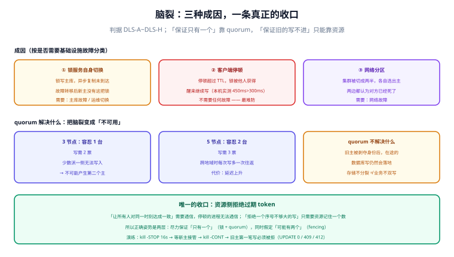

# 脑裂与分区

脑裂（split-brain）指的是**两个节点同时认为自己是主**。它不需要任何组件出 bug：一次网络分区、一次主从切换、一次足够长的停顿，就足以让两个进程各自握着一份「我是主」的证据继续干活。而两边的日志都是干净的。

这一页把三种成因拆开，说明 quorum 到底解决了什么、没解决什么，最后给出一个有点反直觉的结论：**没有任何机制能保证「同一刻只有一个写者」，能保证的只有「旧的写不进去」。**

## 判据族声明

本页判据族 `DLS-A` ~ `DLS-H`，共 8 条。定义表在第八节。

## 本页不讲什么

- 不讲选主的具体实现与代码，归 [选主与领导权](../LeaderElection/index.md)。
- 不讲 token 怎么签发与落地，归 [fencing token](../Fencing/index.md)；本页只论证「为什么最终必须靠它」。
- 不讲 Kubernetes 的网络模型与 CNI，归 [Kubernetes](/docs/Ops/Kubernetes/index.md)。



## 一、三种成因，都不是「bug」

| 成因 | 机理 | 是否需要组件故障 |
| --- | --- | --- |
| **锁服务自身切换** | 锁写主库，故障转移时新主没有这条记录，锁凭空消失 | 需要（主库故障或运维切换） |
| **客户端停顿** | 持有者被挂起超过 TTL，锁被他人获得，醒来继续写 | **不需要**，一次 Full GC 即可 |
| **网络分区** | 集群被切成两半，各自选出一个主（或各自能读到「锁是我的」） | 需要（网络故障） |

第二种最容易被低估，因为它**不依赖任何基础设施故障**。第 3 节的时序会说明：只要持有者停 450 ms、TTL 是 300 ms，双写就已经发生了——而这段时间里 Redis 运行完全正常。

## 二、quorum：解决了什么，没解决什么

共识型存储（etcd / ZK）用多数派（quorum）保证「同一刻只有一个主」：

| 集群规模 | 容忍故障节点 | 写需要 | 分区时的少数派 |
| --- | --- | --- | --- |
| 3 节点 | 1 | 2 票 | **无法写入**（只能读，且可能读到旧值） |
| 5 节点 | 2 | 3 票 | 无法写入 |
| 2 节点 | 0（没有容错） | 2 票 | 任意一侧都无法写入 |

关键在第三列：**少数派一侧无法写入，所以它不可能产生第二个主**。这就是 quorum 的全部价值——它把「脑裂」变成「不可用」。

代价同样直接：

1. **分区时牺牲可用性**。宁可拒绝服务，也不让两边都写。这是 CP 的定义。
2. **节点数必须是奇数**。偶数规模不会提高容错（4 节点仍需 3 票，与 3 节点相同，但多一台机器）。
3. **跨地域部署会拖慢写入**。多数派要求跨机房往返，延迟从亚毫秒涨到几毫秒到几十毫秒。

::: warning quorum 保证的是「存储不会分裂」，不是「业务不会双写」
如果你的业务逻辑是「从 etcd 抢到主 → 去写 MySQL」，那么 etcd 的 quorum 只保证「抢主」这一步不会分裂。**旧主在被剥夺主身份的那一刻，可能已经发出了一个正在路上的 MySQL 写请求**——quorum 管不到这一步。所以即使全部用共识型存储，仍然需要 fencing 或幂等。
:::

## 三、Redis 主从：一次完整的丢锁时序

Redis 主从是**异步复制**。这把锁的完整生命周期可能是这样：

```text
① 客户端 A → 主库：SET lock:job A NX PX 30000   → OK（只写在主库内存）
② 主库 → 从库：异步复制（尚未到达）
③ 主库宕机，哨兵/集群把从库提升为新主
④ 新主上不存在 lock:job（②没完成）
⑤ 客户端 B → 新主：SET lock:job B NX PX 30000   → OK
⑥ 此时 A 与 B 都持有锁；A 的 TTL 还剩 29 秒
```

三个缓解手段与其局限：

| 手段 | 做法 | 局限 |
| --- | --- | --- |
| `WAIT numreplicas timeout` | 写入后等待 N 个从库确认 | 只是缩小窗口；超时后仍然返回（不保证成功） |
| Redisson `checkLockSyncedSlaves`（默认 `true`，`slavesSyncTimeout` 默认 `1000 ms`） | 加锁后检查已同步从节点数 | 每次加锁多一次等待；`1000 ms` 的超时远大于锁本身延迟 |
| Redlock（多主独立加锁，过半成功） | 需多数独立实例同意 | 依赖各实例的时钟与「同时性」假设，2016 年的争论至今未有定论；运维复杂度高 |

结论：**这些手段都在降低概率，没有一个能消除。** 只要锁的存储是异步复制的，故障转移与「锁还在不在」之间就存在一个无法关闭的窗口。

## 四、分区时怎么选：一张必须提前填好的表

分区发生时，系统只有两种姿态。这个选择必须**在事故前**做，而不是在事故中争论：

| 维度 | 选 CP（拒绝服务） | 选 AP（继续服务） |
| --- | --- | --- |
| 典型实现 | etcd / ZK / 多数派数据库 | Redis 单实例 / AP 型存储 |
| 分区的少数派 | 写失败，读可能陈旧 | 继续读写，可能双写 |
| 用户感受 | 报错、超时 | 「看起来正常」但数据可能错 |
| 事后成本 | 明确的失败，好修 | 隐性不一致，难查、难补 |
| 适合 | 钱、库存、券、账 | 点赞数、在线状态、非关键计数 |

一条经验判断：**如果这类数据出错的修复成本高于「停 5 分钟」的成本，就选 CP。** 反过来，如果「停 5 分钟」的损失远大于数据轻微不一致，就选 AP，但**必须给这条链路配上 fencing 或幂等**。

## 五、为什么最终只有 fencing 能收口

把前面所有机制排一排，看它们各自能保证什么：

| 机制 | 保证 | 在「停顿」面前 |
| --- | --- | --- |
| 单实例锁 + TTL | 同一刻至多一个持有者（前提：不切换） | 停顿超过 TTL 即失效 |
| 主从 + `WAIT` | 缩小切换丢锁的窗口 | 停顿仍然失效 |
| quorum（etcd/ZK） | 存储不会分裂出两个主 | 停顿仍然失效：旧主不知道自己已被剥夺 |
| 选主 + `leaseTransitions` | 新主能被选出 | 旧主若停顿，醒来仍认为自己是主 |
| **资源侧拒绝过期 token** | **旧写者的写不进去** | **不受停顿影响** |

原因在于一个不对称：**「让所有人对同一时刻达成一致」需要通信，而停顿的进程无法通信；但「拒绝一个序号不够大的写」只需要资源自己记住一个数。** 前者要求全局协调，后者要求一次本地比较。

所以工程上的正确姿势是：**尽力保证「只有一个」（锁 + quorum），同时假定「可能有两个」（fencing）**。两层都要，缺一不可。

## 六、怎么发现「现在有两个主」

双主发生时，两边都认为自己正常。可用的检测手段有三类：

| 手段 | 做法 | 灵敏度 |
| --- | --- | --- |
| **周期号 / 任期号** | 每次换主 +1，写入携带周期号；资源侧拒绝旧周期 | 高（写入即被发现） |
| **token 单调性** | 资源侧记录 `last_token`，出现更小的写入即拒绝并告警 | 高 |
| **外部见证** | 第三方（如数据库的一行、对象存储的一个对象）记录「当前主是谁 + 时间」 | 中（依赖见证者的可用性） |
| **心跳对账** | 两个实例都向同一个地方上报「我是主」，出现两条即告警 | 中（有延迟） |

最实用的是前两条：它们不需要额外组件，且**在数据被写坏之前**就能拦住。第三条适合做辅助——尤其在「主不知道自己是不是主」的场景里。

## 七、一次脑裂推演：八步

不要等到事故才推演。把下面八步写成一次可执行的演练（本机单机无法构造分区，标注为推演脚本形态）：

```text
① 记录基线：当前主是谁（Lease.holderIdentity / 锁的 owner）
② 冻结旧主：kill -STOP <pid>（模拟停顿，不杀进程）
③ 等 TTL + 余量：确认新主已接管（Lease.holderIdentity 变化）
④ 让旧主恢复：kill -CONT <pid>
⑤ 观察旧主的第一次写：它带的是旧 token
⑥ 检查资源侧：该写是否被拒（UPDATE 0 / 409 / 412）
⑦ 若被放行 → 闸门缺失，这是必须修的缺陷（不是「偶发」）
⑧ 恢复后核对：两边日志里的「我是主」时间段有没有重叠
```

第 ⑦ 步是整场演练的目的。**如果旧主的写被放行了，说明系统只有「锁」没有「闸门」**——这时无论锁的实现在纸面上多正确，都不能算通过。

::: danger `kill -STOP` 是最便宜的故障注入
它不需要网络工具、不需要集群、不需要改配置：一条命令就能让进程「活着但停住」。而这恰好是最难被常规测试覆盖的一类失效——所有单元测试、集成测试都在进程正常运行的前提下编写。

注意：`kill -STOP` 之后必须 `kill -CONT`，否则进程会一直挂着；演练脚本里要用 `trap` 保证恢复。
:::

## 八、判据族定义

| 判据 | 规则 | 违反时的样子 | 验证方式 |
| --- | --- | --- | --- |
| `DLS-A` | 选主与强一致互斥不用异步复制的锁存储，或明确记录其失效概率 | 主从切换后双主，日志两边都正常 | 命令 1 |
| `DLS-B` | 集群规模为奇数，且 quorum 规则写入运维手册 | 偶数节点集群「以为能容错 2 台」 | 命令 2 |
| `DLS-C` | 分区姿态（CP / AP）按数据类型显式选择并写入文档 | 事故中现场争论「要不要停」 | 命令 3 |
| `DLS-D` | 存在 fencing 或等价的资源侧拒绝机制，且演练验证过 | 旧主醒来后的写被放行 | 命令 4 |
| `DLS-E` | 双主检测手段至少落地一种（周期号 / token / 见证） | 双写持续数小时无人发现 | 命令 5 |
| `DLS-F` | 每季度至少一次 `kill -STOP` 演练，含恢复步骤 | 演练从未做过，`kill -CONT` 被忘 | 命令 6 |
| `DLS-G` | 切换期间的「旧主作恶窗口」有上界，且与租约参数一致 | 租约 30 秒而预期「秒级切换」 | 命令 7 |
| `DLS-H` | 任何「我已失锁但仍继续写」的代码路径都被删除 | 代码里存在「尽力写完」的兜底 | 命令 8 |

## 如何验证

```shell
# ① DLS-A：锁存储的复制方式（Redis 侧看主从与持久化配置）
docker exec teamboard-sandbox-cache-1 redis-cli INFO replication | head -6
```

**预期输出**：`role:master` 且 `connected_slaves` 与实际拓扑一致。若为单实例（`connected_slaves:0`），说明当前**没有**主从切换丢锁的问题，但也**没有**高可用——这两种风险要分开记录。

```shell
# ② DLS-B：etcd / ZK 集群规模是否为奇数
kubectl -n kube-system get pods -l component=etcd -o name | wc -l
```

**预期输出**：3、5 之类的奇数。偶数规模不会提高容错能力，只会多一台机器。

```shell
# ③ DLS-C：分区姿态是否写明
grep -rniE "CP|AP|分区|split.?brain" docs/ --include=*.md | grep -i "取舍\|选择\|姿态" | head
```

**预期输出**：至少一处明确写出「本系统在分区时选择 __」。没有这一句，说明这个决策从未被做出。

```shell
# ④ DLS-D：资源侧是否存在 token 条件（闸门是否真实存在）
psql "$DSN" -tAc "UPDATE locklab.ledger SET balance = balance - 10, last_token = 1 WHERE id = 1 AND 1 > last_token;"
```

**预期输出**：`UPDATE 0`（本机实测）。若你的生产表没有 `last_token` 列，这一步根本无从执行——那就是「只有锁、没有闸门」。

```shell
# ⑤ DLS-E：双主检测指标是否存在
curl -s localhost:9090/api/v1/query --data-urlencode 'query=count(lock_holder_info) by (job)'
```

**预期输出**：每个 job 只有 1 个时间序列。出现 2 个即「同一 job 有两个主」——这是最直接的双主告警。

```shell
# ⑥ DLS-F：演练脚本是否可执行（本机可跑的最小版本）
pgrep -f "your-app" | head -1 | xargs -I{} sh -c 'kill -STOP {}; sleep 16; kill -CONT {}'
```

**预期输出**：进程被冻结 16 秒后恢复。期间应能在监控上看到「续约失败 / 新主接管」；恢复后旧主的第一笔写必须被资源拒绝。

```shell
# ⑦ DLS-G：旧主作恶窗口与租约参数是否一致
kubectl get lease order-scheduler -o jsonpath='{.spec.leaseDurationSeconds}{"s\n"}'
```

**预期输出**：一个明确的秒数（K8s 默认 15）。文档里声称的「秒级切换」若小于这个数，说明对窗口的理解有误。

```shell
# ⑧ DLS-H：代码里是否存在「失锁后仍然写完」的兜底
grep -rn -B 3 "catch (.*Lock.*Exception" src/main/java --include=*.java | head
```

**预期输出**：catch 块里应是「中止 + 记录 + 上报」，不出现「继续执行」「忽略」「retry until success」。

::: info 诚实标注
本机为单实例 Redis + 单实例 PostgreSQL，**无法构造主从切换与网络分区**，因此第 1、2、3 类成因中的「锁服务切换」与「分区」在本页只做机理推演，未实测；「客户端停顿」类失效已在 [租约与续期](../Lease/index.md) 用 Redis 7.4.0 实测（TTL 300 ms、停顿 450 ms → 双持有）。凡写「实测」的均为容器内真实读数，其余标为推演。
:::

## 参考资料

- [Martin Kleppmann · How to do distributed locking](https://martin.kleppmann.com/2016/02/08/how-to-do-distributed-locking.html)——「为什么 Redlock 在时钟与停顿面前不成立」的完整论证
- [Redis · Distributed Locks](https://redis.io/docs/latest/develop/use/patterns/distributed-locks/)——主从异步复制与 Redlock 的设计前提
- [etcd · FAQ: Why odd number of members](https://etcd.io/docs/latest/faq/)——quorum 与奇数节点的官方解释
- [Kubernetes · Leases](https://kubernetes.io/docs/concepts/architecture/leases/)——`leaseTransitions` 的含义与使用
- [PostgreSQL · Explicit Locking](https://www.postgresql.org/docs/current/explicit-locking.html)——资源侧条件更新所依赖的行锁语义
- 本站 [Redis 分布式锁](/docs/DB/NoRelational/Redis/Advanced/DistributedLock/index.md) · [Kubernetes](/docs/Ops/Kubernetes/index.md)
- 相邻：[fencing token](../Fencing/index.md) · [运行面](../Operations/index.md)
