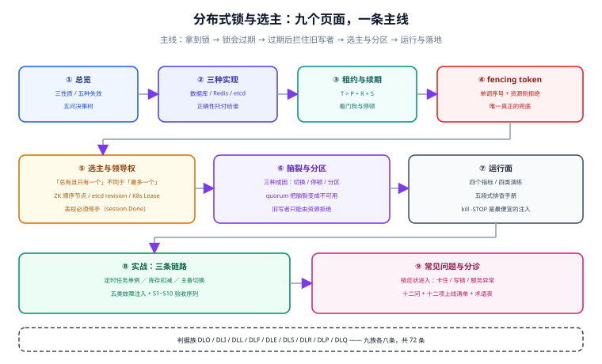

# 分布式锁与选主

分布式锁要解决的是一个听起来很简单的问题：**多个进程，同一时刻，只允许一个进来。** 但它真正的难点不在「怎么加锁」，而在**加锁之后你怎么知道锁还在自己手里**。网络会抖、进程会停、主库会切、机器会被挂起——这些都不是异常路径，而是分布式系统的日常。锁服务在某一刻认定「你的租约过期了」，而你的进程还在慢悠悠地写数据库，这一刻两个进程就同时处在临界区里，而双方都不知道。

本专题讲的就是这一段：**锁的三种实现各自把正确性托付给了谁、租约为什么必然会过期、过期之后靠什么拦住旧的写入者、选主和加锁差在哪、以及脑裂发生时唯一真正有效的那道闸门。**

::: tip 一句话理解
分布式锁的终点不是「拿到锁」，而是「**在失去锁之后，旧持有者的写操作一定进不去**」。前一半由锁服务保证，后一半只能由**资源自己**保证——这就是 fencing token 存在的全部理由。没有后一半的分布式锁，只是「大多数时候看起来是互斥的」。
:::

## 与相邻专题的分工

「分布式锁」「并发控制」「幂等」「选主」四个词经常混着用，边界必须先写死：

| 专题 | 讲什么 | 与本专题的关系 |
| --- | --- | --- |
| 本专题 | **锁与选主的正确性**：三性质、租约、fencing、选主、脑裂、运行面 | —— |
| [Redis · 分布式锁与 Lua](/docs/DB/NoRelational/Redis/Advanced/DistributedLock/index.md) | Redis **单机实现细节**：`SET NX EX`、Lua 校验释放、Redisson 可重入、Redlock 争议、Lua 语言本身 | 那边回答「**在 Redis 上怎么写**」，本专题回答「**写对了没有、失效时谁来兜底**」；本专题不重复 Lua 语法与 Redlock 论战 |
| [幂等与状态机 · 并发护栏](/docs/Backend/IdempotencyStateMachine/ConcurrencyGuard/index.md) | `version` 乐观锁、条件更新、fencing 在「**一次请求只写一次**」语境下的用法 | 那边把 token 当成**行级版本号**，本专题把它当成**锁服务签发的单调序号**；两页的 token 不同源，不能互换 |
| [幂等键设计](/docs/Backend/IdempotencyStateMachine/IdempotencyKey/index.md) | 去重表与 `Idempotency-Key` | 锁解决「同时」，幂等解决「重复」；两件事都要做，但**互不替代** |
| [分布式缓存](/docs/Backend/DistributedCache/index.md) | 缓存一致性、热点治理、多级缓存 | 缓存重建锁是锁的一个**特例**：那把锁允许「拿不到就直接算」，本专题讨论的是「拿不到必须等」的那一类 |
| [高并发系统设计](/docs/Backend/HighConcurrency/index.md) | 分层限流、排队削峰、热点拆分 | 那边用**排队与限流**避免竞争，本专题用**互斥**处理竞争；能用前者解决的场景不该上锁 |
| [PostgreSQL](/docs/DB/Relational/PostgreSQL/index.md) | 行锁、隔离级别、`FOR UPDATE` 语法 | 语法与隔离级别归那边；本专题的 [三种实现](./Implementations/index.md) 只讲「数据库当锁服务时的**安全性来源**」 |
| [实时协作与冲突解决](/docs/Backend/RealtimeCollaboration/index.md) | OT / CRDT、协同编辑的一致性模型 | 那边让**并发写可以合并**（无锁）；本专题让**并发写必须排队**（有锁）。选哪条路取决于「两类写能不能合并成同一个结果」 |
| [Kubernetes](/docs/Ops/Kubernetes/index.md) | 副本、探针、滚动更新 | 那边保证「进程被重启」，本专题讲**重启期间那 15 秒里谁在干活**（`Lease` 对象与 leaderelection） |
| [在线协作任务看板 · 看板与卡片读写接口](/project/Complete/TeamBoard/BoardCardApi/index.md) | 上述原则在一个真实项目里的落地：条件更新、409 语义、重试预算 | 那边是**施工**，本专题是**判据**；判据族不同（`DL-` 系 vs `BC-`），互不覆盖 |

## 专题地图

| 页面 | 内容 | 适合谁读 |
| --- | --- | --- |
| [总览：三性质与五种失效](./Overview/index.md) | 互斥 / 无死锁 / 失败可判定；租约不是所有权；五种失效模式与五问决策树 | 所有人，先读 |
| [三种实现与安全性来源](./Implementations/index.md) | 数据库 / Redis / etcd·ZK 各自把正确性托付给谁；最小正确写法；选型矩阵 | 要选型的人，**重点读** |
| [租约与续期](./Lease/index.md) | TTL 三角公式、看门狗、续期失败三态、时钟漂移、停顿来源清单 | 写锁封装的人，**重点读** |
| [fencing token](./Fencing/index.md) | token 由谁签发、资源侧怎么强制、三个落地位置、五种反模式 | 所有人，**必读** |
| [选主与领导权](./LeaderElection/index.md) | 锁与选主的四条差别、ZK/etcd/K8s 三种实现、丢权必须停手 | 做单例任务与主备切换的人 |
| [脑裂与分区](./SplitBrain/index.md) | 三种成因、quorum 的作用与代价、为什么只有 fencing 能收口 | 值班与架构评审 |
| [运行面：指标、演练与排查](./Operations/index.md) | 四个必看指标、四类演练、五段式排查手册 | 运维与值班 |
| [实战：单例任务、库存扣减与主备切换](./Practice/index.md) | 三条链路的完整实现、五类故障注入、验收命令 | 要落地的人 |
| [常见问题与分诊](./FAQ/index.md) | 分诊树、十二问、十二项上线清单、术语表 | 所有人 |

## 四条底层判断（先记住这四句）

十页内容可以压成四句话。如果只读一段，读这段：

| 判断 | 含义 | 违反它的典型后果 |
| --- | --- | --- |
| **锁是租约，不是所有权** | 你买到的是「一段时间的使用权」，不是「永久的所有权」 | 把锁当所有权，于是从不校验续期结果——停顿一次就双写一次 |
| **租约一定会过期，所以必须能判失败** | 任何「我还在持有锁」的判断都有时效 | 停顿超过 TTL 之后，进程仍按「我持有锁」继续写，而新持有者已经在写了 |
| **互斥由锁服务保证，安全由资源保证** | 锁服务最多保证「同一刻只发一张票」，管不了「过期的票还能不能用」 | 只有锁、没有 fencing：主从切换、分区、停顿三种情况下都会出现两个写者 |
| **选主要求「总有一个」，加锁要求「最多一个」** | 两者的活性目标相反，不能共用一套参数 | 用锁的参数做选主：故障后长时间没有主，单例任务停摆 |

## 成熟度五档

锁这件事最容易「上到一半」：加了锁、也设了过期时间，但**从来没人验证过失锁之后会发生什么**。按下面五档对照：

| 档位 | 特征 | 只补一件事 |
| --- | --- | --- |
| L0 | 用 `SETNX` + 单独 `EXPIRE`，释放直接 `DEL` | 改成 `SET NX PX` 一条命令，释放改成 Lua 校验持有者（见 [三种实现](./Implementations/index.md)） |
| L1 | 加锁正确，但临界区里没有任何「我还持有锁吗」的判断 | 给临界区加**分段校验**：每次外部写之前检查一次租约，见 [租约与续期](./Lease/index.md) |
| L2 | 有租约校验，但资源侧无条件接受写入 | 引入 [fencing token](./Fencing/index.md)：资源侧 `WHERE token > last_token` 强制 |
| L3 | 单实例锁 + fencing 都到位，但锁服务是单点 | 补 [脑裂](./SplitBrain/index.md) 推演：主从切换后那把锁还在不在 |
| L4 | 锁、fencing、选主、演练四件齐备，每次故障都有对应判据 | 做一次**刻意杀主**演练：`kill -STOP` 15 秒后确认旧写者被资源拒绝，见 [运行面](./Operations/index.md) |

## 判据族总览

九个页面各八条，共 **72** 条。判据的写法统一为「规则 + 违反时的样子 + 怎么验证」，验证一节给出可执行命令与预期读数。

| 页面 | 判据族 | 覆盖的约定 | 条数 |
| --- | --- | --- | --- |
| [总览](./Overview/index.md) | `DLO-A` ~ `DLO-H` | 三性质、租约语义、五种失效、决策树 | 8 |
| [三种实现](./Implementations/index.md) | `DLI-A` ~ `DLI-H` | 原子加锁、持有者校验、安全性来源、选型 | 8 |
| [租约与续期](./Lease/index.md) | `DLL-A` ~ `DLL-H` | TTL 三角、续期、停顿、时钟 | 8 |
| [fencing](./Fencing/index.md) | `DLF-A` ~ `DLF-H` | 单调签发、资源侧强制、跨资源、重试 | 8 |
| [选主](./LeaderElection/index.md) | `DLE-A` ~ `DLE-H` | 租约续期、丢权停手、优雅退出、分片 | 8 |
| [脑裂](./SplitBrain/index.md) | `DLS-A` ~ `DLS-H` | quorum、主从切换、分区、见证 | 8 |
| [运行面](./Operations/index.md) | `DLR-A` ~ `DLR-H` | 指标、告警、演练、排查 | 8 |
| [实战](./Practice/index.md) | `DLP-A` ~ `DLP-H` | 三条链路、故障注入、验收 | 8 |
| [常见问题](./FAQ/index.md) | `DLQ-A` ~ `DLQ-H` | 分诊、清单、反模式 | 8 |

## 事实与版本速览（2026-10）

本专题讲机制，但机制落在具体组件上。下表每一行都标注了核对渠道，「本机实测」指本文档写作时在本机容器里真跑出来的读数。

| 项 | 当前事实（2026-10） | 对判断的影响 |
| --- | --- | --- |
| Redis | **8.10.2**（2026-09-17 发布）；本机实测 **7.4.0** | 单机 `SET NX PX` 的原子性两个版本一致；集群模式下的槽位与主从语义才是变量 |
| Redisson | **4.8.0**（2026-10-02）；`lockWatchdogTimeout` 默认 **30000 ms**；`checkLockSyncedSlaves` 默认 **true**、`slavesSyncTimeout` 默认 **1000 ms** | 看门狗窗口 30 秒意味着「停顿 30 秒内锁不会丢」——这不是安全，是**默认参数下的运气** |
| etcd | **3.7.2**（2026-09-22）；3.6.14 / 3.5.33 同日补丁（2026-07-23） | 选主走 Raft 多数派，锁的语义由 revision 单调性保证 |
| ZooKeeper | **3.9.7** | 临时顺序节点仍是「会话断了锁就没了」最干净的实现 |
| Kubernetes | **1.37.1**（2026-09-23）；leaderelection 默认 `leaseDuration=15s` / `renewDeadline=10s` / `retryPeriod=2s`，资源锁类型 `leases` | 15 秒是「旧主可以继续作恶」的上界，也是新主接管的最短等待 |
| PostgreSQL | 本机实测 **18.6** | 会话级咨询锁可重入、断开即释放；事务级在 `COMMIT` 释放（实测读数见 [三种实现](./Implementations/index.md)） |

::: info 版本组织说明
本专题**不按大版本建目录**。它讲的是机制（租约、fencing、quorum、选主），机制的有效期远长于组件版本；组件侧的版本事实集中在上面这张表与各页脚注里，并标注核对日期。需要按大版本分目录的是**框架与语言**类主题，范例见 [Spring5](/docs/Backend/Java/Frame/Spring/Spring5/index.md) / [Spring6](/docs/Backend/Java/Frame/Spring/Spring6/index.md)——旧版本一律保留、标注状态、不覆盖。
:::

## 学习路径

1. **先读 [总览](./Overview/index.md)**：三性质与五种失效决定后面八页的读法。跳过它最容易犯的错是把「加锁成功」当成「互斥成立」。
2. **要选型，读 [三种实现](./Implementations/index.md)**：它给的不是「哪个快」，而是「出事时谁负责」。
3. **要写锁封装，连着读 [租约与续期](./Lease/index.md) 与 [fencing](./Fencing/index.md)**：前者决定「多久会失锁」，后者决定「失锁之后还能不能写」。
4. **做单例任务或主备切换，读 [选主](./LeaderElection/index.md)**：`session.Done()` 不消费，是这类系统最常见的一处漏。
5. **做架构评审或值班，读 [脑裂](./SplitBrain/index.md) 与 [运行面](./Operations/index.md)**：前者给推演方法，后者给判据与排查顺序。
6. **要落地，读 [实战](./Practice/index.md)**：三条链路 + 五类故障注入，每条都有可复制的命令。
7. **收尾看 [常见问题](./FAQ/index.md)**：它按症状组织，出问题时从症状进入，不从章节进入。

## 与项目侧的接口

本专题的判据在第 159 天落到了一个真实项目上：[在线协作任务看板 · 看板与卡片读写接口](/project/Complete/TeamBoard/BoardCardApi/index.md)。那一页做的事是**把判据变成代码**：条件更新的 SQL、`409` 的生成与消费、重试预算、以及「两个人同时拖同一张卡片」的实测读数。

两侧分工：

- **本专题**：锁与选主该满足什么、失效时怎么判、验证命令是什么。
- **项目侧那页**：这些判据落在哪条 SQL、哪个异常映射、哪次重试上，以及在这套技术栈里踩到的具体坑。

## 参考资料

- [Martin Kleppmann · How to do distributed locking](https://martin.kleppmann.com/2016/02/08/how-to-do-distributed-locking.html)——fencing token 的原始论述，本专题第五页的骨架来自这篇
- [Redis · Distributed Locks](https://redis.io/docs/latest/develop/use/patterns/distributed-locks/)——单实例方案的官方描述与 Redlock 算法
- [Redisson · Configuration](https://redisson.pro/docs/configuration/)——`lockWatchdogTimeout` / `checkLockSyncedSlaves` 等默认值的官方出处
- [etcd · Concurrency package](https://pkg.go.dev/go.etcd.io/etcd/client/v3/concurrency)——`Election`、`Session` 与租约的接口约定
- [Kubernetes · kube-controller-manager flags](https://kubernetes.io/docs/reference/command-line-tools-reference/kube-controller-manager/)——`--leader-elect-*` 三个默认值的官方文档
- [PostgreSQL · Explicit Locking](https://www.postgresql.org/docs/current/explicit-locking.html)——行锁、表锁与咨询锁的语义边界
- 本站 [Redis 分布式锁](/docs/DB/NoRelational/Redis/Advanced/DistributedLock/index.md) · [并发护栏](/docs/Backend/IdempotencyStateMachine/ConcurrencyGuard/index.md) · [分布式缓存](/docs/Backend/DistributedCache/index.md) · [实时协作](/docs/Backend/RealtimeCollaboration/index.md)
