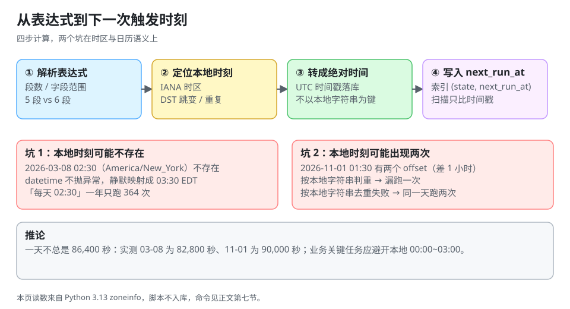

# Cron 语义：时区、DST 与下一次触发时间

一个 cron 表达式只描述「本地日历上的哪些时刻」，它**故意不描述**「这些时刻在物理时间上间隔多久」。这句话是所有「半夜三点跑两次」「夏令时那天没跑」事故的总根源。

::: tip 一句话理解
Cron 的语义是**日历**，不是**间隔**：`0 2 * * *` 的意思是「每个日历日的 02:00」，而有的日子**没有 02:00**，有的日子**有两次 01:30**。
:::



## 一、字段与语义

### 1. 五段 vs 六段

| 实现 | 字段 | 秒 | 年 | 特殊符号 |
| --- | --- | --- | --- | --- |
| Unix crontab / K8s CronJob | 5 段：分 时 日 月 周 | 无（最小粒度 1 分钟） | 无 | `*` `,` `-` `/` |
| Quartz | 6~7 段：秒 分 时 日 月 周 (年) | 有 | 可选 | 额外支持 `?` `L` `W` `#` |
| Spring `@Scheduled` | 6 段（秒在前） | 有 | 无 | 与 Quartz 相近，**不支持** `L` `W` |
| XXL-JOB | 6 段（秒在前） | 有 | 无 | 不支持 `?` 以外的 Quartz 扩展 |

**最容易踩的一条**：`0 0 3 * * ?` 这串在 Spring 与 Quartz 里是「每天 03:00:00」，但直接贴进 K8s CronJob 会**报错**（K8s 只收 5 段）。跨平台复制表达式之前先数段数。

### 2. `日` 与 `周` 的「或」关系

五段式里 `日`（day-of-month）与 `周`（day-of-week）是 **OR**，不是 AND：

| 表达式 | 直觉理解 | 实际语义 |
| --- | --- | --- |
| `0 0 3 1 * 1` | 每月 1 日**且**是周一 | 每月 1 日**或**每周一（每月约 5 次，不是 1 次） |
| `0 0 3 1 * *` | 每月 1 日 | 每月 1 日（正确） |
| `0 0 3 * * 1` | 每周一 | 每周一（正确） |

Quartz 用 `?` 来消除这个歧义：`0 0 3 1 * ?` 明确「只看日，不看周」。**五段式的 cron 没有 `?`**，所以要「每月 1 日且是周一」这种语义，只能写两条任务或用支持扩展的库。

### 3. Quartz 扩展：`L` `W` `#`

| 符号 | 含义 | 例子 | 一年触发次数 |
| --- | --- | --- | --- |
| `L`（日） | 当月最后一天 | `0 0 3 L * ?` | 12 |
| `L`（周） | 本周最后一天（周六） | `0 0 3 ? * L` | 52~53 |
| `W` | 最近的工作日 | `0 0 3 15W * ?` | 12（遇周末前/后移） |
| `#` | 第 n 个周几 | `0 0 3 ? * 2#2` | 12（每月第二个周二） |

这四种写法在五段式里**全都没有对应物**，用 `28`（代替「最后一天」）会在 2 月漏跑、在 31 天的月份晚跑。

## 二、DST：两天不是 86,400 秒

夏令时（Daylight Saving Time，DST）不是「时钟拨一下」这么简单，它会让**某些本地时刻不存在，某些本地时刻出现两次**。本机实测（`zoneinfo`，America/New_York，2026 年）：

| 日期 | 这一天有多长 | 发生了什么 |
| --- | --- | --- |
| 2026-03-08 | **82,800 秒**（23 小时） | 02:00 → 03:00，本地时间 02:00~02:59 **不存在** |
| 2026-11-01 | **90,000 秒**（25 小时） | 02:00 → 01:00，本地时间 01:00~01:59 **出现两次** |
| 其余 363 天 | 86,400 秒 | 正常 |

```python
from datetime import datetime, timezone
from zoneinfo import ZoneInfo

NY = ZoneInfo("America/New_York")

# ① 不存在的本地时间：不会抛异常，被静默映射到跳变之后
t = datetime(2026, 3, 8, 2, 30, tzinfo=NY)
print("声明的墙上时间 :", "2026-03-08 02:30")
print("utcoffset      :", t.utcoffset())
print("换算成 UTC     :", t.astimezone(timezone.utc).isoformat())
print("再转回本地     :", t.astimezone(timezone.utc).astimezone(NY).isoformat())

# ② 重复的本地时间：同一个墙上时间对应两个不同的物理时刻
a = datetime(2026, 11, 1, 1, 30, tzinfo=NY, fold=0)
b = datetime(2026, 11, 1, 1, 30, tzinfo=NY, fold=1)
print("fold=0 →", a.astimezone(timezone.utc).isoformat(), a.utcoffset())
print("fold=1 →", b.astimezone(timezone.utc).isoformat(), b.utcoffset())
print("两者相差小时数 :", round((b.timestamp() - a.timestamp()) / 3600, 1))
```

预期输出：

```text
声明的墙上时间 : 2026-03-08 02:30
utcoffset      : -1 day, 19:00:00
换算成 UTC     : 2026-03-08T07:30:00+00:00
再转回本地     : 2026-03-08T03:30:00-04:00
fold=0 → 2026-11-01T05:30:00+00:00 -1 day, 20:00:00
fold=1 → 2026-11-01T06:30:00+00:00 -1 day, 19:00:00
两者相差小时数 : 1.0
```

两条读数都很关键：

1. **不存在的 02:30 被静默变成了 03:30**（`datetime` 不抛异常）。所以「每天 02:30 的任务」在 3 月 8 日那天实际跑在 03:30，一年只跑 **364 次**（实测：364 次触发 + 1 次落到 03:30）。
2. **重复的 01:30 在两个 offset 下相差整整 1 小时**。如果调度器按「本地时间字符串」判重（`2026-11-01 01:30`），第二次会被判成「已经跑过」而跳过；如果按「本地时间字符串」作为唯一键却每次都跑，就会**同一天跑两次**。

::: danger 三个 DST 相关的经典错法
1. **用固定 86,400 秒推进「明天」**：跨过 3 月 8 日之后，任务会稳定地偏移 1 小时，直到 11 月 1 日再偏回来——中间大半年的对账时间都是错的。
2. **把业务时间写在 `01:00~03:00`**：这是跳变窗口，Linux、K8s、Quartz 的行为各不相同（跳过 / 立即执行 / 执行两次）。**金融对账、账单截止这类任务应避开本地 00:00~03:00**。
3. **`TZ=Asia/Shanghai` 就以为安全**：中国当前不实行 DST，但「当前不实行」不是语义保证；跨区域部署（同一份代码在欧美节点运行）时，服务器时区与业务时区不是一回事。
:::

## 三、平台行为对照

| 平台 | 默认时区 | 时区字段 | 跳变窗口行为 |
| --- | --- | --- | --- |
| Unix crontab | 系统本地时区 | 无（只能改 `CRON_TZ`，且非 POSIX 标准） | 依赖 cron 实现（Vixie cron 跳过不存在的时刻） |
| Kubernetes CronJob | controller-manager 的本地时区（多为 UTC） | `spec.timeZone`，**1.27 起稳定** | 由控制器按 tz 计算，落在跳变窗口的时刻会被跳过或合并 |
| Quartz | JVM 默认时区 | `CronTrigger(..., TimeZone)` | 用 `java.util.TimeZone` 的规则，跳过不存在时刻 |
| XXL-JOB | 调度中心 JVM 时区 | 无独立字段（改 JVM 时区） | 依赖底层 cron 库 |
| systemd timer | 系统本地时区 | `OnCalendar=... Asia/Shanghai` | 支持显式时区后缀 |

K8s 的两条硬约束值得单独记：

1. **不写 `timeZone` 就是 controller-manager 的时区**——托管集群通常是 UTC。写 `0 3 * * *` 期望「凌晨三点」，在 UTC 集群上实际是北京时间 11:00。
2. **错过超过 100 次会停止调度**：官方文档的表述是「不再启动，并记录 `too many missed start times`」；当前控制器代码会为最近一次补建一个 Job 并发出 `TooManyMissedTimes` 事件。**无论哪种，中间那些次都不会补**。每分钟一次的任务，控制器停摆约 1 小时 40 分钟就会撞到这条线。

## 四、下一次触发时间怎么算

### 1. 三种算法

| 算法 | 做法 | 成本 | 风险 |
| --- | --- | --- | --- |
| 逐分钟试探 | 从当前时间 +1 分钟开始，逐分钟检查是否匹配 | 高 | 简单、几乎不会错 |
| 直接构造 | 按字段直接算出下一个匹配时刻 | 低 | DST 边界与「日/周 OR」容易写错 |
| 预生成时间轮 | 提前算好未来 N 分钟的槽位 | 中 | 内存换速度，跨时区要重建 |

本机实测（同一个「每天 09:15」的下一次触发计算，各 20 次取均值）：

| 算法 | 单次耗时 | 相对倍数 |
| --- | --- | --- |
| 逐分钟试探 | **0.051 ms** | 70.2× |
| 直接构造 | **0.0007 ms** | 1× |

看起来「直接构造」快 70 倍，但要注意：**0.051 ms 的计算成本，对「每分钟算一次」的任务完全可以忽略**。所以选型的真正理由不是速度，而是**正确性**——直接构造在 DST 与 `日/周 OR` 上极易写错，而写错的代价是「某一天没跑」，不是「慢 0.05 ms」。

::: warning 什么时候才需要「快」
1 万个任务 × 每分钟重算一次 = 每秒 166 次计算；按 0.051 ms 算是 **8.5 ms/s** 的 CPU，仍然可以忽略。**只有当你在「每次扫描都对全表重算」时，才需要预计算**——正确的做法是把 `next_run_at` 落库（见 [调度内核](../SchedulerCore/index.md)），扫描时只比较时间戳。
:::

### 2. 「每月 31 日」到底跑几次

```python
from datetime import datetime, timedelta

# 哪些月份有 31 日
m31 = [m for m in range(1, 13) if (datetime(2026, m % 12 + 1, 1) - timedelta(days=1)).day == 31]
print("有 31 日的月份 :", m31, "共", len(m31), "次")

# 每月最后一天
last = [(m, (datetime(2026, m % 12 + 1, 1) - timedelta(days=1)).day) for m in range(1, 13)]
print("每月最后一天   :", last)

# 2026 是闰年吗
print("2026 闰年      :", 2026 % 4 == 0 and (2026 % 100 != 0 or 2026 % 400 == 0))
```

预期输出：

```text
有 31 日的月份 : [1, 3, 5, 7, 8, 10, 12] 共 7 次
每月最后一天   : [(1, 31), (2, 28), (3, 31), (4, 30), (5, 31), (6, 30), (7, 31), (8, 31), (9, 30), (10, 31), (11, 30), (12, 31)]
2026 闰年      : False
```

`0 0 3 31 * ?` 一年只跑 **7 次**，而「每月月底结账」的业务需求是 **12 次**。这两者在 2、4、6、9、11 月差 5 次，且**不会报错**——账单就是少生成五个月。

## 五、时区与业务时间的正确写法

| 场景 | 推荐写法 | 理由 |
| --- | --- | --- |
| 每天凌晨对账 | cron + 显式业务时区，且避开 00:00~03:00 | 跳变窗口内行为不可控 |
| 每小时统计 | cron `0 * * * *`（UTC） | 整点对齐，跨时区也一致 |
| 「每 5 分钟」 | cron `*/5 * * * *`，**不要**用 `fixedRate` | 间隔语义会随启动时间漂移 |
| 月底结账 | `L`（Quartz）或服务端算「本月最后一天」再注册一次性任务 | 五段式无法表达「最后一天」 |
| 跨时区多租户 | 每个租户一组任务，时区存在任务行上 | 「同一个 03:00」对不同租户是不同的物理时刻 |

最后一条在多租户系统里尤其重要：一个 SaaS 的「每日凌晨 3 点报表」如果只按服务器时区跑一次，**总有一半租户的「昨天」是错的**。

## 六、本页判据

本页判据族 `DSC-A` ~ `DSC-H`，共 8 条。

| 编号 | 判据 | 判定方式 | 不满足时改哪里 |
| --- | --- | --- | --- |
| `DSC-A` | 每个 cron 表达式都标注了段数与适用平台（5 段/6 段） | `grep -rn "cron"` 后逐条核对 | 补注释或换成平台支持的写法 |
| `DSC-B` | 时间点任务显式声明 IANA 时区，不依赖系统默认 | 查触发器构造参数 | 传入 `TimeZone`/`timeZone` |
| `DSC-C` | 需要「日且周」语义的地方没有用五段式（OR）凑 | 审表达式 | 拆成两条任务或改六段 + `?` |
| `DSC-D` | 「每月最后一天」没有写成固定 `28`/`30`/`31` | 审表达式 | 用 `L` 或服务端计算 |
| `DSC-E` | 业务关键任务避开本地 00:00~03:00 跳变窗口 | 查任务清单时刻 | 改到 04:00 之后或改用 UTC |
| `DSC-F` | `next_run_at` 以 UTC 时间戳落库，不以本地字符串为键 | 查表结构 | 改为 `timestamptz`/epoch |
| `DSC-G` | 有「下次触发时间」可查询，且能解释 DST 当天的值 | 查一次 3 月跳变日 | 接 `next_fire_time` 字段 |
| `DSC-H` | 有测试覆盖「跳变日」「2 月」「重复小时」三种输入 | 查测试用例名 | 补三个用例 |

## 七、验证：把一年的触发次数与跳变日打出来

```python
from datetime import datetime, timedelta, timezone
from zoneinfo import ZoneInfo

NY = ZoneInfo("America/New_York")

# 「每天 02:30」一年触发几次、哪一天被推迟
fired, shifted = 0, []
for i in range(365):
    cand = datetime(2026, 1, 1, 2, 30, tzinfo=NY) + timedelta(days=i)
    back = cand.astimezone(timezone.utc).astimezone(NY)
    if back.hour == 2 and back.minute == 30:
        fired += 1
    else:
        shifted.append((cand.date().isoformat(), back.strftime("%H:%M")))
print("触发次数 :", fired)
print("被推迟   :", shifted)

# 一年里哪几天不是 86,400 秒
odd = []
d = datetime(2026, 1, 1, 0, 0, tzinfo=NY)
while d.year == 2026:
    nxt = d + timedelta(days=1)
    if (nxt.timestamp() - d.timestamp()) != 86400:
        odd.append((d.strftime("%m-%d"), int(nxt.timestamp() - d.timestamp())))
    d = nxt
print("长度异常的日子 :", odd)
```

预期输出：

```text
触发次数 : 364
被推迟   : [('2026-03-08', '03:30')]
长度异常的日子 : [('03-08', 82800), ('11-01', 90000)]
```

读法：**「每天 02:30」在 2026 年只跑 364 次，且 3 月 8 日那次实际发生在 03:30**。如果你的对账任务是「每天 02:30 处理昨天的数据」，3 月 8 日那次跑的是「前天的数据」还是「昨天的数据」，取决于你在任务里怎么算「昨天」——**这是业务代码的错误，不是调度器的错误，但只有调度器能把它暴露出来**。

## 八、参考资料

- [Quartz CronTrigger 教程（含 `L` `W` `#` 与 misfire）](https://www.quartz-scheduler.org/documentation/quartz-2.5.x/tutorials/crontrigger.html)
- [Kubernetes 文档：CronJob（`timeZone`、`startingDeadlineSeconds`、`concurrencyPolicy`）](https://kubernetes.io/docs/concepts/workloads/controllers/cron-jobs/)
- [IANA Time Zone Database](https://www.iana.org/time-zones)
- [维基百科：Daylight saving time（跳变窗口的行为差异）](https://en.wikipedia.org/wiki/Daylight_saving_time)
- [调度内核：扫描、认领与执行三段式](../SchedulerCore/index.md)：`next_run_at` 落库之后怎么被消费
