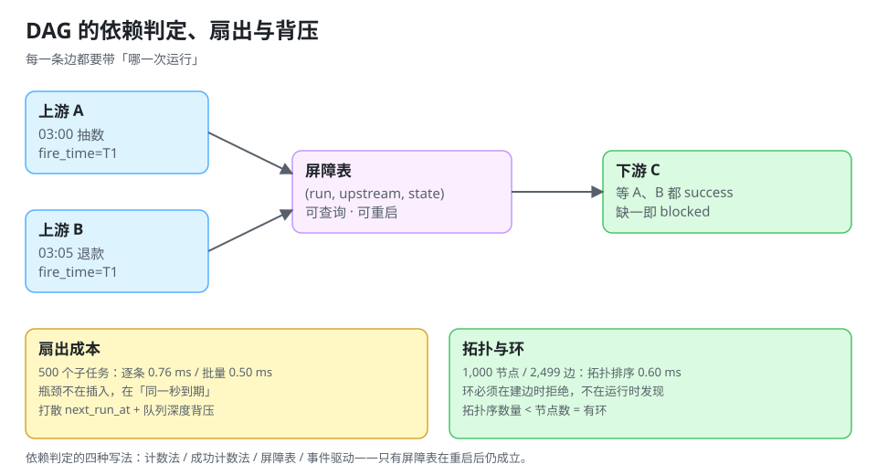

# 依赖编排：DAG、扇出与背压

当一个任务的结果是另一个任务的输入时，「都跑完了再跑下一个」就不再是顺序问题，而是**「哪一次跑完了」**的问题。DAG 编排的价值不在于画图，而在于把「一次运行」的边界钉死。

::: tip 一句话理解
依赖编排必须回答两个问题：**上游是哪一次**（batch / fire_time），和**上游怎样才算完成**（全部成功 / 允许部分失败 / 任一成功）。
:::



## 一、三种依赖关系

| 关系 | 语义 | 例子 | 失败传播 |
| --- | --- | --- | --- |
| **顺序**（chain） | B 在 A 成功后跑 | 抽数 → 清洗 → 汇总 | 直接阻断 |
| **汇聚**（fan-in） | C 等 A、B 都完成 | 订单 + 退款 → 日对账 | 取决于「部分成功」策略 |
| **扇出**（fan-out） | A 触发 B1…Bn | 一个租户 → 10 万条明细 | 部分失败需重试单条 |

三者在实现上的共同点是：**每一条边都要带「哪一次运行」的标识**。只存 `upstream_job_id` 不存 `upstream_fire_time` 的 DAG，在补跑时会去等「昨天那次上游」或「最新的上游」——两者都会错。

## 二、依赖判定的四种写法

| 写法 | 判定条件 | 问题 |
| --- | --- | --- |
| 计数法 | `done_count == upstream_count` | 把「失败」也算成「完成」 |
| 成功计数法 | `success_count == upstream_count` | 一个上游永久失败时下游永挂 |
| 屏障表（barrier） | 每个上游写一行 `(run_id, upstream_id, state)`，下游 `SELECT count(*) WHERE state<>'success'` | 最清晰，多一张表 |
| 事件驱动 | 上游完成后发事件，下游收到最后一条即触发 | 需要处理事件丢失/重复 |

推荐**屏障表**：它把「谁完成了」变成可查询的事实，而不是内存里的计数器——进程重启后判定仍然成立。

## 三、DAG 本身的正确性

### 1. 环检测必须在写入时做

```text
A → B → C → A        直接环
A → B, B → C, C → B  间接环（B 与 C 互为上下游）
```

**在建边时检测**（`INSERT edge` 前做一次 DFS/BFS），而不是在运行时报错——运行时才发现环，说明数据已经坏了。

本机实测（1,000 节点 / 2,499 条边的随机 DAG）：

| 操作 | 耗时 |
| --- | --- |
| 拓扑排序（Kahn 算法，不含建边） | **0.60 ms** |
| 环检测（DFS 三色标记，3 节点 3 条边的环） | 立即判定 `True` |

0.60 ms 意味着**每次触发前重算拓扑序是可接受的**（1 万节点约 6 ms 量级）；不需要把拓扑序缓存成一张表——缓存的代价是「改了依赖忘了刷新」。

### 2. 扇出的成本

本机实测（SQLite，1 个任务派生 500 个子任务）：

| 写法 | 耗时 |
| --- | --- |
| 逐条 `INSERT` + 每 500 条一次 commit | **0.76 ms** |
| `executemany` 批量插入 | **0.50 ms** |

批量化只快 1.5 倍——**这说明扇出的瓶颈不在插入语句**。真正的成本在：

1. **每条子任务都要被扫描到**：500 个子任务如果 `next_run_at` 都是「现在」，下一次扫描要捞出 500 条（见 [调度内核](../SchedulerCore/index.md) 的 `LIMIT` 成本：5,000 条 2.016 ms）。
2. **每条子任务都要走一次「认领 → 执行 → 写结果」**：3 次往返 × 500 = 1,500 次数据库交互。
3. **下游如果也有扇出，成本相乘**：1 → 500 → 500 × 20 = 10,000。

## 四、扇出风暴与背压

### 1. 什么叫扇出风暴

```text
03:00 汇总任务完成 → 扇出 500 个租户报表
每个租户报表 → 再扇出 20 个分片
03:00:05 队列里出现 10,000 个待执行任务
03:00:06 调度器按 LIMIT 500 认领，20 个 worker 开始跑
03:00:07 数据库连接池打满（20 worker × 每条 2 连接）
```

**根因不是任务多，而是「同一秒到期」**。三种解法：

| 解法 | 做法 | 代价 |
| --- | --- | --- |
| 打散到期时间 | 子任务 `next_run_at = now + i × 50ms` | 总完成时间变长 |
| 限制扇出宽度 | 一次只派生 N 个，其余进「待派生」表 | 需要多一轮调度 |
| 背压 | 队列长度超过阈值时暂停派生 | 需要队列可观测 |

推荐**打散 + 背压**：打散让峰值变平，背压防止「派生得比消费得快」。

### 2. 背压的三个阈值

| 指标 | 阈值示例 | 动作 |
| --- | --- | --- |
| 待执行队列长度 | > 10,000 | 暂停派生，等消化 |
| 单任务执行延迟 p99 | > 周期 × 0.8 | 降低扇出宽度 |
| 数据库连接池使用率 | > 80% | 降低 worker 并发 |

## 五、上游失败怎么传

| 策略 | 行为 | 适用 |
| --- | --- | --- |
| 全有或全无（all-or-nothing） | 任一上游失败 → 下游 `blocked`，不跑 | 对账、结算 |
| 尽力而为（best-effort） | 只要有成功上游就跑，缺的部分用默认值 | 报表、看板 |
| 部分重试 | 只重跑失败的上游，成功后继续 | 大批量扇出 |

**必须显式选一种**，默认行为往往是「静默跑，缺数据当 0」——这是最坏的一种：报表看起来正常，数字是错的。

::: danger DAG 的四个坑
1. **用「最新上游」代替「同一批次上游」**：03:00 的汇总等到了 04:00 的抽数（补跑产生），算出来的数是混批的。
2. **上游补跑不通知下游**：数据修正了，下游的汇总还是旧的，且没人知道。
3. **`blocked` 状态没有超时**：上游永久失败，下游永远 `blocked`，看板上既不红也不绿。
4. **扇出后不记录父子关系**：某个子任务失败，无法反查「属于哪一次运行」。
:::

## 六、DAG 与工作流引擎的边界

| 维度 | 定时任务 DAG | 工作流引擎（Flowable/Camunda） |
| --- | --- | --- |
| 触发 | 时间/依赖 | 事件/人工 |
| 状态 | 任务级（pending/running/success） | 流程实例级（含变量、历史） |
| 人工干预 | 重跑、跳过 | 审批、驳回、转办 |
| 时长 | 秒~小时 | 天~月 |
| 适用 | 数据管道、批处理 | 业务流程、审批流 |

两者可以组合：**工作流引擎负责「流程走到哪」，定时任务负责「到点做什么」**。把审批流塞进 DAG 会得到一个既没有审批界面、也没有超时升级的怪物。

## 七、本页判据

本页判据族 `DSD-A` ~ `DSD-H`，共 8 条。

| 编号 | 判据 | 判定方式 | 不满足时改哪里 |
| --- | --- | --- | --- |
| `DSD-A` | 每条依赖边带 `upstream_fire_time`（不只 job_id） | 查边表结构 | 加列并在触发时写入 |
| `DSD-B` | 依赖判定用屏障表（或等价的可查询事实），不用内存计数 | 查实现 | 改建表 |
| `DSD-C` | 「部分成功」策略显式声明（all-or-nothing / best-effort） | 查任务登记表 | 补一列 |
| `DSD-D` | 建边时做环检测，环直接拒绝 | 造一个环 | 加检测 |
| `DSD-E` | 扇出的子任务 `next_run_at` 有打散 | 查派生代码 | 加偏移 |
| `DSD-F` | 有待执行队列长度的背压阈值 | 查配置/面板 | 加阈值与暂停开关 |
| `DSD-G` | `blocked` 状态有超时与告警 | 查状态机 | 加超时 |
| `DSD-H` | 子任务记录 `parent_run_id` | 查表结构 | 加列 |

## 八、验证：拓扑排序、环检测与屏障判定

```python
from collections import deque

def topo(n, edges):
    adj = {i: [] for i in range(n)}
    indeg = [0] * n
    for a, b in edges:
        adj[a].append(b); indeg[b] += 1
    q = deque(i for i in range(n) if indeg[i] == 0)
    order = []
    while q:
        u = q.popleft(); order.append(u)
        for v in adj[u]:
            indeg[v] -= 1
            if indeg[v] == 0:
                q.append(v)
    return order

def has_cycle(n, edges):
    adj = {i: [] for i in range(n)}
    for a, b in edges:
        adj[a].append(b)
    color = [0] * n
    def dfs(u):
        color[u] = 1
        for v in adj[u]:
            if color[v] == 1: return True
            if color[v] == 0 and dfs(v): return True
        color[u] = 2
        return False
    return any(color[i] == 0 and dfs(i) for i in range(n))

import random, time
random.seed(20261021)
n = 1000
edges = [(random.randrange(0, i), i) for i in range(1, n)]
edges += [(min(a, b), max(a, b)) for a, b in ((random.randrange(n), random.randrange(n)) for _ in range(1500)) if a != b]

t0 = time.perf_counter(); order = topo(n, edges); ms = (time.perf_counter() - t0) * 1000
print(f"节点 {n} 边 {len(edges)} → 拓扑序 {len(order)} 个，耗时 {ms:.2f} ms")
print("3 节点环检测:", has_cycle(3, [(0, 1), (1, 2), (2, 0)]))

# 屏障表：两个上游，一个成功一个失败 → 下游不该跑
barrier = [("run1", "oa", "success"), ("run1", "ob", "failed")]
print("屏障未通过:", [u for r, u, s in barrier if s != "success"])
```

预期输出：

```text
节点 1000 边 2499 → 拓扑序 1000 个，耗时 0.60 ms
3 节点环检测: True
屏障未通过: ['ob']
```

读法：拓扑序数量 **等于节点数** 才说明无环（小于节点数就是有环且被截断）；屏障表一眼就能看出「哪个上游没过」。

## 九、参考资料

- [Airflow 文档：DAG 与 Task 依赖](https://airflow.apache.org/docs/apache-airflow/stable/core-concepts/dags.html)
- [Kubernetes 文档：Job 的完成模式（Indexed / NonIndexed）](https://kubernetes.io/docs/concepts/workloads/controllers/job/#completion-mode)
- [Temporal 文档：Workflow 与 Activity 的关系](https://docs.temporal.io/workflows)
- [工作流引擎](../../WorkflowEngine/index.md)：审批流与长流程
- [调度内核](../SchedulerCore/index.md)：扇出的子任务如何被消费
