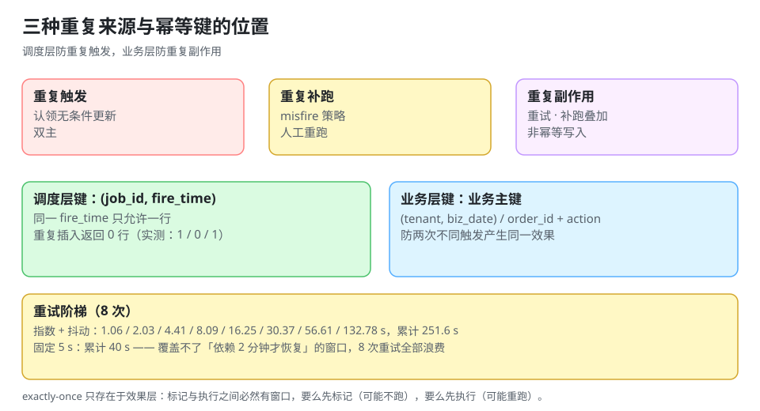

# 幂等与重试：一次到底算几次

调度系统里有三种「重复」：**重复触发**（认领没做对）、**重复补跑**（misfire 策略）、**人工重跑**（运维补数据）。前两种能靠机制消灭，第三种永远存在——所以每一个定时任务都必须回答「同一次跑两遍会怎样」。

::: tip 一句话理解
分布式里没有 exactly-once 的**执行**，只有 exactly-once 的**效果**——而效果只能靠幂等键造出来，不能靠调度器保证。
:::



## 一、三种执行语义的真相

| 语义 | 含义 | 能否真正实现 | 实现方式 |
| --- | --- | --- | --- |
| at-most-once | 最多一次，可能不跑 | 能（先标记再执行） | 牺牲可靠性，几乎没人用 |
| at-least-once | 至少一次，可能重复 | 能（先执行再标记） | 默认选择，必须配幂等 |
| exactly-once | 恰好一次 | **执行层面不能** | 只有「效果恰好一次」：幂等键 + 去重表 |

为什么「执行层面不能」：标记与执行是两个动作，中间必然有窗口。**要么先标记（崩了就不跑）要么先执行（崩了就重跑）**，物理上不存在第三种。所谓 exactly-once 都是把「去重」藏在状态存储里（Kafka 事务、Flink checkpoint 都是这个套路）。

## 二、幂等键怎么设计

### 1. 键的形状

| 键 | 是否够用 | 说明 |
| --- | --- | --- |
| `job_id` | 不够 | 一个任务会跑很多次 |
| `(job_id, run_date)` | 日报够用 | 一天一次的任务刚好 |
| `(job_id, fire_time)` | **推荐** | 与调度语义一一对应 |
| `(job_id, fire_time, shard)` | 分片任务用 | 分片各自幂等 |
| `biz_key`（业务主键） | 业务幂等用 | 例如 `order_id + action`，与调度解耦 |

推荐同时用两个层次：**调度层用 `(job_id, fire_time)` 防重复触发，业务层用业务键防重复副作用**。两者不是冗余——前者防「同一次跑两遍」，后者防「两次不同触发产生同一个效果」（例如补跑 03:00 与 04:00 两次都处理了同一批订单）。

### 2. 去重表的实现

```sql
CREATE TABLE job_exec_log (
  job_id    BIGINT      NOT NULL,
  fire_time TIMESTAMPTZ NOT NULL,          -- 这一次「代表」的时间点
  state     TEXT        NOT NULL,          -- running / success / failed
  started_at  TIMESTAMPTZ NOT NULL DEFAULT now(),
  finished_at TIMESTAMPTZ,
  attempts  INT         NOT NULL DEFAULT 1,
  PRIMARY KEY (job_id, fire_time)          -- 幂等键就是主键
);
```

本机实测（SQLite，主键 `(job_id, fire_at)`）：

| 操作 | 影响行数 | 含义 |
| --- | --- | --- |
| 第一次插入 `(1, 1000)` | **1** | 正常 |
| 重复插入 `(1, 1000)` | **0**（`IntegrityError`） | 被主键拦住 |
| 插入 `(1, 1300)` | **1** | 不同 fire_time 是不同的一次 |

**「重复插入返回 0 行」就是幂等成功的判据**——不是「没报错」，也不是「日志里写了 skip」。

### 3. 三种落地方式

| 方式 | 写法 | 优点 | 缺点 |
| --- | --- | --- | --- |
| `INSERT ... ON CONFLICT DO NOTHING` | 一条语句 | 无竞态 | 需要唯一索引 |
| 先查再插 | `SELECT` → `INSERT` | 直观 | 有竞态，必须配唯一索引兜底 |
| 抢占式（`UPDATE ... WHERE state='pending'`） | 状态机 | 天然互斥 | 需要状态列 |

## 三、重试：退避要算，不要拍

### 1. 两种退避的实际差异

本机算例（8 次重试，指数退避基数 1 s、上限 300 s、抖动 50%；固定间隔 5 s）：

| 策略 | 第 1~8 次等待（秒） | 累计等待 |
| --- | --- | --- |
| 指数 + 抖动 | 1.06 / 2.03 / 4.41 / 8.09 / 16.25 / 30.37 / 56.61 / 132.78 | **251.6 s** |
| 固定 5 s | 5 / 5 / 5 / 5 / 5 / 5 / 5 / 5 | **40 s** |

指数退避的累计等待是固定间隔的 **6.3 倍**。这不是缺点——**它换来的是「依赖恢复的时间」**：固定 5 s 的 8 次重试在 40 秒内打完，如果依赖恢复需要 2 分钟，8 次全部浪费；指数退避把最后一次推到 2 分钟后，正好覆盖恢复窗口。

### 2. 三条必须配的东西

| 配置 | 没有会怎样 |
| --- | --- |
| 最大重试次数 | 无限重试打满线程池 |
| 最大累计时长（deadline） | 一个任务重试到下一次触发，与下一个实例重叠 |
| 抖动（jitter） | 所有实例在同一毫秒重试（惊群） |

::: danger 重试的四个反模式
1. **对不可重试的错误重试**：`400` 参数错、`401` 认证错、唯一键冲突，重试一万次也一样。要按错误类型分流（见 [幂等与状态机工程](../../IdempotencyStateMachine/index.md)）。
2. **重试不带幂等键**：重试本身就是重复执行。
3. **重试与下一周期重叠**：03:00 的任务重试到 03:40，04:00 又触发一次，两个实例同时写。
4. **重试耗尽后静默失败**：必须进死信表 + 告警，否则「失败 8 次」和「成功」在看板上长得一样。
:::

## 四、重试与补跑的关系

两者看起来都是「再跑一次」，但语义不同：

| 维度 | 重试 | 补跑 |
| --- | --- | --- |
| 触发原因 | 这一次失败了 | 这一次压根没跑（或跳过了） |
| `fire_time` | **不变**（同一次） | **不变**（补的是那一次） |
| 幂等键 | 相同 | 相同 |
| 次数上限 | 通常 3~8 次 | 由 `misfire_policy` 决定 |
| 记录标志 | `attempts += 1` | `is_backfill = true` |

**共同点**：两者都必须用 `(job_id, fire_time)` 作为幂等键。这也是为什么补跑必须带 `fire_time`——不带就无法区分「重试同一次」和「补另一次」。

## 五、人工重跑：最容易被忽略的入口

运维看到数据不对，第一反应是「重跑一下」。这条路径如果没走幂等键，前面所有机制都白做。

| 要求 | 做法 |
| --- | --- |
| 必须指定 `fire_time` | 命令行参数 `--fire-time 2026-10-20T03:00:00Z`，不接受「就跑昨天」 |
| 必须检查是否已成功 | 已 `success` 时要求 `--force`，并记录操作人 |
| 必须留痕 | `triggered_by=manual:alice`、`reason=...` |
| 必须限速 | 一次只允许重跑一个 `fire_time`，禁止循环批量 |

## 六、什么任务天生不幂等

| 类型 | 为什么 | 补救 |
| --- | --- | --- |
| 发通知/发邮件 | 重跑就重发 | 用 `(event_id, channel)` 去重，或先查发送记录 |
| 扣款/加余额 | 累加型副作用 | 业务键 + 唯一流水；余额用「流水求和」而非「直接加减」 |
| 递增序号 | 每跑一次号段前进 | 号段由业务键派生，不用自增 |
| 调用第三方 API | 对方可能计费 | 传幂等键（多数支付/短信 API 支持） |
| 写日志/审计 | 重复行 | `(job_id, fire_time, line_no)` 作主键 |

对这类任务，「幂等」不是加个 `if` 就能解决，**要么改数据模型（流水化），要么用外部去重表**。

## 七、本页判据

本页判据族 `DSI-A` ~ `DSI-H`，共 8 条。

| 编号 | 判据 | 判定方式 | 不满足时改哪里 |
| --- | --- | --- | --- |
| `DSI-A` | 每个任务有 `(job_id, fire_time)` 幂等键，且落库 | 查表结构 | 建去重表 |
| `DSI-B` | 重复执行返回「0 行」而不是抛异常给上游 | 造一次重复 | 用 `ON CONFLICT DO NOTHING` |
| `DSI-C` | 重试有最大次数、最大累计时长、抖动三项 | 查配置 | 补齐三项 |
| `DSI-D` | 不可重试的错误有明确分类（4xx 不重试） | 查异常处理 | 加分类 |
| `DSI-E` | 重试耗尽后进死信表并告警 | 造一次耗尽 | 加死信与告警 |
| `DSI-F` | 人工重跑必须指定 `fire_time`，且记录操作人 | 查运维手册/CLI | 加参数与审计 |
| `DSI-G` | 累加型副作用走「流水 + 求和」，不直接加减 | 查资金/计数逻辑 | 改模型 |
| `DSI-H` | 重试与下一周期的重叠有检测（`overlap_total`） | 查指标 | 加计数 |

## 八、验证：幂等键与退避都能算出来

```python
import random, sqlite3
random.seed(20261021)

# ① 幂等键：重复插入必须返回 0
con = sqlite3.connect(":memory:")
con.execute("CREATE TABLE exec_log(job_id INT, fire_at INT, PRIMARY KEY(job_id, fire_at))")
def ins(j, t):
    try:
        con.execute("INSERT INTO exec_log VALUES(?,?)", (j, t)); return 1
    except sqlite3.IntegrityError:
        return 0
print("首次:", ins(1, 1000), "重复:", ins(1, 1000), "另一次:", ins(1, 1300))

# ② 退避：指数 + 抖动 vs 固定
def backoff(base=1.0, cap=300.0, jitter=0.5, n=8):
    seq, cur = [], base
    for _ in range(n):
        w = min(cap, cur)
        seq.append(round(w * (1 - jitter / 2 + random.random() * jitter), 2))
        cur *= 2
    return seq
exp = backoff()
print("指数+抖动:", exp, "累计", round(sum(exp), 1), "s")
print("固定 5 s :", [5.0] * 8, "累计", 40.0, "s")
```

预期输出：

```text
首次: 1 重复: 0 另一次: 1
指数+抖动: [1.06, 2.03, 4.41, 8.09, 16.25, 30.37, 56.61, 132.78] 累计 251.6 s
固定 5 s : [5.0, 5.0, 5.0, 5.0, 5.0, 5.0, 5.0, 5.0] 累计 40.0 s
```

读法：`0` 那一格是幂等生效的证据；指数退避的累计 251.6 s 覆盖了「依赖恢复需要 2 分钟」这个窗口，而固定 5 s 的 40 s 覆盖不了。

## 九、参考资料

- [PostgreSQL 文档：`INSERT ... ON CONFLICT`](https://www.postgresql.org/docs/current/sql-insert.html)
- [Stripe 文档：Idempotent requests](https://docs.stripe.com/api/idempotent_requests)
- [AWS 构建块：Timeouts, retries and backoff with jitter](https://aws.amazon.com/builders-library/timeouts-retries-and-backoff-with-jitter/)
- [幂等与状态机工程](../../IdempotencyStateMachine/index.md)：状态机与补偿
- [misfire 与补跑](../MisfireCatchup/index.md)：补跑为什么必须带 `fire_time`
