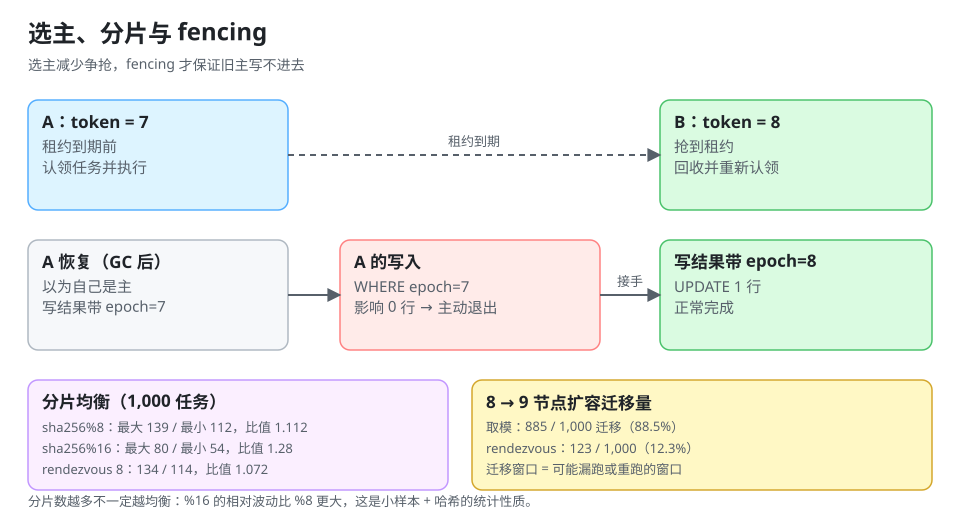

# 高可用：选主、分片、脑裂与 fencing

多副本部署之后，「谁在调度」这个问题必须先有答案。答案只有两种：**选一个主**（单写）或**分片让每个人各管一部分**（多写）。两者都能高可用，但失效方式完全不同。

::: tip 一句话理解
选主解决的是「别抢」，fencing 解决的是「抢过之后旧主别再写」——**只做选主不做 fencing，等于把脑裂的概率从「一直」降到「偶发」**，而偶发的脑裂最难排查。
:::



## 一、选主的四种实现

| 实现 | 机制 | 优点 | 失效方式 |
| --- | --- | --- | --- |
| DB 行租约 | `UPDATE leader SET holder=?, expire_at=? WHERE expire_at < now` | 无额外组件 | 依赖 DB 时钟与主库可用性 |
| Redis `SET NX PX` | 单键租约 | 快 | 主从切换可能丢租约（`min-replicas-to-write` 可缓解） |
| etcd / ZooKeeper | 临时节点 + 会话 | 有 lease 与 watch，语义强 | 需要运维，网络分区时可能短暂双主 |
| 平台托管 | K8s `Lease` 对象 / 云厂商选主 | 与部署平台一致 | 受 API Server 可用性影响 |

本库在 [分布式锁与选主](../../DistributedLock/index.md) 里讲过每种锁的正确性来源，这里只强调调度场景的两个额外要求：

1. **租约要短于「业务能容忍的空窗」**：主挂了没人接管的那段时间，任务不会跑。租约 60 s 意味着最长 60 s 空窗。
2. **续约失败必须立刻停止调度**（不是「重试几次再说」）：它意味着你已经被判定为失效，继续调度就是双主。

## 二、脑裂：两个主同时调度

```text
时刻 T     主 A 的租约到期（A 因为 FULL GC 卡住 40 秒，没续上）
时刻 T+1   B 抢到租约，开始扫描
时刻 T+2   A 从 GC 恢复，它「以为」自己还是主，继续扫描
结果        同一批任务被两个主各扫一遍 → 依赖认领的 `AND state='pending'` 兜底
```

关键点：**只有在认领语句有条件更新时，脑裂才不会变成重复执行**。这也是为什么 [调度内核](../SchedulerCore/index.md) 把那条 `AND state='pending'` 称为「唯一真正防重的地方」——选主是优化，不是保证。

## 三、fencing token：让旧主写不进去

即使认领有条件更新，还有一种漏网场景：**旧主已经认领成功、正在执行；新主认为旧主死了，把任务回收再跑一遍**。这时两个执行者都在写同一行业务结果。

解决办法是给每次「主权」一个单调递增的号（fencing token / epoch）：

| 步骤 | 旧主（token=7） | 新主（token=8） |
| --- | --- | --- |
| 认领任务 | `locked_by=A, epoch=7` | — |
| 租约过期被回收 | — | `UPDATE ... SET state='pending' WHERE locked_until < now` |
| 再认领 | — | `locked_by=B, epoch=8` |
| 写结果 | `UPDATE ... WHERE id=? AND epoch=7` → **0 行** | `WHERE id=? AND epoch=8` → 1 行 |
| 结果 | 写不进去，主动退出 | 正常完成 |

三条纪律：

1. **epoch 必须单调递增且持久化**（不能是进程内的计数器）。
2. **所有写路径都要带 epoch 条件**，包括「写状态」「写结果」「删临时文件」。
3. **写 0 行要当失败处理**，并且要打点（`fenced_writes_total`）——它是「发生过脑裂」的唯一证据。

## 四、分片：谁管哪一批任务

分片（sharding）把任务按某个键分给 N 个实例，每个实例只扫自己那一片。三种分片键：

| 分片键 | 均衡性 | 扩缩容代价 | 适用 |
| --- | --- | --- | --- |
| `hash(job_key) % N` | 一般（见下表） | **几乎全量迁移** | 实例数固定的小集群 |
| 一致性哈希 / rendezvous | 较好 | 只迁移 1/N | 需要经常扩缩容 |
| 按业务维度（租户、区域） | 由业务分布决定 | 需要迁移整个维度 | 多租户、单元化 |

### 1. 均衡性实测（1,000 个任务）

| 方案 | 最大片 | 最小片 | 标准差 | 最大/均值 |
| --- | --- | --- | --- | --- |
| `sha256 % 8` | 139 | 112 | 8.2 | **1.112** |
| `sha256 % 16` | 80 | 54 | 6.9 | **1.28** |
| rendezvous（8 节点） | 134 | 114 | **7.3** | 1.072 |

两个反直觉的读数：

- **分片数越多不一定越均衡**：`%16` 的最大/均值比 `%8` 更差（1.28 对 1.112）。分片数增加时，每片的期望任务数下降，**相对波动反而变大**——这是「小样本 + 哈希」的统计性质，不是实现错误。
- **rendezvous 的标准差最小**（7.3），但它每次分配要做 N 次哈希，N 大时成本上升。

### 2. 扩缩容的迁移量（8 → 9 节点）

| 方案 | 迁移任务数 | 迁移比例 |
| --- | --- | --- |
| `sha256 % N` | 885 / 1,000 | **88.5%** |
| rendezvous | 123 / 1,000 | **12.3%** |

`% N` 在扩容时几乎重排全部任务，这不是「多算几次哈希」的问题：**迁移意味着「这一批任务在切换窗口里可能被跳过或被执行两次」**。所以实例数会变的集群，不要用取模。

### 3. 扩缩容的顺序

| 操作 | 正确顺序 | 为什么 |
| --- | --- | --- |
| 扩容 | 先让新实例只「接管新任务」，再逐步迁移旧分片 | 一次性重排会让大量任务在同一分钟内到期 |
| 缩容 | 先把该实例置为 `draining`（不再认领），等在跑的任务结束，再下线 | 直接 kill 会留下一批 `running` + 租约过期的任务 |
| 变更分片数 | 用「双读单写」过渡：新旧两套映射都算，但只让新映射写 | 过渡期内不会漏任务 |

## 五、单主 vs 全活：怎么选

| 维度 | 选主（单写） | 分片（多写） |
| --- | --- | --- |
| 实现复杂度 | 低（一个租约 + 条件更新） | 中（分片键 + 迁移 + 再均衡） |
| 吞吐上限 | 单实例 | 线性近似 |
| 故障影响 | 租约到期前有任务延迟 | 只影响该分片 |
| 数据一致性 | 天然单点决策 | 需要保证「一个任务只属于一片」 |
| 适用规模 | 万级任务、分钟级精度 | 十万级以上或秒级精度 |

一个常见的折中：**分片 + 每片选主**。片内单写保证顺序，片间并行保证吞吐。

::: danger 分片最容易错的三件事
1. **分片函数在客户端与服务端各写一份**：一处用 `hash(job_id)%N`，另一处用 `hash(job_key)%N`，同一任务被两片都认领。**分片函数必须只有一个实现**，且要有单测固定输入输出。
2. **`N` 存在配置文件里并被热更新**：改 `N` 的那一刻，所有实例的分片视图不一致，出现「谁都不管」的空洞。`N` 只能通过一次滚动发布变更。
3. **按 `tenant_id` 分片但任务表里 `tenant_id` 可空**：空值全部落到同一片（`hash(null)` 恒定），该片成为热点。
:::

## 六、本页判据

本页判据族 `DSH-A` ~ `DSH-H`，共 8 条。

| 编号 | 判据 | 判定方式 | 不满足时改哪里 |
| --- | --- | --- | --- |
| `DSH-A` | 选主租约有显式 TTL，且 TTL 写进文档（等于最长空窗） | 查配置 | 补 TTL 与说明 |
| `DSH-B` | 续约失败时进程主动停止调度，不只打日志 | 造一次续约失败 | 加 `stop()` 分支 |
| `DSH-C` | 认领与结果写入都带 `epoch`（fencing token） | 查 SQL | 补条件列 |
| `DSH-D` | `fenced_writes_total` 有指标，且 > 0 时有告警 | 查面板 | 加计数与告警 |
| `DSH-E` | 分片函数只有一份实现（不重复写在两处） | `grep` 分片表达式 | 抽成公共函数 |
| `DSH-F` | 实例数会变时不用 `% N` 分片 | 查代码 | 改 rendezvous/一致性哈希 |
| `DSH-G` | 缩容有 `draining` 状态与等待期 | 查发布流程 | 加优雅下线 |
| `DSH-H` | 分片键非空（或空值有单独策略） | 查表约束 | 加 `NOT NULL` 或默认片 |

## 七、验证：算均衡度与迁移量

```python
import hashlib, statistics

def h(key):
    # 生产里用 murmur3 或 sha256；不要用 Python 内置 hash()（字符串哈希加盐，跨进程不一致）
    return int(hashlib.sha256(key.encode()).hexdigest()[:8], 16)

def mod_spread(nodes, tasks=1000):
    b = {i: 0 for i in range(nodes)}
    for t in range(tasks):
        b[h(f"job-{t}") % nodes] += 1
    v = list(b.values())
    return max(v), min(v), round(statistics.pstdev(v), 1), round(max(v) / (tasks / nodes), 3)

def rendezvous(nodes, tasks=1000):
    b = {i: 0 for i in range(nodes)}
    for t in range(tasks):
        key = f"job-{t}"
        best = max(range(nodes), key=lambda i: h(f"{key}#{i}"))
        b[best] += 1
    v = list(b.values())
    return max(v), min(v), round(statistics.pstdev(v), 1), round(max(v) / (tasks / nodes), 3)

def moved(n_from, n_to, tasks=1000, use_rdv=False):
    def owner(key, n):
        if not use_rdv:
            return h(key) % n
        return max(range(n), key=lambda i: h(f"{key}#{i}"))
    c = sum(1 for t in range(tasks) if owner(f"job-{t}", n_from) != owner(f"job-{t}", n_to))
    return c, round(c / tasks * 100, 1)

print("mod  8 :", mod_spread(8))
print("mod 16 :", mod_spread(16))
print("rdv  8 :", rendezvous(8))
print("8->9 mod :", moved(8, 9))
print("8->9 rdv :", moved(8, 9, use_rdv=True))
```

预期输出：

```text
mod  8 : (139, 112, 8.2, 1.112)
mod 16 : (80, 54, 6.9, 1.28)
rdv  8 : (134, 114, 7.3, 1.072)
8->9 mod : (885, 88.5)
8->9 rdv : (123, 12.3)
```

读法：**`% N` 扩容要搬 88.5% 的任务，rendezvous 只搬 12.3%**。这个差距不是性能问题，是「切换窗口里有多少任务可能被跳过或重跑」的问题。注意 `rdv` 那一行的最大/均值 1.072 比 `%8` 的 1.112 更好，但代价是每次分配多做 N 次哈希——N ≤ 32 时可忽略。

## 八、参考资料

- [Kubernetes 文档：Lease（选主原语）](https://kubernetes.io/docs/reference/kubernetes-api/cluster-resources/lease-v1/)
- [etcd 文档：Lease 与 concurrency 包](https://etcd.io/docs/latest/learning/api/#lease-api)
- [Redis 文档：`SET` 的 `NX`/`PX` 选项](https://redis.io/docs/latest/commands/set/)
- [分布式锁与选主](../../DistributedLock/index.md)：锁的正确性来源
- [调度内核：扫描、认领与执行三段式](../SchedulerCore/index.md)：为什么选主不能替代条件更新
