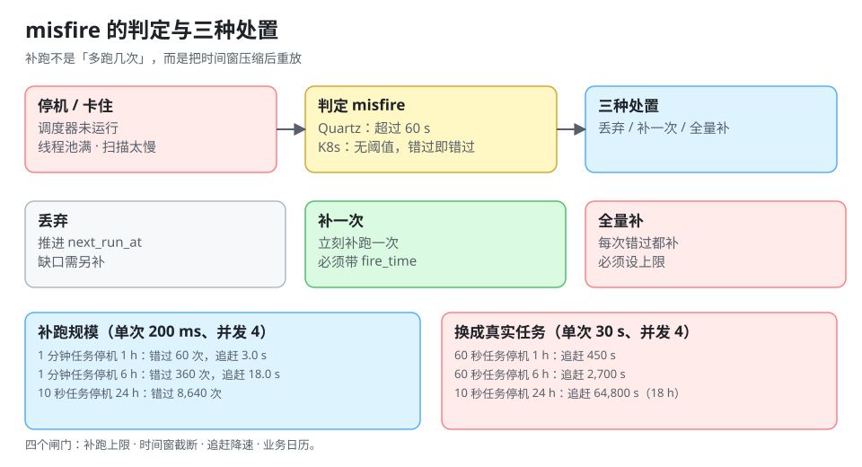

# misfire 与补跑：停机之后补几次

调度器停了三小时，恢复之后那三小时里「本该跑」的任务怎么办？这个问题没有标准答案，但**必须有一个写在配置里的答案**——没有答案时，框架的默认值会替你回答，而默认值通常是最危险的那个。

::: tip 一句话理解
补跑的代价不是「多跑几次」，而是**「下游要承受一个压缩过的时间窗」**：三小时的量在一分钟里涌进来，任何有配额、有锁、有速率限制的下游都会被打穿。
:::



## 一、什么是 misfire

**misfire（错过触发）**：到了该触发的时刻，调度器没有把它执行掉。原因只有三类：

| 原因 | 表现 | 是否可避免 |
| --- | --- | --- |
| 调度器没在运行 | 停机、发布、崩溃 | 部分（多副本 + 租约） |
| 调度器在运行但来不及 | 线程池满、扫描周期太长 | 可（扩容/调参） |
| 到了但被策略跳过 | `concurrencyPolicy: Forbid` 且上一个还在跑 | 不可（这是设计） |

第三类最容易被忽略：**「跳过一次」也是 misfire**，K8s 把它计入错过次数，Quartz 也会触发 misfire 策略。所以「上一个任务跑太久」会连锁成「后面几次全被跳过」。

## 二、三种处置策略

| 策略 | 行为 | 适用 | 风险 |
| --- | --- | --- | --- |
| **丢弃**（do nothing） | 只把 `next_run_at` 推到下一个未来时刻 | 报表、缓存刷新、非累计型任务 | 数据缺口要另外补 |
| **补一次**（fire once now） | 立刻补跑一次，然后回到正常节奏 | 对账、日终结算 | 需要知道「补的是哪一天」 |
| **全量补**（fire all missed） | 每一次错过都补 | 累计型（每 5 分钟聚合一次） | **追赶风暴** |

Quartz 里对应 `MISFIRE_INSTRUCTION_DO_NOTHING` / `FIRE_NOW` / `RESCHEDULE_NOW_WITH_EXISTING_REPEAT_COUNT` 等；K8s 没有策略可配，**行为是固定的**：错过多次只补最近一次，且错过超过 100 次就停止调度。

::: danger 「全量补」最容易踩的坑
1. **补跑的任务读到的是「现在」的数据**：03:00 的任务在 06:00 补跑，如果它内部用 `now()` 算时间窗，补出来的三份数据全是 06:00 的窗口——**看起来跑了三次，实际只有一份数据**。补跑必须把 `fire_time` 作为参数传进去。
2. **补跑的写入不幂等**：同一批次被补两次，累计型指标翻倍。
3. **补跑触发下游**：一次补跑派生 N 个下游任务，下游也补，形成级联放大。
:::

## 三、补跑规模是算出来的

设停机时长 `D`、任务周期 `P`、单次执行耗时 `t`、并发度 `c`，则：

```text
错过次数   = D / P
追赶耗时   ≈ (D / P) × t / c          （忽略新任务到达）
追赶期间的到达率 = 1/P + c/t           （正常运行 + 追赶）
```

本机算例（单次执行 200 ms、并发 4，即追赶能力 20 次/秒）：

| 任务周期 | 停机 1 小时错过 | 追赶耗时 | 停机 6 小时错过 | 追赶耗时 |
| --- | --- | --- | --- | --- |
| 1 分钟 | 60 | 3.0 s | 360 | 18.0 s |
| 5 分钟 | 12 | 0.6 s | 72 | 3.6 s |
| 15 分钟 | 4 | 0.2 s | 24 | 1.2 s |
| 60 分钟 | 1 | 0.05 s | 6 | 0.3 s |

看起来「360 次只要 18 秒」很轻松，但这是**空转成本**——真实任务的执行耗时不是 200 ms，而是几秒到几分钟：

| 场景 | 错过次数 | 若单次执行 30 s、并发 4 |
| --- | --- | --- |
| 每分钟任务停机 1 小时 | 60 | **450 s（7.5 分钟）** |
| 每 10 秒任务停机 24 小时 | 8,640 | 追赶 434 s（按 20 次/秒算），且期间仍在产生新任务 |

最后一行是关键：**8,640 次「合法的补跑」等于给下游打了 8,640 次请求**。如果下游是计费接口或第三方 API（有日配额），这就是一次事故。

## 四、四种限流闸门

| 闸门 | 规则 | 效果 |
| --- | --- | --- |
| **补跑上限** | 一次最多补 N 次（如 24），超出部分标记 `skipped_capped` | 防止无限追赶 |
| **时间窗截断** | 只补最近 X 小时内的错过 | 与业务保留期对齐 |
| **追赶降速** | 补跑期间并发降到正常值的 1/4 | 保护下游 |
| **业务日历** | 非交易日/维护窗口内不补 | 避免无意义补跑 |

推荐组合：**补跑上限 + 时间窗截断**必选，**追赶降速**按下游敏感度选，**业务日历**按业务性质选。

## 五、补跑必须带 `fire_time`

这是本页最重要的一条工程约束：**任务函数必须接受「这一次代表哪个时间点」这个参数**。

```python
# 错误：时间窗由「现在」决定，补跑时窗口全错
def daily_settle():
    day = date.today() - timedelta(days=1)
    settle(day)

# 正确：时间窗由 fire_time 决定，补跑与正常跑等价
def daily_settle(fire_time: datetime):
    day = (fire_time - timedelta(days=1)).date()
    settle(day)
```

差别在补跑时暴露：03:00 的任务在 06:00 补跑，前者算出「昨天」，后者算出「今天」——**前者会重复结算，后者会漏结算**。

## 六、Quartz 与 K8s 的具体行为

| 平台 | 判定 misfire 的阈值 | 默认策略 | 可配置项 |
| --- | --- | --- | --- |
| Quartz | `misfireThreshold` 默认 **60 s**（超过 60 s 才算 misfire） | 取决于 trigger 类型（`SimpleTrigger` 默认「现在补一次」；`CronTrigger` 默认「丢弃」） | 每个 trigger 单独设 instruction |
| Kubernetes CronJob | 无阈值，**错过即错过** | 只补最近一次；错过 > 100 次停止调度 | `startingDeadlineSeconds`（限制「迟到多久还算数」）、`concurrencyPolicy` |
| XXL-JOB | 由调度中心判定 | 默认丢弃，可在任务上配「调度过期策略」 | 任务级配置 |
| systemd timer | `Persistent=true` 才补 | 默认不补 | `Persistent` / `AccuracySec` |

K8s 的 `startingDeadlineSeconds` 值得单独解释：它同时起两个作用——**限制单次迟到多久还执行**，以及**把「错过计数」限制在这个窗口内**。不设它，一次长停机就会把计数推到 100 以上，任务从此静默停摆。

## 七、本页判据

本页判据族 `DSM-A` ~ `DSM-H`，共 8 条。

| 编号 | 判据 | 判定方式 | 不满足时改哪里 |
| --- | --- | --- | --- |
| `DSM-A` | 每个任务显式声明 misfire 策略（丢弃/补一次/全量补） | 查任务登记表 | 补一列 `misfire_policy` |
| `DSM-B` | 任务函数接受 `fire_time` 参数，时间窗不取 `now()` | `grep "now()\|today()"` | 改为由 `fire_time` 推导 |
| `DSM-C` | 补跑有上限 N，超出部分写 `skipped_capped` | 造一次长时间停机 | 加计数与状态 |
| `DSM-D` | 补跑窗口与业务数据保留期对齐 | 查配置 | 改窗口 |
| `DSM-E` | K8s CronJob 设置了 `startingDeadlineSeconds` | `kubectl get cronjob -o yaml` | 补字段（建议 ≤ 300 s） |
| `DSM-F` | 补跑期间的并发低于正常值 | 查补跑分支的线程池配置 | 加降速开关 |
| `DSM-G` | 补跑产生的执行记录带 `is_backfill=true` | 查事实表 | 加标记列 |
| `DSM-H` | 有「连续 N 次未成功」的告警，不只看单次失败 | 查告警规则 | 加连续计数 |

## 八、验证：算一遍你自己的补跑规模

```python
def catchup(downtime_min, period_min, each_s=0.2, concurrency=4):
    missed = int(downtime_min // period_min)
    drain = missed * each_s / concurrency
    return missed, round(drain, 1)

print("停机 1 小时 / 6 小时，单次 200 ms、并发 4：")
for p in (1, 5, 15, 60):
    print(f"  周期 {p:>2} 分钟 → 1h 错过 {catchup(60, p)[0]:>3} 次，追赶 {catchup(60, p)[1]:>6} s"
          f" ；6h 错过 {catchup(360, p)[0]:>3} 次，追赶 {catchup(360, p)[1]:>6} s")

print("换成单次 30 秒（真实任务）：")
for p, d in ((1, 60), (1, 360), (10/60, 1440)):
    missed = int(d // p)
    print(f"  周期 {p*60:>5.0f} 秒、停机 {d:>4} 分钟 → 错过 {missed:>5} 次，追赶 {missed*30/4:>8.0f} s")
```

预期输出：

```text
停机 1 小时 / 6 小时，单次 200 ms、并发 4：
  周期  1 分钟 → 1h 错过  60 次，追赶    3.0 s ；6h 错过 360 次，追赶   18.0 s
  周期  5 分钟 → 1h 错过  12 次，追赶    0.6 s ；6h 错过  72 次，追赶    3.6 s
  周期 15 分钟 → 1h 错过   4 次，追赶    0.2 s ；6h 错过  24 次，追赶    1.2 s
  周期 60 分钟 → 1h 错过   1 次，追赶   0.1 s ；6h 错过   6 次，追赶    0.3 s
换成单次 30 秒（真实任务）：
  周期    60 秒、停机   60 分钟 → 错过    60 次，追赶      450 s
  周期    60 秒、停机  360 分钟 → 错过   360 次，追赶     2700 s
  周期    10 秒、停机 1440 分钟 → 错过  8640 次，追赶    64800 s
```

读法：**同一份「补跑」逻辑，在 200 ms 的任务上是 18 秒，在 30 秒的任务上是 45 分钟，在 10 秒周期 + 一天停机时是 18 小时**。所以补跑上限不是「可选的优化」，而是必须有的断路器。

## 九、参考资料

- [Quartz 文档：Trigger misfire 指令](https://www.quartz-scheduler.org/documentation/quartz-2.5.x/tutorials/trigger/)
- [Kubernetes 文档：CronJob 的 `startingDeadlineSeconds` 与错过计数](https://kubernetes.io/docs/concepts/workloads/controllers/cron-jobs/#cron-job-limitations)
- [systemd.timer 手册：`Persistent=`](https://www.freedesktop.org/software/systemd/man/systemd.timer.html)
- [幂等与重试：一次到底算几次](../IdempotentRetry/index.md)：补跑与重试共享同一套幂等键
- [可观测：五个口径与静默停摆](../Observability/index.md)：怎么发现「补跑正在进行」
