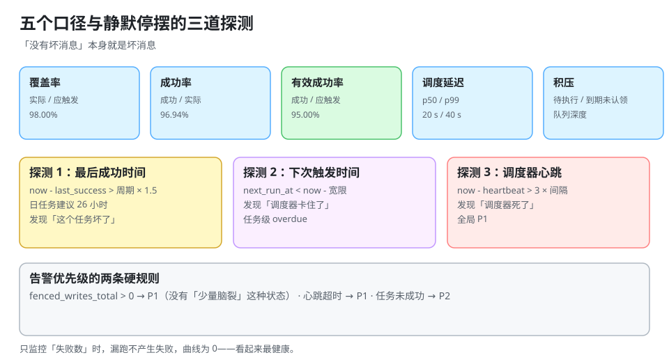

# 可观测：五个口径与静默停摆

调度系统最危险的故障不是「报错」，而是**「什么都不报」**：任务没跑、没有异常日志、看板上没有红色，只有业务数据在悄悄变少。

::: tip 一句话理解
调度器的健康指标不是「跑没跑」，而是**「该跑的跑了没有、跑的是不是那一次、跑完的结果对不对」**——这三件事需要用不同口径分别度量。
:::



## 一、五个口径

| 口径 | 定义 | 回答的问题 | 坏了说明什么 |
| --- | --- | --- | --- |
| **覆盖率** | 实际执行次数 / 应触发次数 | 有没有漏跑 | 调度器/补跑策略有问题 |
| **成功率** | 成功次数 / 实际执行次数 | 跑了有没有用 | 业务代码或依赖有问题 |
| **有效成功率** | 成功次数 / 应触发次数 | 端到端是否达标 | 上面两者之一 |
| **调度延迟** | `started_at - fire_time` 的分位数 | 准不准时 | 轮询周期/资源不足 |
| **积压** | 待执行数 / 到期未认领数 | 消化得过来吗 | 执行能力不足 |

**五个必须同时看**。只看成功率会出现「没跑的不算失败」；只看覆盖率会出现「跑了但全失败；两个 100% 拼起来才是 0.98 × 0.95」。

### 1. 一组真实口径的算例

100 次应触发、98 次实际执行、其中 95 次成功（本机可复跑，见第七节）：

| 口径 | 值 | 读法 |
| --- | --- | --- |
| 覆盖率 | **98.00%** | 漏了 2 次（第 17、68 次） |
| 成功率 | **96.94%** | 执行的 98 次里失败 3 次 |
| 有效成功率 | **95.00%** | 端到端 95%，两个百分比相乘的结果 |
| 延迟 p50 / p95 / p99 | 20 s / 38 s / 40 s | 轮询周期相关的固定开销 |

注意 **96.94% 与 95.00% 的差别**：如果只看成功率，你会以为「还差 3 个百分点」；实际上漏跑的 2 次根本没进分母。

### 2. 调度延迟的期望值

任务到期时刻在轮询周期内均匀分布时，延迟的期望是 **周期 / 2**，上界是周期。本机模拟（5,000 任务/秒到达）：

| 轮询周期 | p50 | p99 | 每秒查询数 |
| --- | --- | --- | --- |
| 1 s | 0.5012 s | 0.9932 s | 5,000 |
| 5 s | 4.5064 s | 4.992 s | 1,000 |
| 30 s | 29.4998 s | 29.9884 s | 166.67 |

**延迟不是越小越好**：把周期从 30 s 压到 1 s，查询量涨 30 倍，p50 只从 29.5 s 降到 0.5 s。如果业务能接受 30 s 内的偏差，压到 1 s 只是把数据库压力变成新问题。

## 二、静默停摆：三道探测

### 1. 什么是静默停摆

```text
03:00 该跑的对账任务没跑
03:01 没有任何日志（因为根本没进入执行）
03:02 监控面板全绿（因为「没有失败」）
09:00 财务发现昨天的账没结
```

这是调度系统最典型的事故形态：**它的所有指标都是「没有坏消息」，而「没有消息」恰恰是坏消息**。

### 2. 三道探测，缺一不可

| 探测 | 判据 | 能发现什么 |
| --- | --- | --- |
| **最后成功时间**（deadman） | `now - last_success_at > 周期 × 1.5` | 任务没跑或一直失败 |
| **下次触发时间**（overdue） | `next_run_at < now - 宽限期` | 调度器没在推进 |
| **调度器心跳** | `now - scheduler_heartbeat_at > 3×心跳间隔` | 调度器整个停了 |

三者的分工：**第一道发现「这个任务坏了」，第二道发现「调度器卡住了」，第三道发现「调度器死了」**。只有第一道时，如果所有任务都没跑，你要等每个任务的告警逐个响；只有第三道时，调度器活着但某个任务被暂停，你永远不知道。

### 3. deadman 的门槛怎么定

| 任务周期 | 建议门槛 | 理由 |
| --- | --- | --- |
| 1 分钟 | 5 分钟 | 允许 4 次重试 + 1 次补跑 |
| 1 小时 | 2 小时 | 允许一次补跑窗口 |
| 1 天 | **26 小时** | 允许补跑 + 人工处理时间 |
| 1 周 | 8 天 | 允许一次完整补跑 |

门槛太紧会天天误报（一次 GC 就红），太松会延迟发现。**26 小时**是一个好用的一日任务默认值：它能容纳「当天补跑一次」，又不至于拖到第二天。

## 三、该采集什么

### 1. 事实表

```sql
CREATE TABLE job_run (
  job_key     TEXT        NOT NULL,
  fire_time   TIMESTAMPTZ NOT NULL,     -- 这一次「代表」的时间点
  started_at  TIMESTAMPTZ,
  finished_at TIMESTAMPTZ,
  state       TEXT        NOT NULL,     -- pending/running/success/failed/blocked/skipped
  attempts    INT         NOT NULL DEFAULT 0,
  is_backfill BOOLEAN     NOT NULL DEFAULT false,
  worker_id   TEXT,
  error_code  TEXT,
  PRIMARY KEY (job_key, fire_time)
);
CREATE INDEX job_run_state_idx ON job_run (state, fire_time);
```

三列不能省：`fire_time`（区分「哪一次」）、`is_backfill`（补跑污染统计时必须能剔除）、`error_code`（分诊用，不能只存异常栈）。

### 2. 指标

| 指标 | 类型 | 标签 | 用途 |
| --- | --- | --- | --- |
| `job_runs_total` | counter | `job_key`, `state` | 覆盖率/成功率 |
| `job_duration_seconds` | histogram | `job_key` | 执行时长 p99（租约依据） |
| `job_schedule_delay_seconds` | histogram | `job_key` | 调度延迟 |
| `job_last_success_timestamp` | gauge | `job_key` | deadman |
| `job_queue_depth` | gauge | `queue` | 积压 |
| `scheduler_heartbeat_timestamp` | gauge | `instance` | 心跳 |
| `job_reaped_total` | counter | `job_key` | 租约回收次数 |
| `job_fenced_writes_total` | counter | `job_key` | 脑裂证据 |

**标签基数警告**：`job_key` 如果有上万个，指标基数会爆炸。做法是「重点任务逐个建标签，长尾任务聚合到 `job_group`」——详见 [指标先行与口径](../../../Tools/ObservabilityDriven/MetricsFirst/index.md)。

## 四、四条告警规则

| 规则 | 表达式（示意） | 阈值 | 级别 |
| --- | --- | --- | --- |
| 任务未成功 | `time() - job_last_success_timestamp > period*1.5` | 按周期 | P2 |
| 调度器停摆 | `time() - scheduler_heartbeat_timestamp > 180` | 3×心跳 | **P1** |
| 积压增长 | `job_queue_depth > 10000` 持续 10 min | 容量 80% | P2 |
| 脑裂证据 | `increase(job_fenced_writes_total[1h]) > 0` | > 0 | **P1** |

`job_fenced_writes_total > 0` 用「大于零」而不是百分比，因为**它一旦发生就意味着两个执行者在写同一行**，没有「少量发生」这种状态。

::: danger 四个常见的监控错法
1. **只监控「失败数」**：没跑不产生失败，曲线是 0，看起来最健康。
2. **告警挂在「最后一次执行」上而不是「最后一次成功」**：任务一直失败时，它的「最后执行时间」是新的，告警不响。
3. **用平均延迟代替分位数**：99 次 1 秒 + 1 次 300 秒，平均 4 秒，看不出问题；p99 是 300 秒。
4. **补跑数据混进正常统计**：一次补跑 300 次会让当天的「执行次数」暴涨，覆盖率看起来超过 100%——必须用 `is_backfill` 分开。
:::

## 五、分诊表

| 现象 | 先看什么 | 常见原因 |
| --- | --- | --- |
| 覆盖率 < 100% | `job_run` 里缺哪些 `fire_time` | 停机、misfire 丢弃、被暂停 |
| 覆盖率 > 100% | 是否有重复 `(job_key, fire_time)` | 认领没条件更新、双主 |
| 成功率骤降 | `error_code` 分布 | 依赖故障、参数变更 |
| 延迟 p99 变高 | 队列深度、执行时长 | 任务变慢、轮询变长、资源不足 |
| 全部任务都不跑 | 调度器心跳 | 调度器挂了/被暂停 |
| 某个任务一直 `running` | `locked_until` | 租约未回收、执行卡死 |

## 六、本页判据

本页判据族 `DSV-A` ~ `DSV-H`，共 8 条。

| 编号 | 判据 | 判定方式 | 不满足时改哪里 |
| --- | --- | --- | --- |
| `DSV-A` | 五个口径都在面板上，且分母写清楚 | 查面板 | 补口径 |
| `DSV-B` | 每个任务有 `last_success_timestamp` 指标 | 查指标列表 | 加 gauge |
| `DSV-C` | 有调度器心跳指标与 P1 告警 | 停一次调度器 | 加心跳 |
| `DSV-D` | `next_run_at` 过期有独立告警 | 造一次卡住 | 加 overdue 规则 |
| `DSV-E` | 事实表有 `is_backfill`，统计可剔除补跑 | 查表结构 | 加列 |
| `DSV-F` | 延迟用分位数，不用平均值 | 查查询语句 | 改 histogram |
| `DSV-G` | `job_reaped_total` 持续增长（> 10/小时）有告警 | 查告警规则 | 加规则并标注租约问题 |
| `DSV-H` | `job_fenced_writes_total > 0` 触发 P1 | 查告警规则 | 加规则 |

## 七、验证：把五个口径算出来

```python
import sqlite3

con = sqlite3.connect(":memory:")
con.execute("CREATE TABLE exec(job_key TEXT, fire_at INT, started_at INT, state TEXT)")
rows = []
for i in range(100):
    if i in (17, 68):                 # 两次没执行
        continue
    delay = 1 + (i * 7) % 40          # 1~40 秒的调度延迟
    state = "failed" if i in (5, 41, 90) else "success"
    rows.append(("nightly", i * 86400, i * 86400 + delay, state))
con.executemany("INSERT INTO exec VALUES(?,?,?,?)", rows); con.commit()

expected, ran = 100, con.execute("SELECT count(*) FROM exec").fetchone()[0]
ok = con.execute("SELECT count(*) FROM exec WHERE state='success'").fetchone()[0]
delays = sorted(r[2] - r[1] for r in con.execute("SELECT * FROM exec"))
q = lambda p: delays[int(len(delays) * p)]
print(f"应触发 {expected} / 实际 {ran} / 成功 {ok}")
print(f"覆盖率 {ran/expected*100:.2f}%  成功率 {ok/ran*100:.2f}%  有效成功率 {ok/expected*100:.2f}%")
print(f"延迟 p50 {q(0.50)}s  p95 {q(0.95)}s  p99 {q(0.99)}s  max {delays[-1]}s")
```

预期输出：

```text
应触发 100 / 实际 98 / 成功 95
覆盖率 98.00%  成功率 96.94%  有效成功率 95.00%
延迟 p50 20s  p95 38s  p99 40s  max 40s
```

读法：**「98% 的覆盖率」和「96.94% 的成功率」都不能单独说明问题**，乘起来 95% 才是端到端结论。任何只报其中一个数字的看板，都会在事故复盘时被追问「另一个呢」。

## 八、参考资料

- [Google SRE Workbook：Monitoring Distributed Systems](https://sre.google/workbook/monitoring-distributed-systems/)
- [Prometheus 文档：Histogram 与 Summary](https://prometheus.io/docs/practices/histograms/)
- [Kubernetes 文档：CronJob 状态字段（`lastScheduleTime` / `lastSuccessfulTime`）](https://kubernetes.io/docs/reference/kubernetes-api/workload-resources/cron-job-v1/)
- [指标先行与口径](../../../Tools/ObservabilityDriven/MetricsFirst/index.md)：标签基数与口径定义
- [监控告警](../../../Ops/Monitoring/index.md)：告警通道与分级
