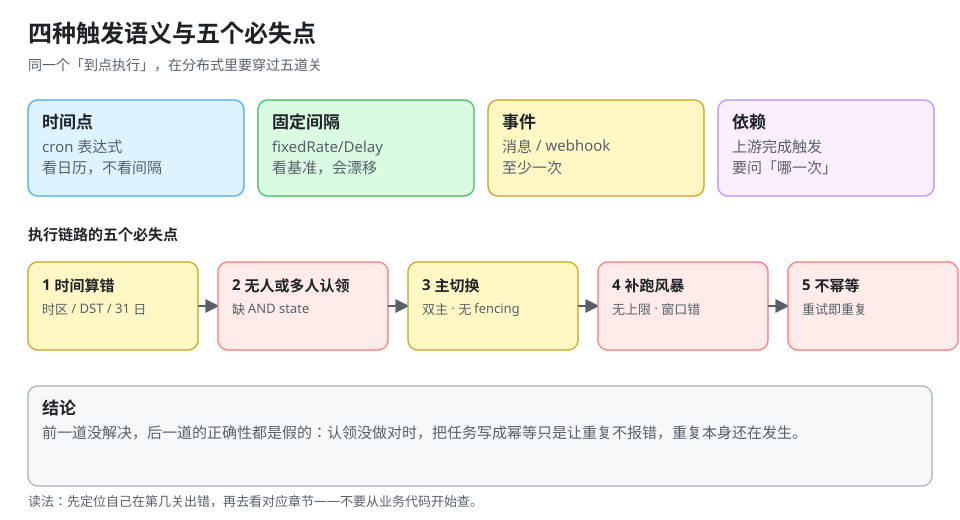

# 总览：四种触发语义与五个必失点

「定时任务」这个词把四件不同的事揉成了一件。把它们拆开之后，绝大多数线上事故都能归到「用错了语义」或「没定义语义」上。

::: tip 一句话理解
`0 0 3 * * ?` 只说了「什么时候想跑」，没说**「跑几次、跑多久、跑失败了算不算跑过」**——这三件事才是调度工程的全部内容。
:::



## 一、四种触发语义

| 语义 | 定义 | 典型实现 | 幂等要求 | 失败后果 |
| --- | --- | --- | --- | --- |
| **时间点**（calendar） | 在某个本地日历时刻触发一次 | Quartz `CronTrigger`、K8s CronJob | 必须幂等 | 错过就是错过，补不补要显式选 |
| **固定间隔**（interval） | 上次开始/结束后固定时长再跑 | `@Scheduled(fixedRate/fixedDelay)` | 通常幂等 | 间隔会漂移、会堆积 |
| **事件**（event） | 由某件事触发（消息、webhook） | 消息队列、CDC | 消费侧幂等 | 重投即重复 |
| **依赖**（dependency） | 上游全部成功后触发 | Airflow DAG、XXL-JOB 子任务 | 需要「哪一次上游」 | 上游失败传导、部分成功难判 |

四条语义的**成本结构完全不同**：

- 时间点语义要解决「**谁的时间**」——时区、DST、集群时钟；
- 间隔语义要解决「**基准**」——从上一次开始算还是结束算，两者在任务变慢时差一个执行时长；
- 事件语义要解决「**至少一次还是至多一次**」——几乎所有消息系统默认至少一次；
- 依赖语义要解决「**同一批次**」——上游 03:00 那次成功，不代表上游 04:00 那次也成功。

::: danger 最常见的语义混用
1. **用 `fixedRate` 实现「每小时整点」**：进程 03:17 启动，任务就永远在每小时 17 分跑。要整点必须用 cron 语义，不能用间隔语义去「凑」。
2. **用 cron 实现「上一次结束后 10 分钟」**：cron 只认日历，不认上一次是否结束。任务跑 40 分钟时，这两者会重叠两次。
3. **把依赖当成「同一时刻并发跑」**：上游任务 03:00 启动、03:20 结束，下游 03:00 也启动——它读到的是一半的数据。
:::

## 二、执行链路的五个必失点

一次「到点执行」在分布式系统里要穿过五道关，每一道都对应一类真实故障：

| # | 环节 | 会怎么坏 | 本专题对应页 |
| --- | --- | --- | --- |
| 1 | **触发时间算错** | 时区写错、DST 跳变、`31 日`在 2 月不存在 | [Cron 语义](../CronSemantics/index.md) |
| 2 | **没人认领 / 多人认领** | 扫描到却没有条件更新，两个实例各跑一遍 | [调度内核](../SchedulerCore/index.md) |
| 3 | **主节点切换** | 旧主以为自己是主，新主也开工，同一次触发两次 | [高可用](../LeaderSharding/index.md) |
| 4 | **停机后的补偿** | 一次性补 360 次，把下游打挂 | [misfire 与补跑](../MisfireCatchup/index.md) |
| 5 | **执行不幂等** | 重试、补跑、人工重跑，三次效果叠加 | [幂等与重试](../IdempotentRetry/index.md) |

这五道关的顺序有意义：**前一道没解决，后一道的正确性都是假的**。比如「认领没有条件更新」时，你把任务写成幂等的，只是让重复执行不出错，**重复本身还在发生**，下游的调用量、账单、配额扣减全都翻倍。

## 三、三段式：所有调度器的骨架

不管用 Quartz、XXL-JOB 还是自己写，落到存储上都是同一件事：

```text
① 扫描   SELECT ... WHERE state='pending' AND next_run_at <= now() ORDER BY next_run_at LIMIT n
② 认领   UPDATE ... SET state='running', locked_by=?, locked_until=? WHERE id IN (...) AND state='pending'
③ 执行   调业务方法 → 成功写 success / 失败按策略重试 → 计算并写入下一次 next_run_at
```

三段式的每一段都有一个「看起来能省、实际不能省」的细节：

1. **扫描必须带 `state` 条件**：只按时间过滤会把已在运行的任务再捞一遍。
2. **认领必须带 `AND state='pending'`**：这是**唯一**能防止重复执行的语句级保证（见 [调度内核](../SchedulerCore/index.md) 的 20 次幻影执行实测）。
3. **执行完成后必须原子地「写结果 + 写下一次时间」**：分开写会在中间崩溃，留下一个「成功但永远不会再跑」的任务——它比失败更隐蔽，因为看板上全是绿的。

## 四、单机 cron 免费给你的三件事

| 能力 | 单机 cron | 分布式调度器 |
| --- | --- | --- |
| 「只有一个人知道」 | 进程唯一，天然成立 | 需要选主或分片 |
| 「只发生一次」 | 无并发者，天然成立 | 需要条件更新 + fencing |
| 「发生了能证明」 | syslog 里有一行 | 需要 `(job_key, fire_time)` 事实表 |

这也是「本地测得好好的，上集群就双跑」的根因：**你在单机上验证的那套代码，从没验证过这三件事**。

## 五、一个最小的判定流程

遇到「任务没跑 / 跑了两次 / 跑了一半」，按这个顺序查，不要一上来就看业务代码：

```text
1. 这一次的 fire_time 应该是什么？        → 算出来（别用「应该是三点」）
2. 事实表里有没有 (job_key, fire_time)？  → 没有：触发阶段的问题
3. 有几条？                              → 两条以上：认领/选主问题
4. 状态是什么？                          → running 且有 locked_until：租约问题
5. 结束时间 - 开始时间 与周期比？          → 大于周期：重叠问题，不是失败问题
```

## 六、本页判据

本页判据族 `DSO-A` ~ `DSO-H`，共 8 条。

| 编号 | 判据 | 判定方式 | 不满足时改哪里 |
| --- | --- | --- | --- |
| `DSO-A` | 每个任务都写明四种语义中的哪一种（时间点/间隔/事件/依赖） | 查任务登记表 | 补一列 `trigger_semantics` |
| `DSO-B` | 时间点任务显式声明时区（IANA 名），不用「服务器本地时间」 | `grep -r "fixedRate\|ZoneId.systemDefault"` | 改成显式 zone |
| `DSO-C` | 间隔任务写明基准是「上次开始」还是「上次结束」 | 查注解/配置 | 变更并在页内注明影响 |
| `DSO-D` | 扫描 SQL 带 `state` 条件，认领 SQL 带 `AND state='pending'` | 读 SQL | 补条件（唯一防重手段） |
| `DSO-E` | 「写结果」与「写下一次时间」在同一事务 | 读代码/事务注解 | 合并为一个事务 |
| `DSO-F` | 有 `(job_key, fire_time)` 事实表，且能按天查询 | 执行一次查询 | 建表并接线 |
| `DSO-G` | 每个任务都有「最后一次成功时间」指标 | 查面板 | 加 `last_success_timestamp` |
| `DSO-H` | 任务登记表写明「失败是否补跑」与「补跑上限」 | 查登记表 | 补两列并在代码里生效 |

## 七、验证：把四类语义的差异算出来

```python
# 同一个「每小时」需求，三种实现的触发时刻完全不同
from datetime import datetime, timedelta

start = datetime(2026, 5, 1, 3, 17, 0)          # 进程启动时刻
print("间隔语义（fixedRate 1h）：", [ (start + timedelta(hours=i)).strftime("%H:%M") for i in range(4) ])
print("cron 语义（每小时 0 分）：", ["04:00", "05:00", "06:00", "07:00"])
first_delay = start + timedelta(minutes=40 + 60)   # 执行 40 分钟后再等 60 分钟
second_delay = first_delay + timedelta(minutes=40 + 60)
print("间隔语义（fixedDelay 1h + 执行 40min）：",
      first_delay.strftime("%H:%M"), "→", second_delay.strftime("%H:%M"), "，每次后移 100 分钟")
```

预期输出：

```text
间隔语义（fixedRate 1h）： ['03:17', '04:17', '05:17', '06:17']
cron 语义（每小时 0 分）： ['04:00', '05:00', '06:00', '07:00']
间隔语义（fixedDelay 1h + 执行 40min）： 04:57 → 06:37 ，每次后移 100 分钟
```

读法：**间隔语义的触发时刻由「启动那一刻」决定，cron 语义由日历决定**。一个每天 03:00 对账的任务如果写成 `fixedRate = 24h`，在滚动发布之后就会漂到「上次发布的时间」，而它往往还要和「昨天 23:59 的账单截止」对齐——这就是漂移从「不方便」变成「算错账」的路径。

## 八、参考资料

- [Quartz Scheduler 官方文档：CronTrigger 与 misfire](https://www.quartz-scheduler.org/documentation/)
- [Kubernetes 文档：CronJob](https://kubernetes.io/docs/concepts/workloads/controllers/cron-jobs/)
- [XXL-JOB 官方文档](https://www.xuxl-job.com/)（调度中心与执行器模型）
- [Cron 语义：时区、DST 与下一次触发时间](../CronSemantics/index.md)
- [调度内核：扫描、认领与执行三段式](../SchedulerCore/index.md)
