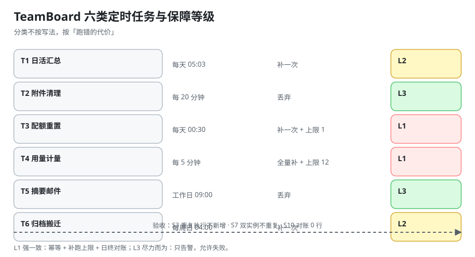

# 实战：TeamBoard 的六类定时任务验收

这一页把前五页的规则落到一个真实的多租户协作产品上：TeamBoard 有六类定时任务，每一类的失败代价不同，因此不能共用一套默认值。

::: tip 一句话理解
定时任务的分类不按「写起来像不像」，而按**「跑错的代价」**：多跑一次扣两次配额的任务，和少跑一次只是报表晚一小时的任务，必须用完全不同的配置。
:::



## 一、六类任务登记表

| # | 任务 | 周期（本地时区） | 语义 | 幂等键 | misfire | 分片键 | 失败代价 |
| --- | --- | --- | --- | --- | --- | --- | --- |
| T1 | 看板日活汇总 | `0 5 3 * * *`（Asia/Shanghai） | 时间点 | `(daily_active, fire_time)` | 补一次 | 无（单实例） | 报表晚点 |
| T2 | 附件 `pending` 清理 | `0 */20 * * * *` | 间隔（20 分钟） | `(attachment_gc, fire_time)` | 丢弃 | `hash(tenant) % 4` | 存储涨、无功能影响 |
| T3 | 配额日重置 | `0 30 0 * * *` | 时间点 | `(quota_reset, tenant, fire_time)` | **补一次 + 上限 1** | 按 `tenant` | 租户当天无法新建 |
| T4 | 用量计量入库 | `0 */5 * * * *` | 时间点（滚动） | `(usage_rollup, window_start)` | 全量补（上限 12） | `hash(tenant) % 8` | 计费口径错 |
| T5 | 通知摘要邮件 | `0 0 9 * * 1-5` | 时间点（工作日） | `(digest, tenant, fire_date)` | 丢弃 | 按 `tenant` | 用户少收一封信 |
| T6 | 归档表搬迁 | `0 0 4 * * 0`（周日） | 时间点（周） | `(archive_move, period_start)` | 补一次 | 无 | 存储成本 |

这张表本身就是交付物：**任何一列空着，都意味着「默认行为在替你做决定」**。

## 二、三类保障等级

| 等级 | 任务 | 要求 |
| --- | --- | --- |
| **L1 强一致** | T3、T4 | 幂等键 + 补跑上限 + 逐租户对账 + `fenced` 写入 |
| **L2 可重放** | T1、T6 | 幂等键 + 补一次 + 结果可重算 |
| **L3 尽力而为** | T2、T5 | 幂等键（防重发）+ 丢弃策略 + 只告警 |

**分级的意义在于「允许失败」**：T5 少发一封邮件不需要半夜起来，T4 少算一次用量就是账错。把所有任务都按 L1 要求，结果是没人维护得动；全按 L3，则是账目性事故。

## 三、T4 的完整设计（最复杂的一类）

### 1. 为什么要「滚动窗口 + 幂等键」

```text
00:00 ───── 00:05 ───── 00:10 ───── 00:15
   │ 窗口1   │ 窗口2   │ 窗口3
   └─ 每 5 分钟把上一个完整窗口的用量聚合进 usage_rollup
```

幂等键是 `(usage_rollup, window_start)`——**不是 `fire_time`**。原因是补跑时 `fire_time` 会变（补的是「现在」），而窗口不变；用 `window_start` 才能保证「同一个窗口只入账一次」。

```sql
INSERT INTO usage_rollup (tenant_id, window_start, window_end, cards_created, attachments_bytes)
SELECT tenant_id,
       date_trunc('minute', created_at) - interval '5 minute',
       date_trunc('minute', created_at),
       count(*) FILTER (WHERE kind = 'card'),
       coalesce(sum(size), 0)
  FROM usage_event
 WHERE created_at >= :win_start AND created_at < :win_end
 GROUP BY tenant_id, date_trunc('minute', created_at) - interval '5 minute'
ON CONFLICT (tenant_id, window_start) DO NOTHING;
```

`ON CONFLICT DO NOTHING` 让「补跑重叠」变成无害操作：重复窗口插入 0 行。

### 2. 补跑上限为什么是 12

窗口 5 分钟、上限 12 次 = **1 小时**。这与「用量事件保留 24 小时」不冲突，因为超过 1 小时的缺口应该走**离线重算**（按 `usage_event` 全量重放），而不是让调度器补 288 次。

| 缺口长度 | 处置 |
| --- | --- |
| ≤ 1 小时 | 调度器补跑（≤ 12 次） |
| 1~24 小时 | 离线重算任务（一次性，人工触发） |
| > 24 小时 | 事件已归档，走归档重放 + 对账 |

### 3. 对账 SQL

```sql
-- 每个租户：事件表求和 vs 汇总表求和，差值必须为 0
SELECT e.tenant_id,
       sum(e.cards_created) AS from_events,
       coalesce(sum(r.cards_created), 0) AS from_rollup,
       sum(e.cards_created) - coalesce(sum(r.cards_created), 0) AS diff
  FROM (SELECT tenant_id, count(*) FILTER (WHERE kind='card') AS cards_created
          FROM usage_event WHERE created_at >= :day_start GROUP BY tenant_id) e
  LEFT JOIN usage_rollup r
         ON r.tenant_id = e.tenant_id AND r.window_start >= :day_start
 GROUP BY e.tenant_id
HAVING sum(e.cards_created) - coalesce(sum(r.cards_created), 0) <> 0;
```

**返回 0 行才算通过**。这条查询是 L1 任务的「日终验收」，每天 04:00 由另一个任务执行——**用定时任务检查定时任务**。

## 四、验收序列 S1~S10

| 步骤 | 操作 | 期望结果 |
| --- | --- | --- |
| S1 | `SELECT job_key, cron, tz FROM job_registry ORDER BY job_key;` | 6 行，每行有 `tz`，无空值 |
| S2 | 手动把 T4 的 `next_run_at` 改成过去 30 秒，等一个轮询周期 | `job_run` 新增 1 行，`state=success` |
| S3 | 重复执行 S2（同一 `window_start`） | `job_run` 不新增；`usage_rollup` 行数不变 |
| S4 | 停掉调度器 20 分钟，再启动 | `is_backfill=true` 的记录 ≤ 4 条（20 分钟 / 5 分钟） |
| S5 | 停掉调度器 3 小时，再启动 | 补跑 ≤ 12 条，其余标 `skipped_capped` |
| S6 | 造一条 `state='running'` 且 `locked_until` 过期的记录 | 60 秒内被回收，`job_reaped_total` +1 |
| S7 | 两个实例同时启动 | `job_run` 中同一 `(job_key, fire_time)` 只有 1 行 |
| S8 | 把 T3 的 cron 改成 `0 30 0 31 * *` | 一个月只在 31 日跑；2 月不跑（用于验证语义，不用于生产） |
| S9 | 查面板 | 五个口径齐全，T4 覆盖率 100%、有效成功率 ≥ 99% |
| S10 | 执行对账 SQL | 0 行 |

S3 与 S7 是**必须过的两条**：它们分别验证「幂等」与「防重」，任一失败都说明前五页的机制没接上。

## 五、踩过的坑

| 坑 | 现象 | 修复 |
| --- | --- | --- |
| T3 用 `fire_time` 作幂等键 | 补跑时 `fire_time` 变了，同一租户被重置两次 | 改用 `(quota_reset, tenant, 业务日期)` |
| T2 清理任务用 `LIKE 'pending'` 匹配状态 | 把 `pending_review` 也删了 | 等值匹配 + 状态枚举 |
| T4 窗口按「执行时刻」算 | 补跑时窗口错位，同一批事件进了两个窗口 | 窗口由 `fire_time` 对齐到 5 分钟边界 |
| T6 归档用 `DELETE ... LIMIT` | 无 `ORDER BY`，每次删的行不确定，断点续跑丢行 | `ORDER BY id LIMIT` + `id > last_id` |
| 所有任务共用 60 s 租约 | T6 执行 8 分钟，每次都被回收重跑 | 按 p99 设租约（T6 = 20 分钟） |

## 六、本页判据

本页判据族 `DSX-A` ~ `DSX-H`，共 8 条。

| 编号 | 判据 | 判定方式 | 不满足时改哪里 |
| --- | --- | --- | --- |
| `DSX-A` | 任务登记表六列齐全（周期/语义/幂等键/misfire/分片/代价） | 查登记表 | 补列 |
| `DSX-B` | 每个任务有明确保障等级（L1/L2/L3） | 查登记表 | 加一列 |
| `DSX-C` | L1 任务的幂等键不含 `fire_time`（用业务窗口） | 查幂等键 | 改键 |
| `DSX-D` | 补跑上限与「离线重算」的边界写清楚 | 查文档 | 补阈值 |
| `DSX-E` | 有对账 SQL，且返回 0 行才算通过 | 执行一次 | 补对账 |
| `DSX-F` | 至少两条验收用例覆盖「重复执行」与「双实例」 | 查验收清单 | 补 S3/S7 |
| `DSX-G` | 租约按各任务 p99 设定，不共用默认值 | 查配置 | 分别设定 |
| `DSX-H` | 批量删除/搬迁带 `ORDER BY` 与游标 | 读 SQL | 补排序与游标 |

## 七、验证：T4 的幂等与补跑上限

```python
import sqlite3
con = sqlite3.connect(":memory:")
con.execute("CREATE TABLE rollup(tenant TEXT, win_start INT, cards INT, PRIMARY KEY(tenant, win_start))")

def upsert(tenant, win, cards):
    cur = con.execute("INSERT INTO rollup VALUES(?,?,?) ON CONFLICT DO NOTHING", (tenant, win, cards))
    return cur.rowcount

print("首次写入:", upsert("t1", 0, 10))          # 1
print("补跑重复:", upsert("t1", 0, 10))          # 0
print("下一个窗口:", upsert("t1", 300, 7))       # 1

# 补跑上限：3 小时缺口 / 5 分钟窗口 = 36 次，上限 12
gap_min, win_min, cap = 180, 5, 12
missed = gap_min // win_min
print(f"缺口 {gap_min} 分钟 → 错过 {missed} 次，补 {min(missed, cap)} 次，丢弃 {max(0, missed - cap)} 次")
```

预期输出：

```text
首次写入: 1
补跑重复: 0
下一个窗口: 1
缺口 180 分钟 → 错过 36 次，补 12 次，丢弃 24 次
```

读法：`0` 证明「同一窗口补两次也只入账一次」；最后一行的 12/24 是补跑上限的可见结果——**被丢弃的 24 个窗口必须能被对账 SQL 发现**，否则它们就是静默的数据缺口。

## 八、参考资料

- [TeamBoard 用量计量与配额](../../../../project/Complete/TeamBoard/TenantMetering/index.md)：本页 T3/T4 的项目侧实现
- [幂等与重试：一次到底算几次](../IdempotentRetry/index.md)：幂等键设计
- [misfire 与补跑](../MisfireCatchup/index.md)：补跑上限的依据
- [PostgreSQL 文档：`date_trunc` 与窗口聚合](https://www.postgresql.org/docs/current/functions-datetime.html)
