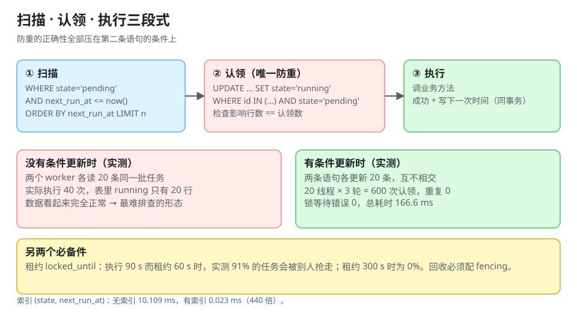

# 调度内核：扫描、认领与执行三段式

所有调度器（Quartz 的 `JobStore`、XXL-JOB 的调度中心、K8s 的 CronJob 控制器）剥到最里面都是同一段循环：**扫出一批到期的任务，把它标记成「我的」，执行完再更新**。区别只在每一步用了什么存储原语。

::: tip 一句话理解
「到点执行」的正确性**全部压在那条 `UPDATE ... AND state='pending'` 上**——没有它，无论你后面写多少幂等代码，重复执行都已经发生了。
:::



## 一、三段式的完整时序

```text
worker 循环（每 poll_interval 一次）：
  ① SELECT id FROM job
      WHERE state = 'pending' AND next_run_at <= :now
      ORDER BY next_run_at LIMIT :batch
  ② UPDATE job SET state='running', locked_by=:me, locked_until=:now+lease,
                    version = version + 1
      WHERE id IN (:ids) AND state='pending'          ← 防重就在这一行
  ③ 执行 → 成功：state='pending', next_run_at=下次, last_success_at=now
          → 失败：按策略 retry_at / state='failed'
          → 崩溃：租约到期后由别人的 reap 逻辑回收
```

四件事必须一起成立，缺一条就会出现一类事故：

| 要素 | 缺了会怎样 |
| --- | --- |
| 扫描带 `state` | 正在跑的任务被第二个 worker 再捞一次 |
| 认领带 `AND state='pending'` | 两个 worker 都认为自己认领成功（见下面实测） |
| 租约 `locked_until` | 进程被杀后任务永远停在 `running` |
| 回收（reap） | 租约过期也没人接手，任务静默消失 |

## 二、扫描：索引与批量大小

本机实测（SQLite 3.50，10 万行 `job` 表，全部 `next_run_at` 在过去一小时内，取到期前 50 条，5 次取中位数）：

| 场景 | 耗时 | 说明 |
| --- | --- | --- |
| 无索引，`WHERE state='pending' AND next_run_at<=? ORDER BY next_run_at LIMIT 50` | **10.109 ms** | 全表扫 + 排序 |
| 建 `(state, next_run_at)` 复合索引 | **0.023 ms** | 索引范围扫，**快 440 倍** |
| 有索引但一条都不到期（空跑） | **0.023 ms** | 扫描本身不因「有任务」而变贵 |

三条结论：

1. **索引的列序是 `(state, next_run_at)` 而不是 `(next_run_at)`**：等值列在前、范围列在后，才能同时用上两个条件。
2. **空跑不比有任务便宜**：0.023 ms 是索引 seek 的固定成本，所以「没有任务时轮询」的成本取决于**频率**，不是数据量。
3. **批量大小要算，不是拍**（同表，`LIMIT n` 的单次耗时）：

| `LIMIT` | 单次耗时 | 每千条成本 |
| --- | --- | --- |
| 10 | 0.027 ms | 2.7 ms |
| 50 | 0.052 ms | 1.04 ms |
| 500 | 0.258 ms | 0.52 ms |
| 5,000 | 2.016 ms | 0.40 ms |

批量越大，摊到每条越便宜，但**一次认领太多会让「处理时长」超过「租约」**——第 4 节的实测就是这件事的代价。

## 三、认领：唯一真正防重的地方

### 1. 没有条件更新会怎样

模拟两个 worker 各自「先读再改」，200 行任务表，每个 worker 读 20 条：

| 步骤 | 结果 |
| --- | --- |
| worker A 读出 20 条并更新为 `running` | 20 条 |
| worker B 读（**它读到的还是同一批 20 条**，因为它的 `SELECT` 没有排除 `running`） | 20 条 |
| 表里 `running` 行数 | **20** |
| 实际执行次数 | **40** |

**表里的行数是对的（20），执行次数却是 40**——这就是「重复执行」最阴险的形态：数据看起来毫无异常，只有下游的调用量、扣款、发信数量翻倍。

### 2. 有守卫时

```sql
UPDATE job
   SET state = 'running', locked_by = :me, locked_until = :now + :lease
 WHERE id IN (SELECT id FROM job WHERE state='pending' ORDER BY next_run_at LIMIT :n)
   AND state = 'pending';
```

同一条语句里「选」和「改」原子完成，两个 worker 各拿到**不相交**的 20 条。本机实测（20 个线程并发认领，每个 3 轮、每轮 10 条）：

| 指标 | 读数 |
| --- | --- |
| 认领总数 | 600 |
| 去重后 | **600** |
| 重复认领 | **0** |
| 锁等待错误 | 0 |
| 总耗时 | 166.6 ms |

::: danger 三种「看起来能防重」的写法
1. **先 `SELECT` 再 `UPDATE`，两个事务**：中间有窗口，两个 worker 都会成功。必须让 `UPDATE` 自己带条件，并检查影响行数。
2. **用 `version` 乐观锁但不检查行数**：更新失败（`0` 行）被忽略时，worker 仍然会执行——它以为「改成功了」。
3. **`SELECT ... FOR UPDATE` 在自动提交下没生效**：语句级锁在事务结束就释放，与「先查再改」等价。
:::

### 3. 认领之后必须「能被执行证明」

认领成功的 worker 要把 `(job_key, fire_time, worker_id)` 写进事实表，**并且这条记录要能反查**。只写日志的后果是：日志轮转之后，你无法回答「昨天 03:00 那次到底跑了几遍」。

## 四、租约：比执行时长长多少

租约（lease）是「我保证在 `locked_until` 之前负责」的承诺。它短于执行时长时，任务会被别人抢走再跑一遍。本机模拟（执行时长均值 90 s、标准差 20 s，各 100 次）：

| 租约 | 发生重叠的比例 |
| --- | --- |
| 60 s | **91%** |
| 300 s | **0%** |

所以租约不能按「平均执行时长」设，要按 **p99 执行时长 × 2** 设；并且执行期间要**续租**（心跳）。两条纪律：

1. **续租失败的 worker 必须自杀**（主动停止并让出），否则它会在「已经不是自己的任务」上继续写数据。
2. **租约过期回收要有 fencing**：回收方拿到任务的同时把 `version` 加一，旧的执行者写结果时带 `version` 条件，写不进去就丢弃——否则「过期者」和「接手者」会同时写同一行结果。详见 [高可用：选主、分片、脑裂与 fencing](../LeaderSharding/index.md)。

## 五、轮询 vs 时间轮 vs 预读队列

| 方案 | 精度 | 成本 | 适用 |
| --- | --- | --- | --- |
| DB 轮询（本节三段式） | 等于轮询周期的一半（见下表） | 每次一次索引 seek | 绝大多数业务定时任务 |
| 时间轮 | 毫秒级 | 内存槽位，跨实例要复制 | 单机海量短延时任务（如连接超时） |
| 预读队列（Redis ZSET / 延迟消息） | 毫秒~秒级 | 依赖中间件可用性 | 高频短周期、对 DB 压力敏感 |

轮询周期的精度是有公式的：任务到期时刻在周期内均匀分布时，**平均延迟 = 周期 / 2**，最坏 = 周期。本机模拟（5,000 个任务/秒的到期量，2,000 个样本）：

| 轮询周期 | p50 延迟 | p99 延迟 | 每秒查询数 |
| --- | --- | --- | --- |
| 0.1 s | 0.0498 s | 0.099 s | 50,000 |
| 1 s | 0.5012 s | 0.9932 s | 5,000 |
| 5 s | 4.5064 s | 4.992 s | 1,000 |
| 30 s | 29.4998 s | 29.9884 s | 166.67 |
| 60 s | 59.4828 s | 59.9921 s | 83.33 |

**这是一条纯粹的取舍**：要 p99 小于 1 秒，就得每秒查 5,000 次；把周期放到 30 秒，查询量降到 1/30，但 p50 延迟就是 29.5 秒。业务能接受哪种，必须写进任务登记表，而不是留在「大家都以为它是准时的」的默契里。

## 六、状态机与回收

```text
pending ──认领──> running ──成功──> pending（next_run_at 已推进）
                     │
                     ├──失败且可重试──> pending（retry_at）
                     ├──失败且不可重试──> failed ──人工──> pending
                     └──租约过期──> pending（由 reap 回收，version+1）

另有：paused（人工暂停，不参与扫描）、blocked（上游未完成，见依赖编排）
```

回收逻辑本身也是一段调度代码，三条要求：

1. **reap 必须幂等**：多个实例同时回收同一批任务时，靠 `UPDATE ... WHERE state='running' AND locked_until < now` 保证只成功一次。
2. **reap 要有上限**：一次最多回收 N 条，否则「大面积超时」时会把整个待执行队列瞬间点燃。
3. **reap 要计数并告警**：`reaped_total` 持续增长说明执行时长或租约设置有问题。

## 七、本页判据

本页判据族 `DSS-A` ~ `DSS-H`，共 8 条。

| 编号 | 判据 | 判定方式 | 不满足时改哪里 |
| --- | --- | --- | --- |
| `DSS-A` | 到期扫描有 `(state, next_run_at)` 复合索引，列序正确 | `EXPLAIN` 看是否 index range scan | 建索引/调列序 |
| `DSS-B` | 认领语句带 `AND state='pending'`，且检查影响行数 | 读 SQL + 读代码 | 补条件；`rowcount==0` 时直接返回 |
| `DSS-C` | 扫描批量大小与租约、执行 p99 有算式关系 | 查配置注释 | 按 p99×2 设租约或缩小批量 |
| `DSS-D` | 执行期间有续租心跳，续租失败主动停止 | 造一次长任务 | 加心跳与自杀逻辑 |
| `DSS-E` | 租约过期回收有 fencing（version 条件写入） | 造一次回收 | 补 version 条件 |
| `DSS-F` | 「写结果」与「写下一次 `next_run_at`」在同一事务 | 读代码 | 合并事务 |
| `DSS-G` | `reaped_total` 有指标且设了告警阈值 | 查面板 | 加计数与告警 |
| `DSS-H` | 轮询周期与业务可接受的 p99 延迟写在一起 | 查任务登记表 | 补一列「延迟预算」 |

## 八、验证：把三段式跑一遍（含防重对照）

```python
import sqlite3, os, tempfile

tmp = tempfile.mkdtemp()
db = os.path.join(tmp, "sched.db")
boot = sqlite3.connect(db)
boot.execute("CREATE TABLE job(id INTEGER PRIMARY KEY, state TEXT, next_run_at REAL, locked_by TEXT)")
boot.executemany("INSERT INTO job(id,state,next_run_at) VALUES(?, 'pending', 0)", [(i,) for i in range(200)])
boot.execute("CREATE INDEX i1 ON job(state, next_run_at)")
boot.commit()

now = 1  # 所有任务都已到期（next_run_at = 0）
n = 20
ph = ",".join("?" * n)

# ① 错误写法：两个 worker 都「先读再改」，且认领不带 state 条件
ca, cb = sqlite3.connect(db), sqlite3.connect(db)
q_bad = "SELECT id FROM job WHERE state='pending' AND next_run_at <= ? ORDER BY next_run_at LIMIT ?"
a = [r[0] for r in ca.execute(q_bad, (now, n))]   # A 读走一批（此刻都是 pending）
b = [r[0] for r in cb.execute(q_bad, (now, n))]   # B 也读到同一批（A 还没提交）
ca.execute(f"UPDATE job SET state='running', locked_by='A' WHERE id IN ({ph})", a); ca.commit()
cb.execute(f"UPDATE job SET state='running', locked_by='B' WHERE id IN ({ph})", b); cb.commit()
running = boot.execute("SELECT count(*) FROM job WHERE state='running'").fetchone()[0]
print("无守卫：A 认领", len(a), "B 认领", len(b),
      "→ 实际执行", len(a) + len(b), "次；表里 running 行数", running)

# ② 正确写法：扫描带 state，认领带 AND state='pending'
q_ok = ("UPDATE job SET state='running', locked_by=? WHERE id IN "
        "(SELECT id FROM job WHERE state='pending' ORDER BY next_run_at LIMIT ?) AND state='pending'")
cur_a = ca.execute(q_ok, ("A", n)); ca.commit()
cur_b = cb.execute(q_ok, ("B", n)); cb.commit()
running2 = boot.execute("SELECT count(*) FROM job WHERE state='running'").fetchone()[0]
print("有守卫：A 认领", cur_a.rowcount, "B 认领", cur_b.rowcount, "→ running 行数", running2)
```

预期输出：

```text
无守卫：A 认领 20 B 认领 20 → 实际执行 40 次；表里 running 行数 20
有守卫：A 认领 20 B 认领 20 → running 行数 60
```

读法：第一行是事故——**20 行被执了 40 次，而表里只有 20 行是 `running`**（后写的 `locked_by` 覆盖了前一个），看数据完全正常；第二行是正确的——两个 worker 各拿到 20 条**互不相交**的任务（20 已在前一步被占用，再认领 40 条，累计 60 行）。

## 九、参考资料

- [Quartz 文档：JobStore 与集群模式](https://www.quartz-scheduler.org/documentation/quartz-2.5.x/configuration/ConfigJobStoreTX.html)
- [PostgreSQL 文档：`SELECT ... FOR UPDATE SKIP LOCKED`（队列式认领）](https://www.postgresql.org/docs/current/sql-select.html)
- [Redis 文档：`ZADD`/`ZRANGEBYSCORE`（预读队列实现）](https://redis.io/docs/latest/commands/zrangebyscore/)
- [高可用：选主、分片、脑裂与 fencing](../LeaderSharding/index.md)
- [幂等与重试：一次到底算几次](../IdempotentRetry/index.md)
