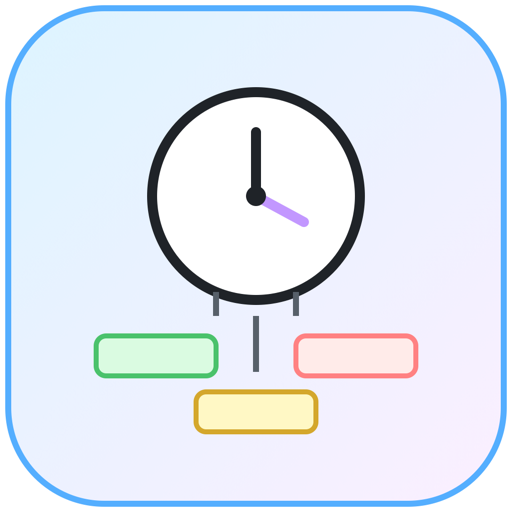
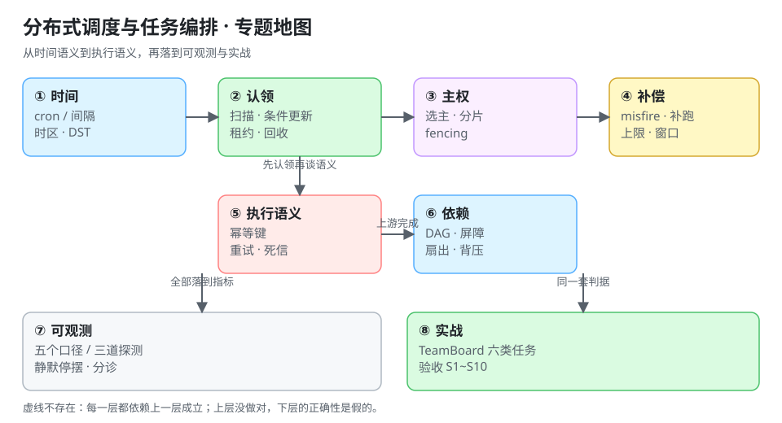

# 分布式调度与任务编排

定时任务看起来是后端里最不像「工程」的一块：写一行 `@Scheduled(cron = "0 0 3 * * ?")` 就能跑。可一旦它跑在多副本、多租户、要补数据、要对账的系统里，**「一天跑一次」这句话就有十几种失效方式**——跑两次、一次没跑、跑到一半被另一个实例接管、停机三小时后一次性补了三百次。

本专题面向已经在生产上维护定时任务的后端与运维：把「谁在什么时候触发、触发几次、失败了算不算数、停机之后补不补」这四件事讲成可判定的规则。

::: tip 一句话理解
调度器的难点从来不是「到点执行」，而是**「到点这件事只有一个人知道、只发生一次、发生了能证明」**——单机 cron 免费拥有这三点，分布式里每一点都要自己买。
:::

::: info 本专题与相邻专题的分工
- **业务流程怎么走、人工审批卡在哪** → [工作流引擎](../WorkflowEngine/index.md)：那里管「一个请假单经过五个人」，本专题管「凌晨三点该跑的那批账」。
- **消息怎么不丢不重、消费幂等怎么做** → [消息队列工程](../MessageQueue/index.md) 与 [幂等与状态机工程](../IdempotencyStateMachine/index.md)：调度只负责「把任务叫起来」，执行语义的底座在那两处。
- **多实例抢一把锁、谁是主** → [分布式锁与选主](../DistributedLock/index.md)：那里讲锁的正确性来源，本专题只讲「调度器怎么用锁保证一次触发」。
- **系统级 crontab 与 systemd timer 怎么写** → [Linux 进阶](../../Ops/Linux/Advanced/index.md)：那页是「机器上的定时任务」，本专题是「集群里的定时任务」。
- **任务跑慢了要不要告警、积压怎么看** → [监控告警](../../Ops/Monitoring/index.md) 与 [观测驱动开发](../../Tools/ObservabilityDriven/index.md)：本专题给出「该报什么数」，告警通道与分级在那两处。
- **定时任务在多租户系统里的真实形态** → [TeamBoard 用量计量与配额](../../../project/Complete/TeamBoard/TenantMetering/index.md)：项目侧的落地章节，用同一套判据验收。
:::

## 目录

- [总览：四种触发语义与五个必失点](Overview/index.md)
- [Cron 语义：时区、DST 与下一次触发时间](CronSemantics/index.md)
- [调度内核：扫描、认领与执行三段式](SchedulerCore/index.md)
- [高可用：选主、分片、脑裂与 fencing](LeaderSharding/index.md)
- [misfire 与补跑：停机之后补几次](MisfireCatchup/index.md)
- [幂等与重试：一次到底算几次](IdempotentRetry/index.md)
- [依赖编排：DAG、扇出与背压](DagDependency/index.md)
- [可观测：五个口径与静默停摆](Observability/index.md)
- [实战：TeamBoard 的六类定时任务验收](Practice/index.md)
- [常见问题与分诊](FAQ/index.md)

## 专题地图

## 判据纪律

本专题沿用全库写法：**每页 8 条，编号形如 `DSO-A`**，逐页前缀唯一，可被 `utils/audit` 下的判据类巡检机械核对。判据不是口号，每条都要能回答三个问题：**看什么现象、判成什么、不满足时改哪里**。

| 页 | 判据族 | 条数 | 这一族管什么 |
| --- | --- | --- | --- |
| 总览 | `DSO-A` ~ `DSO-H` | 8 | 四种触发语义是否被分开定义与度量 |
| Cron 语义 | `DSC-A` ~ `DSC-H` | 8 | 表达式、时区、DST 与下次触发时间 |
| 调度内核 | `DSS-A` ~ `DSS-H` | 8 | 扫描、认领、租约与状态机 |
| 高可用 | `DSH-A` ~ `DSH-H` | 8 | 选主、分片、fencing 与扩缩容 |
| misfire 与补跑 | `DSM-A` ~ `DSM-H` | 8 | 补不补、补几次、什么时候停 |
| 幂等与重试 | `DSI-A` ~ `DSI-H` | 8 | 执行语义、幂等键与退避上限 |
| 依赖编排 | `DSD-A` ~ `DSD-H` | 8 | DAG、依赖判定、扇出与背压 |
| 可观测 | `DSV-A` ~ `DSV-H` | 8 | 五个口径、静默停摆与告警 |
| 实战 | `DSX-A` ~ `DSX-H` | 8 | TeamBoard 六类任务的端到端验收 |
| 常见问题 | `DSQ-A` ~ `DSQ-H` | 8 | 症状分诊与上线自查 |

合计 **10 族 80 条**。

## 事实与版本速览（2026-10 核对）

| 项 | 现状 | 对调度的影响 |
| --- | --- | --- |
| Quartz | **2.5.x**（官方下载页当前为 2.5.1，Java 11+、`jakarta.*` 命名空间）；**2.4.1** 是 Java 8 + `javax.*` 的最后一支 | 集群模式必须用 `JDBCJobStore`（`RAMJobStore` 无法跨实例协调）；`misfireThreshold` 默认 60 s |
| XXL-JOB | **3.5.0**（2026-10-09） | 调度中心与执行器分离；3.5 起 AccessToken 按执行器维度隔离，**两端需一起升级** |
| Kubernetes CronJob | `batch/v1`；`spec.timeZone` 自 **1.27** 稳定 | 不设 `timeZone` 按 controller-manager 本地时区（多为 UTC）；`concurrencyPolicy` 默认 `Allow`；**错过超过 100 次会停止调度** |
| Airflow / Temporal | Airflow 3.x 系列、Temporal 1.x 系列为当前主线 | 两者都把「任务定义」与「执行状态」分离，适合 DAG 型与长事务型编排 |
| systemd timer / crontab | `OnCalendar=` / 五段式 | 单机语义，**没有**分布式协调；`crontab` 无秒级、无时区字段 |
| 时区数据库 | IANA tzdata，2026 年仍在按国家立法更新 | 「写死偏移量」的调度器会在下一次立法变更时错点 |

::: warning 关于「实测」的诚实标注
本专题的数字分两类，正文里逐处标明：

- **本机可复跑**：Python 3.13.12 标准库（`zoneinfo` / `sqlite3` / `threading`），固定种子 `20261021`，命令写在页面里，**脚本本身不入库**（放在仓库外）。涉及数据库的实验一律用 SQLite 3.50 的等价表结构，**不是** PostgreSQL 或 MySQL 的执行计划——它能证明「语义与并发行为」，不能证明「某个数据库的锁等待毫秒数」。
- **公开口径**：Quartz / XXL-JOB / Kubernetes / Airflow 的行为与默认值，逐条标了来源与日期。凡属推算（容量、drain 时间）一律写「算例」，不当成线上统计。
:::

## 版本组织说明（为何不建版本目录）

本专题涉及 Quartz 2.4 → 2.5（`javax` → `jakarta`）、XXL-JOB 3.x、Kubernetes `batch/v1` 等多个组件的版本变化，但这里**不建** `Quartz2/Quartz3` 之类的版本目录，理由三条：

1. **变化的是包名与依赖，不是调度语义**：`javax.*` → `jakarta.*` 影响的是升级动作（换依赖坐标、容器基线），不是「怎么写一个 cron 表达式」。语义层面的东西（触发一次、补跑、时区）在 2.3 到 2.5 之间没有变。
2. **本库建版本目录的先例都是「两代技术栈长期并存」**：`docs/Backend/Java/Frame/Spring/Spring5` 与 `Spring6`、`SpringBoot` 下的 `v2`/`v3`/`v4`、`Vue2` 与 `Vue3`——读者可能真的还在维护旧栈，且**写法不同**。Quartz 2.4 与 2.5 的 Job 写法完全一致，拆开只会产出两份会各自漂移的副本。
3. **真正需要按版本区分的是「平台行为」而不是「库版本」**：Kubernetes 1.27 之前的 `timeZone` 字段会被忽略、`batch/v1beta1` 在 1.25 被移除——这些差异用**页内表格 + 版本标注**表达最清楚（见 [Cron 语义](CronSemantics/index.md) 的「平台行为对照」），不需要两套目录。

旧内容一条不删：本专题首次建立，不涉及覆盖；将来若某天出现「同一时代必须同时维护两套调度栈」的局面（例如 Quartz 与某新一代调度器长期并存且 API 不可迁移），**届时再建版本目录并原样保留旧目录**。

## 三条底线

1. **任何一次执行都要能回答「谁触发的、触发的是哪一次」**——只记日志不够，要有可查询的 `(job_key, fire_time)` 事实。
2. **补跑是策略，不是默认行为**：默认「不补」比默认「全补」安全，因为补跑会放大一切不幂等的副作用。
3. **调度器自己也要被调度**：没有「最后一次成功时间」的定时任务，等于没有监控的定时任务。
