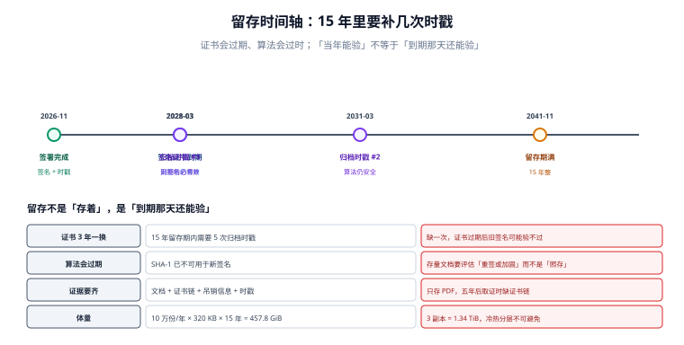

# 合规与留存：四要件与十五年

技术上讲「签名有效」是一回事，法律上讲「这份电子合同能当证据」是另一回事。中间隔着一份清单：签名是否专有、签署时是否可控、改动能被发现、留存是否完整。这些条件在《电子签名法》里写得相当具体，而工程实现里最常缺的，恰恰是「事后能证明」那半句。

::: tip 一句话理解
合规不是「用了 CA 就合规」，而是**四要件逐条能举证**。缺哪一条，就在哪一条上解释。
:::



## 一、可靠电子签名的四个条件

《电子签名法》第十三条给出的判据是四条同时满足：

| 条件 | 法律表述 | 工程上对应什么 | 常见缺口 |
| --- | --- | --- | --- |
| 专有性 | 电子签名制作数据用于电子签名时，属于电子签名人专有 | 私钥/令牌只由本人持有 | 私钥在服务端明文存，运维可代签 |
| 可控性 | 签署时电子签名制作数据仅由电子签名人控制 | UKey/手机盾/HSM + 二次授权 | 后台有「代签」按钮 |
| 可检测 | 签署后对电子签名的任何改动能够被发现 | `ByteRange` 摘要 + 逐版本验签 | 只验最后一个签名 |
| 可发现 | 签署后对数据电文内容和形式的任何改动能够被发现 | 快照不可变 + 哈希链 | 快照可被原地覆盖 |

四条里前两条是**管理问题**（谁能碰到私钥），后两条是**技术问题**（能不能发现改动）。很多系统把四条都当成技术问题，于是做出了「技术上完美、管理上有后门」的系统——验签永远通过，因为后台可以合法代签。

## 二、合规清单：能举证才算合规

| 事项 | 判据 | 本专题对应章节 |
| --- | --- | --- |
| 真实身份 | 签署人有可核验的实名信息 | [实名与意愿](../IdentityIntent/index.md) |
| 真实意愿 | 有明确的意思表示记录（对象/内容/方式/时刻） | 同上 |
| 原文完整 | 签名覆盖定稿字节，逐版本可验 | [字节范围与印章](../SealSignature/index.md) |
| 时间可信 | 有第三方时间戳，且令牌与摘要一致 | [证据链](../EvidenceChain/index.md) |
| 不可篡改 | 事件链 + 外部锚定 | 同上 |
| 可复现 | 第三方拿到证据包能独立验签 | [实战](../Practice/index.md) |
| 留存完整 | 文档 + 证书链 + 吊销信息 + 时戳 + 操作日志 | 本页 |
| 可删除 | 个人信息删除请求可执行，且与留存义务协调 | 本页第五节 |

前七条是「证明签过」，第八条是「证明之后要能忘」——两者在法律上并存（合同留存义务 vs 个人信息删除权），冲突时按「法定义务优先、其余最小化」处理。

## 三、留存多久：三套时钟，取最长

| 依据 | 期限 | 适用范围 |
| --- | --- | --- |
| 合同诉讼时效 | 3 年（《民法典》188 条），自知道或应当知道权利受损起 | 一般合同 |
| 会计档案 | 10 年 / 30 年（视档案类别） | 涉资金、涉税的合同 |
| 企业档案管理惯例 | 合同期满后 15 年 | 多数企业的内控标准 |
| 网络日志 | **不少于 6 个月** | 网络安全法第 21 条 |

工程上的做法是**按最长的那个算**：一份 2026 年签署、2031 年到期的合同，按「期满后 15 年」要存到 2046 年。这直接影响成本：

| 项 | 计算 | 结果 |
| --- | --- | --- |
| 每年签署量 | — | 100,000 份 |
| 平均体积（3 位签署人） | — | 320 KB |
| 15 年总量 | 100,000 × 320 KB × 15 | **457.8 GiB** |
| 3 副本 | × 3 | **1.34 TiB** |
| 其中签名与证据 | 每人 4 KB 占位 + 2.5 KB 证书链，2.4 人/份 | **22.3 GiB** |

最后一行有个反直觉的结论：**证据本身只占 5%**，绝大部分是文档正文。所以「为了省空间而不存证书链」是明显的错误取舍——省下 5%，失去全部可验证性。

## 四、电子档案格式：为什么常要求 PDF/A

| 格式 | 特点 | 适用 |
| --- | --- | --- |
| PDF 1.7（签名的原始形态） | 支持增量更新与签名 | 签署环节 |
| PDF/A-2b / -3b | 自包含（字体嵌入、禁加密），长期可渲染 | 归档环节 |
| 原生 Office 文档 | 依赖软件版本，渲染会漂移 | **不适合**作为唯一归档件 |

关键冲突：**PDF/A 要求「静态」，签名要求「可追加」**。所以正确顺序是「先签完、后转 PDF/A」，且转换会产生新字节 → 需要**转换后再签一次**（或由归档系统对转换件做一次封装签名）。把「转 PDF/A」放在签署之前，会让后续增量更新破坏 A 级一致性。

::: danger 四个必踩的坑

1. **把「有 CA 证书」当成合规闭环**。证书只解决「私钥是谁的」，解决不了「签署人是否本人」「时间是否真实」「记录是否被改」。
2. **留存只存 PDF，不存证书链与吊销信息**。五年后验证时，签名证书早过期、CA 的 OCSP 也查不到历史状态——证据包缺件，等于没有。
3. **日志留存不足 6 个月**。网络安全法要求网络日志不少于 6 个月，而合同纠纷往往在一年后才发生。日志与合同证据包必须分开定策略，别用同一套清理任务。
4. **删除请求直接删主表**。个人信息删除权要执行，但合同留存是法定义务：正确做法是**分离「履约必需字段」与「营销/画像字段」**，只删后者，并在删除日志里记录依据。
:::

## 五、删除与留存的冲突怎么落

```text
① 分类：合同正文与签署证据 = 法定义务留存；营销标签、行为画像 = 可删除
② 删除请求：只作用于第二类，第一类标记「因法定义务暂不删除」并告知用户
③ 到期：留存期满后，按批次做「可验证删除」——删除 + 记录删除清单的摘要
④ 审计：任何人查一份合同，都能看到「哪些字段被删过、依据是什么」
```

第 ③ 步的「可验证删除」常被忽略：删除本身也要留证据（删了什么、什么时候删的、依据哪条），否则无法向监管证明「我确实删了」。

## 六、存证与司法：三条常见路径

| 路径 | 做法 | 成本 | 证明力 |
| --- | --- | --- | --- |
| 自建证据包 | 自己存 PDF + 证书链 + 时戳，出证时导出 | 低 | 需自行说明技术可靠性 |
| 第三方存证 | 链头摘要推送存证机构，出证时由其出具证明 | 中 | 较高（有中立第三方） |
| 司法鉴定 | 纠纷发生后申请鉴定，由鉴定机构复验 | 高 | 高，但慢 |

多数团队的正确起点是「自建证据包 + 链头推送第三方」：日常成本可忽略，出证时有中立第三方背书。纯自建的问题不是技术不行，而是**对方会质疑「你们自己的系统」**——这一句质疑就足以让举证陷入拉锯。

## 判据

本页判据族 `ESL-A` ~ `ESL-H`，共 8 条，逐条可判定：

| 编号 | 判据 | 怎么判 |
| --- | --- | --- |
| `ESL-A` | 四要件逐条有对应实现与举证材料 | 四条各能找到证据 |
| `ESL-B` | 私钥不出签署人控制范围，后台无代签路径 | 接口清单里无「代签」 |
| `ESL-C` | 留存期限按「最长时钟」计算并写入策略 | 策略表可查，含依据 |
| `ESL-D` | 证据包含文档、证书链、吊销信息、时戳 | 导出包结构固定 |
| `ESL-E` | 网络日志留存 ≥ 6 个月，与合同留存分开定策略 | 两套清理任务并存 |
| `ESL-F` | 归档件格式自包含（PDF/A 或等效），且签名在转换后仍然有效 | 转换后重验通过 |
| `ESL-G` | 删除请求区分法定义务留存与可删除字段 | 存在字段分类表 |
| `ESL-H` | 删除动作本身留可审计记录 | 删除日志含依据与时间 |

## 验证方式

```shell
# 1) 留存体量算术
python3 - <<'PY'
per_year, kb, yrs, rep = 100_000, 320, 15, 3
g = per_year * kb * yrs / 1024 / 1024
print(f"总量 {g:,.1f} GiB，{rep} 副本 {g*rep/1024:,.2f} TiB")
ev = per_year * 2.4 * (4 + 2.5) / 1024 / 1024 * yrs
print(f"签名与证据 {ev:,.1f} GiB，占比 {ev/g*100:.1f}%")
PY
# 期望：457.8 / 1.34，22.3 GiB / 4.9%

# 2) 证据包完整性（项目侧导出目录）
ls dist/evidence/C-2026-0912/ | sort
# 期望：chain.jsonl  crl.der  manifest.json  snapshot.pdf  tsa-1.tsr  tsa-2.tsr

# 3) 本页判据 8 条
grep -o 'ESL-[A-H]' docs/Backend/ESignature/Compliance/index.md | sort -u | wc -l
```

预期输出：第一条两行与上表一致（`457.8 GiB` / `1.34 TiB`、`22.3 GiB` / 约 `4.9%`）；第二条列出六个文件；第三条 `8`。

## 参考资料

- [证据链：哈希链、时间戳与外部锚定](../EvidenceChain/index.md)
- [度量与验收：漏斗、时效与拒签](../Metrics/index.md)
- 《中华人民共和国电子签名法》（2019 修正）第十三条、第十四条：<https://www.gov.cn/flfg/2005-08/28/content_27127.htm>
- 《中华人民共和国网络安全法》第二十一条（网络日志留存不少于六个月）：<https://www.gov.cn/xinwen/2016-11/07/content_5129723.htm>
- 《中华人民共和国个人信息保护法》第四十七条（删除权）与第十三条（法定职责或义务）：<https://www.gov.cn/xinwen/2021-08/20/content_5632486.htm>
- GB/T 18894—2016《电子文件归档与电子档案管理规范》：<https://openstd.samr.gov.cn/bzgk/gb/newGbInfo?hcno=0D6A0E5A5A5F1C0E7B0E4E1C6C2D5B73>
