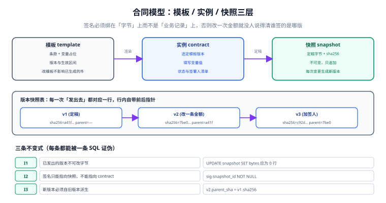

# 合同模型：模板、实例与版本快照

「改了金额，让签署人重签一下」这句话背后藏着一个必须先回答的问题：**重签的是哪一份？** 如果系统里只有一行「合同」记录、金额字段被原地 `UPDATE`，那么历史签名指向的字节已经不存在了——不是失效，是**不存在**。三个月后有人问「他当时签的是 12 万还是 15 万」，数据库只有一个当前值，谁也证明不了。

这一页解决的就是这件事：把「模板」「实例」「快照」拆成三层，让每次变更都留下不可变的一份字节。

::: tip 一句话理解
**模板可以改，实例可以变，快照只能追加。** 签名只能绑快照，不能绑实例。
:::

## 一、三层各自回答什么



| 层 | 表 | 回答的问题 | 关键约束 | 能不能改 |
| --- | --- | --- | --- | --- |
| 模板层 | `template` | 「这一版条款长什么样」 | `UNIQUE(code, version)` | 新建版本，不改旧行 |
| 实例层 | `contract` | 「谁和谁、按哪版模板、当前走到哪」 | `template_id` 指向确定的版本 | 可以改状态与业务字段 |
| 快照层 | `snapshot` | 「发出去的那一份字节是什么」 | `sha256` 唯一、`bytes` 只增不改 | **禁止 UPDATE bytes** |

三层分工可以用一句话检验：**如果把 `contract` 整表删掉，能不能只靠 `snapshot` 重建出「谁签了哪一版」？** 不能，说明快照里缺了签署人绑定；能，说明签名与快照的关系是对的。

## 二、为什么要按「版本」而不是「修订号」命名模板

模板改动有两类，混在一起会出人命：

| 改动类型 | 例子 | 处理方式 | 已发出的件 |
| --- | --- | --- | --- |
| 错别字 / 排版 | 把「权力」改成「权利」 | 补丁版 `1.0.3` | 不影响（字节未变） |
| 实质性条款 | 违约金从 5% 改 10% | 大版本 `2.0` | 已在途的必须作废重发 |

判据是：**这个改动会不会让「同一份快照」有两种可能的解释**。排版修正不会，条款变更会。所以模板表要有 `change_kind`（`cosmetic` / `substantive`），大版本变更时系统必须主动列出「受影响的在途合同」——而不是等对方签完才发现签的是旧条款。

## 三、快照表：把不变式写进 DDL

```sql
CREATE TABLE snapshot(
  id          INTEGER PRIMARY KEY,
  contract_id INTEGER NOT NULL REFERENCES contract(id),
  seq         INTEGER NOT NULL,                     -- 同一合同内递增
  sha256      TEXT    NOT NULL,
  parent_sha  TEXT,                                 -- 派生自哪一版
  bytes_len   INTEGER NOT NULL,
  bytes       BLOB    NOT NULL,                     -- 引擎里可落对象存储
  frozen_at   TEXT    NOT NULL,                     -- 定稿时刻（UTC）
  reason      TEXT    NOT NULL,                     -- initial / amount_change / add_signer
  UNIQUE (contract_id, seq),
  UNIQUE (contract_id, sha256),
  CHECK (seq = 1 OR parent_sha IS NOT NULL)
);
```

三条不变式，每条都能被一条查询证伪：

| 不变式 | 查询 | 违反说明什么 |
| --- | --- | --- |
| I1 已发出的快照不可改字节 | `SELECT count(*) FROM snapshot_log WHERE op='UPDATE_BYTES'` 应为 0 | 有人原地改了 PDF |
| I2 签名指向快照而非合同 | `SELECT count(*) FROM signature WHERE snapshot_id IS NULL` 应为 0 | 签名绑到了业务行上 |
| I3 新版本必须自旧版本派生 | `SELECT count(*) FROM snapshot WHERE seq>1 AND parent_sha IS NULL` 应为 0 | 出现「平行版本」，说不清先后 |

::: danger 三个必踩的坑

1. **`bytes` 用 `TEXT` 存 base64**。体积涨 33%，且每次读出都要解码；更糟的是某些驱动会在读写间改变换行，导致**未改动的字节摘要对不上**。用 `BLOB` 或落对象存储、库里只存 `sha256` + `uri`。
2. **`frozen_at` 用本地时间**。跨时区签署时，两个人看到的「签署时间」会相差 8 小时，而时间戳机构给的是 UTC。全表统一 UTC，展示层再转换。
3. **`UNIQUE(contract_id, sha256)` 省掉**。同一份合同「改回旧版本」时会产生两条相同摘要的行，验签时无法判断哪条是「当时签的那条」。
:::

## 四、定稿时机：摘要必须在「发出去之前」算

摘要的采样点只有三个候选，只有一个是对的：

| 采样点 | 做法 | 问题 |
| --- | --- | --- |
| 渲染后立即算 | 生成 PDF 字节后立刻 `sha256` | 若渲染引擎非确定性（字体、时间戳水印），**两次渲染摘要不同** |
| 发送前算 | 把字节落盘、算摘要、用同一份字节发送 | 正确：发出去的字节 = 算过摘要的字节 |
| 签署时算 | 签署服务收到文件后再算 | 中间任何一次转存都可能改变字节（压缩、转 PDF/A） |

本机实测的对照很直白：同一份 8,597 字节的件，占位容量从 4,096 B 降到 1,024 B，摘要就从 `a418db83…` 变成 `76ff6f67…`。**签名容器的大小属于文件字节的一部分**，所以「先算摘要、后决定容器大小」一定错。

```python
import hashlib, io

def freeze(pdf_bytes: bytes) -> tuple[str, bytes]:
    """定稿：返回摘要与「将要发出去的那一份字节」，两者必须来自同一个对象。"""
    return hashlib.sha256(pdf_bytes).hexdigest(), pdf_bytes

sha, payload = freeze(rendered)
assert hashlib.sha256(payload).hexdigest() == sha   # 发送的必须是这一份
```

## 五、变更流程：改一条金额要走五步

```text
① 业务发起变更 -> 生成新草稿（不覆盖 snapshot）
② 重新渲染 -> 新字节 -> 新 sha256（parent_sha = 旧版本）
③ 判定是否实质变更：实质 -> 作废旧签名、重新走会签；非实质 -> 仅记录
④ 通知已签各方：旧版本作废原因与时间点写入事件流
⑤ 新版本按原顺序重新签（旧签名不得「迁移」到新字节上）
```

第 ⑤ 步是最容易被绕过的一步：有人会想「只改了金额，其他签名还有效，保留吧」。这在技术上也做不到——字节变了，旧签名的 `ByteRange` 摘要必然不匹配，保留只会让整份文件验签失败。

## 判据

本页判据族 `ESD-A` ~ `ESD-H`，共 8 条，逐条可判定：

| 编号 | 判据 | 怎么判 |
| --- | --- | --- |
| `ESD-A` | 模板、实例、快照三层分表，快照存字节或其不可变引用 | 存在三张表，`snapshot` 有 `sha256` |
| `ESD-B` | `snapshot.bytes` 无 UPDATE 业务路径 | 代码/权限里没有更新字节的入口 |
| `ESD-C` | 签名外键指向 `snapshot.id` 而非 `contract.id` | 表结构可查 |
| `ESD-D` | 新快照必须带 `parent_sha`，可追溯派生关系 | I3 查询返回 0 |
| `ESD-E` | 摘要采样点 = 发送前，且发送的字节与算摘要的字节同一对象 | 校验代码中 `sha` 与 `payload` 出自同一次渲染 |
| `ESD-F` | 时间字段统一 UTC，展示层单独转换 | 全表无本地时区存储 |
| `ESD-G` | 模板变更区分 `cosmetic` / `substantive` | 存在 `change_kind`，实质变更触发重签 |
| `ESD-H` | 变更后旧签名被标记作废，而不是「自动迁移」 | 存在 `void_reason`，且旧签名不再计入有效 |

## 验证方式

```shell
# 1) 三条不变式（在项目侧 SQLite 上跑）
sqlite3 /tmp/oph.db "SELECT count(*) FROM snapshot WHERE seq>1 AND parent_sha IS NULL;"
# 期望：0

# 2) 快照字节不可改：尝试 UPDATE 应被拒（本仓用触发器或权限）
sqlite3 /tmp/oph.db "UPDATE snapshot SET bytes_len=0 WHERE id=1;"
# 期望：Error: cannot modify frozen snapshot（或影响 0 行）

# 3) 本页判据 8 条
grep -o 'ESD-[A-H]' docs/Backend/ESignature/ContractModel/index.md | sort -u | wc -l

# 4) 复现「容器大小改变摘要」
python3 - <<'PY'
import hashlib
def build(n):  # n = 占位十六进制字符数
    return b"%PDF-1.7\n1 0 obj<</Type/Catalog>>endobj\n3 0 obj<</Contents <" + b"0"*n + b"> >>endobj\n%%EOF\n"
for n in (2048, 8192):
    d = build(n)
    print(n, len(d), hashlib.sha256(d).hexdigest()[:8])
PY
```

预期输出：第一条 `0`；第二条报错或影响 0 行；第三条 `8`；第四条两行长度不同、摘要不同——**同一个模板渲染两次，只要占位不同，摘要就不同**。

## 参考资料

- [总览：七段链与四道闸门](../Overview/index.md)
- [会签流程：顺序、并行与状态机](../SigningFlow/index.md)
- ISO 32000-2:2020 §7.5.6（增量更新与文件结构）：<https://www.iso.org/standard/63534.html>
- 《中华人民共和国电子签名法》第五条（数据电文原件形式要求）：<https://www.gov.cn/flfg/2005-08/28/content_27127.htm>
