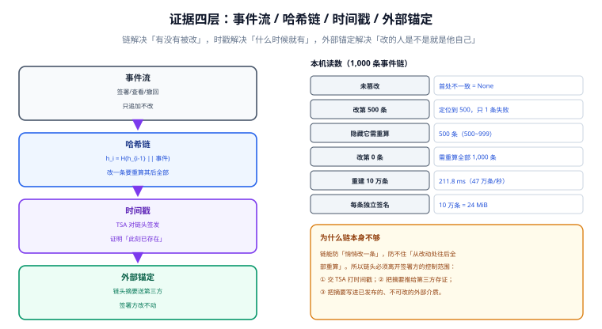

# 证据链：哈希链、时间戳与外部锚定

签名解决了「这份字节被某私钥签过」，但没有解决两个问题：**什么时候签的**，以及**你们自己有没有改过记录**。第一个问题靠时间戳，第二个问题靠哈希链加外部锚定。三者缺一，对方律师只需要问一句「这些记录都在你们自己服务器上，凭什么相信？」。

::: tip 一句话理解
签名证明**内容**，时戳证明**时刻**，链证明**顺序**，外部锚定证明**你们改不动**。四件事，四个机制。
:::

## 一、四层结构



| 层 | 解决什么 | 实现 | 谁验证 |
| --- | --- | --- | --- |
| 事件流 | 发生了什么（查看/核身/签署/撤回） | 只追加的事件表 | 内部审计 |
| 哈希链 | 事件顺序是否被改过 | `h_i = H(h_{i-1} ‖ 事件_i)` | 任何人（只要有链头） |
| 时间戳 | 链头在何时已存在 | TSA 对链头签发 RFC 3161 令牌 | 任何人 |
| 外部锚定 | 你们是否重算过整条链 | 链头摘要送第三方/写入不可改介质 | 第三方 |

第二层的价值常被高估也常被低估：**它能精确定位「哪一条被改」，但防不住「从改动处往后全部重算」**。所以第三、四层不是锦上添花，是链能成立的前提。

## 二、本机实测：链能定位，但不能自证

1,000 条事件链，篡改单条之后重算全链：

| 场景 | 首处不一致 | 受影响条数 | 含义 |
| --- | --- | --- | --- |
| 干净链 | 无 | 0 | 链自洽 |
| 改第 500 条 | 500 | **1**（只这一条） | 定位精确 |
| 改第 0 条 | 0 | 1 | 同样只影响一条 |

「只影响一条」看起来很好，恰恰是问题所在：**因为每条只存了前驱哈希，改一条只需重算它自己**。要让后面 500 条重新自洽，攻击者要重算第 500~999 条（500 次哈希）——这就是「隐藏一处篡改的成本」。

| 改动位置 | 隐藏它需要重算 | 难度 |
| --- | --- | --- |
| 第 999 条（最后一条） | 1 条 | 几乎无成本 |
| 第 500 条 | 500 条 | 一键脚本 |
| 第 0 条 | 1,000 条（全部） | 一键脚本 |

**结论：链本身对「有写权限的人」没有任何防御力。** 它的作用是把「静默篡改」变成「必须重写整条链」，从而让**外部锚定**有意义——你重写链，锚定在第三方的那份摘要就对不上了。

## 三、吞吐与成本：链不是性能瓶颈

| 操作 | 本机读数 |
| --- | --- |
| 重建 100,000 条链 | **211.8 ms**（约 47 万条/秒） |
| 单条约 2 µs | 一次签名事件写入的哈希成本可忽略 |
| 若改为「每条各存一份 RSA-2048 签名」 | 100,000 条 = **24 MiB** |

第三行解释了为什么工业界普遍用「一条链 + 少量签名」而不是「每条都签」：后者体积涨 24 MiB/10 万条，且**每条都要调一次私钥**（HSM 有 QPS 上限）。链 + 周期性签名是成本与强度的正确折中。

```python
import hashlib, json

def chained(events: list[dict]) -> list[tuple[bytes, bytes]]:
    """返回 [(prev_hash, hash)]；链头 = 最后一条的 hash。"""
    prev, out = b"\x00" * 32, []
    for e in events:
        payload = json.dumps(e, ensure_ascii=False, sort_keys=True,
                             separators=(",", ":")).encode()
        h = hashlib.sha256(prev + payload).digest()
        out.append((prev, h))
        prev = h
    return out
```

::: danger 两个必踩的坑

1. **`json.dumps` 不写 `sort_keys=True` 和 `separators`**。字典顺序或空格差异会让同一份事件算出不同哈希，链在「重建」时对不上——而这种不一致只在**恢复演练**时才暴露。
2. **链头不落地，只存在内存里**。进程重启后从头重算，链头就变了；如果此时外部锚定的是旧链头，系统会显示「证据被篡改」，而实际只是重启了。链头必须持久化，且与事件同事务写入。
:::

## 四、时间戳：证明「此刻已存在」

时间戳不是一个时间字符串，是一份**由第三方签名的令牌**：

```text
请求：TSA 收到 H(链头) + nonce
响应：TimeStampToken {
        TSTInfo { hashAlg, hashedMessage = H(链头), genTime, nonce, serial },
        signature = TSA 私钥签名
      }
```

三个字段值得单独说：

| 字段 | 作用 | 校验要点 |
| --- | --- | --- |
| `hashedMessage` | 绑定的链头摘要 | 必须等于本地算出的链头 |
| `genTime` | 权威时刻 | 必须落在 TSA 证书有效期内 |
| `nonce` | 防重放 | 必须等于本次请求的 nonce |

本机做过一个直白的对照：签署方本机时间 `2026-11-02 15:13:19`，时间戳机构时间 `15:20:19`，偏移 7 分钟。没有时间戳时，第三方**只能相信签署方自己的时钟**——而「签署时刻是否在证书有效期内」恰恰是验签的关键前提。

## 五、长期验证：15 年留存要补 5 次时戳

证书 3 年一换，合同要存 15 年。签名时的证书到期之后，怎么还能验？

| 时间点 | 事件 | 需要做什么 |
| --- | --- | --- |
| 2026-11 | 签署 + 首次时戳 | 记录完整证据包 |
| 2028-03 | 签名证书到期 | **到期前**追加归档时戳（证明「到期前它已存在且有效」） |
| 2031-03 | 第 2 次 | 同上 |
| … | 每 3 年一次 | 共 **5 次**才能在 2041 年仍可验证 |
| 2041-11 | 留存期满 | 证据包完整导出 |

这套机制叫**长期验证（LTV）**，在 PAdES 里对应 DSS（Document Security Store）：把证书链、CRL/OCSP 响应、时间戳令牌一起存进 PDF，让十年后的验证器不需要联网也能验。

::: warning 一个反直觉的结论
「证书过期了，所以签名无效」是错的。**证书在签名时刻有效，签名就有效**；之后证书过期不影响已产生的签名，前提是你能证明「签名时刻证书有效」——那个证明就是时间戳。反过来，「证书现在有效、但签名时刻早于 `notBefore`」，这个签名从一开始就无效。
:::

## 六、验证流程：五步，缺一步结论都不可信

```text
① 逐版本验签：每份签名的 ByteRange 摘要 = 文件对应字节         -> 字节未变
② 验证书链：签名证书 -> 中间 CA -> 根，且每张都在有效期内      -> 主体可信
③ 查吊销：OCSP/CRL（或 DSS 里的历史响应），时间点 = 签名时刻    -> 未吊销
④ 验时间戳：令牌签名 + genTime 落在证书有效期 + nonce 匹配     -> 时刻可信
⑤ 验链：事件链从链头重算，与外部锚定的摘要比对                -> 记录未改
```

五步里任何一步跳过，结论都会「看起来通过」。最容易被跳过的是第 ③ 步——离线验签时没有网络，验证器默认「不吊销」，于是一个已被吊销的证书签出来的文件照样显示「签名有效」。

## 判据

本页判据族 `ESE-A` ~ `ESE-H`，共 8 条，逐条可判定：

| 编号 | 判据 | 怎么判 |
| --- | --- | --- |
| `ESE-A` | 事件表只追加，无 UPDATE/DELETE 业务路径 | 权限与代码可查 |
| `ESE-B` | 链哈希的规范化输入确定（键序、分隔符固定） | 重建后哈希一致 |
| `ESE-C` | 链头持久化，并与事件同事务写入 | 表中有 `chain_head` 且事务内更新 |
| `ESE-D` | 链头有 TSA 时戳，令牌与链头摘要一致 | 令牌 `hashedMessage` = 链头 |
| `ESE-E` | 存在外部锚定（第三方存证/不可改介质） | 可导出锚定记录与时间 |
| `ESE-F` | 留存期内按证书有效期追加归档时戳（15 年需 5 次） | 存在归档时戳登记表 |
| `ESE-G` | 验签流程含吊销检查，离线时明确报「未检查」 | 结果里有 `revocation_status` |
| `ESE-H` | 能定位篡改位置（哪一版、哪一个签名、哪一条事件） | 失败报告含索引 |

## 验证方式

```shell
# 1) 链自洽 + 篡改定位
python3 - <<'PY'
import hashlib
def build(n):
    prev, out = b"\0"*32, []
    for i in range(n):
        h = hashlib.sha256(prev + str(i).encode()).digest()
        out.append((prev, h)); prev = h
    return out

def first_bad(chain, tamper=None):
    prev = b"\0"*32
    for i, (p, h) in enumerate(chain):
        payload = str(i) + ("X" if i == tamper else "")
        if hashlib.sha256(prev + payload.encode()).digest() != h:
            return i
        prev = h
    return None

c = build(1000)
print("干净：", first_bad(c))
print("改第 500 条：", first_bad(c, 500))
print("隐藏它需要重算：", 1000 - 500, "条")
PY
# 期望：None / 500 / 500

# 2) 本页判据 8 条
grep -o 'ESE-[A-H]' docs/Backend/ESignature/EvidenceChain/index.md | sort -u | wc -l
```

预期输出：`干净： None`、`改第 500 条： 500`、`隐藏它需要重算： 500 条`。第二行不是 `None` 才说明链在工作；如果第一行就返回了数字，说明构造链时 `prev` 没有随循环更新。

## 参考资料

- [实名与意愿：证明他是他且他同意](../IdentityIntent/index.md)
- [合规与留存：四要件与十五年](../Compliance/index.md)
- RFC 3161《Internet X.509 PKI Time-Stamp Protocol (TSP)》：<https://www.rfc-editor.org/rfc/rfc3161>
- ETSI EN 319 142-2（PAdES 长期验证与 DSS）：<https://www.etsi.org/deliver/etsi_en/319100_319199/31914202/>
- 《最高人民法院关于民事诉讼证据的若干规定》第九十三条、第九十四条（电子数据真实性的审查因素）：<https://www.court.gov.cn/fabu-xiangqing-206511.html>
