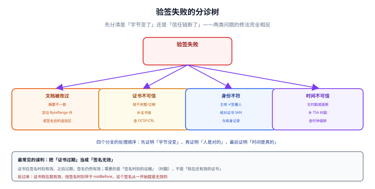

# 常见问题与分诊

这一页按「症状」组织，不按概念组织。遇到问题时先定位到哪一类，再看对应条目——因为**验签失败和合规不足的修法完全相反**：前者要动代码，后者要动流程，混在一起查会同时改错两边。

::: tip 一句话理解
先分清「字节变了」还是「信任链断了」，再谈谁来修。
:::

## 一、分诊顺序：四步，不要跳



| 步 | 检查 | 通过则 | 不通过则 |
| --- | --- | --- | --- |
| ① 字节 | 逐版本算 `ByteRange` 摘要，与签名内摘要比 | 进 ② | **文档被改过**（或签名算法写错） |
| ② 证书链 | 签名证书 → 中间 CA → 根，逐张验 | 进 ③ | **信任链不完整**（缺中间证书最常见） |
| ③ 主体 | 证书 SAN/CN = 签署人身份 | 进 ④ | **签署人与证书持有人不一致** |
| ④ 时刻 | 时间戳令牌 `genTime` 在证书有效期内 | 全部通过 | **签名时刻不可信** |

四步里最耗时的是第 ②步：**缺中间证书**是线上验签失败的第一大原因，而错误信息通常只说「无法构建证书路径」。判断方法很简单——把证书链按顺序导出，看中间证书有没有一起放进 CMS 的 `certificates` 字段。

## 二、验签类问题

### Q1 第二个人签完，第一个人的签名失效了

**症状**：单方签署正常，多方会签时第一份签名报「文档已被修改」。

**原因**：签名覆盖了整份文件，而不是 `ByteRange` 的两段。第二份增量更新追加在后面，整份文件的摘要就变了。

**修法**：改用「挖洞 + 两段范围」。本机实测：8,597 B 的件，`ByteRange = [0, 313, 8505, 92]`，追加 rev2 后总长 17,098 B，而 rev1 的摘要**不变**；若签整份文件，摘要从 `a418db83…` 变成 `6d61ec92…`。

### Q2 证书过期了，历史合同的签名还有效吗

**有效**，前提是你能证明「签名时刻证书有效」。

| 情形 | 结论 |
| --- | --- |
| 签名时证书有效，之后过期 | **签名仍有效**（需时戳证明签名时刻） |
| 签名时证书已过期 | 签名无效，从一开始就无效 |
| 签名时早于证书 `notBefore` | 签名无效 |
| 证书被吊销，吊销时间早于签名 | 签名无效（需查历史吊销状态） |

### Q3 为什么验签通过了，但我确信文件被改过

三种可能，按概率排序：

1. **只验了最后一个签名**。改第一版会通过，因为最后一份签名的范围不含它被改的那段（本机实测：改偏移 8637，rev1 摘要变、rev2 才是被改的那版）。
2. **验签器信任了文档内的自述时间**。`/M` 字段是签署方自己写的，改成任何值都不影响验签。
3. **签名对象不是这份文件**。有些系统签的是「业务字段的 JSON」，PDF 怎么改都验得过。

### Q4 印章图片贴上去，算不算电子签名

**不算**。图片是外观，不是签名；任何人十分钟就能贴一张。要既好看又有效，正确顺序是「先嵌入章图 → 再算摘要 → 再签名」，让章图落在签区之内。

### Q5 时间戳到底要不要

| 场景 | 要不要 | 理由 |
| --- | --- | --- |
| 内部审批、无对外争议 | 可不要 | 争议在内部，走审计 |
| 对外合同、需要举证 | **要** | 否则只能相信签署方自己的时钟 |
| 留存超过证书有效期（>3 年） | **必须要**，且要归档时戳 | 否则证书过期后无法证明签名时刻 |

本机对照：签署方时钟 `15:13:19`、TSA 时间 `15:20:19`，偏移 7 分钟——没有时戳时，这个偏移无法被任何第三方发现。

## 三、合规类问题

### Q6 「用了 CA 证书」是不是就合规了

不是。证书只解决「私钥是谁的」。《电子签名法》第十三条的四条判据里，证书能覆盖的只有前两条的一半，后两条（改动可检测、改动可发现）完全靠实现：

| 判据 | 证书能覆盖吗 |
| --- | --- |
| 专有性 | 部分（私钥在谁手里） |
| 可控性 | 部分（是否只有本人能用） |
| 签署后签名改动可发现 | **不能**，靠 `ByteRange` 逐版本验签 |
| 签署后内容改动可发现 | **不能**，靠不可变快照 + 哈希链 |

### Q7 扫描件贴上章，能不能当电子合同

技术上是「带图片的 PDF」，法律上通常按**复印件**对待，举证时需要原件核对。它的价值是「形式齐全」，不是「不可否认」。

### Q8 留存多久，删不删

按最长的时钟算：

| 依据 | 期限 |
| --- | --- |
| 诉讼时效 | 3 年 |
| 会计档案 | 10 年 / 30 年（视类别） |
| 合同期满后（内控惯例） | 15 年 |
| 网络日志 | ≥ 6 个月 |

一份 2026 年签、2031 年到期的合同，按「期满后 15 年」要存到 **2046 年**。删除请求只作用于「营销/画像」类字段，履约必需的合同与证据走法定义务留存。

### Q9 换了 CA，老合同怎么办

老合同不受影响——**签名与签发它的证书绑定，不与被信任列表绑定**。但要让老签名继续可验，必须保留：签名时的证书链、当时的吊销信息（OCSP/CRL 响应）、时间戳令牌。这三样丢了，换不换 CA 都验不过。

## 四、流程类问题

### Q10 后台能不能「代签」

技术上能，合规上不能。代签会让「可控性」这条判据失效——私钥不再只由本人控制。真要支持「经办人代签」，正确做法是**授权链**：授权书（本身也是一份签过名的快照）+ 经办人核身 + 企业证书。

### Q11 多方签署该串行还是并行

| 拓扑 | 轮次 | 适用 | 注意 |
| --- | --- | --- | --- |
| 串行 | N | 分级审批（金额越大签得越高） | 任一人卡住全停 |
| 并行 | 1 | 多方对等签约 | 催办按「未签人集合」 |
| 混合 | 2 | (法务+财务) → 总经理 | 需要有向图 + 环检测 |

两者**文件体积几乎相同**（每人一段增量），并行省的是等待时间。

### Q12 同一个人点了两次「签署」，会怎样

会造出两段互相覆盖的字节范围，验签时表现为「文档被修改」。本机实测：1,200 位签署人、8% 双击，无唯一约束时多出 **96 条**签名；加 `UNIQUE(snapshot_id, signer_id, revision)` 后，1,296 次插入只有 1 次成功。

### Q13 手机号换了主人，之前的合同还算他签的吗

算。签名绑的是**当时的证书与核身记录**，不是手机号。但要注意两个衍生问题：

- 新主人用同一号码登录，**不应**看到旧主人的合同（要按 `customer_id` 而非 `phone` 做归属）。
- 若核身只靠短信，号码回收后的 90 天冷静期内确实存在冒签风险——这是「核身强度」问题，解法是提高强度（人脸/私钥），不是改合同归属。

## 判据

本页判据族 `ESK-A` ~ `ESK-H`，共 8 条，逐条可判定：

| 编号 | 判据 | 怎么判 |
| --- | --- | --- |
| `ESK-A` | 分诊顺序固定为「字节 → 链 → 主体 → 时刻」 | 排障文档与实现一致 |
| `ESK-B` | 「证书过期」与「签名无效」在文案上分开 | 错误码区分两者 |
| `ESK-C` | 验签失败的报错含签名序号与偏移 | 错误信息可定位 |
| `ESK-D` | 印章与签名在术语上分开，UI 不混用 | 文档与界面用词一致 |
| `ESK-E` | 时间戳的「要不要」有场景化判据 | 存在策略表 |
| `ESK-F` | 后台无「代签」，代签走授权链 | 接口与权限可查 |
| `ESK-G` | 重复提交由唯一键拦截，不靠布尔字段 | 表约束存在 |
| `ESK-H` | 号码换主人不影响历史归属，按客户 ID 查询 | 归属查询不含 `phone` |

## 验证方式

```shell
# 1) 分诊第 1 步：改一个字节，看是否两段都失败
python3 - <<'PY'
import hashlib
d = bytearray(b"%PDF-1.7\n" + b"A"*100 + b"<sig1>" + b"B"*50 + b"<sig2>")
h = lambda b: hashlib.sha256(bytes(b)).hexdigest()[:8]
print("原样：", h(d))
d[20] ^= 1
print("改第一个签区：", h(d))
PY
# 期望：两次摘要不同

# 2) 错误文案是否区分「过期」与「无效」
grep -rn "certificate_expired\|signature_invalid" docs/Backend/ESignature | head -3

# 3) 本页判据 8 条
grep -o 'ESK-[A-H]' docs/Backend/ESignature/FAQ/index.md | sort -u | wc -l
```

预期输出：第一条两次摘要不同；第二条能搜到两类错误码（若只有一类，说明文案把「过期」误报成「无效」）；第三条 `8`。

## 参考资料

- [总览：七段链与四道闸门](../Overview/index.md)
- [字节范围与印章：签名到底签了什么](../SealSignature/index.md)
- [合规与留存：四要件与十五年](../Compliance/index.md)
- 《中华人民共和国电子签名法》第十三条、第十四条：<https://www.gov.cn/flfg/2005-08/28/content_27127.htm>
- RFC 5280《Internet X.509 Public Key Infrastructure Certificate and CRL Profile》§6（证书路径构建）：<https://www.rfc-editor.org/rfc/rfc5280>
