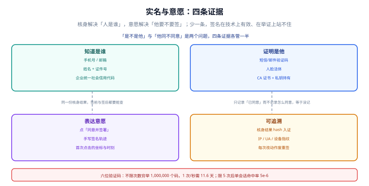

# 实名与意愿：证明他是他且他同意

签署页面上那个绿色对勾，通常由两件事拼成：**核身通过**（手机验证码对了）与**点击了按钮**（前端发了个 `POST /sign`）。这两件事在网络世界里分量差得很远——前者证明「某个持有该手机的人在场」，后者证明「浏览器发过一个请求」。中间那段「这个人真的想签这份文件」的空隙，就是事后所有纠纷的入口。

::: tip 一句话理解
核身证明**人是谁**，意愿证明**他要不要签**。两个都记录，签字才站得住；只记「已同意」，等于没记。
:::

## 一、四条证据，各管一半



| 维度 | 要回答的问题 | 常用手段 | 强度 | 失败形态 |
| --- | --- | --- | --- | --- |
| 知道是谁 | 这个人怎么被标识 | 手机号、邮箱、证件号、统一社会信用代码 | 弱 | 号码换主人，标识指向别人 |
| 证明是他 | 屏幕前的人是否持有该标识 | 短信/邮件验证码、人脸活体、私钥挑战 | 中~强 | 验证码被转发，人脸被照片绕过 |
| 表达意愿 | 他是否明确同意这批条款 | 「同意并签署」按钮、手写签名轨迹、勾选框 | 弱（但必需） | 定时脚本批量「同意」 |
| 可追溯 | 事后能否复现当时发生了什么 | 核身结果摘要入证、IP/UA/设备指纹、操作录像 | 中 | 只存「已同意」布尔值 |

四行的关系不是累加而是**缺一不可**：只有「知道是谁」，别人拿他的号就能签；只有「证明是他」而没有意愿记录，他可以主张「我收到验证码但没点同意」；只有意愿没有核身，等于匿名投票。

## 二、意愿不是一句话，是四个要素

法律上讲的「意思表示」落到系统里，至少要能取出这四项。缺任何一项，「他同意了」都会退化成「系统认为他同意了」。

| 要素 | 系统里怎么落 | 常见缺失 |
| --- | --- | --- |
| 同意的对象 | 快照 `sha256` + 合同标题 | 只记 `contract_id`，不说清哪一版 |
| 同意的内容 | 条款版本、金额、关键字段的摘要 | 只有一个「同意」字样 |
| 同意的方式 | 点击 / 手写 / 勾选 + 界面元素标识 | 不记「点的是哪个按钮」 |
| 同意的时刻 | 服务器时间 + 时间戳（可选） | 用前端传的时间 |

```sql
CREATE TABLE consent(
  id           INTEGER PRIMARY KEY,
  snapshot_id  INTEGER NOT NULL REFERENCES snapshot(id),
  signer_id    TEXT    NOT NULL,
  purpose      TEXT    NOT NULL,   -- e_signature / privacy_policy / marketing
  method       TEXT    NOT NULL,   -- sms_otp / face / click_wrap / handwrite
  ui_ref       TEXT    NOT NULL,   -- 界面元素标识，如 "btn-sign-footer"
  evidence_sha TEXT    NOT NULL,   -- 核身结果 + 界面快照的摘要
  at_utc       TEXT    NOT NULL,
  revoked_at   TEXT,
  UNIQUE (snapshot_id, signer_id, purpose)
);
```

`ui_ref` 是最容易被认为「没用」的一列，也是最有用的一列：当有人主张「我点的是查看，不是签署」时，只有它能对上界面快照。

## 三、验证码：六位数字的真实强度

六位数字的搜索空间是 1,000,000。强度完全取决于**允许多少次尝试**：

| 限速 | 不限尝试次数时穷举耗时 | 结论 |
| --- | --- | --- |
| 1 次/秒 | **277.8 小时 = 11.6 天** | 一个耐心的攻击者两周内必中 |
| 3 次/秒 | 92.6 小时 = 3.9 天 | 三天 |
| 10 次/秒 | 27.8 小时 = 1.2 天 | 一天 |

所以安全强度**不来自位数，来自锁定策略**：

| 策略 | 单次会话命中概率 | 说明 |
| --- | --- | --- |
| 每次会话限 5 次尝试 | **5 × 10⁻⁶** | 5 次错即锁定，需重新核身 |
| 同一码允许重发 3 次而不换码 | 1.5 × 10⁻⁵ | 攻击面变成 3 个会话 |
| 每次重发都换新码 | 5 × 10⁻⁶ | 正确做法：换码即作废旧码 |

::: danger 四个必踩的坑

1. **验证码不过期**。`code` 表里没有 `expires_at`，一个码可以用一年——重发三次就等于给了攻击者三个永久有效的猜测机会。
2. **重发不换码**。用户点「重新发送」，系统把同一个码再发一次。本机算过：允许重发 3 次，攻击面从 5×10⁻⁶ 涨到 1.5×10⁻⁵，等于白送三倍机会。
3. **只校验「码对不对」，不校验「发给谁」**。同一个验证码表，攻击者拿 A 的码去签 B 的合同，接口只查 `code = ?`，不查 `phone = ?`。必须把「码 + 接收方 + 用途」三者一起绑定。
4. **把前端时间当签署时间**。`Date.now()` 可以被改；签署时刻只能取服务器时间，且要能对上时间戳。
:::

## 四、私钥挑战：比验证码更强的「是他」

如果签署人持有证书（UKey、手机盾、云端密钥），可以让他对一段随机挑战签名：

```text
① 服务端生成 nonce（32 字节随机 + 过期时间）
② 客户端用私钥签名 nonce + snapshot_sha256
③ 服务端用证书公钥验签，并核对证书主体 = 签署人
④ 验签通过即视为「持有私钥」+「同意该快照」
```

这条路径的强度高于验证码，因为它同时证明了「持有私钥」与「对特定快照表达意愿」——挑战串里带了 `snapshot_sha256`，签的不是一个抽象 nonce，而是**这一版合同**。

代价是可用性：用户要插 UKey 或按指纹。所以实际系统通常分层：小额用验证码，大额强制私钥/人脸。

| 场景 | 建议强度 | 理由 |
| --- | --- | --- |
| 内部审批单 | 登录态 + 点击 | 争议在内部，走审计而不是举证 |
| 对外服务合同（个人） | 短信验证码 + 意愿四要素 | 成本与强度的平衡点 |
| 大额 / 房产 / 股权 | 人脸活体 或 私钥挑战 | 单份合同的经济影响足够大 |
| 企业签署 | 经办人核身 + 授权书 + 企业证书 | 还要证明「他有权代表公司」 |

## 五、代签与授权：最容易被忽略的一条

企业场景里，签字的人几乎都不是法定代表人。系统必须能回答「这个经办人凭什么代表公司」：

| 材料 | 作用 | 缺失后果 |
| --- | --- | --- |
| 授权委托书 | 证明经办人有签署权限 | 合同可能对公司不生效 |
| 营业执照 / 统一社会信用代码 | 确认主体存在 | 签了个不存在的公司 |
| 经办人身份核验 | 确认经办人本人 | 谁都能拿公章照片来签 |

授权书本身也应该是一份**签过名的快照**——它和主合同享受同样的证据待遇，否则「授权」两个字在举证时只是一句话。

## 判据

本页判据族 `ESI-A` ~ `ESI-H`，共 8 条，逐条可判定：

| 编号 | 判据 | 怎么判 |
| --- | --- | --- |
| `ESI-A` | 核身结果与意愿记录分表存放，各自可追溯 | 存在 `verify_result` 与 `consent` 两张表 |
| `ESI-B` | 意愿记录含「对象/内容/方式/时刻」四要素 | 四列均非空 |
| `ESI-C` | 意愿记录绑定快照摘要，而不是合同 ID | `snapshot_id` 外键存在 |
| `ESI-D` | 验证码有有效期、限次、重发换码 | 三个字段/逻辑均可查 |
| `ESI-E` | 验证码校验绑定「接收方 + 用途」 | 查询条件含 `phone` 与 `purpose` |
| `ESI-F` | 签署时刻取服务器时间，不采信前端时间 | 入参里无 `client_ts` 直接入库路径 |
| `ESI-G` | 企业签署有授权链（授权书快照 + 经办人核身） | 存在授权材料引用 |
| `ESI-H` | 核身结果以摘要形式进入证据链 | `evidence_sha` 可在链上找到 |

## 验证方式

```shell
# 1) 验证码强度算术
python3 - <<'PY'
space = 10 ** 6
for rps in (1, 3, 10):
    print(f"{rps} 次/秒 -> {space/rps/3600:.1f} 小时 = {space/rps/86400:.1f} 天")
print("限 5 次 ->", f"{5/space:.2e}")
print("允许重发 3 次不换码 ->", f"{15/space:.2e}")
PY
# 期望：277.8/11.6、92.6/3.9、27.8/1.2，以及 5.00e-06、1.50e-05

# 2) 意愿四要素非空（项目侧库）
sqlite3 /tmp/oph.db "SELECT count(*) FROM consent WHERE snapshot_id IS NULL OR method IS NULL OR ui_ref IS NULL;"
# 期望：0

# 3) 本页判据 8 条
grep -o 'ESI-[A-H]' docs/Backend/ESignature/IdentityIntent/index.md | sort -u | wc -l
```

预期输出：第一段三行的小时数与天数与上表一致；第二行 `0`；第三行 `8`。若第一段打印出 `277777.8 小时`，说明公式里的 `/3600` 被写成了 `*3600`。

## 参考资料

- [会签流程：顺序、并行与状态机](../SigningFlow/index.md)
- [证据链：哈希链、时间戳与外部锚定](../EvidenceChain/index.md)
- [隐私工程：同意与目的](../../../Others/PrivacyEngineering/ConsentPurpose/index.md)（同意文本与撤回机制）
- NIST SP 800-63B《Digital Identity Guidelines: Authentication and Lifecycle Management》§5.1（限速与锁定）：<https://pages.nist.gov/800-63-4/sp800-63b.html>
- 《中华人民共和国电子签名法》第十三条（可靠电子签名需「签署时电子签名制作数据仅由电子签名人控制」）：<https://www.gov.cn/flfg/2005-08/28/content_27127.htm>
