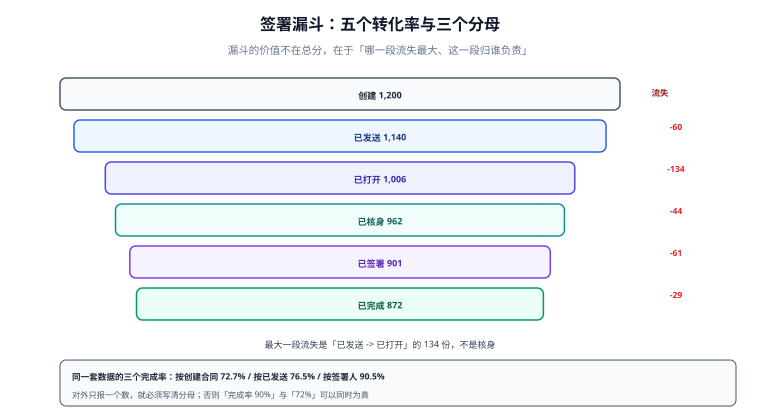

# 度量与验收：漏斗、时效与拒签

「签署完成率 90%」这句话，在同一套数据上可以是真的，也可以是假的。本机的一组数据同时算出 **72.7% / 76.5% / 90.5%** 三个完成率——差别只在分母是「创建的合同」「已发送的合同」还是「签署人」。所以这一页不定义「好指标」，只定义一个前提：**任何比率都必须带分母**。

::: tip 一句话理解
签署的度量不是打分，是**定位**：哪一段流失最大、这一段归谁负责、改哪一处能最快见效。
:::

## 一、漏斗：五段转化与各自的责任人



| 段 | 数量 | 相对上一段 | 流失 | 责任方 | 改善手段 |
| --- | --- | --- | --- | --- | --- |
| 创建 | 1,200 | — | — | 业务方 | 减少不必要的合同 |
| 已发送 | 1,140 | 95.0% | 60 | 发起方（漏发/信息缺） | 发送前校验签署人手机号 |
| 已打开 | 1,006 | 88.2% | **134** | 触达 | 多渠道提醒、短信带直达链接 |
| 已核身 | 962 | 95.6% | 44 | 核身 | 简化路径、减少跳转 |
| 已签署 | 901 | 93.7% | 61 | 交互 | 去掉多余确认步骤 |
| 已完成 | 872 | 96.8% | 29 | 全部到齐 | 催办按「未签人集合」 |

**最大的一段流失是「已发送 → 已打开」的 134 份，不是核身**。这个结论值得记住：团队凭直觉优化核身流程（因为「核身最难」），但数据说明真正丢人的地方是「他根本没打开」。改善手段也不同——前者靠触达策略，后者靠流程简化。

## 二、三个分母：同一套数据，三个完成率

| 口径 | 计算 | 结果 | 什么时候用 |
| --- | --- | --- | --- |
| 按创建的合同 | 872 / 1,200 | **72.7%** | 对内看「业务目标达成」 |
| 按已发送的合同 | 872 / 1,140 | **76.5%** | 看「流程本身的效率」 |
| 按签署人 | 2,605 / 2,880 | **90.5%** | 对外/对客户，看「用户体验」 |

三个数都正确，用途不同。危险的是「只报最高的那个」——它会让「72.7% 的合同最终没签成」这个事实消失。规范做法：**dashboard 上三个数并排，标题里写清分母**。

## 三、时效：均值会骗人，必须看中位数与 P90

本机 1,000 份样本（30% 半小时内、60% 四小时内、10% 拖到三天以上）：

| 指标 | 数值 | 说明 |
| --- | --- | --- |
| 均值 | **6.2 h** | 被 10% 的长尾拉高 |
| 中位数 | **1.6 h** | 一半的合同在 1.6 小时内签完 |
| P90 | **25.3 h** | 十分之一的合同超过一天 |
| 最大值 | 71.1 h | 接近三天 |
| 剔除 >24h 后均值 | **1.6 h** | 与中位数重合，说明长尾是唯一扰动 |

这组数字说明：**均值 6.2 h 是「长尾的平均」，不是「典型体验」**。如果 SLO 写成「平均签署时长 < 4 h」，优化方向会变成「催那 10% 的人」，而真正影响多数人的是中位数。

推荐的口径组合：

| 用途 | 指标 | 为什么 |
| --- | --- | --- |
| 用户体验 | 中位数 + P90 | 反映多数人与较差那部分 |
| 运营效率 | 按段的转化率 | 定位瓶颈 |
| 资源配置 | 逾 24h 的合同数与占比 | 决定要不要加催办 |
| 举证质量 | 证据包完整率 | 决定出事时能不能自证 |

## 四、拒签与重签：两个必须分开的数

| 指标 | 定义 | 正常范围（经验） | 异常时先查 |
| --- | --- | --- | --- |
| 拒签率 | 被签署人主动拒签的合同 / 已发送 | 3%~10% | 条款争议、金额不一致 |
| 作废率 | 因超期/变更/撤回而 `void` / 已发送 | 2%~8% | 模板错误、流程太长 |
| 重签率 | 同一合同产生 ≥2 个快照 / 全部合同 | 5%~15% | 条款频繁变、校验不足 |
| 一次性通过率 | 首个快照即完成签署 / 全部合同 | 越高越好 | 低说明前期校验缺失 |

重签率高不一定是坏事（业务确实在变），但它有一个必须监控的副作用：**重签意味着旧签名作废**，如果系统把「重签」实现成「在同一快照上再签一次」，就会产生本专题反复警告的那类缺陷（字节范围互相覆盖）。

## 五、成本：一份合同两块钱，钱花在哪

按「2.4 位签署人/份、每次签章 0.9 元、短信 2 条 × 0.04 元、存储 15 年 0.0001 元/MB/月」这组**假设参数**：

| 项 | 单份成本 | 说明 |
| --- | --- | --- |
| 签章（CA） | 2.16 元 | 2.4 次 × 0.9 元，占 **96%** |
| 短信 | 0.08 元 | 2 条 × 0.04 元 |
| 存储 15 年 | 0.0056 元 | 320 KB × 180 个月 |
| 合计 | **2.25 元/份** | 10 万份/年 ≈ 22.5 万元/年 |

关键结论：**成本几乎全在签章次数上**。所以「减少不必要的签署人」比「压缩存储」有效得多——后者最多省 0.3%，前者少一个签署人省 0.9 元。

## 判据

本页判据族 `ESU-A` ~ `ESU-H`，共 8 条，逐条可判定：

| 编号 | 判据 | 怎么判 |
| --- | --- | --- |
| `ESU-A` | 每个对外比率都标注分母 | 报表定义里有 `denominator` 字段 |
| `ESU-B` | 完成率同时给出三个口径 | dashboard 三个数并排 |
| `ESU-C` | 时效同时给出中位数与 P90，不只均值 | 指标清单可查 |
| `ESU-D` | 漏斗按「上一段为分母」逐段计算 | 五段转化率之和可复算 |
| `ESU-E` | 拒签、作废、重签三个数分开统计 | 三个独立计数 |
| `ESU-F` | 重签被实现为「新快照 + 旧签名作废」，不是原地再签 | 代码路径可查 |
| `ESU-G` | 证据包完整率作为质量指标纳入 | 存在该指标与告警 |
| `ESU-H` | 成本按「签章次数」为主因分解，可指导优化 | 成本表按项拆分 |

## 验证方式

```shell
# 1) 三个分母
python3 - <<'PY'
created, sent, done, signers, signed_signers = 1200, 1140, 872, 2880, 2605
print(f"按创建 {done/created*100:.1f}% / 按发送 {done/sent*100:.1f}% / 按签署人 {signed_signers/signers*100:.1f}%")
stages = [(1200,1140),(1140,1006),(1006,962),(962,901),(901,872)]
print("逐段转化：", " / ".join(f"{b/a*100:.1f}%" for a,b in stages))
print("逐段流失：", " / ".join(str(a-b) for a,b in stages))
PY
# 期望：72.7% / 76.5% / 90.5%；95.0/88.2/95.6/93.7/96.8；60/134/44/61/29

# 2) 均值 vs 中位数
python3 - <<'PY'
import statistics as st, random
random.seed(20261102)
d = ([random.uniform(0.1,0.5) for _ in range(300)] + [random.uniform(0.5,4) for _ in range(600)]
     + [random.uniform(24,72) for _ in range(100)])
print(f"均值 {st.mean(d):.1f}h 中位 {st.median(d):.1f}h P90 {sorted(d)[900]:.1f}h")
PY
# 期望：均值 6.2h 中位 1.6h P90 25.3h

# 3) 本页判据 8 条
grep -o 'ESU-[A-H]' docs/Backend/ESignature/Metrics/index.md | sort -u | wc -l
```

预期输出：`72.7% / 76.5% / 90.5%`；五段转化 `95.0% / 88.2% / 95.6% / 93.7% / 96.8%`；流失 `60 / 134 / 44 / 61 / 29`；均值 `6.2h`、中位 `1.6h`。**均值与中位数差 3.9 倍**，这就是「只报均值」的危害。

## 参考资料

- [合规与留存：四要件与十五年](../Compliance/index.md)
- [实战：一份合同走完签署与取证](../Practice/index.md)
- Google SRE Workbook《Implementing SLOs》（为什么用分位数而非均值）：<https://sre.google/workbook/implementing-slos/>
- NIST SP 800-63B §5.2（限速与失败率监控）：<https://pages.nist.gov/800-63-4/sp800-63b.html>
