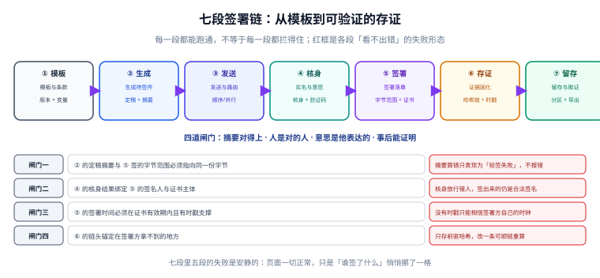

# 总览：七段链与四道闸门

电子签署系统最容易做错的地方，是把「流程走完」当成「签署成立」。流程走完只需要状态机写得对；签署成立需要四件事同时为真：**字节没被改、人是对的、意思是他表达的、事后能被别人验证**。这四件事分别落在链条的不同段上，任何一段省掉，前一段的努力都归零。

::: tip 一句话理解
签署系统不是一个流程，是**四道互不替代的闸门**。流程只是把它们串起来的绳子。
:::

## 一、七段链：每一段都在解决一个「不可替代」的问题

| 段 | 输入 | 产物 | 不可替代的原因 |
| --- | --- | --- | --- |
| ① 模板 | 条款库、变量定义 | `template(version)` | 没有版本化模板，就说不清「签的是哪一版条款」 |
| ② 生成 | 模板 + 变量值 | `snapshot(sha256)` | 摘要必须来自**定稿字节**，不能来自业务字段拼接 |
| ③ 发送 | 快照 + 签署人清单 | `sign_task` | 顺序与并行决定「谁先签」，影响后续所有字节 |
| ④ 核身 | 签署人身份信息 | `verify_result` | 只有它能回答「屏幕前的人是不是证书持有人」 |
| ⑤ 签署 | 证书私钥 + 字节范围 | `signature` | 只有它能让字节具备不可否认性 |
| ⑥ 存证 | 签名 + 事件流 | `evidence(chain)` | 只有它能证明「这个签名在当时就存在」 |
| ⑦ 留存 | 全部证据 + 留存策略 | `archive` | 只有它能保证「十年后还取得出来、还验得过」 |



上图的红框是七段里**失败最安静**的部分。它们的共同形态是：签署页显示「已完成」，而真正重要的东西少了一块。比如少了时间戳，验签照样通过——因为验签只检查「签名与字节是否匹配」，从不检查「签名是什么时候产生的」。

## 二、四道闸门：判断「是否成立」的唯一清单

| 闸门 | 判据 | 落在哪一段 | 漏掉的后果 |
| --- | --- | --- | --- |
| 闸门一 · 字节一致 | ② 的 `sha256` 与 ⑤ 的字节范围指向同一份字节 | ②+⑤ | 文档被改一字，验签失败，而且**无法定位是哪一版被改** |
| 闸门二 · 人对 | 证书主体 = ④ 核身通过的那个人 | ④+⑤ | 核身放行了代签人，签出来的仍是「合法签名」 |
| 闸门三 · 意愿真 | 签署动作由本人发起，且记录「怎么同意的」 | ④ | 事后主张「我没点过」，系统只有一句「已同意」 |
| 闸门四 · 可举证 | 链头锚定在签署方控制范围之外 | ⑥ | 内部数据自洽，但对方可以主张「你们自己改的」 |

四道闸门里，**只有闸门一会自己报错**（验签失败）。闸门二、三、四漏掉时，系统一切正常——这是本专题反复强调「安静失败」的原因。

### 一个真实形态的反例

某系统把签名对象设成「合同业务表的一行 JSON」，而不是 PDF 字节：

```json
{
  "contract_id": "C-2026-0912",
  "amount": "128000.00",
  "signer": "张伟",
  "signed_at": "2026-11-02T15:13:19+08:00"
}
```

签名完全有效，验签永远通过。但只要有人改了 PDF 里的付款条款、而业务表没动，**验签仍然通过**——因为你签的从来不是那份 PDF。这类系统在演示时无懈可击，在举证时一句话就崩：「你签的是数据库字段，不是合同。」

## 三、成熟度：从 L0 到 L4

| 级别 | 形态 | 能回答的问题 | 典型缺口 |
| --- | --- | --- | --- |
| L0 | 页面勾选「我已阅读并同意」 | 有没有点过 | 点的人是谁、点的哪一版 |
| L1 | 贴印章图片 + 记录操作日志 | 形式上像合同 | 图片可伪造，日志可改 |
| L2 | 证书签名（整文件） | 这份文件被某私钥签过 | 多人签时互相作废，无时间证明 |
| L3 | 证书签名（字节范围）+ 时间戳 | 谁在何时签了哪一版 | 证据留在自己库里，第三方仍需信任你 |
| L4 | L3 + 哈希链 + 外部锚定 + 可导出验证包 | 第三方可独立复验 | 成本与运维复杂度 |

多数团队停在 L2 并以为自己在 L3：**他们确实用了证书，但签名覆盖整份文件**。本机实测（8,597 字节的件）显示，这种写法在第一位签署人之后一切正常，第二位一签，第一位的签名就永远验不过——而错误信息只会说「文档已被修改」，看起来像是被人篡改。

## 四、三个「签了什么」，先选一个再写代码

| 说法 | 技术含义 | 什么时候够用 | 什么时候不够 |
| --- | --- | --- | --- |
| 签了「这份文件」 | 对定稿字节的摘要签名 | 单方签署、内部存档 | 多方会签（后续签会改变文件） |
| 签了「这一版字节范围」 | 对 `ByteRange` 两段求摘要 | 多方会签、需要逐版本验证 | 需要证明签署时间（还要时戳） |
| 签了「这笔业务」 | 对业务字段的规范化 JSON 签名 | 系统间调用、接口鉴权 | 任何需要「文件即证据」的场景 |

第三列不是「低级选项」，而是**不同问题**：接口鉴权签业务字段是对的，合同签署签业务字段是错的。判断依据只有一条——**争议发生时，对方会拿着哪一份东西去比对？** 如果答案是「那份 PDF」，那你就必须签 PDF 的字节。

## 五、本机读数（种子 20261102）

| 观测 | 数值 | 出处 |
| --- | --- | --- |
| 8,597 B 的件，签区 313 B、占位 8,192 字符、尾部 92 B | 签区只占 3.6% | 字节范围实验 |
| 追加 rev2 后总长 17,098 B，rev1 摘要不变 | 增量签名成立 | 同上 |
| 签整份文件：rev1 `a418db83` → rev2 后 `6d61ec92` | 第一人签名失效 | 同上 |
| 干净链 1,000 条，篡改第 500 条 | 首处不一致 = 500 | 哈希链实验 |
| 隐藏该篡改需重算 500 条 | 链头必须外部锚定 | 同上 |
| 6 位验证码、1 次/秒、不限次数 | 11.6 天穷举完 | 意愿核验算术 |
| 1,200 位签署人、8% 双击 | 无约束多 96 条签名 | SQLite 唯一键实验 |

::: warning 一个数字的边界
这些读数是「形态可复现、绝对值不可迁移」：字节偏移依赖我构造的 PDF 片段长度，换成真实合同（几十页、含图片）比例完全不同。**可以迁移的是比例关系与结论方向，不是 313 这个数。**
:::

## 判据

本页判据族 `ESG-A` ~ `ESG-H`，共 8 条，逐条可判定：

| 编号 | 判据 | 怎么判 |
| --- | --- | --- |
| `ESG-A` | 七段各有明确产物，且产物可被下游引用 | 七张表/对象都存在，且 ② 的摘要被 ⑤ 引用 |
| `ESG-B` | 签名对象是定稿字节，不是业务字段的拼接 | 验签输入能追到某个文件的字节范围 |
| `ESG-C` | 四道闸门各有至少一条自动判据 | 每条闸门能找到对应查询/校验 |
| `ESG-D` | 系统能区分「流程完成」与「签署成立」 | 存在独立的状态字段，不是同一个 `status` |
| `ESG-E` | 多人签署时，每份签名各自可独立验证 | 逐版本验签脚本对每一版都返回通过 |
| `ESG-F` | 证据链的链头有外部锚定 | 存在 TSA 时戳或第三方存证记录 |
| `ESG-G` | 系统对自身成熟度有明确声明（L0~L2 不宣称 L3） | 对外文档与实现一致 |
| `ESG-H` | 安静失败项有监控或巡检兜底 | 缺时戳 / 缺证书链能被巡检发现 |

## 验证方式

```shell
# 1) 本页判据 8 条
grep -o 'ESG-[A-H]' docs/Backend/ESignature/Overview/index.md | sort -u | wc -l

# 2) 七段产物是否在实现里存在（按本仓项目侧命名）
ls project/Complete/OpenPlatformHub/ | head

# 3) 复现「签整份文件 vs 签字节范围」的分水岭
python3 - <<'PY'
import hashlib
base = b"%PDF-1.7\n" + b"A" * 200
sig1 = b"<sig-placeholder-4096>" 
doc1 = base + sig1 + b"%%EOF\n"
doc2 = doc1 + b"3 0 obj <</Type/Sig>> endobj\n"
# 正确做法：只对签区求摘要，签区在 doc2 里位置不变
print("按字节范围：", hashlib.sha256(base).hexdigest()[:8],
      hashlib.sha256(doc2[:len(base)]).hexdigest()[:8])
# 错误做法：对整份文件求摘要
print("按整份文件：", hashlib.sha256(doc1).hexdigest()[:8],
      hashlib.sha256(doc2).hexdigest()[:8])
PY
```

预期输出：第一条 `8`；第三条前一行两个摘要**相同**，后一行两个摘要**不同**——差一行代码，就是「第一人签名失效」与「不失效」的分界。

## 参考资料

- [合同模型：模板、实例与版本快照](../ContractModel/index.md)
- [字节范围与印章：签名到底签了什么](../SealSignature/index.md)
- ETSI EN 319 142-1（PAdES 基线剖面）：<https://www.etsi.org/deliver/etsi_en/319100_319199/31914201/>
- ISO 32000-2:2020 §12.8（PDF 2.0 数字签名）：<https://www.iso.org/standard/63534.html>
- RFC 3161《Internet X.509 PKI Time-Stamp Protocol (TSP)》：<https://www.rfc-editor.org/rfc/rfc3161>
