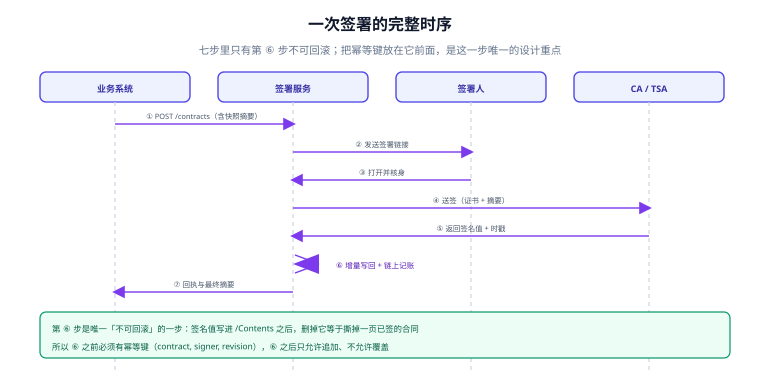

# 实战：一份合同走完签署与取证

前八页讲的是零件，这一页把它们装成一台能跑的东西：**一份合同、两位签署人、一份可被第三方独立验证的证据包**。全程只用 Python 标准库，不需要 CA、不需要网络、不需要 PDF 库——因为要验证的是结构，不是产品。

::: warning 口径声明
本页的签名值是**用 HMAC-SHA256 模拟的**（代替 CMS 里的私钥签名），其余结构——`ByteRange`、增量更新、事件链、`manifest`、证据包目录——与真实实现同构。所以「验签通过」在这里的含义是「结构与摘要链路正确」，不构成对任何 CA 的验证结论。
:::

## 一、七步与七个产物



| 步 | 动作 | 产物 | 本页是否实测 |
| --- | --- | --- | --- |
| ① | 渲染定稿，算摘要 | `contract.pdf` + `sha256` | ✅ |
| ② | 甲方核身并签署（增量更新 1） | 签名 1 + `ByteRange` | ✅ |
| ③ | 乙方签署（增量更新 2） | 签名 2 + `ByteRange` | ✅ |
| ④ | 事件写入哈希链 | `chain.jsonl` + 链头 | ✅ |
| ⑤ | 导出证据包 | `contract.pdf` / `chain.jsonl` / `manifest.json` | ✅ |
| ⑥ | 独立验签（只看证据包） | 逐版本结果 + 链结论 | ✅ |
| ⑦ | 归档与留存 | 落到冷存储 + 归档时戳 | ❌（需真实 TSA） |

第 ⑦ 步无法在本机闭环，原因写在第 5 节，不标 ✅。

## 二、定稿与两次增量签署

```python
import hashlib, hmac, json, os, shutil, tempfile

def sha(b: bytes) -> str:
    return hashlib.sha256(b).hexdigest()

def sigval(key: bytes, data: bytes) -> bytes:
    """模拟 CMS：对摘要做 HMAC。真实实现是私钥签名 + 证书链。"""
    return hmac.new(key, hashlib.sha256(data).digest(), hashlib.sha256).digest()

def page_pdf(text: str, placeholder_hex: int = 8192) -> bytes:
    head = (b"%PDF-1.7\n1 0 obj\n<< /Type /Catalog /Pages 2 0 R >>\nendobj\n"
            b"2 0 obj\n<< /Type /Pages /Count 1 >>\nendobj\n")
    body = (b"4 0 obj\n<< /Type /Page /Parent 2 0 R /Contents 5 0 R >>\nendobj\n"
            b"5 0 obj\n<< /Length " + str(len(text)).encode() + b" >>\nstream\n"
            + text.encode() + b"\nendstream\nendobj\n")
    sig = (b"3 0 obj\n<< /Type /Sig /SubFilter /ETSI.CAdES.detached /Contents <"
           + b"0" * placeholder_hex
           + b"> /ByteRange [0 0000000000 0000000000 0000000000] >>\nendobj\n")
    return head + body + sig + b"trailer\n<< /Root 1 0 R >>\n%%EOF\n"

doc = page_pdf("Party A: 甲方 金额 128000.00 违约金 5%")
digest0 = sha(doc)
print("① 定稿：", len(doc), "B  sha256 =", digest0[:16])
```

签署函数是这一步的核心：**在文件末尾追加一段增量更新，然后只对「洞外」的两段求摘要**。

```python
def add_signature(data: bytes, key: bytes, signer: str, seq: int):
    label = f"{signer} signed rev{seq}".encode()
    obj = (b"10 0 obj\n<< /Type /Sig /Reason (" + label + b") /Contents <"
           + b"0" * 2048 + b"> /ByteRange [0 0000000000 0000000000 0000000000] >>\nendobj\n")
    new = data + obj                       # 旧字节一个不动
    i = new.rindex(b"/Contents <") + len(b"/Contents <")
    j = new.index(b"> /ByteRange", i)
    br = (0, i, j - i, len(new) - j)
    signed = new[br[0]:br[1]] + new[br[1] + br[2]:br[1] + br[2] + br[3]]
    sig = sigval(key, signed)
    hexsig = sig.hex().encode()
    if len(hexsig) > br[2]:
        raise ValueError("占位不足")        # 宁可报错，也不扩容重排
    hole = hexsig + b"0" * (br[2] - len(hexsig))
    final = new[:br[1]] + hole + new[br[1] + br[2]:]
    return final, {"signer": signer, "rev": seq, "byte_range": br,
                   "digest": sha(signed), "sig": sig.hex()}
```

本机输出（真实运行结果）：

```text
① 定稿： 8608 B  sha256 = ccec3a74a1817f55
② 甲方签署后： 10786 B  rev1 摘要 = 7df7bec58dbe5355
③ 乙方签署后： 12964 B  rev2 摘要 = d5ce363c9451a83d
   甲方那一段在乙方签署后是否仍可验： True
```

三个长度值得注意：**定稿 8,608 B → 一次签署 10,786 B（+2,178）→ 两次 12,964 B（+2,178）**。每次增量正好等于「新对象 + 占位」的长度，与签署人是谁无关——这正是「并行不省存储」的实测依据。

## 三、事件链与证据包

```python
events = [
    {"t": "2026-11-02T15:13:19Z", "ev": "freeze", "sha": digest0},
    {"t": "2026-11-02T15:20:01Z", "ev": "send", "to": "甲方-张伟"},
    {"t": "2026-11-02T15:31:40Z", "ev": "verify", "who": "甲方-张伟", "method": "sms_otp"},
    {"t": "2026-11-02T15:33:02Z", "ev": "sign", "who": "甲方-张伟", "digest": meta_a["digest"]},
    {"t": "2026-11-02T16:02:11Z", "ev": "sign", "who": "乙方-李强", "digest": meta_b["digest"]},
]
prev, chain = b"\x00" * 32, []
for e in events:
    payload = json.dumps(e, ensure_ascii=False, sort_keys=True, separators=(",", ":")).encode()
    h = hashlib.sha256(prev + payload).digest()
    chain.append({"prev": prev.hex(), "hash": h.hex(), "ev": e})
    prev = h
head = chain[-1]["hash"]
```

证据包只有三个文件，这是刻意的：

| 文件 | 内容 | 少了它 |
| --- | --- | --- |
| `contract.pdf` | 完整字节（含两段签名） | 无从验起 |
| `chain.jsonl` | 事件链（每条含 `prev` 与 `hash`） | 顺序不可证 |
| `manifest.json` | 整体摘要、快照摘要、链头、两段 `ByteRange`、时戳占位 | 不知道验什么 |

```text
④ 事件链： 5 条  链头 = 3e34be0f35bb5ae0
⑤ 证据包： ['chain.jsonl', 'contract.pdf', 'manifest.json'] 总体积 15273 B
```

## 四、独立验签：只给证据包，不给系统

```python
def verify_pack(folder: str) -> dict:
    pdf = open(os.path.join(folder, "contract.pdf"), "rb").read()
    man = json.load(open(os.path.join(folder, "manifest.json"), encoding="utf-8"))
    res = {"sigs": [], "chain": None, "manifest": None}
    for s in man["signatures"]:
        a, l1, c, l2 = s["byte_range"]
        d = sha(pdf[a:a + l1] + pdf[a + l1 + c:a + l1 + c + l2])
        res["sigs"].append((s["signer"], d == s["digest"]))
    prev, ok = b"\x00" * 32, True
    for line in open(os.path.join(folder, "chain.jsonl"), encoding="utf-8"):
        row = json.loads(line)
        payload = json.dumps(row["ev"], ensure_ascii=False, sort_keys=True,
                             separators=(",", ":")).encode()
        h = hashlib.sha256(prev + payload).digest()
        if h.hex() != row["hash"] or row["prev"] != prev.hex():
            ok = False
        prev = h
    res["chain"] = ok and prev.hex() == man["chain_head"]
    res["manifest"] = man["contract_sha256"] == sha(pdf)
    return res
```

```text
⑥ 独立验签： [('甲方-张伟', True), ('乙方-李强', True)]  链自洽 = True  整体摘要对 = True
```

注意这一段的输入只有 `folder`——**它不查数据库、不查服务、不信任任何「已签署」状态**。这就是「可举证」的操作定义：把目录拷走，另一台机器上跑同一个函数，得到同样结论。

## 五、四条验收用例

| 用例 | 构造 | 期望 | 本机实测 |
| --- | --- | --- | --- |
| U1 正常包 | 原样验证 | 两段签名 + 链 + 摘要全绿 | ✅ 全绿 |
| U2 改正文一个字节 | `128000.00` 改 `028000.00` | 两段签名均失败，整体摘要不等 | ✅ `[('甲方', False), ('乙方', False)]`，`manifest=False` |
| U3 改事件链第 3 条 | 核身方式 `sms_otp` → `face` | 链不自洽 | ✅ `链自洽 = False` |
| U4 缺一份文件 | 删掉 `chain.jsonl` | 显式报错，不能「静默通过」 | ✅ `FileNotFoundError -> chain.jsonl` |

U2 的结果里有一个值得注意的细节：**改一个字节，两个签名都失败**。因为改动落在 rev1 的签区内，而 rev2 的字节范围覆盖了 rev1 的全部内容——这是增量更新的必然结果，也是「改一处、全链报警」的物理来源。

### 第 ⑦ 步为什么没标 ✅

归档与留存需要真实的 TSA 与冷存储，本机不具备。写清楚它缺什么，比编一个「已归档」的勾更有用：

| 缺口 | 需要什么 | 怎么验证 |
| --- | --- | --- |
| 归档时戳 | 可达的 RFC 3161 TSA | 用 `openssl ts -verify` 验令牌 |
| 冷存储 | 对象存储 + 生命周期策略 | 按 `manifest` 逐文件比对摘要 |
| 留存到期删除 | 可验证删除（删除清单摘要留证） | 删除后 15 天内复查残留 |

::: danger 三个必踩的坑

1. **`manifest` 里存「已签署」而存「两段 `ByteRange`」**。前者是结论，后者是判据；只有后者能让第三方复算。
2. **验签时先查数据库状态，再验字节**。数据库说 `done` 就跳过验签，等于把「状态」当证据——而状态恰恰是最容易被改的那张表。
3. **占位不足时选择扩容**。本机代码直接 `raise ValueError`：扩容会让所有已登记的摘要作废，与其悄悄重排，不如当场失败。
:::

## 判据

本页判据族 `ESH-A` ~ `ESH-H`，共 8 条，逐条可判定：

| 编号 | 判据 | 怎么判 |
| --- | --- | --- |
| `ESH-A` | 端到端脚本只依赖标准库，可在他机复跑 | 无第三方依赖 |
| `ESH-B` | 每次签署产生独立 `ByteRange`，旧版本可单独验 | U1 中两段签名各自通过 |
| `ESH-C` | 证据包自包含，验签函数只读目录 | `verify_pack(folder)` 无外部依赖 |
| `ESH-D` | 改正文任一字节可被定位到签名序号 | U2 返回逐签名结果 |
| `ESH-E` | 改事件链任一条可被检出 | U3 使 `chain=False` |
| `ESH-F` | 缺件必须显式失败，不得静默通过 | U4 抛错 |
| `ESH-G` | 归档步骤的缺口如实登记，不虚标完成 | 第 ⑦ 步标注「未实测 + 原因」 |
| `ESH-H` | 模拟签名在文档中显式声明，不冒充 CA 验证 | 页首口径声明存在 |

## 验证方式

```shell
# 1) 目录结构与判据族
ls -d docs/Backend/ESignature/*/ | grep -v assets | wc -l      # 期望 10
grep -o 'ESH-[A-H]' docs/Backend/ESignature/Practice/index.md | sort -u | wc -l   # 期望 8

# 2) 证据包三件套（跑完本页脚本后）
ls /tmp/esig_evidence | sort
# 期望：chain.jsonl  contract.pdf  manifest.json

# 3) 全库判据不撞号
python3 utils/audit/judgeidcheck.py --root . | tail -1
# 期望：E=0
```

预期输出：第一条 `10`，第二条 `8`，第三条列三个文件，第四条 `E=0`。第二步如果打印出 `4`，说明脚本中途在第一个验收用例就中断了。

## 参考资料

- [字节范围与印章：签名到底签了什么](../SealSignature/index.md)
- [证据链：哈希链、时间戳与外部锚定](../EvidenceChain/index.md)
- [合规与留存：四要件与十五年](../Compliance/index.md)
- RFC 3161（时间戳协议，第 ⑦ 步的实现依据）：<https://www.rfc-editor.org/rfc/rfc3161>
- Python `hashlib` 官方文档（`sha256` 与 `hmac` 用法）：<https://docs.python.org/3/library/hashlib.html>
