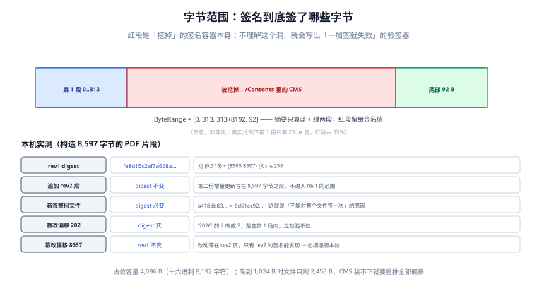

# 字节范围与印章：签名到底签了什么

大多数「PDF 签名」的实现错误，都能收敛到同一句话上：**签名签的是字节，不是文件。** 一旦把这个「字节」理解成「整个文件」，系统在单方签署时完美工作，在多方会签时第二天就开始报「文档已被修改」——而这份文档谁都没动过。

这一页把 PDF 签名的物理结构拆开：签名值存在哪、为什么要「挖一个洞」、多个人签时文件怎么长长、以及贴在页面上的红章到底算不算签名。

::: tip 一句话理解
`ByteRange` 声明「我签了这两段字节」，`/Contents` 是那个被挖掉的洞。**洞里的东西不被签，洞外的每一个字节都被签。**
:::

## 一、签名在文件里的物理位置



一份签过名的 PDF，签名不是「附在文件末尾的一段数据」，而是**文件结构里的一个字典对象**，形如：

```text
3 0 obj
<< /Type /Sig
   /Filter /Adobe.PPKLite
   /SubFilter /ETSI.CAdES.detached
   /ByteRange [0 313 8505 92]
   /Contents <30820...省略...>
   /M (D:20261102151319+08'00')
>>
endobj
```

四个关键字段：

| 字段 | 含义 | 出错后果 |
| --- | --- | --- |
| `/ByteRange` | 四个数 `[起点1 长度1 起点2 长度2]` | 写错 → 验签永远失败，或**签了个空区间**（等于没签） |
| `/Contents` | 签名值（CMS/PKCS#7 的十六进制） | 容量不足 → 必须扩容，全部偏移作废 |
| `/SubFilter` | 签名格式剖面 | 写成 `adbe.pkcs7.detached` 却用时戳 → 验证器不认 |
| `/M` | 声称的签署时间 | **这是自述**，不是证据；证据在时间戳里 |

`/ByteRange [0 313 8505 92]` 读作：签 `[0, 313)` 与 `[8505, 8597)` 两段。中间被跳过的 `313..8505` 正好是 `/Contents <...>` 里那串十六进制——**它不能被自己签**（自指悖论），所以要挖掉。

## 二、本机实测：8,597 字节的件，签区只有 313 字节

| 观测 | 数值 |
| --- | --- |
| 文件总长 | 8,597 B |
| 第 1 段（签区） | `[0, 313)` |
| 洞（`/Contents` 占位） | 8,192 个十六进制字符 = 4,096 B 容量 |
| 第 2 段（尾部） | `[8505, 8597)`，92 B |
| 第 1 段 + 第 2 段 = 405 B | 只占全文 **4.7%**，其余 95% 是那个洞 |
| rev1 摘要 | `fe8d15c2af7a668a…` |

这个比例说明一件事：**签名容器的容量占了文件的绝大部分**。真实合同（几十页正文）里比例会低得多，但结论不变——占位容量是设计参数，不是细节。

### 增量签名：第二个人签，第一个人不能失效

第二位签署人签署时，工具不会重写整个文件，而是在末尾**追加**一份增量更新（incremental update）：新的对象、新的 `xref`、新的 `trailer`，旧字节一个不动。

| 步骤 | 文件长度 | rev1 的摘要 |
| --- | --- | --- |
| rev1 签署完成 | 8,597 B | `fe8d15c2…` |
| 追加 rev2（第二人签） | 17,098 B | **不变** `fe8d15c2…` |
| 若签名覆盖整份文件 | 17,098 B | `a418db83…` → `6d61ec92…`，**变了** |

第三行的对照就是全部要害：rev1 的 `ByteRange` 只覆盖前面那 8,597 字节里的两段，后面追加多少都不影响它。而「对整份文件签一次」的方案，第二人一签，第一人的签名永远验不过。

::: danger 三个必踩的坑

1. **对整份文件求摘要再塞进 PDF**。单方签署测不出来，多方会签必炸，而且错误信息是「文档已被修改」——所有人都会去查「是不是有人改了文件」，实际是设计问题。
2. **`/ByteRange` 写成 `[0, len, 0, 0]`**（等价于「签全文」）。某些库默认这么写，验签时看起来「通过」，因为验签器也按这个范围算——直到第二个人签进来。
3. **占位容量拍脑袋给 2 KB**。CMS 里含签名值、证书链、时间戳令牌，RSA-2048 + 完整证书链通常在 3~6 KB。本机把占位从 4,096 B 降到 1,024 B，同一份文件长度从 8,597 B 掉到 2,453 B（少 6,144 B），摘要随之改变——**扩容意味着所有已登记的摘要作废**，而签署人手里拿的可能是旧摘要。
:::

## 三、印章是外观，不是签名

业务方常说「要盖红章」。红章在 PDF 里是**外观（appearance）**：一张图片或一段矢量，画在页面的某个坐标上。它和签名的关系只有两条：

| 组合 | 是否算「签了」 | 说明 |
| --- | --- | --- |
| 只有印章图片 | **不算** | 图片可以复制粘贴，任何人都能贴 |
| 只有签名，无外观 | 算 | 技术有效，但业务方看不到「章」 |
| 签名 + 外观（章图由签名保护） | 算且可看 | 正确做法：外观也在签区之内 |

关键是最后一行：**章图必须落在 `ByteRange` 覆盖的字节里**。如果签名之后再「贴章」，章图属于签名之后的追加内容，签名不保护它——别人可以换一张章图，签名依然通过。

```text
顺序 A（正确）：生成外观 -> 嵌入章图 -> 算摘要 -> 签名
顺序 B（错误）：算摘要 -> 签名 -> 贴章图
              => 章图不在签区内，可被替换而不影响验签
```

## 四、篡改定位：摘要变了，还得说清是哪一段变了

验签失败只说「文档已被修改」，对取证几乎没用。要能回答「改在哪」，必须**逐版本验签**：每个签名各自算一次摘要，各自比对。

| 篡改位置 | rev1 摘要 | rev2 摘要 | 结论 |
| --- | --- | --- | --- |
| 偏移 202（`2026` 改 `3026`，在 rev1 签区内） | **已变** | 已变 | 第一版就被改了 |
| 偏移 8637（在 rev2 追加区） | 不变 | **已变** | 只有第二版被改 |

第二行是很多验签器的盲区：它们只验**最后一个签名**，于是改第一版会被发现、改第二版反而「通过」。正确做法是把每份签名的 `ByteRange` 都验一遍，并且报告「第 N 版第 M 个签名失败」。

```python
import hashlib

def verify_ranges(data: bytes, ranges: list[tuple[int, int, int, int]],
                  expected: list[str]) -> list[tuple[int, bool]]:
    """逐版本验签：返回 [(签名序号, 是否通过)]。绝不因为最后一版通过就短路。"""
    out = []
    for i, (a, l1, c, l2) in enumerate(ranges):
        digest = hashlib.sha256(data[a:a + l1] + data[a + l1 + c:a + l1 + c + l2]).hexdigest()
        out.append((i, digest == expected[i]))
    return out
```

::: warning 一个容易误判的细节
`/ByteRange` 里的数字是**字节偏移**，不是字符偏移。中文合同里两者差别巨大：一个汉字在 UTF-8 里是 3 字节。用字符下标去切字节，会切出「看起来对、摘要永远不对」的区间，而错误信息仍然是那句「文档已被修改」。
:::

## 五、`/SubFilter` 怎么选

| 取值 | 含义 | 适用 |
| --- | --- | --- |
| `adbe.pkcs7.detached` | 传统 PDF 签名，签名值独立于内容 | 兼容性最好，老阅读器都认 |
| `ETSI.CAdES.detached` | PAdES-BES 基线，要求含签署证书与必要属性 | 需要长期验证（LTV）时首选 |
| `ETSI.RFC3161` | 文档级时间戳（不是人签的） | 给已签文件补「此刻已存在」的证明 |

选择依据不是「哪个高级」，而是**对方用什么验**：只在自己系统里验，三者都行；要交给外部机构或法院，`ETSI.CAdES.detached` + 时间戳是当前最稳的组合，因为它把「验签所需的材料」也放进了签名容器里。

## 判据

本页判据族 `ESB-A` ~ `ESB-H`，共 8 条，逐条可判定：

| 编号 | 判据 | 怎么判 |
| --- | --- | --- |
| `ESB-A` | `/ByteRange` 为两段，且洞内恰好是 `/Contents` 的值 | 解析偏移可核对 |
| `ESB-B` | 多人签署用增量更新，旧版本字节不变 | 追加后旧摘要不变 |
| `ESB-C` | 绝不使用「整文件摘要」充当签名输入 | 代码中无 `sha256(whole_file)` 入签 |
| `ESB-D` | 占位容量按 CMS 实测大小 + 余量设定（建议 ≥ 8 KB） | 配置项可查，实测不触发扩容 |
| `ESB-E` | 印章外观在签区之内（先生成外观后签名） | 签名后无「贴章」路径 |
| `ESB-F` | 验签逐版本进行，不只验最后一个签名 | 验签结果按签名序号返回 |
| `ESB-G` | `ByteRange` 用字节偏移计算，不用字符下标 | 含中文的样本验签通过 |
| `ESB-H` | `/SubFilter` 与签名容器内容一致（含时戳则用 CAdES） | 解析容器属性比对 |

## 验证方式

```shell
# 1) 复现「增量签名不破坏旧摘要」
python3 - <<'PY'
import hashlib
head = (b"%PDF-1.7\n1 0 obj\n<< /Type /Catalog /Pages 2 0 R >>\nendobj\n"
        b"2 0 obj\n<< /Type /Pages /Count 1 >>\nendobj\n")
body = (b"4 0 obj\n<< /Type /Page /Parent 2 0 R /Contents 5 0 R >>\nendobj\n"
        b"5 0 obj\n<< /Length 12 >>\nstream\nHello 2026.\nendstream\nendobj\n")
sig  = (b"3 0 obj\n<< /Type /Sig /Filter /Adobe.PPKLite /SubFilter /ETSI.CAdES.detached /Contents <"
        + b"0"*8192 + b"> /ByteRange [0 0000000000 0000000000 0000000000] >>\nendobj\n")
tail = b"trailer\n<< /Root 1 0 R >>\n%%EOF\n"
d1 = head + body + sig + tail
i = d1.index(b"/Contents <") + len(b"/Contents <")
j = d1.index(b"> /ByteRange", i)
br = (0, i, j - i, len(d1) - j)
h = lambda b, r: hashlib.sha256(b[r[0]:r[1]] + b[r[1]+r[2]:r[1]+r[2]+r[3]]).hexdigest()[:8]
print("rev1", len(d1), br, h(d1, br))
d2 = d1 + b"3 0 obj\n<< /Type /Sig >>\nendobj\n%%EOF\n"
print("追加 rev2 后 rev1 摘要是否不变：", h(d1, br) == h(d2, br))
t = bytearray(d1); k = d1.index(b"Hello 2026.") + 6; t[k] ^= 1
print("篡改偏移", k, "后 rev1 摘要是否不变：", h(d1, br) == h(bytes(t), br))
PY

# 2) 本页判据 8 条
grep -o 'ESB-[A-H]' docs/Backend/ESignature/SealSignature/index.md | sort -u | wc -l
```

预期输出（本机实测）：`rev1 8597 (0, 313, 8192, 92) fe8d15c2`；`追加 rev2 后 rev1 摘要是否不变： True`；`篡改偏移 202 后 rev1 摘要是否不变： False`。三个结果同时成立，才叫「增量签名 + 篡改可测」——注意第三个 `False` 是**期望结果**，它证明篡改被摘要抓住了。

## 参考资料

- [会签流程：顺序、并行与状态机](../SigningFlow/index.md)
- [证据链：哈希链、时间戳与外部锚定](../EvidenceChain/index.md)
- ISO 32000-2:2020 §12.8.1（签名字典与 ByteRange 定义）：<https://www.iso.org/standard/63534.html>
- ETSI EN 319 142-1 §6（PAdES 基线剖面与 SubFilter 取值）：<https://www.etsi.org/deliver/etsi_en/319100_319199/31914201/>
- Adobe《Digital Signatures in PDF》技术说明（增量更新与验证流程）：<https://opensource.adobe.com/dc-acrobat-sdk-docs/pdfstandards/pdfreference1.7old.pdf>
