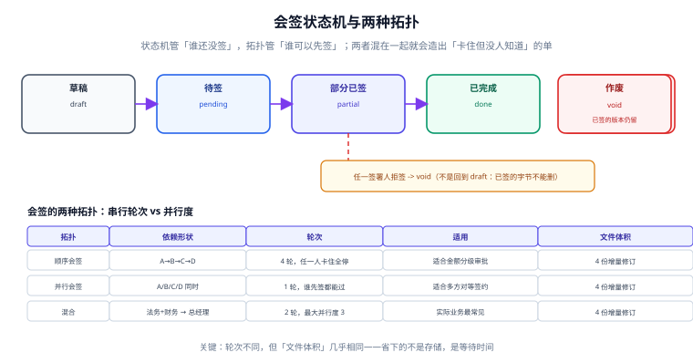

# 会签流程：顺序、并行与状态机

一份三方合同，法务先看、财务再审、总经理最后签，对方公司随时可以签。这套规则写进代码时只有一个问题：**「谁还没签」和「谁可以先签」是两件事**。前者是状态，后者是拓扑。把它们塞进同一个字段，就会出现「状态显示待签、但所有人都签不了」的死单——而系统不会报错，只是永远不动。

::: tip 一句话理解
状态机管**进度**，拓扑管**许可**。混在一起，卡住的单没人知道。
:::

## 一、状态机：五个状态，两条出路



| 状态 | 含义 | 允许的下一步 | 常见误设 |
| --- | --- | --- | --- |
| `draft` | 已生成快照，尚未发出 | `pending`（发送）、`void` | 允许在 `draft` 里改字节（可以，但必须生成新快照） |
| `pending` | 已发出，无人签 | `partial`、`void` | 把「已发送」当成「已送达」 |
| `partial` | 至少一人已签，未齐 | `partial`、`done`、`void` | 允许退回 `draft`（已签的字节删不掉） |
| `done` | 全部必签人已签 | 终态 | 允许再改（等于让签名失效） |
| `void` | 作废（拒签、超期、条款变更） | 终态 | 物理删除记录（证据没了） |

关键约束只有一条：**`partial` 不能回到 `draft`**。因为一旦有人签过，文件里就多了一段签名，把它「退回草稿」意味着你要么删掉那段字节（证据被销毁），要么保留（那它就不是草稿）。正确做法是 `void` 旧单、开新单，并在事件流里记下「为什么作废」。

## 二、两种拓扑：轮次不同，体积几乎相同

| 拓扑 | 依赖形状 | 串行轮次 | 适用场景 | 5 人签署的文件增量 |
| --- | --- | --- | --- | --- |
| 顺序会签 | A→B→C→D | 4 | 金额分级审批 | ≈ 4 × 占位容量 |
| 并行会签 | A/B/C/D 同时 | 1 | 多方对等签约 | ≈ 4 × 占位容量 |
| 混合 | (法务+财务) → 总经理 | 2 | 实际业务最常见 | ≈ 4 × 占位容量 |

第 5 列是很多人没想到的：**并行不省存储**。每位签署人都要写一段独立的增量更新（各自一段 `ByteRange` 与 `/Contents`），所以字节增量只跟「人数」有关，跟「轮次」无关。并行省下的是**等待时间**——4 轮串行要等 4 次往返，并行只需 1 次。

### 依赖其实是张图，不是一个列表

```python
def topo(deps: dict[str, list[str]]) -> list[str] | None:
    """返回一个合法签署顺序；有环则返回 None（必须报错，不能等）。"""
    done, order = set(), []
    while len(order) < len(deps):
        ready = [k for k in deps if k not in done and all(d in done for d in deps[k])]
        if not ready:
            return None            # 环：谁也等不到谁
        for k in sorted(ready):
            done.add(k)
            order.append(k)
    return order

deps = {"法务": [], "财务": [], "总经理": ["法务", "财务"], "对方": []}
print(topo(deps))                                  # ['对方', '法务', '财务', '总经理']
print(topo({**deps, "法务": ["总经理"]}))           # None —— 环
```

本机跑出来的顺序是 `对方 -> 法务 -> 财务 -> 总经理`：注意**「对方」被排在第一位**是合法的——它没有前置依赖，谁先谁后不影响结果。很多系统会强制「我方先签」，这不是技术约束，是业务约定，要写进模板而不是写进算法。

## 三、轮次与并行度可以从图里算出来

```text
层级：法务 0 / 财务 0 / 总经理 1 / 对方 0
=> 最少串行轮次 = max(层级) + 1 = 2
=> 最大并行度 = 同一层级的人数峰值 = 3
```

这两个数决定了两件事：**什么时候该发催办**（一轮结束后）、**一轮最多并发多少封通知**（并行度）。如果系统里没有这两个数，催办逻辑只能写「每天催一次」——对 2 轮的单太吵，对 5 轮的单太慢。

## 四、幂等：同一位签署人点两次「签署」

重复提交的后果不是「多一条记录」，而是**同一份文档上出现两段互相覆盖的字节范围**：后写入者让前一段 `ByteRange` 失效，验签时表现为「文档被修改」。用户会看到「签署成功」，对方会看到「文件已损坏」。

```sql
CREATE TABLE signature(
  id          INTEGER PRIMARY KEY,
  snapshot_id INTEGER NOT NULL REFERENCES snapshot(id),
  signer_id   TEXT    NOT NULL,
  revision    INTEGER NOT NULL,          -- 第几次增量更新
  byte_range  TEXT    NOT NULL,          -- "0,313,8505,92"
  cms         BLOB    NOT NULL,
  UNIQUE (snapshot_id, signer_id, revision)
);
```

本机实测（1,200 位签署人、8% 双击）：

| 做法 | 签名条数 | 结果 |
| --- | --- | --- |
| 无唯一约束 | 1,296 | 多出 96 条，96 份文件出现双份字节范围 |
| `UNIQUE(snapshot_id, signer_id, revision)` | 1,200 | 第 2 次请求被拦下，返回首次响应 |

SQLite 上连点 1,296 次，只有第 1 次插入成功，其余 1,295 次全部被唯一键拒绝——这是「同一 (快照, 签署人, 版本) 只允许一条」在数据库层的直接证据。

::: danger 四个必踩的坑

1. **用「是否已签」布尔字段挡重复**。两个请求同时读到 `signed=false`，都进入签署流程，布尔字段挡不住并发，只有唯一键能。
2. **用签署顺序号 `seq` 当幂等键**。并发时两个请求会拿到同一个 `seq`（`SELECT max(seq)+1`），唯一键反而让正常请求失败。幂等键必须是**业务上确定的值**（快照 + 签署人 + 版本）。
3. **拒签直接把单删掉**。拒签是重要证据：它证明「某一方在某一时刻拒绝签署」，往往是后续谈判的关键。改成 `void` + `void_reason`。
4. **催办不区分轮次**。并行会签里催「下一位」是错的——没有「下一位」，只有「还没签的那几位」。
:::

## 五、超期与撤回

| 动作 | 谁发起 | 允许的条件 | 后果 |
| --- | --- | --- | --- |
| 催办 | 发起方 | 状态为 `pending` / `partial` | 记一条事件，不改变状态 |
| 撤回 | 发起方 | 尚未有人签 | `void`，快照保留 |
| 拒签 | 签署人 | 状态为 `pending` / `partial` | `void`，写入 `void_reason` |
| 超期作废 | 系统 | 超过 `expire_at` 且未齐签 | `void`，通知全部相关人 |

注意「撤回」的前提是**尚未有人签**。已有人签之后发起方无权单方面撤回——那会销毁别人的签名。此时只能走「作废并重发」，且新单必须告知已签各方。

## 判据

本页判据族 `ESS-A` ~ `ESS-H`，共 8 条，逐条可判定：

| 编号 | 判据 | 怎么判 |
| --- | --- | --- |
| `ESS-A` | 状态机五态明确，`partial` 不可回 `draft` | 状态迁移表可查，非法迁移抛错 |
| `ESS-B` | 签署依赖表达成有向图，能检测环 | 有环时返回明确错误而非挂起 |
| `ESS-C` | 能从图算出轮次与并行度，用于催办 | 存在 `round` 与 `parallelism` 计算 |
| `ESS-D` | 同一 (快照, 签署人, 版本) 有唯一约束 | 重复提交被数据库拒绝 |
| `ESS-E` | 幂等键与 `seq` 解耦，不依赖 `max(seq)+1` | 并发下不出现正常请求失败 |
| `ESS-F` | 拒签/撤回/超期都落 `void` 且有原因 | `void_reason` 非空率 100% |
| `ESS-G` | 已有人签后禁止单方撤回 | 撤回接口校验已签数 |
| `ESS-H` | 并行拓扑下催办按「未签人集合」而非「下一位」 | 催办查询按集合返回 |

## 验证方式

```shell
# 1) 拓扑与环检测
python3 - <<'PY'
def topo(deps):
    done, order = set(), []
    while len(order) < len(deps):
        ready = [k for k in deps if k not in done and all(d in done for d in deps[k])]
        if not ready:
            return None
        for k in sorted(ready):
            done.add(k); order.append(k)
    return order
print(topo({"法务": [], "财务": [], "总经理": ["法务", "财务"], "对方": []}))
print(topo({"法务": ["总经理"], "财务": [], "总经理": ["法务"], "对方": []}))
PY
# 期望：['对方', '法务', '财务', '总经理'] 与 None

# 2) 唯一键拦重复
sqlite3 :memory: "CREATE TABLE s(a,b,c,UNIQUE(a,b,c)); INSERT INTO s VALUES(1,2,3); INSERT INTO s VALUES(1,2,3);"
# 期望：Error: UNIQUE constraint failed

# 3) 本页判据 8 条
grep -o 'ESS-[A-H]' docs/Backend/ESignature/SigningFlow/index.md | sort -u | wc -l
```

预期输出：第二行 `None` 是**正确结果**——它证明环被识别出来了，而不是程序卡死在那里。

## 参考资料

- [合同模型：模板、实例与版本快照](../ContractModel/index.md)
- [字节范围与印章：签名到底签了什么](../SealSignature/index.md)
- [工作流引擎](../../WorkflowEngine/index.md)（通用的流程状态机与补偿）
- 《中华人民共和国电子签名法》第十三条（可靠电子签名的条件）：<https://www.gov.cn/flfg/2005-08/28/content_27127.htm>
