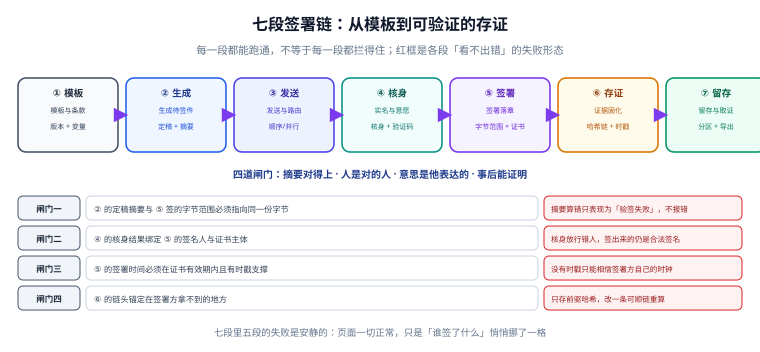
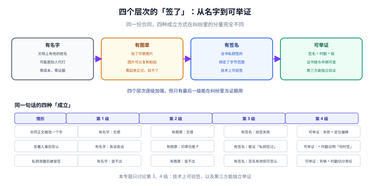

# 电子签署与合同存证

<p style="text-align:center;"></p>

一次线上签约要走完这些事：业务系统生成待签件、把链接发给对方、对方打开文件、证明「他是他」、落一个签名、事后还能拿出证据说明「谁在什么时间签了哪一版」。任何一步做错，后果都不在当下显现——页面会显示「签署成功」，直到有一天有人翻脸。

所以本专题关心的不是「怎么把印章图片贴上去」，而是**签完之后还能不能证明**：字节有没有被改、人是不是本人、时间是不是真的、证据链能不能被第三方独立验证。

::: tip 一句话理解
电子签署的产物不是一个「已签署」的状态，是一份**能被别人验证的字节**。状态可以改，字节改了就说不清。
:::

## 一、这个专题讲什么

从「选一份模板」到「十五年后还能取证」，要走七段。本专题按这七段组织，每段都标出产物与失败方式：

| 段 | 这一段在做什么 | 产物 | 失败是否安静 |
| --- | --- | --- | --- |
| ① 模板 | 条款、变量、版本与生效区间 | `template` | 显性（渲染报错） |
| ② 生成 | 渲染成待签件，定稿并算摘要 | `snapshot` | **安静**（摘要算错只是「验签失败」） |
| ③ 发送 | 路由到签署人，决定顺序或并行 | `sign_task` | 半显性（漏发会催） |
| ④ 核身 | 实名与意愿：证明是本人且他同意 | `verify_result` | **安静**（放行错人也能签成功） |
| ⑤ 签署 | 证书私钥签字节范围，写回文件 | `signature` | 半显性（格式错会报） |
| ⑥ 存证 | 哈希链、时间戳、外部锚定 | `evidence` | **安静**（少了时戳照样能验签） |
| ⑦ 留存 | 分区、归档、取证导出 | `archive` | **安静**（十年后才发现取不出） |



七段里**四段的失败是安静的**。它们共同的特征是：签署页一切正常，绿色对勾照常出现，只有「这份字节能不能被第三方验证」这一层悄悄塌了一角。本机实测里最典型的一条是——**把签名覆盖到整份文件上，第一位签完一切正常，第二位一签，第一位就失效了**（第 1 份实测见「字节范围」一页）。

## 二、四个层次的「签了」，只有最后一个能举证

| 层次 | 判据 | 典型错法 | 纠纷时的分量 |
| --- | --- | --- | --- |
| 有名字 | 文档上出现了他的姓名 | 用系统里的用户名自动填充 | 谁都能打，等于没有 |
| 有图章 | 贴了一张印章图片 | 把 PNG 抠图贴到 PDF 上 | 图片可复制，越像越可疑 |
| 有签名 | 证书私钥对字节签过名 | 签名只覆盖整份文件、不含时戳 | 能证「私钥签过」，证不了「何时签」 |
| 可举证 | 签名 + 时戳 + 证书链 + 链式证据 | 只存 PDF，不存证书链与吊销信息 | 第三方可独立复验 |



本专题只讨论后两层。前两层不是「不够专业」，而是**在争议里不成立**：一份贴了红章的 PDF，任何人用图片编辑器十分钟就能做出来；一份带证书签名的 PDF，改一个字节就会验签失败。

## 三、与其它专题的分工

库里写「合同」「签名」「凭证」的册子不少，问的问题完全不一样。先看这张表再决定读哪一册：

| 你关心的问题 | 该读哪一册 | 为什么不是本册 |
| --- | --- | --- |
| 「接口契约怎么升级不破坏调用方」 | [契约演进](../ContractEvolution/index.md) | 那册判**接口版本**，本册判**文件字节的不可否认性** |
| 「同一个请求重试会不会重复扣款」 | [幂等状态机](../IdempotencyStateMachine/index.md) | 那册判**请求幂等**，本册判**同一份文档不被签两次** |
| 「证书怎么签发、怎么轮换」 | [证书生命周期](../../Ops/CertificateLifecycle/index.md) | 那册判**证书运维**，本册判**签名怎么用证书** |
| 「用户同意了什么、能不能撤回」 | [隐私工程：同意与目的](../../Others/PrivacyEngineering/ConsentPurpose/index.md) | 那册判**同意文本与用途**，本册判**同意这件事怎么成为签名的一部分** |
| 「文件怎么存、怎么下发临时链接」 | [对象存储](../ObjectStorage/index.md) | 那册判**存储与访问控制**，本册判**对象里的字节是否可信** |
| 「批量导入导出的文件契约」 | [批量数据交换](../BulkDataExchange/index.md) | 那册判**行列校验与回执**，本册判**单份文件的签名与留存** |
| 「合同金额怎么入账」 | [账务与分录](../Ledger/index.md) | 那册判**记账**，本册判**合同本身的证据效力** |
| 「签署流程怎么编排、怎么催办」 | [工作流引擎](../WorkflowEngine/index.md) | 那册判**流程状态机**，本册判**流程产生的文件怎么落章** |

::: info 为什么不并入「契约演进」
两册都会出现「版本」，但含义完全不同：契约演进管的是**API 的版本兼容**（v1 不破坏 v2 的调用方），本册管的是**同一份合同被改了字节之后，之前的签名还算不算数**。前者是接口问题，后者是证据问题。
:::

## 四、本机读数（种子 20261102）

下表的数字都来自本机可复跑的脚本（构造的 PDF 片段 + 哈希链 + SQLite），后面每一页都会用到：

| 环节 | 读数 | 说明 |
| --- | --- | --- |
| 字节范围 | 8,597 B 的件，签区仅 **313 B** | 其余是签名容器与尾部 |
| 增量签名 | 追加 rev2 后文件 **17,098 B** | rev1 的摘要**不变**（这是增量签名的全部意义） |
| 若签整份文件 | rev1 摘要 a418db83 → 6d61ec92 | 第二人一签，第一人的签名即失效 |
| 哈希链 | 1,000 条事件，篡改第 500 条 | 定位到 500，只 1 条不一致 |
| 隐藏篡改 | 需重算 **500 条**（500~999） | 改第 0 条则要重算全部 1,000 条 |
| 链重建吞吐 | 10 万条 **211.8 ms**（47 万条/秒） | 验一遍全链的成本可以忽略 |
| 验证码 | 6 位码不限次数，1 次/秒需 **11.6 天** | 限 5 次后单会话命中率 5e-6 |
| 重复点击 | 1,200 位签署人、8% 双击 | 无约束多 **96 条**签名，唯一键拦下全部 |
| 留存 | 10 万份/年 × 320 KB × 15 年 | **457.8 GiB**，3 副本 1.34 TiB |

::: warning 这些数字之间的关系
它们不是九个独立指标，是**同一条链上九次「安静失败」的度量**。摘要算错、核身放错人、少打一个时戳、重复签一次，没有一个会让接口返回 500。这正是本专题要建立判据的理由。
:::

## 五、章节索引

| 章 | 章节 | 判据族 | 条数 |
| --- | --- | --- | --- |
| 1 | [总览：七段链与四道闸门](Overview/index.md) | `ESG-A` ~ `ESG-H` | 8 |
| 2 | [合同模型：模板、实例与版本快照](ContractModel/index.md) | `ESD-A` ~ `ESD-H` | 8 |
| 3 | [会签流程：顺序、并行与状态机](SigningFlow/index.md) | `ESS-A` ~ `ESS-H` | 8 |
| 4 | [字节范围与印章：签名到底签了什么](SealSignature/index.md) | `ESB-A` ~ `ESB-H` | 8 |
| 5 | [实名与意愿：证明他是他且他同意](IdentityIntent/index.md) | `ESI-A` ~ `ESI-H` | 8 |
| 6 | [证据链：哈希链、时间戳与外部锚定](EvidenceChain/index.md) | `ESE-A` ~ `ESE-H` | 8 |
| 7 | [合规与留存：四要件与十五年](Compliance/index.md) | `ESL-A` ~ `ESL-H` | 8 |
| 8 | [度量与验收：漏斗、时效与拒签](Metrics/index.md) | `ESU-A` ~ `ESU-H` | 8 |
| 9 | [实战：一份合同走完签署与取证](Practice/index.md) | `ESH-A` ~ `ESH-H` | 8 |
| 10 | [常见问题与分诊](FAQ/index.md) | `ESK-A` ~ `ESK-H` | 8 |

## 六、验证方式

先确认结构齐备，再复现「增量签名与整文件签名」的分水岭：

```shell
# 1) 目录页 + 10 章齐备
ls -d docs/Backend/ESignature/*/ | grep -v assets | wc -l

# 2) 本专题判据族 10 个、每个 8 条
grep -rho 'ES[A-Z]-[A-H]' docs/Backend/ESignature | sort -u | wc -l

# 3) 全库判据不撞号
python3 utils/audit/judgeidcheck.py --root . | tail -1

# 4) 复现「整文件签名，第二人一签第一人就失效」
python3 - <<'PY'
import hashlib
d1 = b"%PDF-1.7\n1 0 obj\n<< /Type /Catalog >>\nendobj\n" + b"X" * 300
d2 = d1 + b"3 0 obj\n<< /Type /Sig >>\nendobj\n"   # 第二份增量更新
h = lambda b: hashlib.sha256(b).hexdigest()[:8]
print("rev1 时：", h(d1))
print("rev2 后：", h(d2), "整份摘要是否相同：", h(d1) == h(d2))
PY
```

预期输出：第一条 `10`；第二条 `80`；第三条 `E=0`；第四条打印两次不同的 8 位摘要与 `整份摘要是否相同： False`——**这就是为什么签名必须绑字节范围而不是绑整个文件**。

## 参考资料

- [总览：七段链与四道闸门](Overview/index.md)
- [字节范围与印章](SealSignature/index.md)
- ETSI EN 319 142-1《PAdES digital signatures — Building blocks and baseline profiles》：<https://www.etsi.org/deliver/etsi_en/319100_319199/31914201/>
- ISO 32000-2:2020《Document management — Portable document format — Part 2: PDF 2.0》§12.8 Digital signatures：<https://www.iso.org/standard/63534.html>
- 《中华人民共和国电子签名法》（2019 修正）第十四条、第十六条：<https://www.gov.cn/flfg/2005-08/28/content_27127.htm>
