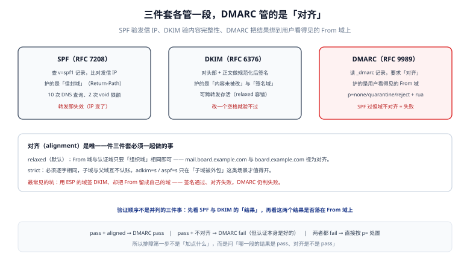

# 身份三件套：SPF、DKIM、DMARC 与对齐

三件套不是三个并列的开关，而是**一条判定链**：SPF 与 DKIM 各自给出一个结果，DMARC 检查「这两个结果里的域，是不是用户看到的那个域」。缺任何一环，另外两环的结论都会被绕过。

::: tip 一句话理解
SPF 证明「这台机器被允许替我发信」，DKIM 证明「这封信出去之后没被改过」，DMARC 证明「前面两个证明，说的是我**这个域**」。
:::



## 一、SPF：用 IP 做授权

SPF（Sender Policy Framework）把「允许哪些 IP 用我的域发信」写成一条 DNS TXT 记录，收件方拿**连接来源 IP** 去比对。

### 1. 记录的机制表

| 机制 | 含义 | 是否消耗查询预算 |
| --- | --- | --- |
| `all` | 匹配所有 | 否 |
| `ip4:` / `ip6:` | 直接给网段 | **否**（这是最省预算的写法） |
| `a` / `a:host` | 用 A 记录（或 AAAA）比对 | **是** |
| `mx` / `mx:host` | 用 MX 记录的 A 地址比对 | **是**（每个 MX 各 1 次） |
| `include:domain` | 递归求值另一个域的 SPF | **是**（且内部机制继续计数） |
| `exists:domain` | 构造域名做存在性查询 | **是** |
| `ptr` | 反向解析比对 | **是**，且 RFC 7208 已声明**不推荐** |
| `redirect=domain` | 作为默认分支重定向 | **是** |

### 2. 七种结果

| 结果 | 含义 | 收件方通常怎么做 |
| --- | --- | --- |
| `pass` | 命中授权 | 放行（还需 DMARC 对齐） |
| `fail` | 明确不授权（`-all`） | 按 DMARC 策略处置 |
| `softfail` | 疑似不授权（`~all`） | 标记但不拒收，适合灰度期 |
| `neutral` | 不表态（`?all`） | 等于没配 |
| `none` | 没有 SPF 记录 | 交给 DKIM 与声誉 |
| `temperror` | 查询临时失败（DNS 超时） | 通常放行，别惩罚 |
| `permerror` | 记录语法错或**超预算** | 等同于没有 SPF，很多收件方直接判失败 |

::: danger 最容易误判的一点：permerror 不是 fail
`permerror` 表示「你的记录我看不懂 / 太复杂」，`fail` 表示「我看懂了，这个 IP 不在名单里」。两者的日志表现、修复动作完全不同：前者要去数查询次数与检查语法，后者要去补 IP。把 `permerror` 当成 `fail` 处理，会让团队去改一个本来就正确的 `ip4` 条目。
:::

### 3. 预算实测

本机用合成区文件实现了一个只含 `include` / `a` / `mx` / `ip4` / `redirect` 的求值器，按 RFC 7208 §4.6.4 在第 11 次查询时返回 `permerror`：

```text
include 链   查询次数   结果        说明
3            4          pass        在预算内
8            9          pass        在预算内
9            10         pass        刚好用满
10           11         permerror   超 10 次 → permerror（哪怕最后的 ip4 本可命中）
15           11         permerror   同上（在第 11 次就截断）
```

再模拟一个真实形态——主域 include 三家 SaaS，每家再套 2~3 层：

```text
主域 3 家 SaaS 形态：查询 10 次 → pass（预算 10 次，只剩 0 次余量）
```

**结论**：这不是「配置对不对」的问题，而是**容量问题**。留 2 格余量是运维底线，接第四家之前必须先合并（把多家 `ip4` 收敛成自己的中继，或改用子域分担）。

### 4. SPF 在转发面前必然失效

转发（forwarding）会改变来源 IP：原信从 A 域发出、被 B 的地址转发给 C，C 看到的 IP 是 B 的，与 A 的 SPF 无关。三种应对：

1. **SRS**（Sender Rewriting Scheme）：转发时重写信封域，代价是破坏原始 `Return-Path`。
2. **ARC**（RFC 8617）：把原始认证结果封装成一串签名头，让最终收件方能验证「这封信确实经过了可信转发」。
3. **接受失败**：靠 DKIM 存活（DKIM 签的是内容，转发不改内容），所以**转发场景里 DKIM 比 SPF 重要**。

## 二、DKIM：用签名保证内容没被改

DKIM（DomainKeys Identified Mail）对**选定的头部 + 正文**做规范化，再用私钥签名；公钥发布在 DNS 的 `<selector>._domainkey.<domain>`。

### 1. 规范化（canonicalization）到底容错什么

这是最容易被误解的一节。本机实测（同一封信，四种改动，两种规范化方式，SHA-256 前 12 位）：

| 改动 | simple（原样） | relaxed（宽松） |
| --- | --- | --- |
| 原文 | `3zkLfXfdxsDY` | `3zkLfXfdxsDY` |
| 结尾加两个空行 | `bZ9EWnGrxp1p`（**变了**） | `3zkLfXfdxsDY`（**没变**） |
| 行尾加一个空格 | `PSm7lSqZJ4OP`（**变了**） | `3zkLfXfdxsDY`（**没变**） |
| 行内加一个空格 | `hN3VVb83bpe8` | `r+st3MXOE3Yp`（**变了**） |

三条可操作的结论：

1. `simple` 连「结尾多一个空行」都不容忍，所以生产环境几乎都用 `relaxed/relaxed`。
2. `relaxed` 容忍的是**传输损伤**（行尾空白、多余空行、行尾 CRLF 归一），**不容忍内容变化**——加一个空格照样失败。它不是「宽松到无所谓」。
3. 正因为如此，**任何在签名之后追加内容的行为都会破坏签名**：在 MTA 里加免责声明、加统计像素、在队列里改主题前缀 `[Board]`，都是典型事故。

### 2. 签什么：`h=` 列表与 `b=` 的位置

```text
DKIM-Signature: v=1; a=rsa-sha256; c=relaxed/relaxed;
    d=board.example.com; s=2026; t=1761091200;
    h=from:to:subject:date:message-id;
    bh=<正文的 base64 SHA-256>;
    b=<对「上述头部 + 本头去掉 b= 值」的签名>
```

签名输入 = `h=` 里列出的每个头（按顺序，各自规范化）+ `DKIM-Signature` 头自身（`b=` 值清空）+ `bh`。**头部顺序变化会导致验证失败**，这就是本机实验里「改 `from` 的值」与「改主题」都返回 `Verification failure` 的原因。

### 3. 密钥与算法

本机用 OpenSSL 3.3.2 实测：

```text
RSA-2048 签名 256 B → base64 344 字符
Ed25519 签名  64 B → base64  88 字符
RSA 公钥 DER 大小: 294 B
Ed25519 公钥 DER 大小: 44 B
```

| 选择 | 优点 | 代价 |
| --- | --- | --- |
| RSA-2048 | 所有收件方都支持，最稳 | 签名头 344 字符；头部膨胀；验签 CPU 略高 |
| RSA-4096 | 更长的安全边际 | 头部更长，部分移动端会截断显示 |
| Ed25519（RFC 8463） | 签名只有 RSA 的 1/4，头部干净 | 部分老旧网关不支持 `ed25519-sha256` |

**建议**：主签名用 RSA-2048；对头部长度敏感的场景（如短消息、SMS 网关）加一条 Ed25519 签名，两条并存，收件方取能验过的那条。

### 4. `l=` 标签：一个不该用的「容错」

`l=` 声明「只校验正文前 N 字节」。它看起来能容忍追加免责声明，实际给了攻击者一个追加内容的窗口：**只要在 N 字节之后追加，签名依然有效**。除了极少数历史兼容场景，不要用。

## 三、DMARC：把结果绑到用户看到的域

DMARC 记录放在 `_dmarc.<domain>`，核心是三个动作：**要求对齐**、**声明处置策略**、**要求报告**。

| 标签 | 取值 | 作用 | 常见错误 |
| --- | --- | --- | --- |
| `p` | `none` / `quarantine` / `reject` | 对**本域**的处置策略 | 直接上 `reject`，把未对齐的合法发信方打死 |
| `sp` | 同上 | 对**子域**的策略（缺省继承 `p`） | 忘了子域还在用旧系统发信 |
| `adkim` | `r`（默认）/ `s` | DKIM 对齐严格度 | 误以为 `s` 更安全，实际常导致合法子域失败 |
| `aspf` | `r`（默认）/ `s` | SPF 对齐严格度 | 同上 |
| `rua` | `mailto:` | 聚合报告接收地址 | 报告地址不验证归属，收不到报告 |
| `ruf` | `mailto:` | 失败报告（含原始信）接收地址 | 含 PII，合规上要谨慎 |
| `fo` | `0`/`1`/`d`/`s` | 失败报告触发条件 | 与 `ruf` 一起配才有意义 |

### 对齐的两种模式（本机实测）

```text
From 域                    信封域 / 签名域              模式       结果
mail.board.example.com     board.example.com          relaxed   aligned
board.example.com          mail.board.example.com     relaxed   aligned
mail.board.example.com     board.example.com          strict    NOT aligned
board.example.com          board.example.com          strict    aligned
board.example.com          example.com                relaxed   aligned
board.example.com          example.com                strict    NOT aligned
```

`relaxed` 只要求**组织域**（organizational domain）相同；`strict` 要求逐字相同。注意最后一行：`board.example.com` 与 `example.com` 在 `relaxed` 下算对齐——这意味着**一旦 `example.com` 被攻破，攻击者可以对所有子域发信**。多租户场景要特别小心这一点。

::: danger 对齐失败最常见的三种写法
1. **ESP 代签**：`d=` 是 ESP 的域，`From:` 是自己的域 → DKIM pass，DMARC fail。
2. **子域发信但 `aspf=s`**：`From: notice@mail.example.com`，信封域是 `example.com` → strict 下不对齐。
3. **`Return-Path` 被网关改写**：中间设备把信封域换成自己的域，SPF 仍 pass，但该域与 `From` 无关 → 对齐失败。
:::

### 灰度三步

| 阶段 | 记录 | 时长 | 通过条件 |
| --- | --- | --- | --- |
| 观测 | `p=none; rua=...` | ≥ 2 周 | 聚合报告里所有合法发信源都 `pass + aligned` |
| 隔离 | `p=quarantine; pct` 已在 RFC 9989 废弃，直接全量 | ≥ 1 周 | 进箱率无下降、投诉无上升 |
| 拒收 | `p=reject` | 长期 | 连续 4 周无合法信被拒的工单 |

## 四、规范换代：RFC 7489 → RFC 9989

2026-05-20，IETF 发布三份 Standards Track 文档，废止 2015 年的 RFC 7489 与 RFC 9091：

| 文档 | 内容 | 状态 |
| --- | --- | --- |
| RFC 9989 | 核心协议（对齐、策略、发现） | 现行；`v=DMARC1` 不变 |
| RFC 9990 | 聚合报告（`rua`） | 从核心拆出，可独立修订 |
| RFC 9991 | 失败报告（`ruf`） | 同上 |

对既有部署的实际影响只有一条：**`pct` / `rf` / `ri` 三个标签被废弃**。收件方会忽略它们而不是拒绝整条记录，所以记录不会「突然失效」；但 `pct` 废弃意味着「只对 50% 的失败信执行策略」这种灰度手段没有了——灰度要靠**分域**（先在子域上 `reject`）而不是靠百分比。

## 五、本页判据

本页判据族 `DVA-A` ~ `DVA-H`，共 8 条。

| 编号 | 判据 | 判定方式 | 不满足时改哪里 |
| --- | --- | --- | --- |
| `DVA-A` | 发信域有且仅有一条 `v=spf1` 记录 | `dig +short TXT` 计数 = 1 | 合并成一条；多段字符串而不是多条记录 |
| `DVA-B` | SPF 查询次数 ≤ 10 且余量 ≥ 2 | 逐条数 `include`/`a`/`mx`/`exists` | 合并 include、改用 `ip4`、拆子域 |
| `DVA-C` | DKIM 使用 `relaxed/relaxed`，且签名覆盖 `From`、`Subject`、`Date`、`Message-ID` | 读原始信的 `h=` | 补 `h=` 项；改 `c=` |
| `DVA-D` | 签名之后没有任何组件改写正文或主题 | 对比发信前与收信后的 `bh` | 把「加免责声明」挪到签名之前或取消 |
| `DVA-E` | `From` 域与 DKIM `d=` 或 SPF 信封域**至少一个对齐** | 用本页对齐表逐行核对 | 改 `d=` 或改信封域 |
| `DVA-F` | DMARC 记录存在且 `rua` 可达（能收到聚合报告） | 连续 7 天有报告入库 | 补 `rua`；在报告地址域加授权 TXT |
| `DVA-G` | 策略推进有书面阶段表（none → quarantine → reject）与通过条件 | 查变更记录 | 按本页三步表补 |
| `DVA-H` | 转发场景有 DKIM 或 ARC 兜底，不只依赖 SPF | 用转发地址实测一封信 | 加 ARC 签名或接受 SPF 失败 |

## 六、验证：本地验一封真信

把收到的原始邮件（含全部头部）存成 `mail.eml`，用 OpenSSL 验证 DKIM 的 `b=`：

```shell
# 1) 取出 DKIM-Signature 里的 b= 与 bh=（本机实测：RSA-2048 的 b= 是 344 字符）
python3 - <<'EOF'
import email, base64
m = email.message_from_bytes(open("mail.eml","rb").read())
dk = m["DKIM-Signature"]
print("d=", [p.split("=",1)[1] for p in dk.replace("\n","").split(";") if p.strip().startswith("d=")])
print("b 长度 =", len([p for p in dk.replace("\n","").split(";") if p.strip().startswith("b=")][0].split("=",1)[1].strip()))
EOF

# 2) 拉公钥（selector 与 d= 换成实际值）
dig +short TXT 2026._domainkey.board.example.com

# 3) 用公钥验签（签名输入需按 h= 顺序重建，本页示例给出可复跑的构造方式）
openssl dgst -sha256 -verify pub.pem -signature sig.bin signed_headers.txt
```

预期输出：第 1 步打印 `d= ['board.example.com']` 与 `b 长度 = 344`；第 3 步输出 `Verified OK`。把 `signed_headers.txt` 里的主题改一个字，第 3 步必须变成 `Verification failure`——**验不过才是验证成功的证据**。

## 七、参考资料

- [RFC 7208：SPF](https://www.rfc-editor.org/rfc/rfc7208)
- [RFC 6376：DKIM](https://www.rfc-editor.org/rfc/rfc6376) 与 [RFC 8463：Ed25519 签名](https://www.rfc-editor.org/rfc/rfc8463)
- [RFC 9989：DMARC](https://www.rfc-editor.org/rfc/rfc9989)
- [RFC 8617：ARC](https://www.rfc-editor.org/rfc/rfc8617)
- [dmarc.org：DMARCbis 变更摘要](https://dmarc.org/)
- [DNS 与密钥](../DnsAndKeys/index.md)：记录形状、预算与轮换的可执行细节
