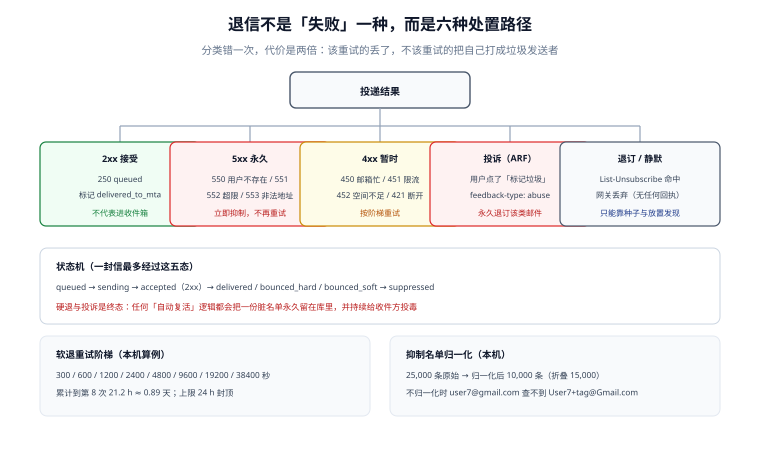

# 退信与投诉：分类、抑制名单与重试阶梯

一次投递失败，系统要回答三个问题：**这是永久失败还是暂时的、要不要再试、要不要把这个地址拉黑**。答错的代价是双向的：该重试的丢了（用户收不到），不该重试的反复投（声誉被打穿）。

::: tip 一句话理解
退信处理的本质不是「处理错误」，而是**维护一份可信的地址名单**：每次失败都在告诉你「这个地址现在还能不能用」。
:::



## 一、六类投递结果

| 类别 | 判据 | 处置 | 是否重试 |
| --- | --- | --- | --- |
| `2xx` 接受 | 收到 `250` | 记 `accepted`，等异步回执 | 不重试 |
| `5xx` 永久 | 状态码 `5.x.x` | 立即写入抑制名单，标 `bounced_hard` | **绝不** |
| `4xx` 暂时 | 状态码 `4.x.x` | 按阶梯排期，标 `bounced_soft` | 是（有上限） |
| 投诉 | 收到 ARF（`feedback-type: abuse`） | 退订该类邮件，标 `complained` | 不重试 |
| 退订 | `List-Unsubscribe` 命中 | 写入退订表，标 `unsubscribed` | 不重试 |
| 静默丢弃 | 无任何回执 | 只能靠种子与投诉反推 | 无法处理 |

**关键区分**：`5xx` 与 `4xx` 的划分依据是**语义**，不是「5 开头就永久」。有几种看起来像永久、实际是配置问题的：

| 应答 | 字面意思 | 真实原因 | 正确处置 |
| --- | --- | --- | --- |
| `421 4.7.40` | 服务不可用 | 你的域**没有 DMARC 记录**（Gmail 对批量发信方） | 补 DNS，**不要重试**，改完立即恢复 |
| `421 4.7.32` | 服务不可用 | DMARC **未对齐** | 修对齐，不要重试 |
| `550 5.7.26` | 拒绝 | SPF 与 DKIM **都失败** | 修认证，不要重试 |
| `550 5.7.25` | 拒绝 | 发信 IP **无 PTR** 或反解不匹配 | 申请反解 |
| `550 5.7.515` | 拒绝（Microsoft，2025-05 起） | 未满足其发信要求 | 按对方文档整改 |

这五条的共同点：**重试一万次也不会好**，但**修配置后立刻就好**。把它们和「用户不存在」混在一个重试队列里，是最常见的浪费。

## 二、DSN 与 ARF：回执长什么样

### 1. DSN（Delivery Status Notification）

退信是一封**新的邮件**，`Content-Type: multipart/report; report-type=delivery-status`：

```text
From: Mail Delivery Subsystem <MAILER-DAEMON@mx.google.com>
To: bounce@bounce.board.example.com
Subject: Delivery Status Notification (Failure)
Content-Type: multipart/report; report-type=delivery-status; boundary="xxx"

--xxx
Content-Type: text/plain; charset=UTF-8

** Address not found **
Your message wasn't delivered to alice@example.net because the address
couldn't be found.

--xxx
Content-Type: message/delivery-status

Reporting-MTA: dns; mx.google.com
Arrival-Date: Wed, 21 Oct 2026 10:00:06 +0800

Final-Recipient: rfc822; alice@example.net
Action: failed
Status: 5.1.1
Diagnostic-Code: smtp; 550-5.1.1 The email account that you tried to reach does not exist.

--xxx
Content-Type: message/rfc822

（原始信，可能被截断）
```

解析要点：

1. **`Final-Recipient` 才是失败的地址**，不是 `To:`——一封多收件人的信，退信只针对某一个。
2. **`Status` 是增强状态码**（`5.1.1`），比 SMTP 应答码更细；优先用它做分类。
3. **`Action`** 有 `failed`（永久）、`delayed`（暂时）、`delivered`（成功通知）、`relayed`、`expanded` 五种，`delayed` 不是失败。

### 2. ARF（Abuse Reporting Format）

投诉报告是 `multipart/report; report-type=feedback-report`：

```text
Content-Type: message/feedback-report

Feedback-Type: abuse
User-Agent: SomeGenerator/1.0
Version: 1
Original-Mail-From: <bounce@bounce.board.example.com>
Original-Rcpt-To: <alice@example.net>
Reported-Domain: board.example.com
Source-IP: 203.0.113.10
```

解析要点：**`Original-Rcpt-To` 是被投诉的收件人**，`Feedback-Type: abuse` 是「标记垃圾」，`fraud` 是「钓鱼」，`not-spam` 是**误报纠正**（用户把信从垃圾箱移回收件箱）。`not-spam` 是好消息，不该触发退订。

::: danger 投诉处理的两条铁律
1. **投诉必须退订该类邮件，而不是全部邮件**。粒度是 `(recipient, message_type)`：用户投诉营销邮件，不该连带收不到密码重置。
2. **不要回复投诉报告**——报告的发件地址通常是 `noreply@`，回复会制造回环，甚至被记为骚扰。
:::

## 三、抑制名单：归一化是全部难点

### 1. 不归一化就查不到

本机实测（25,000 条原始条目，含大小写、`+tag`、Gmail 点号变体）：

```text
原始条目 25,000 条 → 归一化后 10,000 条（折叠 15,000 条），耗时 13.7 ms
  user7@gmail.com                  → user7@gmail.com                命中
  USER7@googlemail.com             → user7@gmail.com                命中
  u.ser7+x@board.example.com       → u.ser7@board.example.com       命中
  user7@board.example.com          → u.ser7@board.example.com       未命中
  不归一化直接查 user7@gmail.com： 未命中（真值应命中）
```

最后一行是重点：**不归一化时，`User7+tag@Gmail.com` 与 `user7@gmail.com` 是两条不同的记录**，于是「已退订的人继续收信」——这是投诉率飙升的典型原因，而且从日志上完全看不出来。

### 2. 归一化规则表

| 规则 | 适用范围 | 说明 |
| --- | --- | --- |
| 转小写 | 全域 | `Local@Example.COM` → `local@example.com` |
| 去 `+tag` | 大多数服务商 | 但**不能对所有域都做**：少数系统把 `+` 当合法字符 |
| Gmail 去点号 | 仅 `gmail.com` / `googlemail.com` | 其他域的点号是有效区分 |
| 域名 punycode | 国际化域名 | `例子.中国` → `xn--fsqu00a.xn--fiqs8s` |
| 去首尾空白与不可见字符 | 全域 | 从 CSV 导入时最常见 |

```python
def normalize(addr: str) -> str:
    local, _, dom = addr.strip().lower().partition("@")
    local = local.split("+", 1)[0]
    if dom in ("gmail.com", "googlemail.com"):
        local, dom = local.replace(".", ""), "gmail.com"
    return f"{local}@{dom}"
```

::: warning 归一化是「有损」的，必须存原值
表里同时存 `address_raw`（原始）与 `address_norm`（归一化），唯一索引建在 `address_norm` 上。只存归一化值会导致：客服无法按用户报的地址查到记录；申诉时无法证明「当时退订的是这个地址」。
:::

### 3. 表结构

```sql
CREATE TABLE suppression (
    address_raw   text        NOT NULL,
    address_norm  text        NOT NULL,
    reason        text        NOT NULL,   -- hard_bounce | complaint | unsubscribe | manual
    message_type  text,                   -- 仅 complaint/unsubscribe 有值，NULL 表示全类
    source        text        NOT NULL,   -- dsn | arf | api | admin
    created_at    timestamptz NOT NULL DEFAULT now(),
    expires_at    timestamptz,            -- 仅 soft 类可空；hard 类应为 NULL（永久）
    PRIMARY KEY (address_norm, COALESCE(message_type, '*'))
);
CREATE INDEX ON suppression (address_raw);
```

`expires_at` 只对「软退累计达阈值」的地址有意义；硬退与投诉必须是**永久**。任何「30 天后自动复活」的清理任务，都会把一份脏名单循环送回队列。

## 四、重试阶梯：算清楚再写代码

### 1. 阶梯与总时长

本机算例（指数退避、基数 300 s、上限 24 h）：

```text
第 1~8 次间隔（秒）：300 / 600 / 1200 / 2400 / 4800 / 9600 / 19200 / 38400
累计到第 8 次：21.2 h = 0.89 天
```

三个设计决定：

| 决定 | 取值 | 依据 |
| --- | --- | --- |
| 总时长上限 | 24 h | 大多数「延迟送达」在 24 h 内会恢复；超过就变成骚扰 |
| 最大尝试次数 | 8 次 | 与 24 h 上限一起夹出，两者取先到者 |
| 抖动（jitter） | ±20% | 避免整批信在同一秒涌向同一个域（同步重试会被判为攻击） |

### 2. 「次数」与「时长」必须双上限

只限次数：间隔拉得太长时，第 8 次可能排在 3 天后。
只限时长：间隔太短时，24 h 内可能重试 200 次。

```sql
-- 两个条件同时成立才允许再试
SELECT id FROM mail_queue
 WHERE status = 'bounced_soft'
   AND attempts < 8
   AND created_at > now() - interval '24 hours'
   AND next_at <= now()
 ORDER BY next_at
 LIMIT 500;
```

### 3. 不同原因用不同阶梯

| 原因 | 典型应答 | 阶梯 | 终止条件 |
| --- | --- | --- | --- |
| 对方限流 | `451 4.7.0`、`421 4.7.28` | **放慢**：按对方建议的间隔，至少 15 分钟起 | 24 h |
| 邮箱忙 / 临时故障 | `450`、`451 4.2.1` | 标准阶梯 | 8 次或 24 h |
| 邮箱满 | `452 4.2.2` | 标准阶梯（用户可能去清邮箱） | 8 次或 24 h |
| 灰名单 | `451 4.7.1` | **固定 5~15 分钟后再试一次**，多数第二次就过 | 2 次 |
| 连接层超时 | 无应答 | 短阶梯，快速失败 | 3 次 |

灰名单值得单独说：它是「第一次一律拒绝、稍后再来就放行」的反垃圾手段。用标准的指数退避会让第一封信等到 5 分钟以上——小事，但如果你的产品承诺「验证码 60 秒内到达」，就必须为灰名单单独走一条快路径。

## 五、本页判据

本页判据族 `DVB-A` ~ `DVB-H`，共 8 条。

| 编号 | 判据 | 判定方式 | 不满足时改哪里 |
| --- | --- | --- | --- |
| `DVB-A` | 分类依据是增强状态码 `Status`，不是「5 开头/4 开头」 | 抽样 20 封 DSN，核对分类 | 改解析逻辑，优先读 `Status` |
| `DVB-B` | 硬退的 `attempts` 恒为 1 | 查库：`bounced_hard` 的 attempts 分布 | 在第一次 5xx 就置终态 |
| `DVB-C` | 软退同时受「次数 ≤ 8」与「24 h 内」双约束 | 造一条 3 天前入队的软退信 | 补 `created_at` 条件 |
| `DVB-D` | 抑制名单同时存原值与归一化值，唯一键在归一化值上 | 查表结构与两列 | 加列、改索引 |
| `DVB-E` | 归一化规则对 Gmail 生效，且不误伤其他域 | 用 `u.ser+x@board.example.com` 测 | 按域名分支 |
| `DVB-F` | 投诉退订粒度是 `(address, message_type)` | 投诉营销后再发密码重置，应能收到 | 改唯一键 |
| `DVB-G` | `not-spam` 反馈不触发退订 | 造一条 `Feedback-Type: not-spam` | 补分支 |
| `DVB-H` | 灰名单走独立快路径，不等标准阶梯 | 查配置里是否按应答码分流 | 加 `451 4.7.1` 专用规则 |

## 六、验证：用 SQLite 跑一遍状态机

```python
import sqlite3, random
db = sqlite3.connect(":memory:")
db.executescript("""
CREATE TABLE q(id INTEGER PRIMARY KEY, addr TEXT, status TEXT, attempts INT DEFAULT 0,
               next_at INT DEFAULT 0, created_at INT DEFAULT 0);
""")
random.seed(7)
NOW = 1_000_000
# 三类各 1000 条：硬退、软退、灰名单
for i in range(1000):
    db.execute("INSERT INTO q VALUES(?,?,?,0,?,?)", (i, f"h{i}@x.test", "queued", NOW, NOW))
    db.execute("INSERT INTO q VALUES(?,?,?,0,?,?)", (1000+i, f"s{i}@x.test", "queued", NOW, NOW))
    db.execute("INSERT INTO q VALUES(?,?,?,0,?,?)", (2000+i, f"g{i}@x.test", "queued", NOW, NOW))

LADDER = [300, 600, 1200, 2400, 4800, 9600, 19200, 38400]

def classify(code: str) -> str:
    if code.startswith("5."): return "hard"
    if code == "4.7.1":       return "greylist"
    return "soft"

def attempt(row_id, kind, now):
    row = db.execute("SELECT attempts, created_at FROM q WHERE id=?", (row_id,)).fetchone()
    att, created = row
    if kind == "hard":
        db.execute("UPDATE q SET status='suppressed', attempts=attempts+1 WHERE id=?", (row_id,))
        return "suppressed"
    if att >= 8 or now - created > 86400:
        db.execute("UPDATE q SET status='given_up', attempts=attempts+1 WHERE id=?", (row_id,))
        return "given_up"
    delay = 300 if kind == "greylist" else LADDER[att]
    db.execute("UPDATE q SET status='queued', attempts=attempts+1, next_at=? WHERE id=?",
               (now + delay, row_id))
    return "retry"

for i in range(1000):
    attempt(i, classify("5.1.1"), NOW)          # 全部 1000 条硬退，只尝试一次
print("h0 550 5.1.1 →", db.execute("SELECT status FROM q WHERE id=0").fetchone()[0])
print("g0 451 4.7.1 →", attempt(2000, classify("4.7.1"), NOW))
for n in range(1, 10):
    print(f"s0 第 {n} 次 451 4.2.1 →", attempt(1000, classify("4.2.1"), NOW + sum(LADDER[:n])))
print("硬退 attempts 分布:", db.execute(
    "SELECT attempts, COUNT(*) FROM q WHERE status='suppressed' GROUP BY attempts").fetchall())
print("软退终态:", db.execute("SELECT status, attempts FROM q WHERE id=1000").fetchone())
```

预期输出：

```text
h0 550 5.1.1 → suppressed
g0 451 4.7.1 → retry
s0 第 1 次 451 4.2.1 → retry
...
s0 第 9 次 451 4.2.1 → given_up
硬退 attempts 分布: [(1, 1000)]
软退终态: ('given_up', 9)
```

`[(1, 1000)]` 就是 `DVB-B` 的现场证据：硬退的 `attempts` 全是 1。如果出现 `(2, ...)`，说明第一次失败后被重排过——那是 bug。`('given_up', 9)` 说明软退一共被尝试了 9 次（1 次原始 + 8 次重试）后放弃，与阶梯定义一致。

## 七、参考资料

- [RFC 3463：增强状态码](https://www.rfc-editor.org/rfc/rfc3463) 与 [RFC 3464：DSN 格式](https://www.rfc-editor.org/rfc/rfc3464)
- [RFC 5965：ARF（投诉报告格式）](https://www.rfc-editor.org/rfc/rfc5965)
- [RFC 8058：一键退订](https://www.rfc-editor.org/rfc/rfc8058)
- [发信链路](../SendingPipeline/index.md)：队列与投递阶段怎么产生这些结果
- [声誉与预热](../ReputationWarmup/index.md)：投诉率怎么算、为什么分母决定结论
