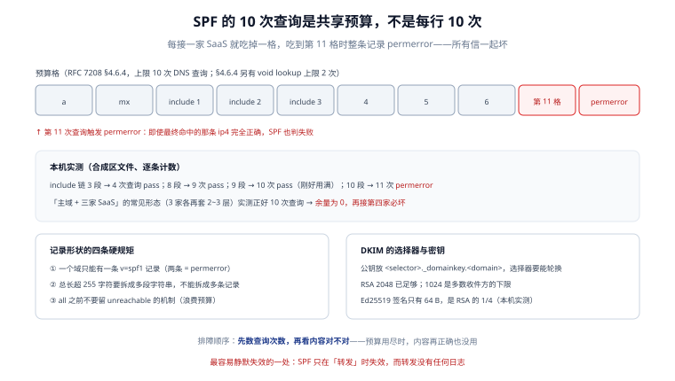

# DNS 与密钥：记录形状、查询预算与轮换

身份三件套的「配置」几乎全在 DNS 里：写错一个字段，前面所有的代码都白做。本页把发信域需要的 DNS 记录逐条拆开，重点讲两件最容易亏的事——**查询预算**与**密钥轮换**。

::: tip 一句话理解
DNS 记录不是「填上就行」的开关，它有**长度上限、条数上限、查询次数上限**，而且是**共享**的：一条记录坏了，整域的信一起坏。
:::



## 一、一个发信域需要的记录清单

以 `board.example.com` 为例，最小可用集合是八条：

| 记录 | 名称 | 类型 | 示例值 | 缺失后果 |
| --- | --- | --- | --- | --- |
| SPF | `board.example.com` | TXT | `v=spf1 include:_spf.provider.net ip4:203.0.113.10 -all` | 无记录 = `none`，多数收件方降权 |
| DKIM 公钥 | `2026._domainkey.board.example.com` | TXT | `v=DKIM1; k=rsa; p=MIIBIjANBg...` | DKIM 无法验证，只能靠 SPF |
| DMARC | `_dmarc.board.example.com` | TXT | `v=DMARC1; p=none; rua=mailto:dmarc@board.example.com` | 无策略、无报告，等于裸奔 |
| 退信域 SPF | `bounce.board.example.com` | TXT | `v=spf1 include:_spf.provider.net -all` | 退信被当伪造，收不到回执 |
| MX（收信） | `board.example.com` | MX | `10 mx.board.example.com.` | 收不到任何回信 |
| MX 目标 A | `mx.board.example.com` | A | `203.0.113.20` | 收信不可达 |
| 发信 IP 反解 | `10.113.0.203.in-addr.arpa` | PTR | `mail.board.example.com.` | Gmail 直接 `5.7.25` |
| MTA-STS 策略 | `_mta-sts.board.example.com` | TXT | `v=STSv1; id=20261021T000000` | 无法声明「必须用 TLS」 |

三个容易漏的点：

1. **退信域要单独有 SPF**：`Return-Path` 通常是 `bounce.` 子域，如果它没有 SPF，退信会被收件方判为伪造，回执永远回不来。
2. **PTR 只能由 IP 归属方设置**：云主机要在控制台申请，自己改不了；这是「自建 MTA」最常见的卡点。
3. **`_dmarc` 是子域**：写在 `board.example.com` 的 TXT 里不生效，必须放在 `_dmarc.board.example.com`。

## 二、SPF 记录的四条形状规矩

| 规矩 | 说明 | 违反后的现象 |
| --- | --- | --- |
| 一个域只能一条 `v=spf1` | 两条记录 = `permerror` | 所有信被判 `permerror`，看起来像「SPF 完全没生效」 |
| 单条 TXT 字符串 ≤ 255 字节 | 超长要拆成多段字符串（同一个 TXT 记录内用空格分隔的多个引号段） | 部分 DNS 服务商直接截断，尾部 `-all` 丢失 |
| 总长建议 ≤ 450 字节 | 超过 512 字节的 UDP 响应会触发 TCP 回退 | 解析变慢，少数收件方直接放弃 |
| 不要给 SPF 记录挂 CNAME | RFC 7208 明确不允许 | 部分解析器返回空，判 `none` |

长记录的正确写法（同一个 TXT 记录、多段字符串）：

```text
board.example.com. 300 IN TXT "v=spf1 include:_spf.a.example.net include:_spf.b.example.net"
board.example.com. 300 IN TXT " include:_spf.c.example.net ip4:203.0.113.10 -all"
```

注意第二段的**开头空格**：拼接时不会自动加分隔符，少这个空格就变成 `...example.netinclude:...`，整条记录 `permerror`。

## 三、查询预算：10 次是共享的

本页的实测与 [身份三件套](../Authentication/index.md) 同源（合成区文件、逐条计数），这里只补两条运维视角的结论：

| 形态 | 查询次数 | 结果 | 余量 |
| --- | --- | --- | --- |
| include 链 3 段 | 4 | `pass` | 6 |
| include 链 8 段 | 9 | `pass` | 1 |
| include 链 9 段 | 10 | `pass` | **0** |
| include 链 10 段 | 11 | `permerror` | — |
| 主域 + 三家 SaaS（各套 2~3 层） | 10 | `pass` | **0** |

**「余量 0」是危险的通过**：它意味着下一个人接第四家服务时，会在毫无预警的情况下把全域打死。运维上要立三条规矩：

1. **台账**：把每个 `include` 的归属方、接入日期、联系人写进一张表，与 DNS 记录对账。
2. **阈值告警**：查询次数 ≥ 8 就报「预算紧张」，而不是等到 11。
3. **收敛优先**：能用自己的中继（`ip4` 一条）就不要让每家 SaaS 各占一格。

还有一条 RFC 7208 的次级限制：**void lookup 不得超过 2 次**。void lookup 指「查了但没查到」（NXDOMAIN 或无该类型记录），常见于 `include` 了一个不存在的域、或 `exists:` 构造出错。这条限制在 `include` 链断掉时最容易触发，表现为 `permerror` 而不是 `none`。

## 四、DKIM 选择器与轮换

### 1. 选择器命名

选择器（selector）是 DNS 记录名前缀，作用相当于「密钥版本号」。三种常见命名：

| 命名方式 | 示例 | 适用 |
| --- | --- | --- |
| 年份 | `2026._domainkey` | 年度轮换，简单直观 |
| 年月 | `202610._domainkey` | 更细的轮换粒度 |
| 用途 + 序号 | `mail1._domainkey`、`mail2._domainkey` | 多套系统并行（事务邮件 / 营销邮件） |

**不要用 `default`**：它无法表达「新旧并存」，轮换时必须原地改记录，中间必然有一段验证失败的窗口。

### 2. 轮换的正确顺序

```text
① 生成新密钥对（selector=2027）
② 先发布新公钥 TXT（此时还没有信在用新私钥）
③ 等 ≥ 2×TTL（通常 24 h）确认全网解析到新记录
④ 切换发信配置到新私钥（新信开始用 2027 签）
⑤ 观察 7 天：DKIM pass 率无下降
⑥ 删除旧公钥（selector=2026）
```

顺序错一步就会出事故：先切私钥再发公钥 = 收件方查不到 `2027._domainkey`，全部 DKIM `temperror`/`permerror`；先删旧公钥再停旧私钥 = 队列里还在用旧私钥的信全部验不过。

### 3. 密钥长度与算法

本机 OpenSSL 3.3.2 实测（与 [身份三件套](../Authentication/index.md) 同一次实验）：

| 算法 | 签名长度 | base64 后 | 公钥 DER | 兼容性 |
| --- | --- | --- | --- | --- |
| RSA-1024 | 128 B | 172 字符 | 162 B | 多数收件方的**下限**，Yahoo 会拒 512 位 |
| RSA-2048 | 256 B | 344 字符 | 294 B | 通用推荐 |
| RSA-4096 | 512 B | 684 字符 | 550 B | 头部过长，部分客户端显示异常 |
| Ed25519 | 64 B | 88 字符 | 44 B | 需收件方支持 `ed25519-sha256` |

`p=` 的值是**公钥 DER 的 base64**。常见错误是把整份 PEM（含 `-----BEGIN PUBLIC KEY-----`）贴进去——DNS 记录里不能有换行与头尾标记，必须只取 base64 主体。

## 五、DMARC 记录与报告授权

```text
_dmarc.board.example.com. 300 IN TXT "v=DMARC1; p=none; rua=mailto:dmarc@board.example.com; adkim=r; aspf=r"
```

两个细节：

1. **报告地址跨域时要加授权记录**。如果 `rua` 指向另一个域（如 `dmarc-reports@thirdparty.example`），必须在那个域上发布：

   ```text
   board.example.com._report._dmarc.thirdparty.example. 300 IN TXT "v=DMARC1"
   ```

   少了这条，收件方会拒绝发送报告，你会以为「没有失败」，其实是「没收到报告」。

2. **聚合报告是 XML 压缩包**，一天一封、按收件方分。解析它需要写代码（或用现成工具），但它是**唯一能告诉你「谁在替你发信」的数据源**——在升到 `p=reject` 之前必须先读它。

### 版本对照：RFC 7489 与 RFC 9989

| 项目 | RFC 7489（2015，已废止） | RFC 9989（2026-05，现行） | 迁移动作 |
| --- | --- | --- | --- |
| 版本标签 | `v=DMARC1` | `v=DMARC1` | 不变 |
| `pct` | 按百分比执行策略（灰度用） | **废弃**，收件方忽略 | 删除；灰度改用子域分批 |
| `rf` | 失败报告格式（`afrf`） | **废弃** | 删除 |
| `ri` | 报告间隔（秒） | **废弃** | 删除 |
| 公共后缀 | 未定义 PSD 概念 | 引入 PSD / PSO 相关标签（`np`、`psd`） | 普通域不用配 |
| 规范地位 | Informational（非标准） | Standards Track | 审计口径可引用正式标准 |

旧记录的字段语义**没有被删除，只是被忽略**——这就是「旧版本保留并标注状态」在本专题的落地方式：不建版本目录，但在同一张表里同时保留两代字段与它们的现状。

## 六、传输层：MTA-STS、TLS-RPT 与 DANE

这三条与「进不进收件箱」不是同一条线，但决定了「信在路上会不会被降级成明文」。

| 机制 | 解决什么 | 依赖 | 落地成本 |
| --- | --- | --- | --- |
| MTA-STS（RFC 8461） | 声明「必须用 TLS 投递到我的 MX」 | `_mta-sts` TXT + `https://mta-sts.<domain>/.well-known/mta-sts.txt` | 中：要维护 HTTPS 策略文件与 `id` 版本号 |
| TLS-RPT（RFC 8460） | 收集 TLS 失败报告 | `_smtp._tls` TXT 指向报告地址 | 低：一条 TXT |
| DANE（RFC 7672） | 用 DNSSEC 绑定 MX 的证书 | DNSSEC + `TLSA` 记录 | 高：要签 DNSSEC，且收件方支持率有限 |

MTA-STS 的策略文件内容：

```text
version: STSv1
mode: enforce
mx: mx1.board.example.com
mx: mx2.board.example.com
max_age: 604800
```

`mode` 从 `testing` 开始，观察 TLS-RPT 报告两周无失败再切 `enforce`——这与 DMARC 的灰度逻辑完全一样：**先观测，再强制**。

## 七、本页判据

本页判据族 `DVD-A` ~ `DVD-H`，共 8 条。

| 编号 | 判据 | 判定方式 | 不满足时改哪里 |
| --- | --- | --- | --- |
| `DVD-A` | 八条基础记录齐全（SPF / DKIM / DMARC / 退信域 SPF / MX / MX 目标 A / PTR / MTA-STS） | 逐条 `dig` 断言非空 | 按第一节清单补 |
| `DVD-B` | SPF 只有一条记录，且长记录用多段字符串拼接 | `dig` 计数 = 1；检查拼接后是否有空格分隔 | 合并/补空格 |
| `DVD-C` | SPF 查询次数 ≤ 10，且 ≥ 8 时有告警 | 脚本计数 + 监控阈值 | 收敛 include |
| `DVD-D` | DKIM 选择器非 `default`，且存在两套并存能力 | 查 DNS 是否有两个 `_domainkey` | 建 `2026`/`2027` 两个选择器 |
| `DVD-E` | 轮换按「先发公钥、再切私钥、最后删旧」执行，且有 ≥ 2×TTL 的等待 | 查变更记录与 DNS TTL | 重排步骤 |
| `DVD-F` | `p=` 是公钥 DER 的 base64 主体，不含 PEM 头尾与换行 | 用 `openssl pkey -pubin` 反解验证 | 重新导出 |
| `DVD-G` | `rua` 报告地址可达，跨域时有 `_report._dmarc` 授权 | 连续 7 天有报告入库 | 补授权记录 |
| `DVD-H` | 传输层策略从 `testing` 起步，有 TLS-RPT 数据支撑后才 `enforce` | 查策略文件 `mode` 与报告 | 回退到 `testing` |

## 八、验证：一次把八条记录验完

```shell
D=board.example.com
echo "SPF:";    dig +short TXT $D | grep "v=spf1"
echo "SPF 条数:"; dig +short TXT $D | grep -c "v=spf1"
echo "DKIM:";   dig +short TXT 2026._domainkey.$D
echo "DMARC:";  dig +short TXT _dmarc.$D
echo "退信域:";  dig +short TXT bounce.$D | grep "v=spf1"
echo "MX:";     dig +short MX $D
echo "PTR:";    dig +short -x 203.0.113.10
echo "MTA-STS:"; dig +short TXT _mta-sts.$D
```

预期：七条 `dig` 各有输出，`SPF 条数` 为 `1`。再补一条「拼接是否正确」的检查：

```shell
dig +short TXT board.example.com | tr -d '"' | tr '\n' ' ' | grep -o "v=spf1.*" | head -1
```

预期输出是**一条完整记录**，`include` 之间有一个空格、结尾是 `-all`。如果看到 `example.netinclude:` 这样粘在一起，就是第二段少了开头空格。

## 九、参考资料

- [RFC 7208：SPF（含 §4.6.4 查询上限）](https://www.rfc-editor.org/rfc/rfc7208)
- [RFC 6376：DKIM（§3.6 选择器与密钥）](https://www.rfc-editor.org/rfc/rfc6376)
- [RFC 8461：MTA-STS](https://www.rfc-editor.org/rfc/rfc8461) 与 [RFC 8460：TLS-RPT](https://www.rfc-editor.org/rfc/rfc8460)
- [RFC 9989：DMARC](https://www.rfc-editor.org/rfc/rfc9989)
- [身份三件套](../Authentication/index.md)：三件套的判定链与对齐
- [证书与信任链生命周期](../../../Ops/CertificateLifecycle/index.md)：MX 证书的签发与轮换
