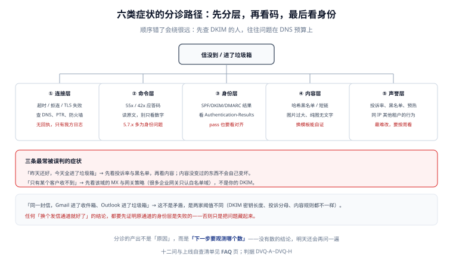

# 常见问题与排错

这一页按「症状 → 先看什么 → 别做什么」组织，最后给出上线自查清单与术语表。所有回答都尽量落回前八页的判据，避免变成经验之谈。

::: tip 一句话理解
排错的第一产出不是原因，而是**下一个要看的数**——没有数的结论，明天还会被重新问一遍。
:::



## 一、症状分诊表

| 症状 | 先看什么 | 最可能的原因 | 别做什么 |
| --- | --- | --- | --- |
| 全部域都收不到，日志里无投递记录 | 队列 `queued` 数量、worker 是否在跑 | 队列入队成功但 worker 挂了 | 别改 DNS |
| 只有 Gmail 收不到 | Gmail 的拒信码（`5.7.26`/`421 4.7.40`） | 缺 DMARC 或未对齐 | 别换服务商 |
| 只有企业客户收不到 | 对方网关策略、是否白名单制 | 企业网关只放行白名单域 | 别怀疑自己的 DKIM |
| 昨天正常，今天全进垃圾箱 | 投诉率日曲线、黑名单 | 声誉事件（某批名单脏） | 别急着改内容 |
| 打开率骤降但交出率不变 | 种子进箱率 | 放置变化（进垃圾箱/促销标签） | 别加重试 |
| 用户说「点链接 404」 | 链接域、令牌是否一次性被预取 | 邮件安全网关预取链接消耗了令牌 | 别把令牌设成「首点即失效」 |
| 部分用户收到两封一样的 | `mail_outbox` 幂等键 | 无唯一索引，或重发被当成重放 | 别在代码里「先查再插」 |
| 附件在 Outlook 里变成 `winmail.dat` | `Content-Type` 与 `TNEF` | 发信端用了 RTF/TNEF 格式 | 别让客户端决定格式 |
| 中文主题乱码 | 是否走 RFC 2047 编码 | 手工拼头部 | 别在头部里直接放 UTF-8 |
| 回复没有接在原邮件下 | `In-Reply-To` / `References` | 回复时没带原 `Message-ID` | 别靠主题前缀补救 |

## 二、十二个高频问题

**Q1：SPF 配了 `~all`，还要不要改 `-all`？**
先跑两周 `p=none` 的 DMARC 报告，确认所有合法发信源都在 SPF 里，再改 `-all`。`~all` 只是「软失败」，很多收件方会照常放行，起不到防伪造作用；但在没摸清发信源之前改 `-all`，会把漏配的系统直接打死。

**Q2：DKIM 通过、SPF 通过，DMARC 还是 fail，为什么？**
对齐失败。看 `From` 域与 `d=` / 信封域是否同一个组织域。最常见的是用 ESP 的域签名却保留自己的 `From`。

**Q3：能不能只用 DKIM，不要 SPF？**
技术上可以（DMARC 要求 SPF 或 DKIM 之一通过并对齐），但转发场景里 SPF 必然失效、DKIM 更容易存活，所以**只配 DKIM 比只配 SPF 更稳**。实践上两个都配，成本只是两条记录。

**Q4：`p=reject` 会不会把老客户的信也拒了？**
会，如果他们有未对齐的合法发信源（老工单系统、旧官网表单）。所以必须先 `p=none` 收报告，把报告里所有 `fail` 的来源逐个修好，再升 `quarantine`，最后 `reject`。

**Q5：共享 IP 出事，我能做什么？**
三件事：查自己的投诉率是否异常（可能你就是那个坏租户）、查黑名单记录属于谁、向服务商要「按租户的投诉数据」。你改不了别人的行为，只能决定是否迁到专用 IP。

**Q6：为什么我的信进了「促销」标签页而不是收件箱？**
Gmail 的标签页分类看内容与互动，不看认证。营销类内容 + 低互动 → 促销标签。这不是失败（用户仍能看到），但会显著降低打开率。想进收件箱，只能提高互动、减少图片比例、避免过度营销话术。

**Q7：主题里加「[重要]」「【通知】」有用吗？**
短期可能提高打开率，长期会提高投诉率（用户觉得被误导）。而且主题前缀会破坏会话串接（见 [收信侧](../InboundMail/index.md)）。

**Q8：附件多大算安全？**
按整封算，不按附件原始大小算。25 MiB 上限下单附件约 18 MiB（base64 + 折行占 37%），实际建议不超过 10 MiB；更大的文件走「下载链接 + 短期签名 URL」。

**Q9：退信回执为什么有时收不到？**
三个原因：`Return-Path` 域没有 SPF（退信被当伪造）、`MAIL FROM` 用了主域而不是 `bounce.` 子域（退信淹没主域邮箱）、对方直接静默丢弃（根本不发退信）。

**Q10：用户点了「标记垃圾」，还能挽回吗？**
不能。投诉是终态，只能退订该类邮件。可以做的：在「设置」里给用户显式的「减少此类邮件」选项，把投诉引导成可控的偏好设置。

**Q11：需要为发信单独申请一个域名吗？**
日发信量 > 10 万、或营销与事务邮件混发时建议拆：`notice.example.com`（事务）与 `news.example.com`（营销）分开，避免营销的投诉率拖累事务邮件的域声誉。

**Q12：怎么证明「我们的信能进收件箱」？**
只有种子测试能证明。每周固定时间发 3~5 个种子邮箱，记录进箱/垃圾箱/未收到，连续 4 周形成基线。任何「客户说收到了」都不能当证据。

## 三、五条「听起来对」的错误建议

| 建议 | 为什么错 | 正确做法 |
| --- | --- | --- |
| 「多买几个 IP 轮着发，能提高送达率」 | 新 IP 没有声誉，轮换等于反复从零开始；且违反「稳定发信」原则 | 固定少量 IP，做预热 |
| 「把投诉率低的名单单独拆出来发」 | 这是「用数据挑好看的分母」，长期会让整体声誉更差 | 按互动分层，但投诉率按全量算 |
| 「用短链能提高点击率」 | 短链域名常被列入黑名单，且隐藏真实域名会提高投诉 | 用主域下的正规路径 |
| 「邮件里多放图更好看」 | 纯图邮件是垃圾邮件的典型特征，且纯文本客户端完全看不到 | 图文比例控制，纯文本版本必须有完整信息 |
| 「先发出去，退信了再清理名单」 | 硬退直接损害声誉，且清理永远滞后 | 发前做语法与域名有效性检查（MX 存在性） |

## 四、上线自查清单（14 项）

发第一封生产邮件之前，逐条打勾：

1. [ ] SPF 记录存在且只有一条，查询次数 ≤ 8
2. [ ] DKIM 两套选择器（当前 + 下一版）都已发布
3. [ ] DMARC 记录存在，`rua` 能收到报告（连续 7 天有数据）
4. [ ] `From` / `d=` / `Return-Path` 三者组织域一致
5. [ ] 退信域（`bounce.`）有自己的 SPF 与独立邮箱
6. [ ] 发信 IP 有 PTR，且与 HELO 名一致
7. [ ] 25/587 端口出站可用（云主机需申请解封）
8. [ ] `mail_outbox` 有唯一索引 `(biz_type, biz_id, recipient)`
9. [ ] 模板同时有纯文本与 HTML 版本，链接在纯文本里可点
10. [ ] 非 ASCII 头部走 RFC 2047，行长 ≤ 998
11. [ ] `List-Unsubscribe` + `List-Unsubscribe-Post` 可用，且 2 天内生效
12. [ ] 硬退立即抑制、软退双上限（8 次 / 24 h）
13. [ ] 五个口径都已定义分母，投诉率用「进收件箱量」
14. [ ] 种子测试已建立（3~5 个邮箱、每周一次）

## 五、术语表

| 术语 | 含义 |
| --- | --- |
| ESP | Email Service Provider，邮件发送服务商 |
| MTA / MDA / MUA / MSA | 传输 / 投递 / 用户 / 提交代理 |
| 信封域 | `MAIL FROM` / `Return-Path` 里的域，SPF 检查对象 |
| 头域 | `From:` 头部里的域，DMARC 对齐对象 |
| 组织域 | 注册域 + 一级后缀（`board.example.com` → `example.com`） |
| `permerror` | SPF 永久错误：语法错或超查询预算 |
| `bh` / `b=` | DKIM 的正文哈希 / 头部签名值 |
| DSN | Delivery Status Notification，退信报告 |
| ARF | Abuse Reporting Format，投诉报告 |
| FBL | Feedback Loop，反馈环（收件方把投诉转给发信方） |
| 种子邮箱 | 自己控制的、用来观测放置的邮箱 |
| 预热 | 从低量开始逐步提高发信量，建立声誉 |

## 六、本页判据

本页判据族 `DVQ-A` ~ `DVQ-H`，共 8 条。

| 编号 | 判据 | 判定方式 | 不满足时改哪里 |
| --- | --- | --- | --- |
| `DVQ-A` | 分诊表覆盖「全部域 / 单域 / 单客户 / 时间突变」四类症状 | 对照本页第一节 | 补类别 |
| `DVQ-B` | 每个症状都有「先看什么」与「别做什么」两列 | 查文档 | 补列 |
| `DVQ-C` | 十二问里涉及数值的回答都给了口径而不是结论 | 抽查 | 补口径 |
| `DVQ-D` | 五条错误建议在团队内被显式否定过（有记录） | 查评审记录 | 把本页表格抄进规范 |
| `DVQ-E` | 自查清单 14 项在首次上线前全部打勾 | 查上线记录 | 补做 |
| `DVQ-F` | 术语表覆盖本专题出现的全部缩写 | 全文检索缩写 | 补词条 |
| `DVQ-G` | 每条「别做什么」都能追到前八页的某条判据 | 抽查 3 条 | 补链接 |
| `DVQ-H` | 排错结论必须带「下一个要看的数」，不能只写原因 | 查工单模板 | 改模板 |

## 七、验证：把自查清单变成命令

```shell
# 清单第 1、3、4、6 项可以一次性验完
D=board.example.com
echo "1) SPF 条数: $(dig +short TXT $D | grep -c 'v=spf1')"
echo "3) DMARC: $(dig +short TXT _dmarc.$D)"
echo "4) 签名域: $(dig +short TXT 2026._domainkey.$D | head -c 40)..."
echo "6) PTR: $(dig +short -x 203.0.113.10)"
```

预期：`SPF 条数: 1`；`DMARC` 行含 `p=none`（灰度期）或 `p=quarantine`/`p=reject`；`签名域` 有输出；`PTR` 返回与 HELO 名一致的主机名。四项有任意一项不符，先不要发生产邮件。

## 八、参考资料

- [RFC 9989：DMARC](https://www.rfc-editor.org/rfc/rfc9989) · [RFC 7208：SPF](https://www.rfc-editor.org/rfc/rfc7208) · [RFC 6376：DKIM](https://www.rfc-editor.org/rfc/rfc6376)
- [Gmail 发信人指南](https://support.google.com/a/answer/81126)
- [总览](../Overview/index.md)：三层送达与五个必失点
- [实战](../Practice/index.md)：S1~S10 验收序列
