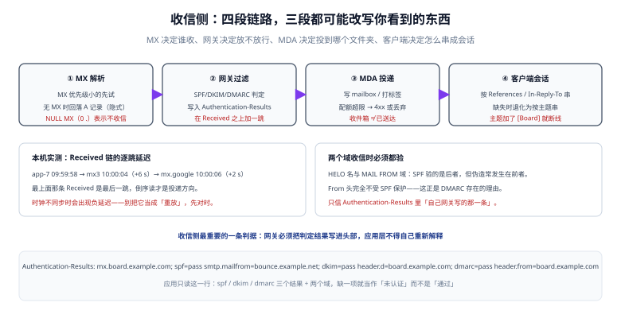

# 收信侧：MX、网关、会话与防伪造

做「回信」「工单转入」「邮件转任务」这类功能时，收信比发信更容易被低估：**发信你只面对一个出口，收信你要面对整个互联网**——任何人对你的地址发任何东西。

::: tip 一句话理解
收信侧的第一原则：**只信自己网关写下的认证结果**。信里的 `Authentication-Results` 头，在到达你之前是可以被伪造的。
:::



## 一、四段链路与端口

| 段 | 组件 | 端口 | 谁在管 |
| --- | --- | --- | --- |
| 收信入口 | MX（MTA） | 25 | 你的 MTA 或邮件网关 |
| 过滤 | 网关（反垃圾 / 反病毒 / 认证） | — | 网关产品 |
| 投递 | MDA | — | 邮件系统 |
| 取信 | IMAP / POP3 / API | 143/993、110/995 | 客户端或你的集成程序 |

四个端口别混：

| 端口 | 用途 | 是否需要认证 | 常见错误 |
| --- | --- | --- | --- |
| 25 | MTA 之间投递（收信） | 否（靠 IP/身份） | 在云主机上被封（多数云默认封 25 出站） |
| 587 | 客户端提交（发信） | **是** | 用 25 端口提交，被拒 `530 Authentication required` |
| 465 | 隐式 TLS 提交 | 是 | 与 587 混用导致 `SSL wrong version number` |
| 993 | IMAPS 取信 | 是 | 用 143 + STARTTLS 但没发 `STARTTLS` 命令 |

### MX 记录的三条冷知识

1. **优先级小的先试**，失败才试下一个；同一优先级按随机顺序。
2. **没有 MX 记录时会回落到 A 记录**（隐式 MX），这是很多「配了 A 就能收信」的原因，也是事故来源：A 记录指向 Web 服务器，25 端口没开。
3. **`0 .`（NULL MX）表示「本域不收信」**，这是 RFC 7505 定义的显式声明。对只发信不收信的域，配 NULL MX 比不配更规范——不配会让别人一直重试。

## 二、认证结果头：收信侧最重要的一行

网关在收信时会做 SPF/DKIM/DMARC 校验，并把结果写进头部：

```text
Authentication-Results: mx.board.example.com;
    spf=pass smtp.mailfrom=bounce.example.net;
    dkim=pass header.d=board.example.com header.s=2026;
    dmarc=pass header.from=board.example.com
```

三条使用纪律：

1. **只采信「自己网关」写的那一条**：`Authentication-Results` 是普通头部，发信方可以自己伪造一条 `dmarc=pass`。判断依据是头部的 authserv-id（`mx.board.example.com`）必须是你自己的网关。
2. **缺项按「未认证」处理，不按「通过」处理**：`spf=none` 与 `spf=pass` 都不是失败，但绝不能当成通过。
3. **不要把 `dkim=pass` 直接当成「这封信是本人发的」**：DKIM 只证明「签名域签了这封信」，域可能是伪造者自己的域。身份判断要看 `dmarc=pass` + `header.from` 是否是你期望的域。

::: danger 一个真实的绕过路径
攻击者发一封 `From: support@board.example.com`、`Reply-To: attacker@evil.test` 的信，用自己的域签 DKIM。如果你的应用只检查「DKIM 通过」就认为是官方来信，并且把 `Reply-To` 当作回复地址——攻击者就拿到了「看起来来自官方、回复却进他邮箱」的效果。

正确做法：**只认 `dmarc=pass` 且 `header.from` 属于白名单域**，并且对 `Reply-To` 与 `From` 不一致的邮件做显式标记。
:::

## 三、会话：为什么你的回信没接在原邮件下面

邮件会话靠三个头部：

| 头部 | 作用 | 谁生成 |
| --- | --- | --- |
| `Message-ID` | 这封信的全局唯一标识 | 发信方（应含域，可校验） |
| `In-Reply-To` | 直接父邮件的 `Message-ID` | 回信方 |
| `References` | 整条链的 `Message-ID` 列表 | 回信方（应保留原链） |

客户端的串会话规则（大致）：

1. 有 `References` → 取最后一个已存在的 `Message-ID` 作为父；
2. 只有 `In-Reply-To` → 用它；
3. 都没有 → 退化为「同主题 + 同参与者 + 时间窗内」。

**第三种退化是事故来源**：只要你在主题前加 `[Board]`、或在回复时改主题，会话就断了。反过来，如果你的系统要「把邮件转成工单再回信」，必须**保留原始 `Message-ID` 并正确填 `References`**，否则用户那边的邮件客户端会把你的回复显示成一封新邮件。

```python
from email.utils import make_msgid, parseaddr, formataddr

def build_reply(orig, body: str):
    """构造一封「接在原信下面」的回复。"""
    msg_id = make_msgid(domain="board.example.com")
    refs = (orig.get("References") or "").split()
    if orig.get("Message-ID"):
        refs.append(orig["Message-ID"].strip())
    return {
        "Message-ID": msg_id,
        "In-Reply-To": orig.get("Message-ID", "").strip(),
        "References": " ".join(refs),
        "Subject": orig.get("Subject", "") if orig.get("Subject", "").lower().startswith("re:")
                   else "Re: " + orig.get("Subject", ""),
    }
```

## 四、Received 链：定位「卡在哪一跳」

每经过一个 MTA 都会在**顶部**加一条 `Received`。所以最上面的那条是最后一跳，**倒序读才是投递方向**。

本机用一封三跳的合成信实测：

```text
投递方向逐跳：
  app-7                   09:59:58
  mx3.board.example.com   10:00:04  +6 s
  mx.google.com           10:00:06  +2 s
```

读法：

| 现象 | 含义 |
| --- | --- |
| 某一跳的延迟特别大（比如 +300 s） | 该跳在排队或做内容扫描，不是网络问题 |
| 出现负延迟 | 时钟不同步（先对时，别当成重放攻击） |
| 跳数异常多（> 6） | 可能经过多个转发或邮件列表，SPF 必然失效，看 DKIM |
| 最后一跳是你自己的网关，但没有更早的记录 | 对方直接投递，前面没有中转 |

解析代码（只依赖标准库）：

```python
import re
from datetime import datetime

def parse_received(raw: str):
    blocks = re.findall(r"Received:\s(.*?)(?=\nReceived:|\nSubject:|\Z)", raw, re.S)
    out = []
    for b in blocks:
        b = " ".join(b.split())
        by = re.search(r"by ([^\s]+)", b)
        dt = re.search(r";\s*([A-Z][a-z]{2}, .*?[+-]\d{4})", b)
        out.append((by.group(1) if by else "?",
                    datetime.strptime(dt.group(1), "%a, %d %b %Y %H:%M:%S %z") if dt else None))
    return out[::-1]   # 反转成投递方向
```

## 五、收信入库：幂等键不能用 Message-ID

看起来 `Message-ID` 是唯一标识，实际上它有两个坑：

1. **可能重复**：某些发信系统（尤其是自研脚本）会生成固定的 `Message-ID`，或者干脆不带。
2. **可能被改写**：中间网关在转投时会重写。

所以收信入库的幂等键要按**收信通道**分别设计：

| 通道 | 幂等键 | 说明 |
| --- | --- | --- |
| IMAP 拉取 | `(mailbox, uidvalidity, uid)` | IMAP 的 `UIDVALIDITY` 变化时 UID 会重用，必须三个一起 |
| SMTP 直收 | `(envelope_to, message_id)` + 内容哈希兜底 | 无 `Message-ID` 时用哈希 |
| API 推送（如 SES/SendGrid inbound） | 对方事件 ID | 优先用对方给的 ID |

内容哈希兜底要注意：**同一封信被投递两次时，`Received` 头会不同**（多了跳），哈希必须只算「业务相关部分」（`From` + `To` + `Subject` + `Date` + 正文），否则两次算出不同哈希。

## 六、附件与安全

| 风险 | 做法 |
| --- | --- |
| 超大附件 | 入口就限制（多数网关 25~50 MB），超限回 `552` 而不是收下再报错 |
| 可执行文件 | 按扩展名 + MIME 双重拦截；不要只信 `Content-Type`（可伪造） |
| 压缩包炸弹 | 解压前限制解压后总大小与层数 |
| 宏文档 | 只存不打开；需要预览时在沙箱里转换 |
| 图片型钓鱼 | 正文纯图 + 图片里带二维码，需要 OCR 或人工审核队列 |
| 附件存储 | 不要存进数据库；落对象存储，库里只存 key 与哈希 |

## 七、本页判据

本页判据族 `DVI-A` ~ `DVI-H`，共 8 条。

| 编号 | 判据 | 判定方式 | 不满足时改哪里 |
| --- | --- | --- | --- |
| `DVI-A` | 只采信自己网关写的 `Authentication-Results`（authserv-id 匹配） | 构造一封自带 `dmarc=pass` 的信，应被忽略 | 加 authserv-id 校验 |
| `DVI-B` | 缺项按「未认证」处理，不按通过 | 造一封无 `dmarc` 结果的信 | 改默认分支 |
| `DVI-C` | 身份判断用 `dmarc=pass` + `header.from` 白名单，不用 `dkim=pass` | 查代码分支 | 改判定条件 |
| `DVI-D` | 回复信正确填 `In-Reply-To` 与 `References`（含原链） | 回一封信，在 Gmail 里看是否成会话 | 用标准库拼头部 |
| `DVI-E` | 收信幂等键按通道设计（IMAP 三元组 / SMTP 双键 + 哈希） | 重放同一封信，库里只有 1 条 | 改唯一索引 |
| `DVI-F` | 内容哈希只算业务相关头部与正文，不含 `Received` | 同一封信投两次，哈希相同 | 改哈希输入 |
| `DVI-G` | 附件按扩展名 + MIME 双重拦截，且限制解压后体积 | 上传 `.exe` 与 zip 炸弹 | 补校验 |
| `DVI-H` | 只发信不收信的域配 NULL MX | `dig MX` 看到 `0 .` | 加 NULL MX 记录 |

## 八、验证：解析一封真信

```shell
# 1) 从你的邮箱导出一封原始邮件为 mail.eml（含全部头部）
# 2) 打印认证结果与逐跳延迟
python3 - <<'EOF'
import email, re
from datetime import datetime
raw = open("mail.eml", encoding="utf-8", errors="replace").read()
m = email.message_from_string(raw)
print("From      :", m.get("From"))
print("Subject   :", m.get("Subject"))
print("Message-ID:", m.get("Message-ID"))
print("In-Reply-To:", m.get("In-Reply-To"))
print("Auth-Results:", (m.get("Authentication-Results") or "(缺失)")[:160])
blocks = re.findall(r"Received:\s(.*?)(?=\nReceived:|\nSubject:|\Z)", raw, re.S)
print("跳数:", len(blocks))
EOF
```

预期：能打印出 `From` / `Subject` / `Message-ID`；`Auth-Results` 一行里能看到 `spf=` / `dkim=` / `dmarc=` 三个结果（缺失说明它没有经过会写头的网关）；`跳数` 通常在 1~5 之间，超过 6 要检查是否有转发链。

## 九、参考资料

- [RFC 5321：SMTP（含 MX 解析规则）](https://www.rfc-editor.org/rfc/rfc5321)
- [RFC 7505：NULL MX](https://www.rfc-editor.org/rfc/rfc7505)
- [RFC 8601：Authentication-Results 头部](https://www.rfc-editor.org/rfc/rfc8601)
- [RFC 5322：Message-ID / References / In-Reply-To](https://www.rfc-editor.org/rfc/rfc5322)
- [身份三件套](../Authentication/index.md)：SPF/DKIM/DMARC 的判定细节
- [观测与分诊](../Observability/index.md)：收信侧的失败怎么进监控
